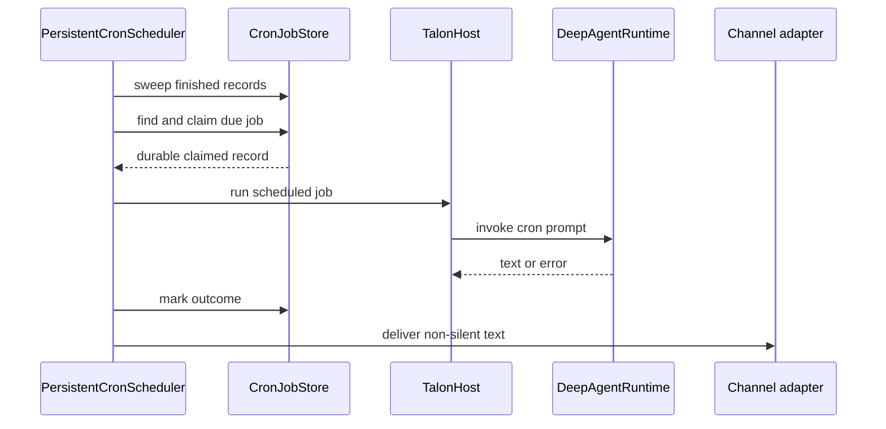
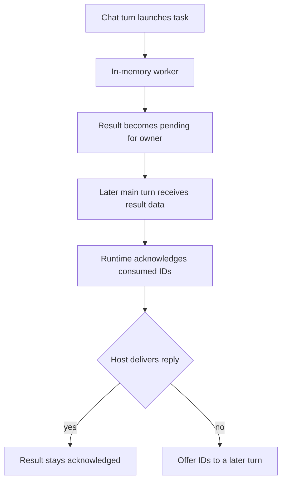

# Talon Scheduling and Background Work

Talon's persistent scheduler is deliberately separate from its agent runtime. `CronJobStore` owns assistant-scoped `jobs.json`; `PersistentCronScheduler` finds and claims due records; `TalonHost` runs the prompt and delivers any report. The normal CLI wires this scheduler only when channels are configured, using the host as the execution callback and a delivery callback for results.

> **Unattended execution.** Talon is experimental, and a cron fire is not an interactive session. Treat a scheduled prompt as delegated access to the installed assistant, not as a sandbox or a way to wait for a person.

## Cron lifecycle

A job stores its prompt, parsed schedule and repeat settings, enabled/next-run state, outcomes, origin, delivery choice, optional end time, claim timestamp, and pinned skills. Origin is host-derived conversation metadata, not a model-selected destination; it both scopes job management and identifies where a result should go.

*The claim is persisted before execution; delivery occurs only after the agent returns text.*

Each tick first removes eligible completed records, then obtains due jobs in next-run order and runs them sequentially. Before invoking the host, the scheduler calls `advance_next_run`, which rechecks that the job is still enabled and due, persists `claimed_at`, and advances or completes the schedule. This makes a claimed occurrence at-most-once: if the process fails after the write and before completion, it is not made due again automatically. Finished records with an error or an unresolved claim are retained for inspection; `prune_completed` provides explicit retention cleanup.

A failed invocation records an error. A successful invocation is marked `ok` before output handling; blank output and output whose trimmed text starts or ends with `[SILENT]` are withheld. For non-silent output, a delivery exception replaces the successful outcome with an error. The ticker catches unexpected tick failures, logs them, and waits its normal interval rather than dying.

## Scheduled host execution and delivery

For each scheduled fire, Talon locks a root derived from the job ID, but generates a new conversation ID below that root. This serializes concurrent fires of the same job while ensuring a fire begins from fresh checkpointed history rather than continuing an earlier scheduled prompt. The host bounds a scheduled run to 30 minutes. On timeout, and on cancellation caused by sender-pairing revocation, it attempts checkpoint interruption recovery before reporting the run as failed.

A scheduled invocation is marked with `trigger: "cron"`, includes the durable origin and pinned-skill metadata, and may receive a read-only history scope for the original channel when history is enabled and the origin adapter still exists. The runtime disables archive scope for cron turns, so running the job itself does not create an attended transcript entry. A delivered final reply can still be recorded in delivery history.

Delivery resolves the recorded provider adapter and computes either the origin thread or its channel-level target according to `deliver_to`. Sending uses `send_with_retry`; successful non-silent sends may be recorded in history. If no adapter remains for an origin, standard CLI delivery logs and drops the message rather than raising to the scheduler, so removing a provider can leave an already-successful execution without a delivered report.

## Approval and authorization boundary

Cron runs have neither an approval handler nor an authorization handler supplied by the host. The runtime additionally auto-rejects tool-approval interrupts for `trigger: "cron"`. Scheduled work must therefore be designed to complete without an interactive protected action or login flow. This restriction also applies to cron's subagent work.

## Job scope and pinned skills

The agent-facing cron tools create, list, edit, and remove jobs using the current runtime origin. Job management is scoped by provider and channel-level origin scope, rather than a model-provided address; delivery target selection does not broaden that authority.

A job can persist up to eight validated skill names. Validation de-duplicates names while retaining their order and does not require an installed skill at creation time, because skills may change before a fire. The host passes these names as `pinned_skills`; the runtime consumes that field only on a cron request. Thus ordinary inbound metadata cannot force pinned skills into a channel turn.

## Detached chat subagents and result handoff

`BackgroundSubagents` serves ordinary attended turns differently from cron turns. In chat, `task` and `start_async_task` create in-memory workers owned by the conversation and immediately return a task ID. The user-facing conversation can continue; when a worker completes, its result is injected as data into a later main-agent turn. Workers and result records are process-local, so they are not restart-durable.

The middleware limits the job table to 128 entries and limits detached workers across conversations (four by default, configurable through `DEEPAGENTS_TALON_MAX_BACKGROUND_TASKS`). A detached worker has a one-hour timeout; stored result text is limited to 64,000 characters. A worker inherits useful scoped context, but its authorization handler is explicitly cleared so it cannot strand an approval after the originating turn ends.

*The runtime knows when the model consumed a result, while the host decides whether the resulting reply reached the conversation.*

If a turn fails while consuming pending results, the runtime counts a delivery failure; after three failed attempts it drops that result. If the model completed but the host discards or cancels the reply before delivery—for example, because a newer turn superseded it—the host requeues only the result IDs consumed by that reply. This prevents an undelivered result from being silently acknowledged while avoiding resurrection of unrelated, cancelled, or already-pruned work. `/stop` and `/new` cancel the relevant conversation's workers and discard its pending results.

## Cron delegation is inline

A cron turn cannot rely on a future user turn. The runtime marks it as scheduled, replaces the ordinary background-work instructions, hides `list_subagents` and `cancel_subagent`, and makes `task` and `start_async_task` run to completion within the tool call. Inline work is not entered in the detached job table and leaves no later result to redeliver.

Inline delegation has a separate four-slot semaphore, so concurrent fan-out queues instead of being refused; it does not consume attended-chat worker capacity. Each delegated operation has a 10-minute default timeout, configurable with `DEEPAGENTS_TALON_INLINE_SUBAGENT_TIMEOUT`; nested delegation is prohibited, and returned text is clamped to 64,000 characters. Failures and timeouts become safe tool error messages rather than escaping the graph and causing a retry that could relaunch sibling work.

## Shutdown and operations

Host shutdown first stops the background dispatch loop and cancels in-flight agent work, then stops channels, the scheduler, and the runtime. The runtime cancels background workers before closing graph/checkpoint resources. If workers outlive its cancellation wait, it raises and intentionally leaves those resources open rather than allowing a live worker to write through a closed checkpointer; the host logs that component failure but continues shutting down other components.

Operationally, use one owner process per `jobs.json`: the store shares a reentrant lock only among live instances in the same process, and locking covers storage mutations—not execution or delivery. Preserve the persist-before-run claim, trusted origin propagation, cron approval rejection, and distinction between detached chat work and inline cron work when changing this area.

## Focused tests

`libs/talon/tests/cron/test_scheduler.py` exercises tick ordering, claims, status and delivery failures. `libs/talon/tests/unit_tests/test_scheduled_history.py` covers fresh scheduled conversation IDs and history behavior. `libs/talon/tests/unit_tests/test_background.py` covers capacity, ownership, cancellation, result acknowledgement/redelivery, failure limits, inline cron delegation, and shutdown behavior. See also [runtime behavior](../architecture/runtime-behavior.md), [permissions and human-in-the-loop controls](./permissions-hitl.md), [Talon channel admission](./talon-channel-admission.md), and [Talon integration](../integrations/talon.md).
