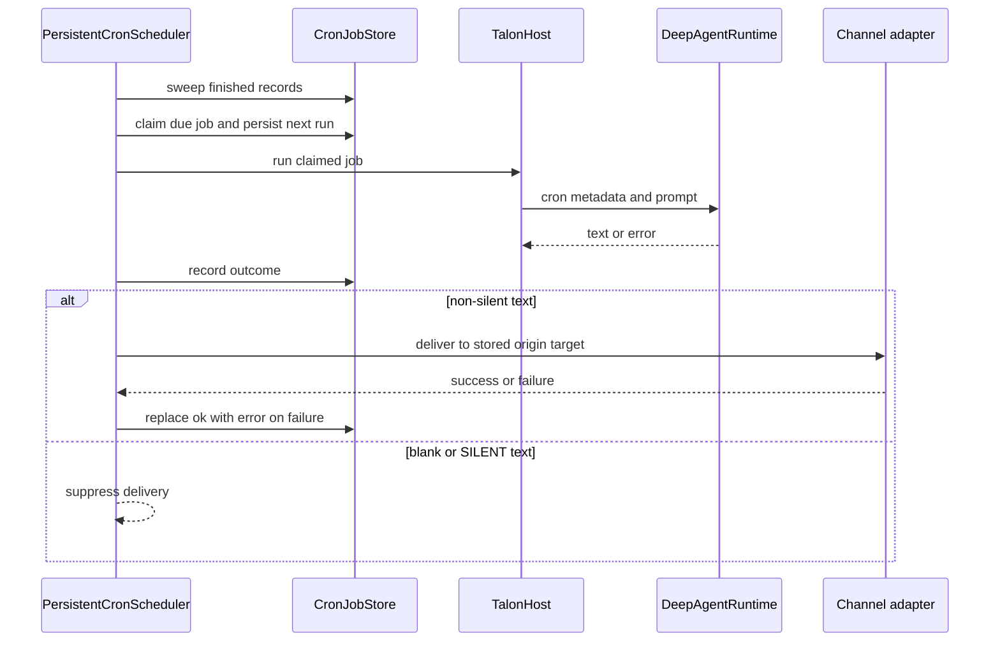
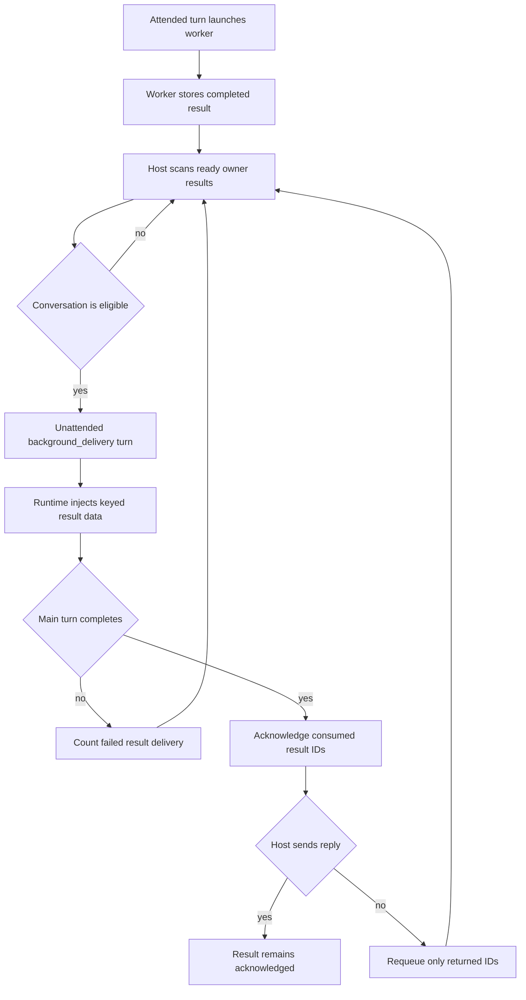

# Talon Scheduling and Background Work

Talon has two intentionally different deferred-work mechanisms. `PersistentCronScheduler` persists assistant-scoped jobs in `jobs.json`, claims due fires, invokes the host, and delivers the resulting text. `BackgroundSubagents` instead keeps process-local workers for an attended chat conversation and offers their completed results to a later main-agent turn. The CLI installs the persistent scheduler only when at least one channel is configured, wiring it to `TalonHost.run_scheduled_job` and a delivery callback.

> **Unattended authority boundary:** Talon is experimental. A cron fire is not an attended chat turn and receives neither approval nor authorization handlers. The runtime automatically rejects approval interrupts on requests whose `trigger` is `"cron"`; detached workers likewise clear the originating authorization handler, so a prompt cannot outlive the turn that could answer it.

## Persistent cron lifecycle

A persisted job includes its prompt, schedule and recurrence/end state, next run, last status/error, trusted origin, delivery choice, claim timestamp, and optional pinned skills. Cron tools create, list, edit, and remove only jobs in the current origin scope. They accept relative one-shot or recurring schedules, timezone-aware wall-clock schedules, and five-field cron schedules; wall-clock and cron forms preserve their local-time meaning across daylight-saving transitions. `deliver_to` selects the result's channel-versus-thread target only—it does not change the job's management scope or origin.

*Scheduled lifecycle: the claim advances durable state before execution, and a delivery failure is recorded as a failed run.*

Each tick first removes finished records, then processes due jobs sequentially. `advance_next_run` rechecks eligibility and writes the advanced or completed state before invoking the host. This is a claim-before-run, effectively at-most-once occurrence model: if the process dies after the claim is written, that occurrence is not made due again. A job that is past `until` beyond a short tick-latency grace is finished rather than delivered after its requested window. A failed tick is logged and retried on the normal interval.

The scheduler marks an invocation exception as an error. After returned text, it records `ok`, suppresses empty text and text whose trimmed start or end has `[SILENT]`, and changes the recorded result to an error if delivery raises. The host resolves the stored origin channel and uses `send_with_retry` to send to the selected target; an unavailable origin adapter drops the result rather than routing it elsewhere.

### Host execution and history

For each fire, the host locks a stable per-job cron root but creates a unique run conversation ID. Fires of one job therefore serialize, while each begins with fresh checkpointed history rather than continuing an earlier scheduled prompt. A run is bounded to 30 minutes. On timeout, or when revocation of the paired sender stops a scheduled DM run, the host attempts checkpoint interruption recovery before reporting the failure.

The host forwards `trigger: "cron"`, origin metadata, and pinned skills. When persistent history and the origin adapter are available, a cron turn can read the origin chat's history scope; it does not archive its own execution transcript into that chat. A final reply is recorded only after host-confirmed delivery.

A job may pin at most eight validated lowercase skill names. Validation preserves first-seen order while deduplicating and does not require the skill to be installed yet. The host forwards them as `pinned_skills`; the runtime accepts that field only for a cron request and passes it into graph/model assembly. Ordinary channel metadata cannot force skill pinning.

Hooks are also per-turn: Talon loads only trusted assistant-home `hooks.json`, not workspace hooks, and validates hook snapshot, thread, and prompt identity before resuming an interrupt. Fresh local subagents receive isolated hook identities and transcripts while sharing the parent turn's hook snapshot.

## Attended-chat background subagents

In an attended turn, `task` and `start_async_task` create in-memory workers owned by the conversation and immediately return a task ID. Completed work is supplied as keyed result data to a later main-agent turn; workers and results do not survive process restart. The table holds at most 128 entries, and running workers share a configurable cross-conversation limit (four by default, configured through `DEEPAGENTS_TALON_MAX_BACKGROUND_TASKS`). A worker has a one-hour timeout and its result is limited to 64,000 characters.

Workers receive necessary copied context but have no authorization handler and no approval operator. A worker failure, timeout, remote stream error, or approval interrupt is converted into safe result text rather than exposing request arguments or credentials. Remote definitions load fail-closed from `[async_subagents]` in `~/.deepagents/config.toml`: every entry needs its table name, `description`, and `graph_id`; optional URL and string headers are validated. Remote streams use `on_disconnect="cancel"`.

Only the owning conversation may inspect, message, or cancel its workers. `inspect_subagent` exposes bounded lifecycle/model/tool metadata plus message receipt IDs and statuses—not reasoning, arguments, outputs, or message text. Guidance is only available to Talon-built local `task` workers: a nonblank message of at most 2,000 characters enters a bounded 20-message inbox and is inserted at the next worker model boundary. It does not interrupt an in-progress model or tool call.

*Background-result delivery: acknowledgement means the main turn consumed the result, while requeue reconciles an acknowledged result whose reply was never delivered.*

While running, the host polls approximately once per second. It skips an owner whose conversation/history scope is locked, whose agent turn is active, whose conversation is blocked or superseded, or which has no ready result. It claims a capped exponential-backoff slot before creating an unattended `background_delivery` follow-up. That follow-up has neither approval nor authorization handler.

The runtime tracks results exposed to a main turn and acknowledges them only after the turn completes. If the turn fails, it increments the result's delivery count and drops it after three failed processing attempts. `AgentResult` returns acknowledged IDs to the host; if a newer turn supersedes the reply, or cancellation occurs before delivery, the host requeues only those IDs. Cancelled or already-pruned work is never resurrected.

## Scheduled delegation is inline

A cron turn has no later user turn into which detached work could be delivered. For `trigger: "cron"`, `task` and `start_async_task` therefore execute inline and return their result in the same turn; they create no background job. The runtime gives scheduled-specific guidance, hides subagent inspection, messaging, listing, and cancellation tools, and blocks nested delegation.

Inline scheduled calls use a separate four-slot semaphore and queue rather than consuming the attended-worker limit or returning a capacity refusal. Their default timeout is 10 minutes, answer text is capped at 64,000 characters, and timeout or failure becomes a safe tool error. This prevents an escaping tool error from causing the graph to retry and relaunch sibling delegation calls.

## Operations and safe changes

`CronJobStore` locks serialize complete reads and mutations only between store instances in the same process. The locks do not coordinate separate processes, execution, or result delivery, so a `jobs.json` file needs one owner process.

During host shutdown, Talon stops the background delivery loop, cancels in-flight work, stops channels and scheduler, and then stops the runtime; a component-stop failure is logged but does not prevent later shutdown steps. Runtime shutdown cancels background workers before closing graph/checkpoint resources. If a worker outlives the cancellation wait, shutdown raises and deliberately leaves those resources open rather than allowing a live worker to write through a closed checkpointer.

When changing this area, preserve the durable claim-before-run transition, trusted origin propagation, cron approval rejection, worker ownership/privacy, and the difference between detached attended work and inline scheduled delegation.

## Focused tests

`libs/talon/tests/cron/test_scheduler.py` covers claiming, outcomes, silent output, delivery failure, ticker recovery, and sequential execution. `libs/talon/tests/test_host.py` covers scheduled-run timeout recovery, serialization, background delivery, and scheduled delivery. `libs/talon/tests/unit_tests/test_scheduled_history.py` verifies fresh scheduled conversation IDs and read-only origin history. `libs/talon/tests/unit_tests/test_background.py` exercises capacity, ownership, cancellation, acknowledgement/requeue, failure limits, remote cancellation, inline cron delegation, and shutdown. `libs/talon/tests/unit_tests/test_subagent_control.py` covers cooperative messages, privacy, and bounded retention. `libs/talon/tests/test_runtime.py` covers runtime graph wiring, cron origin capture, approval rejection, and subagent assembly.

See also [subagents and skills](./subagents-skills.md), [Talon channel admission](./talon-channel-admission.md), [Talon integration](../integrations/talon.md), and [testing guide](../testing/testing-guide.md).
