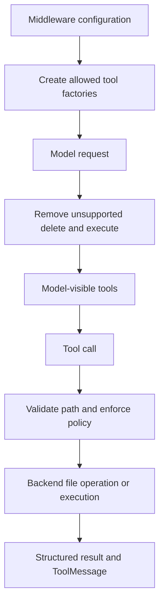
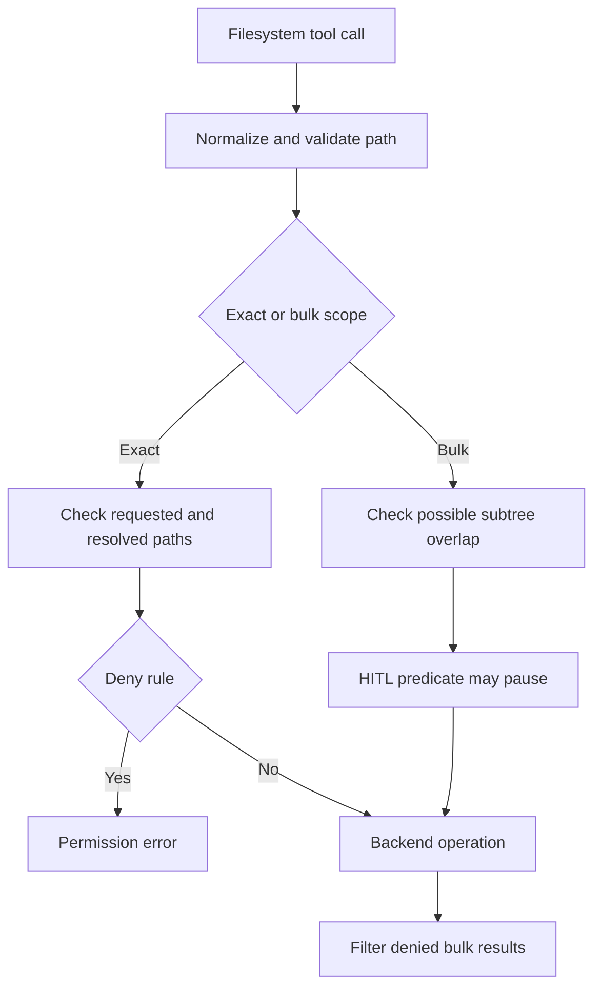
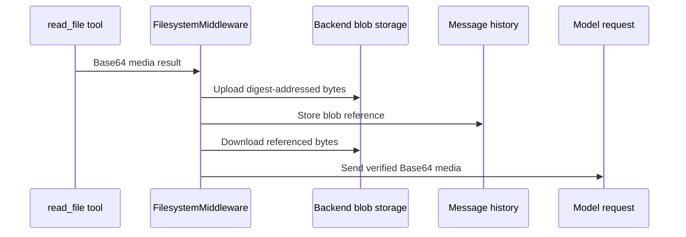

# Filesystem Tools and Policies

`FilesystemMiddleware` is the model-facing adapter over an initialized `BackendProtocol`: it creates tools, validates and formats their results, applies middleware-owned permission policy, and manages large or binary message content. The backend owns storage and operation implementation. A visible tool is not a guarantee that the backend implements it, and a tool allowlist is not an authorization boundary. See [Backends](backends.md) for storage and routing, and [Permissions & HITL](permissions-hitl.md) for approval configuration.

## Tool surface and request boundary

The built-in vocabulary is `ls`, `read_file`, `write_file`, `edit_file`, `delete`, `glob`, `grep`, and `execute`. `tools=None` and `tools="all"` build all of them; an explicit list must include `read_file`, and tools absent from that list are not dispatchable. At model-request time, the middleware removes `delete` when the backend does not implement the optional operation and removes `execute` unless the backend is execution capable. It also adjusts the default `grep` and `execute` guidance to the remaining visible tools.

This flow separates construction-time tool selection, request-time backend capability gating, per-call policy, and backend behavior.

`BackendProtocol` returns structured results, not presentation strings. `ReadResult` rejects incoherent pagination metadata; backends must tolerate negative offsets and non-positive limits, while middleware owns line-number formatting and long-line continuation rows. `grep` and `glob` can be successful yet incomplete, so `truncated=True` means absence from returned matches is not proof of absence from storage. The agent-facing `grep` is literal, not regex; its default total cap is 1,000 matches, a positive per-call `max_count` can override it, and `None` disables the default cap.

## FilesystemBackend and virtual paths

`FilesystemBackend` reads and writes the host filesystem directly. Its default `virtual_mode=True` treats `root_dir` (or the process working directory) as a virtual root: `/x` maps below that root, relative inputs are normalized into that virtual namespace, and traversal through `..` or `~` is refused. Resolved paths must remain under the root; agent-visible listing and glob paths use virtual absolute form and do not reveal the host root. Symlink loops are handled as operation errors, and virtual-mode glob output filters targets that resolve outside the root.

`virtual_mode` provides stable path semantics—especially when `CompositeBackend` strips a route prefix before forwarding a path—but is not a sandbox or general security boundary. With `virtual_mode=False`, absolute paths are used as-is and relative paths can escape `root_dir`. Even in virtual mode, deploy this direct host backend only where giving an agent access to files under its root is appropriate; writes are permanent and recursive deletion can partly complete if the underlying filesystem fails partway through.

The backend's `ls` is non-recursive and sorts entries. Text `read` returns raw UTF-8 content and pagination metadata; a recognized binary extension returns full base64 data instead. Writes create parent directories. Edits are exact replacements: without `replace_all`, the old string must identify one occurrence. Local reads preserve trailing-newline state so an edit can report an EOF-newline mismatch instead of silently failing. Batch upload/download return one ordered result per requested path, allowing partial success; upload/download map traversal and common filesystem failures to standard error codes.

The local backend's `glob` uses the shared backend contract: bare patterns match basenames at any depth, slash-containing patterns are relative to the search root, and leading `/` anchors to that root. Dot names require an explicit dot pattern; in particular, `**` does not descend into dot-directories. The walk has a five-second backend budget and returns accumulated matches with `truncated=True` and reason `budget`; malformed/refused patterns, including `..`, are reported as result errors. `grep` prefers fixed-string ripgrep and falls back to Python when unavailable; both paths preserve literal matching and bound or label partial output.

## Permission and HITL policy

`FilesystemPermission` rules classify operations as `read` or `write` and have `allow`, `deny`, or `interrupt` mode. Patterns must be absolute and may not contain a traversal component or `~`. For exact ordinary operations, declaration order is significant: the first matching rule decides. Middleware checks both the requested normalized path and, for `FilesystemBackend` including routed composites, its symlink-resolved target; an unresolved target is refused when rules are configured. List and search results filter only denied entries, including aliases that resolve to denied targets.

`interrupt` is not enforced inside a filesystem tool. During `create_deep_agent` assembly, `_fs_interrupt` turns interrupt rules into `HumanInTheLoopMiddleware` predicates. Exact tools (`read_file`, `write_file`, `edit_file`) prompt only for matching paths, unless a matching deny wins. Bulk tools (`ls`, `glob`, `grep`, and recursive `delete`) prompt if their target subtree could overlap an interrupt rule; a missing path or current-directory alias is treated as root. The glob predicate also examines absolute patterns and conservatively prompts for relative patterns containing `..`, preventing a benign `path` argument from bypassing a protected target.

Deletion has deliberately stricter policy only when a target may have descendants. A recursive or ambiguous delete fails closed if any deny-write pattern could overlap its subtree, regardless of rule order. A confirmed plain file instead uses normal first-match rule ordering. This distinction protects a denied descendant without making an earlier allow unusable for an identified leaf.

This policy flow shows the boundary: graph assembly owns approval predicates, while filesystem middleware denies calls and filters results.

## Execution is a separate trust boundary

`execute` requires `SandboxBackendProtocol`; for a composite, only the default backend supplies execution. The middleware validates a supplied timeout against both its positive `max_execute_timeout` setting (default 3,600 seconds) and the backend's timeout support. A command invocation that completes gets a successful tool message and an exit-code artifact even if the command exits nonzero; callers must inspect that exit code. Capture-capable sandbox execution may write oversized command output at the source, otherwise generic message eviction applies.

Filesystem permission patterns do not parse or constrain command syntax. Consequently permissions combined with an execution-capable backend are rejected unless every permission pattern is scoped beneath a `CompositeBackend` route; that exception isolates governed file-tool routes from the default executor but does not authorize or confine shell commands. A `LocalShellBackend` runs `shell=True` on the host as the current user, with no isolation, and its virtual paths restrict only inherited file operations—not commands. Use an isolated sandbox and HITL for untrusted work.

A composite can expose paths that are not meaningful to its default shell. When execution is active, middleware adds route-to-host mapping guidance only for routes that share a local `LocalShellBackend` filesystem; remote, sandbox, and store-backed routes have no shell mapping and must be accessed through file tools. It does not rewrite commands.

## Read media, model compatibility, and content lifecycle

For text, `read_file` produces a paginated line-numbered result. For backend-declared base64, it emits a multimodal block selected from the extension (`image`, `audio`, `video`, or generic `file`) rather than line-numbered text, retaining the validated source path and MIME type in metadata. Video decoding, when optional dependencies are available, samples frames into a synthetic `HumanMessage`; middleware moves that message after the entire preceding `ToolMessage` batch to satisfy provider ordering.

`UnsupportedContentMiddleware`, automatically placed after the core, memory, and HITL stack before later profile/caller stack shaping, copies model-request messages and replaces only blocks the active model explicitly cannot accept with a `read_file` path placeholder. Persisted message history remains unchanged. As a fallback, filesystem middleware retries once after a `ModelInvalidRequestError` only when the latest tool turn contains multimodal `read_file` material; it replaces that material with an unsupported-content notice and re-raises unrelated request errors.

Large text and binary payloads have separate lifecycles:

- **Text eviction:** oversized human text and ordinary tool text are written under the backend artifact paths with a preview for the model request. Filesystem tools are excluded from generic tool-result eviction because their output is already paginated, bounded, or compact. An artifact-write failure leaves the original content intact.
- **Binary offload:** with `offload_binary_content=True`, valid inline base64 from `read_file` results and eligible human media are SHA-256-addressed under `blobs/`; history stores a reference instead of bytes, and the model request receives rehydrated media. Offload is disabled with a warning if the blob path routes to `StateBackend`, because that would preserve bytes in checkpoint state.

The binary lifecycle stores references in history but restores verified payloads only for a model request.

Binary offload is best effort: failed uploads keep inline content. Rehydration uses an in-run untracked cache when possible and verifies every downloaded payload against its digest because blobs are agent-writable. Missing, malformed, failed, or digest-mismatched references become a text notice rather than untrusted media.

## Operational checks and focused tests

Keep `read_file` in explicit tool lists, and treat missing `delete` or `execute` as a backend capability issue rather than an allowlist issue. Treat search truncation as incomplete output. Configure binary offload only when the blob route supports upload/download outside checkpoint state. For direct host backends, keep virtual mode enabled unless trusted local workflows explicitly need host paths; do not mistake it for sandboxing.

Focused tests cover virtual-root mapping and traversal rejection, virtual-path output, symlink-loop errors and containment, literal search and dot-glob rules, pagination and binary reads, recursive deletion, ordered batch upload/download partial failure, and trailing-newline edit behavior. Permission tests cover first-match ordering, resolved symlink targets, recursive-delete fail-closed behavior, and bulk HITL bypass cases including root aliases and absolute glob patterns.

## Related pages

- [Backends](backends.md) — storage, routing, and execution-capable implementations.
- [Middleware catalog](middleware-catalog.md) — composition and request/tool wrappers.
- [Permissions & HITL](permissions-hitl.md) — policy and approval configuration.
- [Sandbox partners](../integrations/sandbox-partners.md) — isolated execution integrations.
- [Security](../operations/security.md) — operational threat model and safeguards.
