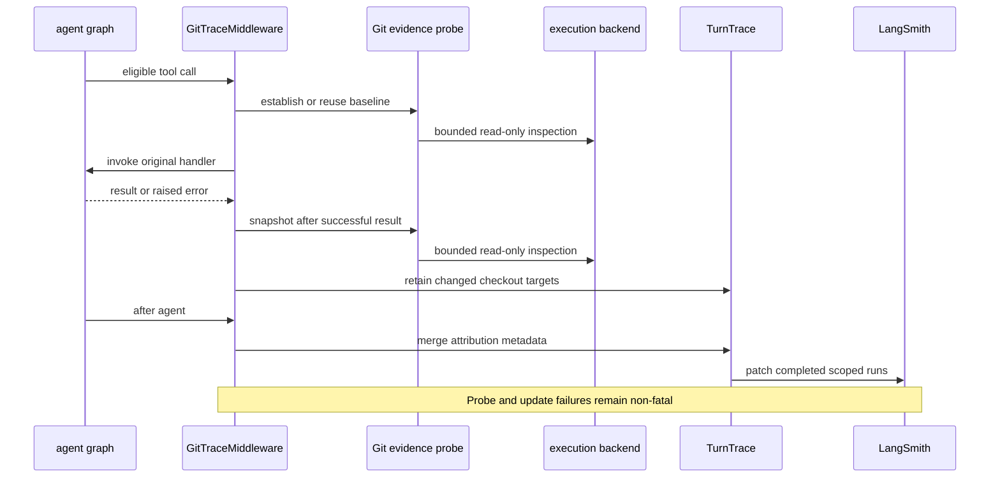

# Trace Attribution

`GitTraceMiddleware` is optional observability, not an execution or authorization control. Around eligible tool calls, it observes Git state in the tool's actual backend, attributes only changes made during the current turn, and retrospectively adds checkout metadata to that turn's completed LangSmith runs. It neither grants filesystem or shell access nor changes a tool's output, graph state, exception, or cancellation behavior.

## Installation and configuration

`create_cli_agent` creates one `GitTraceMiddleware` and places it first in the main middleware stack and in each dcode-created subagent stack. The middleware closes over the execution backend. Its working directory is the sandbox default when a sandbox is selected, otherwise the effective local cwd. Its `TracePolicy` omits middleware input payload processing.

Attribution is enabled by default through `tracing.git_attribution`. Set `DEEPAGENTS_CODE_GIT_ATTRIBUTION` to a falsy value, including an empty value, or set `[tracing].git_attribution = false` to omit the middleware entirely. This is the strongest operational opt-out: no Git inspection is started around tools. It is appropriate for privacy-sensitive or very large workspaces.

## Tool-call lifecycle



*The middleware brackets candidate mutations with evidence collection and performs a best-effort metadata update only after agent completion.*

### Eligibility and non-interference

The middleware does not inspect known read-only tools (`read_file`, `ls`, `glob`, and `grep`) or a tool with `readOnlyHint` unless that tool also declares `destructiveHint`. A destructive hint, or the known write/shell/delegation names `execute`, `write_file`, `edit_file`, `apply_patch`, `js`, and `task`, makes a call eligible. Other calls are eligible only when they carry a string `file_path`, `path`, `cwd`, or `command` argument. This is a cost and coverage heuristic, not proof that a tool writes.

A probe requires an active, scoped LangSmith turn with nonempty string `thread_id` and `turn_id`. Without one, the middleware calls the original handler directly. Handler errors and cancellation propagate unchanged; because there is no successful result, no after snapshot runs. Probe, backend-resolution, observation-retention, and trace-update exceptions are caught and logged at debug level. The asynchronous probe has an additional ten-second enclosing wait. Thus optional telemetry cannot turn a successful tool call into a failure or hide its failure.

### Per-turn baselines and concurrency

The middleware retains up to 64 recent threads, replacing a thread's `_Turn` when its `turn_id` changes. Each turn holds a trace, path coverage, a newest-known baseline per checkout root, ordered targets, and a probe sequence protected by a lock. For a path not already covered or contained in a known local checkout, a pre-call observation establishes a baseline. Every eligible successful call is then followed by an observation. The after snapshot is compared with the newest older snapshot for that root, rather than merely the immediately preceding tool call.

This design avoids crediting dirt that existed before observation. A checkout first encountered only after a call becomes a baseline rather than an attributed target. It also avoids needless pre-probes for paths already covered; only a non-virtual local filesystem can safely infer containment in a known checkout, so sandbox and virtual backends probe more conservatively. Sequence numbers preserve first observed target order, while probe numbers prevent a late concurrent snapshot from overwriting newer evidence.

Repeated evidence failures cool down probing for 30 seconds, then 60 seconds, and so on. A success resets the failure count. After three ordinary failures, or immediately for `NotImplementedError` such as an unsupported backend, the middleware disables probing for its session and emits one informational log explaining the configuration opt-out. Tool handling continues in all cases.

## Bounded evidence and privacy boundary

A `GitSnapshot` contains a checkout root, parsed repository identity, branch, commit, and an opaque fingerprint. The fingerprint hashes porcelain-v2 status records together with filesystem metadata for changed paths—mode, size, mtime, and ctime—not file contents. Origin URLs are normalized to remove credentials before repository metadata is parsed. This still exposes observability-sensitive information: inspected local roots, repository/provider names, branches, commits, and whether work changed.

Candidate paths start with the trace cwd and selected `cwd`, `file_path`, and `path` arguments. For `command`, shell-like tokenization recognizes absolute tokens and paths following `cd` or `-C`. The collector rejects empty, overlong, or metacharacter-bearing values and excludes memory and conversation-history paths. It examines at most 32 candidate values, discovers checkouts with shallow walking, skips hidden directories and common heavy directories, and returns at most 16 repository roots.

For a local `FilesystemBackend`, paths are resolved through the backend and virtual mode cannot inspect outside the backend cwd. Other non-sandbox backends are unsupported. For a sandbox protocol backend, the middleware supplies a self-contained bounded probe command only when the backend supports a timeout, executes it with a ten-second timeout, and validates the returned JSON, exit status, truncation flag, row shape, and repository bound. Unknown, malformed, truncated, or unsupported inspection is failure—not evidence of an empty workspace.

The local probe invokes literal Git arguments without a shell, strips inherited `GIT_*` variables, disables optional locks and terminal prompts, disables the repository's `core.fsmonitor` executable hook, discards stderr, limits each invocation to two seconds and 256 KiB, and rejects more than 4,096 dirty paths. These controls bound cost and prevent the evidence read from invoking configured fsmonitor code; they do not make Git metadata non-sensitive.

## From changes to trace metadata

`changed_snapshots` compares snapshots by checkout root. A root newly found after the baseline, or an existing root whose branch, commit, or fingerprint changed, is attributed. Consequently edits, commits, branch switches, linked worktrees, and new checkouts can be recognized, while unchanged preexisting dirt is excluded. Only snapshots with parseable repository metadata become targets.

Targets are de-duplicated by repository name and branch and ordered by their first attributed call. On completion, the first target supplies `ls_git_repo`, `ls_repo_provider`, and—unless detached—`ls_git_branch`; the complete ordered set becomes `open_swe_git_targets`. If no work was attributed, the middleware explicitly removes the three `ls_*` first-target fields, preventing stale checkout labels while preserving unrelated trace metadata.

`capture_turn` finds the current `LangChainTracer` root and walks upward only while parent `thread_id` and `turn_id` agree. Its thread-bounded cache combines sibling roots from an approval/resume cycle. `TurnTrace.update` visits each captured root and descendant, merges metadata in memory, and sends metadata-only updates only for completed runs. It retains the run's trace, order, session, and address routing fields, and does not resend inputs, outputs, errors, events, tags, or attachments. Replica runs are updated through their replica groups. Failures updating one run are debug logged and do not stop traversal; active runs are never ended simply to add attribution.

## Focused verification

The focused tests exercise both direct evidence collection and the middleware lifecycle:

```bash
make -C libs/code test TEST_FILE=tests/unit_tests/test_git_evidence.py
make -C libs/code test TEST_FILE=tests/unit_tests/test_git_trace.py
make -C libs/code test TEST_FILE=tests/unit_tests/test_git_trace_integration.py
make -C libs/code test TEST_FILE=tests/unit_tests/test_turn_trace.py
```

They cover credentials removal, preexisting dirt, edits, commits, branch changes, linked worktrees, sandbox response validation, fsmonitor suppression, read-only exclusion, cancellation and handler-error propagation, baseline reuse, nested checkout attribution, cooldown and session disablement, approval/resume sibling backfill, next-turn isolation, active-run safety, replica routing, and telemetry failures that leave real tool output and checkout side effects intact.
