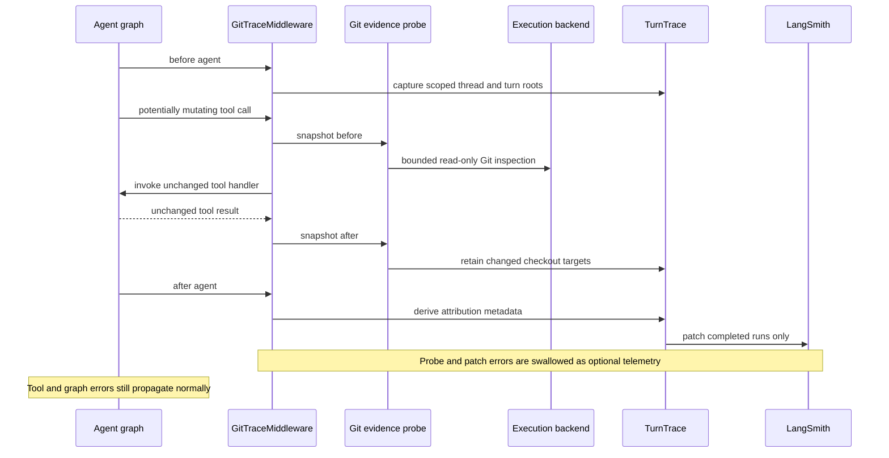

# dcode Turn Trace and Git Attribution

`GitTraceMiddleware` is a **best-effort attribution path**, not a source of agent behavior or an authorization mechanism. It observes Git checkout changes made while a dcode agent or its subagents run, then adds repository attribution to LangSmith metadata after the turn's runs have completed. It does not alter the tool result, graph state, agent response, or recorded input/output/error payloads. A missing trace, unsupported backend, failed inspection, or failed telemetry transport simply leaves attribution absent.

The middleware is installed first in both the main agent and dcode-created subagent middleware stacks. Its checkout root is the effective working directory for local backends, or the default working directory for a configured sandbox. See [Run a dcode Session](../workflows/run-dcode-session.md) for runtime setup, [Permissions and HITL](permissions-hitl.md) for execution authorization, and [Security and Trust Boundaries](../operations/security.md) for the separate backend trust boundary.

## End-to-end flow



*Potentially mutating tools are bracketed by checkout observations; only successful observations can later update completed runs belonging to the same thread and turn.*

The middleware does not probe known read-only filesystem tools (`read_file`, `ls`, `glob`, `grep`), tools explicitly marked `readOnlyHint` unless also marked destructive, or unrelated tools such as `write_todos` and `ask_user`. It observes tools with `destructiveHint`, the known shell/write/delegation names (`execute`, `write_file`, `edit_file`, `apply_patch`, `js`, `task`), and otherwise tools whose arguments include a string `file_path`, `path`, `cwd`, or `command`. This heuristic deliberately favors attributing possible checkout work over attempting to infer actual mutation from a tool's name alone.

When tracing is unavailable or the runnable config lacks string `thread_id` and `turn_id` metadata, the middleware bypasses probes and calls the handler directly. A throwing or cancelled handler likewise propagates without an after snapshot: observability never masks or delays the original execution outcome.

## Checkout evidence: bounded and non-content

A `GitSnapshot` records the discovered checkout root, parsed repository identity, branch, commit, and a fingerprint. Repository identity is parsed from `origin`; URL credentials are removed before metadata parsing. The fingerprint hashes porcelain-v2 status plus non-content filesystem metadata for modified and untracked paths (path bytes, mode, size, and timestamps). It can therefore distinguish a later edit from dirt that was already present, and sees commits, branch switches, and new checkouts without copying file content into tracing metadata.

Candidate paths begin with the configured working directory and may include `cwd`, `file_path`, and `path` arguments. For a command, shell-like tokenization additionally recognizes absolute tokens and paths after `cd` or `-C`. Invalid or suspicious values are discarded, as are memory and conversation-history paths. Discovery looks for Git roots in the candidates and a shallow bounded directory walk, skipping hidden directories, `node_modules`, `vendor`, and `__pycache__`; it stops at 16 repositories and 64 directories.

The implementation performs only bounded read-only Git commands. Each invocation clears inherited `GIT_*` variables, disables optional Git locks, fsmonitor, and untracked caching, disables terminal prompting, has a two-second subprocess timeout, and accepts no more than 256,000 bytes. It rejects a dirty-path list over 4,096 paths. For a `FilesystemBackend`, probing is local and resolves requested paths through the backend; virtual mode does not inspect roots outside its configured cwd. For sandbox-protocol backends, a self-contained Python probe runs through bounded backend execution with a ten-second timeout and validates the returned JSON, exit status, and truncation flag. Other backends, or sandbox implementations that cannot accept a timeout, provide no usable evidence.

`changed_snapshots` compares snapshots by checkout root and treats a checkout as changed if it is newly discovered or its branch, commit, or fingerprint differs. Consequently, unchanged pre-existing dirt is not attributed, whereas edits, commits, branch changes, and newly created checkouts are.

## From evidence to turn attribution

Each active `GitTraceMiddleware` keeps an LRU map of at most 64 threads. A thread entry is replaced when its `turn_id` changes and has its own lock and monotonic observation order. Successful before/after pairs contribute only changed snapshots that have recognized repository metadata. Targets are de-duplicated by `(repository name, branch)`, retaining the first observed occurrence and rendering them in tool-observation order.

At `after_agent`, the middleware updates the captured turn with:

- `ls_git_repo` and `ls_repo_provider` from the first changed target;
- `ls_git_branch` when that branch is nonempty and not detached `HEAD`; and
- `open_swe_git_targets`, an ordered list of every attributed `{repo, branch}` target.

The update removes `ls_git_repo`, `ls_git_branch`, and `ls_repo_provider` first when no checkout work was observed, preventing stale attribution from carrying into a read-only turn. It intentionally does not overwrite unrelated metadata, including other Git fields a caller supplied.

## Scoped retrospective LangSmith updates

`capture_turn` finds the current `LangChainTracer` root from runnable callbacks, but walks upward only while the enclosing parents have the same `thread_id` and `turn_id`. It refuses disabled tracing, absent clients, unscoped configs, and disabled roots. Captured roots are stored by thread and turn in a separate 128-thread LRU map; repeated invocations for an approval/resume cycle join the same `TurnTrace`, allowing sibling invocation roots to be patched together.

`TurnTrace.update` traverses every captured root and its child runs. For each run, it merges metadata in memory but calls LangSmith `update_run` only after the run has an `end_time`. The patch includes the existing timing, trace identity, ordering, session, and address information, but does not resend inputs, outputs, errors, events, tags, or attachments. Replica-enabled runs are remapped and patched per replica group so their destinations and authorization remain correct. Individual update failures are debug-logged and do not stop traversal.

This scope is important for both correctness and privacy: a trace outside the current turn is not backfilled, active runs are not ended by telemetry, and the feature changes metadata rather than trace payloads. For thread and resume semantics more generally, see [State Persistence](state-persistence.md); for session-level trace and spend operations, see [Cost and Sessions](../operations/cost-and-sessions.md).

## Operating and changing the feature

There is no user-facing switch or trace payload configuration specific to Git attribution. It is created during agent assembly and activates only when LangSmith tracing supplies a live, turn-scoped root. Operators should treat its absence as normal under disabled tracing, unscoped invocations, non-Git workspaces, unsupported backends, inspection limits, or telemetry failures—not as evidence that no work occurred.

The feature neither grants filesystem/shell access nor validates a repository's trust. Git probing runs in the same backend environment as the tool, and the backend and HITL policy remain the controls that determine what code can execute. The probe avoids file contents and credential-bearing remote URLs, but repository names, providers, branches, checkout roots during local inspection, and change presence remain observability-sensitive data; configure tracing and backend access accordingly.

Extensions that introduce a new tool should provide accurate `readOnlyHint` and `destructiveHint` metadata when possible. Otherwise a path- or command-bearing tool can be observed conservatively. Do not make the probe path a prerequisite for a tool handler, and preserve the current failure boundary: broad exceptions around capture, probes, recording, and trace reconciliation must remain non-fatal.

## Focused regression coverage

The unit tests exercise real temporary checkouts for local and sandbox-style backends: credential stripping, pre-existing dirt exclusion, edits and commits, branch/worktree behavior, multiple and newly created repositories, path candidates outside the default workspace, virtual filesystem routing, and invalid/truncated sandbox results. Middleware tests cover ordering across two repositories, a fresh turn with no changes, disabled tracing, read-only exclusion, and error/cancellation propagation.

Integration-style unit tests build real LangGraph/LangSmith tracer trees to verify approval-resume sibling roots, root/LLM/tool/nested run patching, turn isolation, metadata preservation, active-run safety, replica delivery, and optional probe/update failures that leave the agent result and side effects intact. Run the focused set through the package Makefile:

```bash
make -C libs/code test TEST_FILE=tests/unit_tests/test_git_evidence.py
make -C libs/code test TEST_FILE=tests/unit_tests/test_git_trace.py
make -C libs/code test TEST_FILE=tests/unit_tests/test_git_trace_integration.py
make -C libs/code test TEST_FILE=tests/unit_tests/test_turn_trace.py
```

See the repository-wide [Testing Guide](../testing/testing-guide.md) for test-command conventions.
