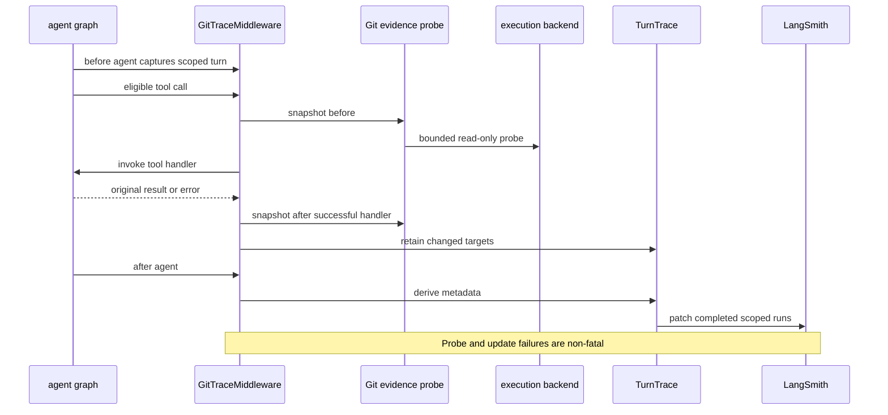
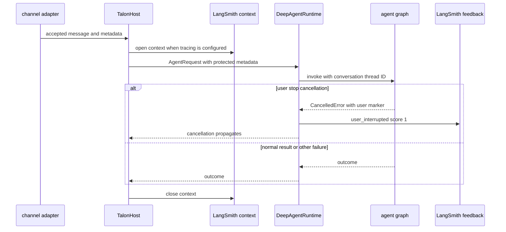

# Trace Attribution and Observability

Observability in this repository is deliberately supplementary to execution. dcode's `GitTraceMiddleware` observes checkout changes around eligible tools and retrospectively annotates completed LangSmith runs; it is not an authorization mechanism and never changes a tool result or graph state. Talon establishes a LangSmith context around a host invocation only when explicitly configured, separately records an intentional user cancellation as feedback, and can emit local activity events with redacted, bounded previews. Execution, approval, persistence, and delivery retain their own failure boundaries; see [Runtime Behavior and Failure Boundaries](../architecture/runtime-behavior.md), [Talon Scheduling and Background Work](talon-scheduling.md), and [Security and Trust Boundaries](../operations/security.md).

## dcode Git attribution

`create_deep_agent` puts one `GitTraceMiddleware` first in the main middleware stack and in dcode-created subagent stacks. It binds the middleware to the execution backend and a trace working directory: a sandbox uses its default working directory; otherwise it uses the effective local cwd. The middleware's `TracePolicy` omits its own input payload processing.



*Checkout attribution brackets candidate mutations but leaves graph execution and handler errors unchanged.*

### Eligibility and failure boundary

The middleware avoids known read-only filesystem tools (`read_file`, `ls`, `glob`, `grep`), tools carrying `readOnlyHint` unless they are also destructive, and tools such as `write_todos` and `ask_user` that lack relevant arguments. It observes tools marked `destructiveHint`, known shell/write/delegation tools (`execute`, `write_file`, `edit_file`, `apply_patch`, `js`, `task`), and otherwise calls with a string `file_path`, `path`, `cwd`, or `command` argument. This is intentionally a conservative eligibility heuristic, not proof that a write occurred.

A trace must be active and scoped by string `thread_id` and `turn_id`; otherwise the middleware directly calls the handler without probing. Capture, backend lookup, snapshots, retention, and LangSmith updates are all best effort. If the handler raises or is cancelled, that outcome propagates and no after snapshot is taken. The async probe itself has a ten-second enclosing wait, while the synchronous implementation follows its backend-specific bounds.

### Bounded, non-content evidence

A snapshot contains a checkout root, parsed repository identity, branch, commit, and fingerprint. Repository identity comes from `origin` with URL credentials removed. The fingerprint combines porcelain-v2 status with non-content metadata for modified and untracked paths, so it can identify edits without exporting file contents.

Candidate discovery starts from the configured cwd and selected arguments. Command parsing can recognize absolute tokens and paths after `cd` or `-C`; unsafe, memory, and history paths are excluded. Discovery uses bounded shallow walking and skips common irrelevant directories, stopping after at most 16 repositories. Git subprocesses are noninteractive, lock-free, time- and output-limited, and invoked without a shell. Local probes resolve paths through a `FilesystemBackend`; sandbox-protocol probes use a bounded self-contained probe and validate its response. Unsupported backends and invalid or truncated sandbox responses yield no evidence rather than an attribution claim.

`changed_snapshots` compares checkout roots. A newly found root, changed branch, changed commit, or changed fingerprint is work; unchanged dirt that already existed before the tool call is not. For a turn, changed repositories are de-duplicated by repository name and branch and retain first-observation order. At completion, the first target supplies `ls_git_repo`, `ls_repo_provider`, and, when applicable, `ls_git_branch`; all targets become ordered `open_swe_git_targets`. A no-change turn removes the three `ls_*` Git fields, preventing stale first-target attribution, while unrelated metadata remains intact.

### Retrospective turn scope

`capture_turn` locates the current `LangChainTracer` root and walks upward only across parents whose `thread_id` and `turn_id` agree. Its thread-bounded cache joins the sibling roots created by an approval/resume cycle. `TurnTrace.update` walks those roots and descendants, merges metadata in memory, and sends a metadata-only patch only for completed runs. The patch preserves destination and routing fields including trace/order/session/address; it does not resend inputs, outputs, errors, events, tags, or attachments. Replica runs are patched through their replica groups. A patch failure is debug logged and traversal continues; active runs are never ended merely to add telemetry.

## Resume labels and trace-payload redaction

A graph invocation resumed with a LangGraph `Command` is labelled `dcode:resume`; an initial invocation remains untagged. Since LangGraph inherits tags to child configs, the label reaches model, tool, and subagent runs beneath that resume. The literal is an external LangSmith saved-view and cost-report contract, so it must not be casually renamed. Reusing the same stream config carries the common `thread_id`, `turn_id`, and `turn_number`; the tag distinguishes the continuation round rather than providing grouping itself.

When dcode configures its LangSmith client secret anonymizer, it uses the standard LangSmith secret rules and depth with a thread-safe bounded LRU keyed by each string. Repeated message-history strings therefore reuse the same masked output rather than running the regex rules again. The cache holds at most 50,000 entries and 16 MiB of key/changed-value characters; oversized strings are still masked but not cached. This is a performance optimization, not a relaxation of redaction.

## Talon trace context and cancellation attribution

Talon's host wraps each `_invoke_agent` call in `langsmith_trace_context`. It is inactive unless both `LANGSMITH_TRACING` is truthy and `LANGSMITH_API_KEY` is present. If tracing is requested but the optional `langsmith` dependency is unavailable, Talon warns and executes normally. With tracing enabled, the context selects `LANGSMITH_PROJECT` or `deepagents-talon`, attaches `deepagents-talon` and `assistant:<id>` tags plus `trigger:<trigger>` when applicable, and merges the assistant ID, conversation ID, and host request metadata into trace metadata.

The host constructs that metadata from trusted routing fields and request/channel metadata, then overwrites `tool_approval_operator` according to operator status and excludes cron and background-delivery turns. Consequently, tracing sees the same request context passed to `AgentRequest`, but the host—not inbound channel metadata—owns its authority flag. Talon's graph configuration always carries the conversation ID as LangGraph `thread_id`; history metadata is added when the history scope exists.



*The LangSmith context surrounds a Talon host invocation; explicit user cancellation is an optional root-run feedback signal, not a replacement for cancellation propagation.*

For each graph payload invocation, Talon appends `UserInterruptionCallback` only when tracing is enabled. It creates `user_interrupted` feedback with score `1` only when a **root** callback receives `asyncio.CancelledError` whose sole argument is `talon:user-interrupted`. Nested cancellation, a different cancellation reason, or a failure to send feedback produces no such attribution. Feedback transport failures are logged as warnings and never prevent cancellation.

Interrupted-checkpoint recovery is separately traced when enabled. `recover_interrupted` retains the checkpoint configuration, adds the Talon/assistant/recovery tags and `conversation_id`, opens Talon's normal trace context, and creates a `talon_interrupt_recovery` trace while it appends the repaired interruption message. This makes state repair identifiable without treating it as an ordinary user turn.

## Talon local activity logs and redaction

`DEEPAGENTS_TALON_AGENT_ACTIVITY_LOGGING` enables an `AgentActivityCallback` for a runtime invocation. It emits structured `talon_event` JSON for run start/completion/failure, model thinking start/completion/failure, and tool start/completion/failure. Events use stable 12-hex-character SHA-256 references for conversation and activity IDs rather than raw identifiers. They include duration, type/name, and counts; tool events may include a preview.

Previews are intentionally bounded before logging: strings and final serialized previews are limited to 1,000 characters, nested data stops at depth five, sequences and mappings take at most 20 entries, and traversal has a 100-value budget. Bytes become a size marker and unknown objects a type marker. The preview redacts secret- or identity-named keys, bearer tokens, secret assignments, URL userinfo, and URL query/fragment data. Structured `log_event` and debug-only `log_debug_event` use the same recursive redaction; `conversation_id`, `message_id`, and `sender_id` are treated as sensitive keys. Redaction is a log-safety boundary, not a guarantee that arbitrary prose or every secret format can be safely emitted.

## Operations and focused tests

Git attribution has no separate user-facing switch: its absence is expected when tracing is disabled or unscoped, work is not in Git, a backend cannot probe safely, bounds are exceeded, or telemetry fails. It does not grant filesystem or shell authority. Although it avoids file contents and remote URL credentials, repository/provider names, branches, change presence, and locally inspected roots remain observability-sensitive data; configure tracing and backend access accordingly. New tools should accurately declare `readOnlyHint` and `destructiveHint`, and extensions must preserve the non-fatal telemetry boundary.

Run focused dcode coverage with:

```bash
make -C libs/code test TEST_FILE=tests/unit_tests/test_git_evidence.py
make -C libs/code test TEST_FILE=tests/unit_tests/test_git_trace.py
make -C libs/code test TEST_FILE=tests/unit_tests/test_git_trace_integration.py
make -C libs/code test TEST_FILE=tests/unit_tests/test_turn_trace.py
```

These tests cover snapshots and backend probes, ordering and stale-field removal, approval/resume sibling backfill, turn isolation, active-run safety, replica delivery, and optional telemetry failure. Talon tests in `libs/talon/tests/test_observability.py`, `test_runtime.py`, and `test_host.py` cover tracing opt-in/context metadata, log redaction and bounds, callback installation, and cancellation feedback behavior. See [Talon Runtime Integration](../integrations/talon.md) for tool integration and [Security and Trust Boundaries](../operations/security.md) for the authority model.
