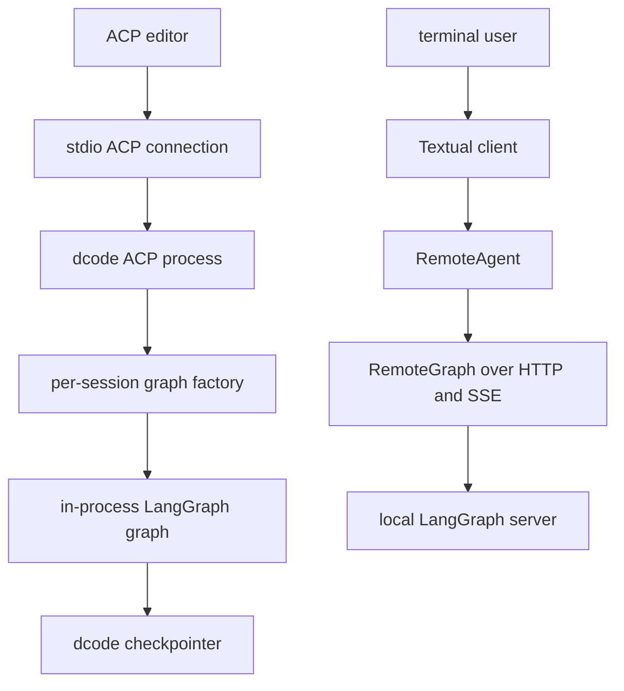
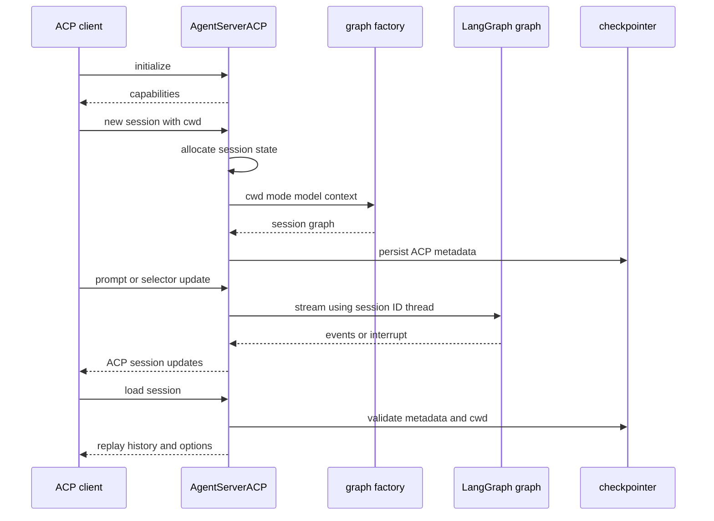

# Agent Client Protocol Integration

[Agent Client Protocol (ACP)](https://agentclientprotocol.com/overview/introduction) connects an editor to an agent process over stdio. `deepagents-acp` supplies `AgentServerACP`, an adapter that projects a LangGraph graph's sessions, stream events, and compatible human-in-the-loop interrupts into ACP. It is not an agent runtime: an embedding host remains responsible for graph construction, tools, checkpoint storage, and interrupt policy.

There are two integration paths:

- A custom host supplies either a compiled graph or a per-session graph factory.
- `dcode --acp` exposes the prebuilt dcode coding agent. It builds graphs and serves ACP **in the dcode process**, rather than starting the Textual UI or the normal local LangGraph server.

## Distribution and transport boundaries

`deepagents-acp` 0.0.13 is an alpha package requiring Python 3.11 or later (below Python 4), `deepagents`, `agent-client-protocol>=0.10.1`, and `python-dotenv>=1.2.2`. `deepagents-code` 0.2.6 requires Python 3.14 (below 3.15) and depends on `deepagents-acp>=0.0.13,<1.0.0`; deploy dcode ACP with dcode's stricter Python floor. Version 0.0.13 narrowed reusable shell authorization to exact commands and preserved local-context prompts through compaction.

A normal terminal dcode session follows a different transport: the Textual client uses `RemoteAgent`, which lazily creates a `RemoteGraph` for HTTP/SSE communication with the local LangGraph server. ACP mode instead runs `run_agent` against an adapter and factory in the same process.



*ACP hosts its graph in-process; the interactive terminal client uses the remote graph path.*

## Adapter contract and session lifecycle

`AgentServerACP` accepts a compiled `CompiledStateGraph` or a factory receiving `AgentSessionContext(cwd, mode, model)`. Mode and model selectors are allowed only with a factory; passing either for a compiled graph raises `ValueError`. The ACP session ID is used as the LangGraph `thread_id`.

At initialization, the server advertises image input and advertises `session/load` only when `load_sessions=True`. A new session creates a unique ID, retains its cwd and ACP-supplied MCP descriptors, initializes configured selectors, and persists ACP metadata when durable loading is enabled. Selector updates through `set_config_option` accept string values only, validate known mode/model values, rebuild the session graph, and persist the choice when applicable.



*The ACP session ID scopes both adapter state and the graph checkpoint thread.*

### Recovery and dcode ownership

Advertising `session/load` is not itself persistence. New durable sessions and loads require a graph compiled with a checkpointer; the checkpointer must survive a process restart to recover a session. The prompt-time `MemorySaver` fallback makes a graph usable for that turn but cannot make it recoverable. A load accepts only an ACP-marked thread with the same cwd, restores supported saved selectors, then replays messages, tool activity, and plans as session updates. Local-context-tagged messages are excluded from replay.

Dcode fences its persistent threads. Its ACP subclass acquires a local lease before creating a configuration, adds the lease token to that configuration, and releases the lease when the adapter forgets the session or its runner exits. The owned SQLite saver validates that token before checkpoint and pending-write mutations, so a stale or released client cannot write after ownership transfers. Thread deletion first acquires a temporary lease and keeps the writer guard through deletion, refusing to delete a thread open elsewhere.

## Prompt projection, cancellation, and permissions

The adapter accepts text, inline images, resource links, and embedded resources. Resource-link paths below the session root are made relative; embedded blobs become data URIs. Input audio raises `NotImplementedError`.

For a prompt, the adapter streams LangGraph `messages` and `updates` with subgraphs enabled. Only top-level assistant text and plaintext reasoning are shown; text/reasoning from subgraphs remain internal. `write_todos` becomes ACP plan updates. Tool-call argument chunks are accumulated and a tool start is emitted only after its JSON arguments parse. Messages tagged `lc_source="local_context"` are suppressed in both live projection and recovery replay, keeping model-only environment context out of the editor transcript.

Cancellation is held in adapter memory per ACP session. A new prompt clears an old cancellation, and the streaming loop checks the flag before and during graph execution; observed cancellation returns `stop_reason="cancelled"`. The normal result is `end_turn`.

ACP can present fixed permission decisions, not arbitrary interactive payloads. The adapter rejects a free-form LangGraph `interrupt()` value. For `HumanInTheLoopMiddleware`-style action requests, it waits until the stream iterator closes before reading checkpoint state, requests an ACP decision, and resumes the graph with `Command(resume={"decisions": ...})`; a cancelled permission dialog is rejection.

Always-allow decisions are in-memory and limited to that ACP session. Non-`execute` tools are allowlisted by tool name. An `execute` grant is keyed by canonical JSON of the full arguments plus the current cwd, mode, and model, so a command, argument, context, or session change requires another review. Forgetting the session drops these grants.

## Dcode ACP startup and policy boundaries

`cli_main` checks raw argv for `--acp` before Textual dependency checks. In ACP mode, it resolves the effective approval mode—rather than trusting raw approval flags—then applies ACP-specific guards: YOLO requires the acknowledgement previously recorded through the interactive TUI, and `--auto-classifier-model` is accepted only for resolved Auto mode. ACP dependencies are imported lazily; a missing `acp` or `deepagents-acp` prints an install hint and exits 1. `--no-mcp` and `--mcp-config` are mutually exclusive and exit 2.

Before opening the ACP server, dcode resolves the initial model and model choices, built-in web tools, configured MCP tools, subagents, and a checkpointer. The graph factory uses the session cwd and selected model and passes resolved approval settings to `create_cli_agent`. Auto mode substitutes a specialized ACP adapter: for every graph stream it writes trusted Auto approval state, attaches metadata for the textual prompt, and supplies `CLIContextSchema` Auto settings.

MCP is intentionally host-owned. The generic adapter retains editor-supplied ACP MCP descriptors but does not expose them in `AgentSessionContext` or turn them into graph tools. Dcode instead loads tools from its explicit configuration, trusted project context, and plugin MCP configurations before it builds a graph. If the configuration file is missing or MCP tool loading fails, it writes an error to stderr and returns 1 before serving ACP. Its MCP session manager is cleaned up on exit.

### Editor configuration

Install dcode with ACP support:

```sh
uv tool install -U deepagents-code --with deepagents-acp
```

For example, configure an ACP-capable editor with:

```json
{
  "agent_servers": {
    "Deep Agents Code": {
      "type": "custom",
      "command": "dcode",
      "args": ["--acp", "--model", "anthropic:claude-sonnet-5"]
    }
  }
}
```

Provider keys such as `ANTHROPIC_API_KEY` come from the process environment. Use `dcode --help` for ACP flags, including `--mcp-config` and `--no-mcp`.

## Focused verification

The ACP launcher tests cover rejecting a classifier model outside Auto mode, resolving the classifier only after resolving the selected provider, releasing retained leases on server exit, blocking a second server from loading an owned thread, and rejecting writes made with an old configuration after ownership changes. Generic adapter tests cover exact execute permission reuse and local-context compaction behavior.
