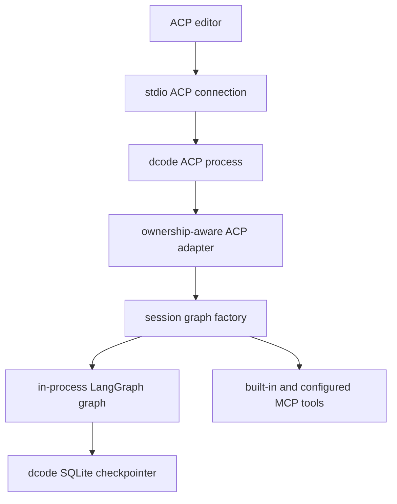
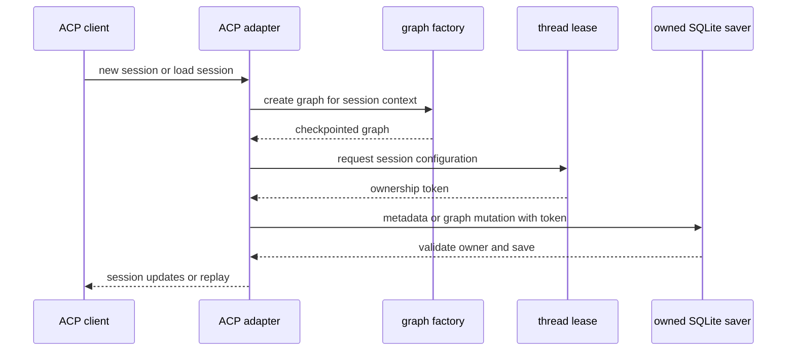
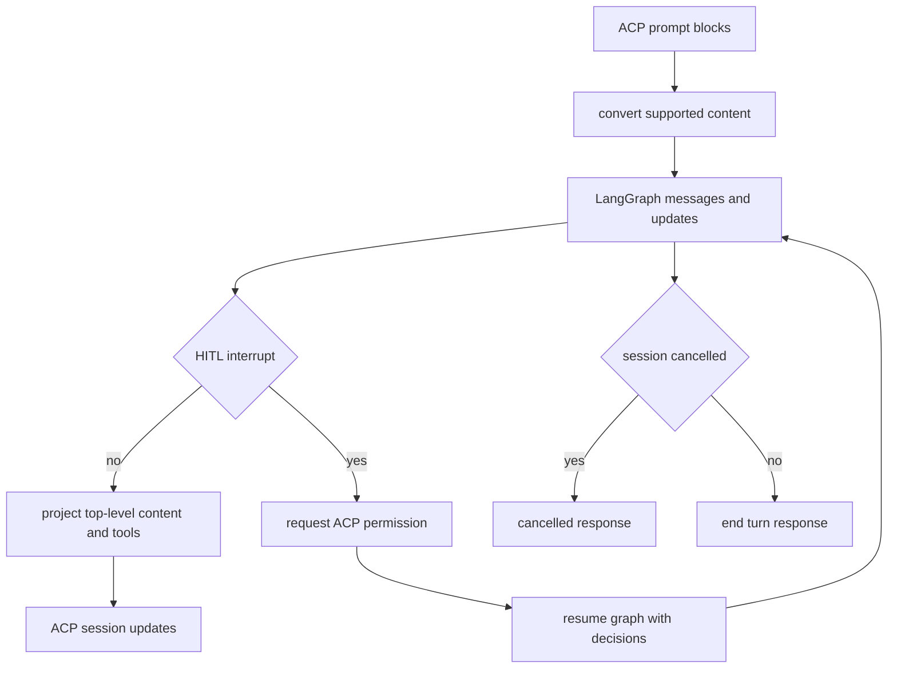

# Agent Client Protocol Integration

[Agent Client Protocol (ACP)](https://agentclientprotocol.com/overview/introduction) lets an editor communicate with an agent process over stdio. `deepagents-acp` supplies `AgentServerACP`, an adapter from an ACP session to a LangGraph graph. It does **not** define the coding-agent policy: its host constructs graphs, chooses tools and approval middleware, and configures checkpointing. `dcode --acp` is one host; it builds the dcode graph and runs the ACP server in the same process instead of launching the Textual UI.

## Compatibility and embedding boundary

`deepagents-acp` 0.0.13 is an alpha package for Python `>=3.11,<4.0` and depends on `deepagents`, `agent-client-protocol>=0.10.1`, and `python-dotenv>=1.2.2`. `deepagents-code` 0.2.11 requires Python `>=3.14,<3.15` and depends on `deepagents-acp>=0.0.13,<1.0.0`. A dcode ACP deployment must therefore meet dcode's narrower Python range.

The ACP runner, `acp.run_agent`, is connected to dcode's stdin/stdout. The graph is in-process: dcode resolves the initial model, tools, MCP configuration, subagents, and SQLite checkpointer, then hands the adapter a factory. The generic adapter can instead be embedded with either a compiled graph or a factory taking `AgentSessionContext(cwd, mode, model)`. Mode and model selectors require a factory; supplying either alongside a compiled graph raises `ValueError`.



*An ACP request remains in the dcode process; the adapter selects a graph for the session, and that graph uses dcode-owned tools and persistence.*

## Session lifecycle, recovery, and ownership

During `initialize`, the adapter advertises image prompt support and advertises `session/load` only when `load_sessions=True`. `new_session` creates an ID, records its cwd and ACP-provided MCP descriptors, initializes configured mode/model state, and, when loading is enabled, persists ACP metadata into the graph checkpoint. The ACP session ID is the LangGraph `thread_id`; metadata marks the thread as ACP-owned and records its original cwd and selected mode/model.

`session/load` requires more than an advertised capability: the graph must have a checkpointer, the checkpoint must be marked as an ACP session, and the requested cwd must equal the original cwd. The adapter restores supported saved selectors, recreates a factory graph if the restored choice differs, then replays persisted user content, assistant content/reasoning, tool starts/results, and plans as ACP updates. A checkpointer must survive process restart for recovery to be durable. On the ordinary prompt path, an unchecked graph receives `MemorySaver`, allowing the turn to run but not providing restart-safe session loading.

Changing a `mode` or `model` config option accepts strings only, validates the advertised choice, resets the session graph, and persists the selection when loading is enabled. The base adapter holds one active graph instance and resets it when the active session changes; a factory must build an appropriate graph from each `AgentSessionContext`, rather than treating the adapter as a multi-graph session cache.

Dcode adds a persistence fence to that generic mechanism. Its wrapper obtains a per-thread `ThreadLease` when session configuration is first requested, adds the lease token to graph configuration, and releases it when the adapter forgets the session or when serving ends. The owned SQLite saver validates the token under a cross-process writer guard for checkpoint and pending-write mutations. A released, stale, or concurrently held thread cannot be mutated; deletion takes a temporary lease and the same guard, so it refuses a thread open elsewhere.



*For dcode durable operations, graph construction precedes the adapter's configuration request, which acquires the thread lease and supplies its token to checkpoint writes.*

## Prompt and stream projection

For each prompt, `AgentServerACP` converts ACP text and images to LangChain content blocks; resource paths under the session root become relative, and embedded resources are represented as text containing their data URI. Audio input is currently rejected with `NotImplementedError`, despite ACP's multimodal prompt type. The adapter streams LangGraph `messages` and `updates` with subgraphs enabled, but exposes only top-level assistant text and plaintext reasoning. Subagent text/reasoning and messages marked `lc_source="local_context"` remain hidden; redacted or non-text reasoning is not exposed.

Tool-call argument chunks are accumulated, and an ACP tool start is emitted only after the JSON arguments parse. The adapter maps common filesystem and shell operations to ACP tool kinds, provides an edit diff when both old and new text are present, formats `execute` results, and projects `write_todos` activity as ACP plan updates. The same projection functions are used for replay, so block ordering and supported assistant content stay aligned between live output and recovered history.

Cancellation is adapter-local and keyed by ACP session ID. `cancel` marks a session, a new prompt clears an earlier mark, and the loop checks before and while streaming. Observing the mark returns `stop_reason="cancelled"`; ordinary completion returns `end_turn`.



*The prompt loop projects supported graph output to ACP, detours through permission handling for supported interrupts, and checks cancellation at turn and stream boundaries.*

## Approval behavior

ACP permissions have fixed choices, so the adapter translates only Human-in-the-loop-style action requests. A free-form LangGraph `interrupt()` payload fails with a protocol error rather than being guessed at. Once an interrupt update has been streamed, the adapter waits for the stream iterator to close before reading state—avoiding a stale checkpoint—requests an ACP permission decision, then resumes through `Command(resume={"decisions": ...})`. A cancelled editor permission dialog is a rejection.

An "always allow" grant is adapter memory only and is scoped to an ACP session. Non-`execute` tools are reused by tool name. `execute` reuse is narrower: the key is a canonical JSON encoding of the complete arguments plus the current cwd, mode, and model. A different command, arguments, session context, or session needs review; forgetting the session discards these grants. An in-progress plan update is auto-approved only after an incomplete plan is already recorded; rejected or cancelled plans are cleared.

Dcode resolves approval mode before entering ACP instead of treating raw flags as authoritative. YOLO requires acknowledgement previously recorded in the interactive TUI, and `--auto-classifier-model` is permitted only in resolved Auto mode. In Auto mode, dcode's ACP subclass writes trusted Auto state to its store, annotates the literal text prompt with a turn ID, and supplies `CLIContextSchema` while streaming the graph.

## Startup operations and MCP boundary

`cli_main` recognizes raw `--acp` before Textual dependency checks, but still runs the managed-configuration health gate before dispatch. ACP startup validates the resolved approval mode, lazily imports ACP dependencies, and reports unavailable or incompatible packages with an upgrade hint and exit status 1. `--no-mcp` and `--mcp-config` are mutually exclusive and fail with status 2.

Before serving, `_run_acp_cli_async` resolves an initial model and advertised model list; adds built-in web tools when credentials permit; loads configured MCP tools and subagents; and opens the dcode checkpointer. Its factory uses the editor-provided session cwd and selected model in `create_cli_agent`; the resolved mode supplies either Auto policy or YOLO approval bypass. Missing explicit MCP configuration and fatal MCP-loading failures are reported before the ACP runner starts. The MCP session manager is cleaned up when serving ends.

The generic adapter retains ACP-client `mcp_servers` descriptors as session data but neither passes them through `AgentSessionContext` nor turns them into tools. This is an authority boundary: dcode tools come from dcode configuration and plugin discovery, subject to its MCP trust policy, not from an editor asking the generic bridge to launch a server. See [MCP Integration](mcp.md) for configuration precedence, trust, and authentication.

### Editor launch

Install a dcode environment containing the ACP adapter, then configure an ACP-capable editor to run `dcode` over stdio:

```sh
uv tool install -U deepagents-code --with deepagents-acp
```

```json
{
  "agent_servers": {
    "Deep Agents Code": {
      "type": "custom",
      "command": "dcode",
      "args": ["--acp", "--model", "anthropic:claude-sonnet-5"]
    }
  }
}
```

Provider credentials, such as `ANTHROPIC_API_KEY`, are inherited from the process environment. Use `dcode --help` to inspect ACP and MCP flags.

## Focused verification

The adapter's stdio handshake test spawns a real Python process running `acp.run_agent(AgentServerACP(...))`, initializes the negotiated ACP protocol version, and creates a session without constructing a graph. This detects ACP SDK namespace or transport drift that in-process tests can miss. The dcode smoke test similarly launches `dcode --acp --no-mcp`, initializes through subprocess stdio, and creates a session.

Adapter tests cover visible reasoning ordering, local-context exclusion, stream projection, cancellation isolation, durable load/replay and cwd/session validation, selector restoration, interrupt checkpoint timing, and always-allow reuse boundaries. Dcode ACP tests cover rejection of an Auto classifier outside Auto mode, provider-based classifier resolution, lease release at server exit, blocking a second server from a held thread, and stale-write rejection after ownership transfer.

MCP timeout tests exercise graph behavior available to ACP sessions: stalled MCP calls time out for delegated and normal paths; pre-tool hooks gate MCP calls; and a timeout reaches the post-tool-failure hook without rerunning the tool on resume.
