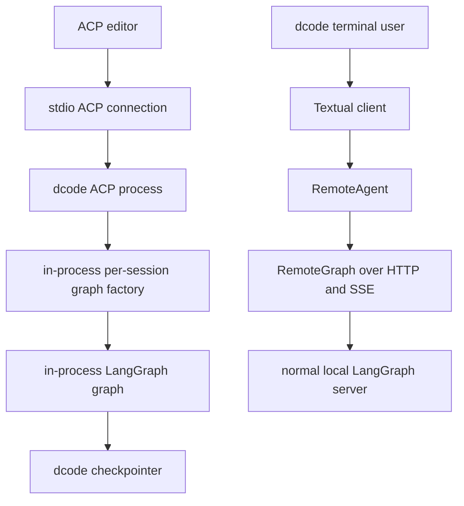
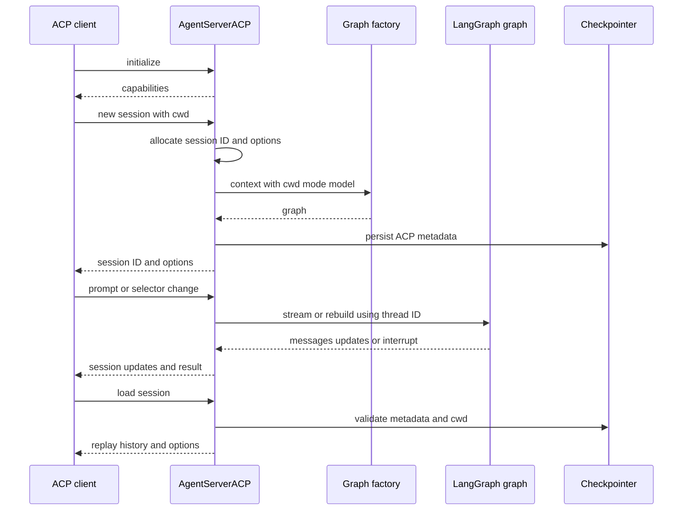

# Agent Client Protocol Integration

[Agent Client Protocol (ACP)](https://agentclientprotocol.com/overview/introduction) lets an editor communicate with an agent process over stdio. `deepagents-acp` provides `AgentServerACP`, which implements ACP while projecting a LangGraph graph's sessions, stream events, and compatible human-in-the-loop interrupts. It is an adapter, not an agent runtime: the embedding host owns graph construction, tools, checkpoint storage, and the agent's interrupt policy.

There are two host choices:

- A custom host can wrap a compatible compiled LangGraph graph, or supply a graph factory.
- `dcode --acp` runs the prebuilt dcode agent as an ACP stdio server. It builds graphs, opens the checkpointer, and handles ACP **inside the dcode process**.

`deepagents-acp` 0.0.13 supports Python 3.11 or later and requires `agent-client-protocol>=0.10.1`. dcode requires Python 3.14 and depends on `deepagents-acp>=0.0.13,<1.0.0`, so a dcode ACP deployment follows dcode's stricter Python floor. The 0.0.13 release restricts reusable shell authorization to exact commands and preserves local-context prompts across compaction.

## Transport boundary: ACP versus normal dcode

ACP mode must not be confused with a normal interactive dcode session. In the normal terminal path, the Textual client uses `RemoteAgent`; it lazily creates a LangGraph `RemoteGraph` that talks HTTP and SSE to the normal local LangGraph server path. In ACP mode, dcode does **not** launch that Textual UI or normal local LangGraph server path, and no `RemoteGraph` participates. Instead, the editor speaks ACP over stdio to an in-process adapter and graph factory.



*ACP directly hosts an in-process graph and never launches the normal local server path; the terminal UI uses a remote graph client.*

## Generic adapter lifecycle

`AgentServerACP` accepts either a compiled `CompiledStateGraph` or a factory receiving `AgentSessionContext(cwd, mode, model)`. Modes and model selectors are valid only for a factory; passing either with a compiled graph raises `ValueError`. The adapter retains one active graph: a compiled graph is reused, while a factory graph is rebuilt when the session changes or is reset. The ACP `session_id` is also the LangGraph `thread_id`.

At `initialize`, the server advertises image input and advertises `session/load` only when `load_sessions=True`. `new_session` creates an ID, retains its cwd and supplied ACP MCP descriptors, initializes selectors, and—when loading is enabled—writes ACP session metadata to the checkpoint before returning. Mode and model option values must be strings and must be recognized; a valid change resets the graph and persists the selection when durable loading is enabled.



*The session ID scopes the checkpoint thread; ACP projects graph state rather than storing a separate durable transcript.*

### Durable recovery and thread ownership

`load_sessions=True` only exposes the protocol capability. New durable sessions and loads require a graph compiled with a checkpointer, and restart recovery requires that storage to outlive the server. The prompt-time `MemorySaver` fallback for a graph without a saver is ephemeral and cannot provide recovery. Loading accepts only an ACP-marked checkpoint thread with the original cwd, restores supported persisted model and mode selections, and replays user and assistant content, thoughts, tool activity, and plans through session updates. Missing, unrelated, or relocated sessions are rejected. See [State persistence](/openwiki/concepts/state-persistence.md) for the underlying model.

Dcode adds ownership fencing to those durable threads. Its ACP wrapper obtains a local lease before producing a session graph configuration, inserts its token into that configuration, and releases it when a session is forgotten or the runner exits. A second server cannot load a leased thread. The ownership-aware SQLite saver validates the token before checkpoint and pending-write mutations; released, stale, or superseded clients therefore cannot write after ownership changes. Its deletion path also reserves the thread, preventing deletion while another client holds it.

## Prompt and stream projection

The adapter converts text, inline images, resource links, and embedded resources to LangChain content. Resource-link paths under the session root become relative and embedded blobs become data URIs; audio raises `NotImplementedError`. It streams LangGraph `messages` and `updates` with subgraphs enabled, but projects assistant text and reasoning only from the top-level graph. Plain-text reasoning becomes ACP thought chunks, `write_todos` becomes plan updates, and partial tool-call arguments are accumulated until they parse as JSON before emitting a tool start.

Cancellation is in-memory and scoped to an ACP session. `cancel(session_id)` marks that session; a new prompt clears any old mark, checks before and during streaming, and returns `stop_reason="cancelled"` when cancellation is observed. On completion it returns `end_turn`.

ACP can display fixed permission decisions, not arbitrary LangGraph UI. A free-form `interrupt()` value is rejected. For `HumanInTheLoopMiddleware`-style action requests, the adapter waits for the stream iterator to close before reading checkpoint state—avoiding a stale persistent-checkpoint snapshot—asks the client for a decision, then resumes with `Command(resume={"decisions": ...})`. A cancelled permission request is treated as rejection.

The adapter offers Approve, Reject, and where valid Always allow. These grants exist only in adapter memory for one ACP session. Non-`execute` tools are allowlisted by name. An `execute` grant is keyed by canonical JSON for the complete arguments and by the current `AgentSessionContext` (cwd, mode, model); a changed command, arguments, context, or session must be reviewed again, while different object-key ordering does not change an equivalent request. Forgetting a session discards its grants. For policy concepts, see [Permissions and human-in-the-loop](/openwiki/concepts/permissions-hitl.md).

## Local context stays model-only

Dcode's `LocalContextMiddleware` detects backend environment details such as git state, project structure, package managers, runtimes, and directory layout. The initial snapshot is retained in private state and appended to the model system prompt. After a summarization cutoff it detects again: a changed snapshot is added as an escaped, fingerprinted internal `HumanMessage` tagged `lc_source="local_context"`; an unchanged or failed refresh records the cutoff without retrying or adding a duplicate. This keeps the initial prompt stable for cacheability while retaining refreshed context in graph state after compaction.

That tag is a visibility boundary. `AgentServerACP` suppresses tagged messages when projecting live assistant content and when replaying both user and assistant history. Hosts that transform these messages must retain the tag or can expose internal environment context in the editor transcript.

## Dcode startup, tools, and policy

`--acp` is detected in raw argv before normal UI dependency checks, and ACP packages are imported lazily. If `acp` or `deepagents-acp` is unavailable, dcode prints an installation hint and exits nonzero. `--no-mcp` and `--mcp-config` are mutually exclusive; YOLO in ACP requires a previous acknowledgement in the interactive TUI; and `--auto-classifier-model` is valid only in Auto mode.

Before opening the ACP server, dcode resolves its initial model and model selector choices, web tools, MCP tools, and subagents; it opens its checkpointer and supplies a graph factory whose cwd and selected model come from the ACP session context. MCP is deliberately configuration-owned here: the generic adapter retains editor-provided MCP descriptors but neither passes them to `AgentSessionContext` nor makes them graph tools. Dcode instead resolves its configured, project-trusted, and plugin MCP configurations before graph construction. Missing configuration files or MCP tool-loading failures go to stderr and exit 1; the MCP session manager is cleaned up when ACP ends.

Dcode passes `auto_approve=yolo` and `auto_mode_enabled=auto` into `create_cli_agent`. Thus ACP fixed-decision rendering applies only if dcode's own policy leaves an interrupt for the user. In Auto mode dcode uses a specialized adapter that writes trusted Auto approval state, attaches text-prompt metadata to the final human message, and streams the graph with `CLIContextSchema` Auto settings.

### Editor configuration

Install dcode with ACP support:

```sh
uv tool install -U deepagents-code --with deepagents-acp
```

For example, configure an ACP-capable editor with:

```json
{
  "agent_servers": {
    "Deep Agents Code": {
      "type": "custom",
      "command": "dcode",
      "args": ["--acp", "--model", "anthropic:claude-sonnet-5"]
    }
  }
}
```

For an end-to-end operating flow, see [Run a dcode session](/openwiki/workflows/run-dcode-session.md).

## Focused verification

The dcode ACP smoke test launches `deepagents --acp --no-mcp`, connects an ACP pipe client, initializes, creates a session, and checks that it receives a session ID. ACP launcher tests verify that one ownership-aware server blocks another from loading an open thread and that writes using the old configuration fail after ownership changes. Thread-ownership tests additionally cover cross-process exclusion, client crash fencing, serialized writers, cancellation-safe deletion, and fenced checkpoint writes.

The generic adapter tests exercise streamed content and reasoning, cancellation and recovery, selector changes, permissions, local-context suppression, replay after compacted history, and exact-command approvals. Local-context tests verify stable initial system prompts, escaping, changed and unchanged compaction refreshes, and failure behavior.
