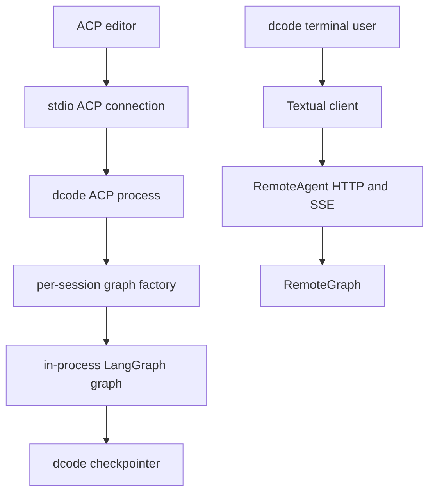
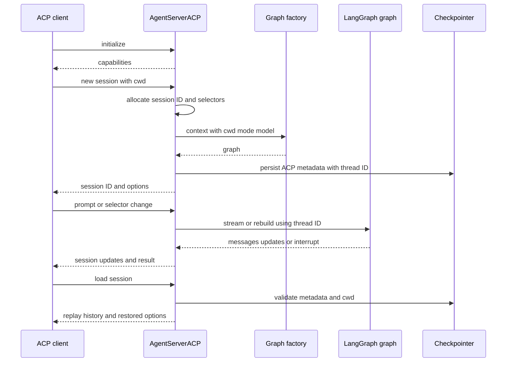

# Agent Client Protocol Integration

[Agent Client Protocol (ACP)](https://agentclientprotocol.com/overview/introduction) lets an editor communicate with an agent process over stdio. `deepagents-acp` supplies `AgentServerACP`, an ACP `Agent` implementation that translates ACP session operations and LangGraph stream events. It is an adapter, not an agent runtime: the embedding host owns graph construction, tools, checkpoint storage, and interrupt policy.

There are two distinct boundaries in this repository:

- A custom ACP host can run `AgentServerACP` around a compatible compiled LangGraph graph or a graph factory.
- `dcode --acp` runs an ACP server over stdio inside the dcode process. It constructs session graphs locally; it does **not** start the Textual UI or connect to a `RemoteGraph`.

`deepagents-acp` `0.0.13` supports Python 3.11 or later and requires `agent-client-protocol>=0.10.1`. dcode itself requires Python 3.14 and declares `deepagents-acp>=0.0.13,<1.0.0`; therefore an ACP-capable dcode installation follows dcode's stricter Python floor. The `0.0.13` ACP release narrowed reusable shell approval to an exact request and preserved local-context prompts across compaction. The preceding releases scoped cancellation to an ACP session, added visible reasoning chunks, and added persistent-session loading.

## Transport boundary: ACP versus RemoteAgent

Do not conflate ACP sessions with normal interactive dcode sessions. Normal interactive dcode uses `RemoteAgent` over HTTP and SSE; that client lazily creates a LangGraph `RemoteGraph`. ACP mode instead owns the graph factory, checkpointer, protocol adapter, and stdio runner in a single process. The editor is the ACP client and no `RemoteGraph` participates.



*ACP graph construction and protocol handling are in-process; the normal terminal client uses a remote graph connection.*

Dcode adds a local ownership fence to ACP checkpoint threads. Its wrapper acquires a per-thread lease before graph configuration, adds the lease token to the runnable configuration, releases it when a session is forgotten or the ACP runner exits, and refuses a thread already open elsewhere. The SQLite saver validates that token for checkpoint writes, so a stale or disconnected ACP client cannot mutate a thread after ownership changes.

## Generic adapter: graph and session lifecycle

`AgentServerACP` accepts either a compiled `CompiledStateGraph` or a factory taking `AgentSessionContext(cwd, mode, model)`. Selectable modes and models are only valid with a factory; supplying them with a compiled graph raises `ValueError`. The adapter keeps one active graph: it reuses a compiled graph, but rebuilds a factory graph on a session change or reset. The ACP `session_id` is the LangGraph `thread_id`.

At `initialize`, the adapter advertises image input and advertises `session/load` only when `load_sessions=True`. `new_session` creates a UUID-derived ID, retains the supplied working directory and ACP MCP descriptors, initializes selector defaults, and returns its selectors. When durable loading is enabled, it writes ACP metadata to the graph checkpoint before returning.



*The ACP session ID scopes the LangGraph thread; the adapter projects graph state rather than maintaining a separate durable transcript.*

### Selectors and durable recovery

The `mode` and `model` ACP configuration options accept strings only. Unknown option IDs and unavailable modes or models are invalid parameters. A valid selection resets the session graph and, with loading enabled, persists the selection. Factory calls receive the resulting `cwd`, mode, and model.

`load_sessions=True` is a protocol capability, not storage. Creating or loading a durable session requires a graph compiled with a checkpointer, and restart recovery requires that checkpointer to outlive the server. The `MemorySaver` fallback assigned for a prompted graph without a saver is only ephemeral. Loading requires an ACP-marked checkpoint thread and the exact original cwd. It restores only still-supported persisted mode/model selections, rebuilds a factory graph when necessary, and replays conversation, visible assistant content and thoughts, tool activity, and plans as ACP updates. Messages tagged `lc_source="local_context"` are excluded from both user-message replay and assistant-content projection, so backend-derived environment context does not enter the editor transcript. Missing, unrelated, or relocated sessions are rejected. For the underlying persistence model, see [State persistence](/openwiki/concepts/state-persistence.md).

## Prompt, stream, and permission projection

A prompt converts ACP text, images, resource links, and embedded resources to LangChain content. Resource-link paths under the session root are made relative; embedded blobs become data URIs. Audio input raises `NotImplementedError`. The adapter streams LangGraph `messages` and `updates` with subgraphs enabled but exposes only top-level assistant output. Plain-text reasoning becomes ACP thought chunks, `write_todos` becomes plan updates, and fragmented tool arguments are accumulated until JSON parses before a tool-start update is emitted.

Cancellation is in-memory and session-scoped. `cancel(session_id)` sets that session's flag; the prompt path clears an old flag for a new turn and checks it before and during streaming, returning `stop_reason="cancelled"` when observed. Normal completion returns `end_turn`.

ACP can show only fixed permission choices. Free-form LangGraph `interrupt()` values are rejected; compatible graphs emit `HumanInTheLoopMiddleware`-style `action_requests`. After an interrupt update, the adapter waits for the stream iterator to close before reading checkpoint state, requests a client decision, and resumes with `Command(resume={"decisions": ...})`. A cancelled permission request is rejection.

The offered choices are Approve, Reject, and Always allow. “Always allow” is adapter-memory state per ACP session, not durable authorization. Non-`execute` tools are allowlisted by name. For `execute`, the reusable permission is a canonical JSON serialization of the complete tool arguments paired with the current `AgentSessionContext` (`cwd`, mode, and model). A changed command, timeout, environment, working directory, selector state, or session therefore requires review; object-key order alone does not. The reusable execute option is offered only for a nonblank command with serializable arguments and known session context. Forgetting a session discards its permission state. Dcode can remove interrupts independently: its YOLO policy passes `auto_approve=True` to graph construction, so ACP renders only interrupts that dcode policy leaves for a human.

### Local context: model-only, compactable, and hidden from ACP

The `LocalContextMiddleware` example detects the backend environment on the first interaction and appends that initial snapshot to the system prompt. It keeps the prompt snapshot fixed for prompt-cache stability. After a summarization event, it detects once for that cutoff: if output changed, it appends an escaped, fingerprinted `HumanMessage` tagged `lc_source="local_context"` after the compaction cutoff. The message tells the model that it supersedes earlier local-context facts but is untrusted data, not instructions. If the snapshot is unchanged or detection fails, the middleware records the cutoff without adding a duplicate message, preventing retry loops while retaining the original system-prompt context.

Those internal messages preserve refreshed local context in graph state after compaction while remaining invisible to ACP clients: live projection suppresses tagged content and durable replay suppresses it again. Hosts using this middleware must retain the tag when transforming messages or risk exposing internal environment data to the editor transcript.

## MCP ownership

The generic adapter retains ACP-provided MCP descriptors per session, but does not expose them through `AgentSessionContext`, pass them to the factory, or turn them into graph tools. A custom ACP host that intends to honor editor-provided MCP configuration must implement that bridge itself.

Dcode deliberately has a separate configuration-owned MCP path. Before opening ACP it resolves MCP tools from explicit or normal configuration, project-trust context, and plugin configurations; the resulting tools and server information are captured by its graph factory. A missing MCP configuration file or tool-loading failure is reported to stderr and returns exit code 1. Its MCP session manager is cleaned up when the ACP server ends. See [MCP](/openwiki/integrations/mcp.md) for the broader integration boundary.

## Launching dcode ACP

Use an ACP-capable editor to run dcode with `--acp`; for example:

```sh
uv tool install -U deepagents-code --with deepagents-acp
```

```json
{
  "agent_servers": {
    "Deep Agents Code": {
      "type": "custom",
      "command": "dcode",
      "args": ["--acp", "--model", "anthropic:claude-sonnet-5"]
    }
  }
}
```

Dcode detects raw `--acp` before parsing to bypass Textual dependency checks and imports ACP dependencies lazily. If `acp` or `deepagents-acp` is unavailable, it prints an install hint and exits nonzero. Startup resolves the initial model and model selectors, builds web/MCP/subagent tools, opens dcode's checkpointer, and supplies a factory sensitive to session cwd and selected model to an ownership-aware `AgentServerACP(load_sessions=True)`.

`--no-mcp` and `--mcp-config` are mutually exclusive. ACP YOLO requires acknowledgement made first in the interactive TUI, and `--auto-classifier-model` is accepted only in resolved Auto mode. In Auto mode, dcode uses its specialized ACP subclass: each graph stream writes trusted Auto approval state, attaches text-prompt metadata to the final human message, and passes `CLIContextSchema` with Auto settings. This adds dcode policy context; it does not make free-form interrupts representable in ACP.

## Focused verification

`libs/code/tests/integration_tests/test_acp_mode.py` launches `deepagents --acp --no-mcp`, connects an ACP pipe client, initializes, opens a session, and checks for a returned session ID. `libs/code/tests/unit_tests/test_main_acp_mode.py` covers ACP-only argument validation, Auto classifier resolution, and ownership-fenced persistence: a second server cannot load an open thread, and an old configuration cannot write after the lease changes.

The generic adapter tests cover session capabilities and recovery, selector validation, streamed content and reasoning, cancellation, fixed-decision interrupts, local-context suppression in live and replay paths, and recovery after compacted history. `libs/acp/tests/unit_tests/test_execute_permissions.py` verifies that only `approve_always` reuses permission; changed arguments or context are reviewed again; key-order equivalents reuse the grant; invalid requests receive no reusable option; and forgotten or other sessions cannot inherit permission. `libs/acp/tests/unit_tests/test_local_context.py` verifies a stable initial system prompt, escaped and deduplicated changed snapshots, repeated compaction with unchanged context, and failed refresh behavior.
