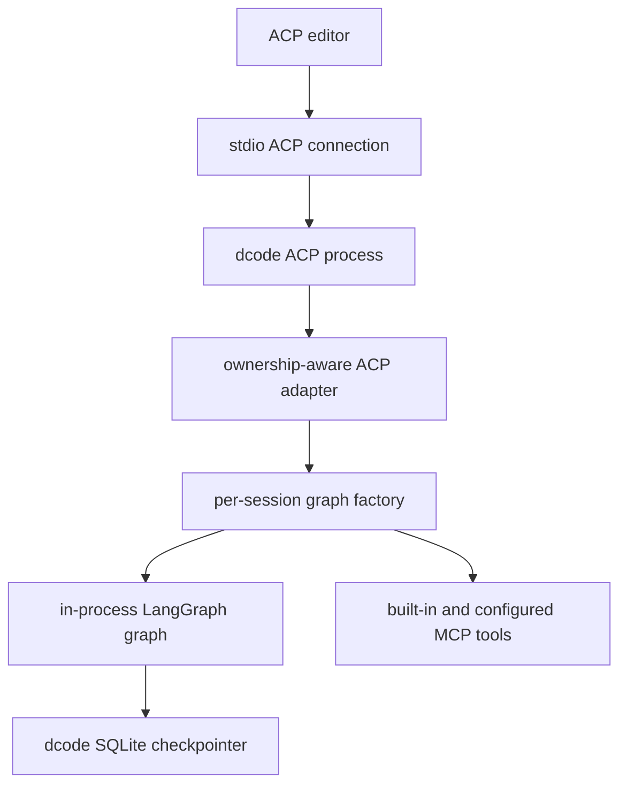
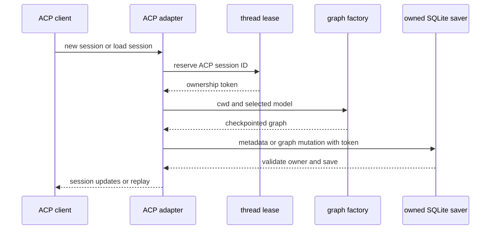

# Agent Client Protocol Integration

[Agent Client Protocol (ACP)](https://agentclientprotocol.com/overview/introduction) lets an editor communicate with an agent process over stdio. `deepagents-acp` supplies `AgentServerACP`, an adapter from an ACP session to a LangGraph graph. It does **not** supply the coding-agent policy: its host constructs graphs, selects tools, configures checkpointing, and chooses approval middleware. `dcode --acp` is one host which builds the dcode graph and runs the ACP server in the same process rather than launching the Textual UI.

## Compatibility and boundaries

`deepagents-acp` 0.0.13 is an alpha package for Python `>=3.11,<4.0`; it depends on `deepagents`, `agent-client-protocol>=0.10.1`, and `python-dotenv>=1.2.2`. `deepagents-code` 0.2.10 requires Python `>=3.14,<3.15` and depends on `deepagents-acp>=0.0.13,<1.0.0`. A dcode ACP deployment must therefore meet dcode's narrower Python range.

The transport endpoint is the ACP runner (`acp.run_agent`) connected to dcode's stdin/stdout. The graph is not remote from that process: dcode resolves the initial model, tools, MCP configuration, subagents, and SQLite checkpointer, then gives the adapter a per-session factory. The adapter has a separate generic embedding mode: it accepts either a compiled graph or a factory taking `AgentSessionContext(cwd, mode, model)`. Modes and models are factory-only; passing them with a compiled graph raises `ValueError`.



*An ACP request stays in the dcode process; the adapter selects a graph for the ACP session and that graph uses dcode-owned persistence and tools.*

## Session identity, recovery, and ownership

On initialization the adapter advertises image prompt support and advertises `session/load` only when `load_sessions=True`. `new_session` creates an ID, records its working directory and ACP-provided MCP descriptors, initializes any configured model/mode selectors, and, for load-enabled servers, writes ACP metadata to the graph checkpoint. The ACP session ID is the LangGraph `thread_id`; metadata marks the thread as ACP-owned and records the original cwd plus selected mode/model.

`session/load` is deliberately stricter than merely turning on the capability. It requires a graph with a checkpointer, accepts only a checkpoint marked as an ACP session, and rejects a different cwd. It restores supported saved selectors, rebuilds a factory graph when needed, and replays persisted user messages, assistant output, tool calls/results, and plans as ACP updates. A checkpointer must survive process restart for recovery to work. The prompt path can attach `MemorySaver` to an otherwise unchecked graph, which allows the turn to run but does not make a later load durable.

Changing a mode or model config option accepts strings only, validates against advertised values, resets the session graph, and persists the selection when loading is enabled. The adapter uses one active graph instance at a time and recreates it when the session changes; hosts should make a factory independent per `AgentSessionContext` rather than assume one graph can safely serve simultaneous sessions.

Dcode adds a persistence fence around this general mechanism. Before an ACP session graph is constructed or restored, its wrapper takes a per-thread `ThreadLease` and places its token in graph configuration. The owned SQLite saver validates that token while holding a writer guard for checkpoint and pending-write mutations. A server that has released a thread, or whose token predates a transfer, cannot write it. Forgetting a session releases its lease; server exit releases retained leases. Deletion similarly obtains a temporary lease and holds the writer guard, refusing to delete a thread open elsewhere.



*Dcode makes the ACP session ID both the graph thread identity and the unit of cross-process write ownership.*

## Prompt and stream projection

For a prompt, `AgentServerACP` converts text, images, audio, resource links, and embedded resources into LangChain content blocks. A resource path under the session root is made relative; embedded data is represented as a data URI. It streams LangGraph `messages` and `updates` with subgraphs enabled, but projects only top-level assistant text and plaintext reasoning to the editor; subagent text and reasoning remain internal. Encrypted/redacted or non-text reasoning is not exposed.

Tool-call argument chunks are accumulated and an ACP tool start is emitted only when the JSON arguments parse. The adapter maps common filesystem and shell operations to ACP tool kinds, presents edit diffs where possible, formats `execute` results, and turns `write_todos` activity into ACP plan updates. Messages marked `lc_source="local_context"` are withheld from both live projection and replay, keeping host-injected local context out of the editor transcript.

Cancellation is adapter-local and keyed by ACP session ID. `cancel` marks a session; a new prompt clears an earlier mark, and the stream loop checks before and during graph execution. A seen cancellation returns `stop_reason="cancelled"`; ordinary completion returns `end_turn`.

## Approval behavior

ACP's permission request has fixed choices, so the adapter can translate only Human-in-the-loop-style action requests. A free-form LangGraph `interrupt()` payload fails with a protocol error rather than being guessed at. When an interrupt arrives, the adapter waits for the stream iterator to close before reading checkpoint state, requests an ACP permission decision, then resumes the graph using `Command(resume={"decisions": ...})`. Cancelling the editor permission UI is a rejection.

An "always allow" grant is memory-only and scoped to the ACP session. Non-`execute` tools are reused by tool name. Shell `execute` reuse is narrower: it keys a canonical JSON encoding of the complete arguments together with current `cwd`, mode, and model. A changed command, arguments, session context, or session therefore requires a new review; forgetting the session discards these grants. In-progress plan updates can be auto-approved after an approved, incomplete plan, while rejecting or cancelling a plan clears it.

Dcode resolves approval mode before entering ACP, rather than treating raw CLI flags as authoritative. YOLO requires the acknowledgement previously recorded in the interactive TUI. `--auto-classifier-model` is accepted only for resolved Auto mode. In Auto mode, dcode uses its ACP subclass to write trusted Auto approval state to the store and attach the literal text prompt plus a per-turn ID to the human message; it supplies `CLIContextSchema` carrying that approval state when streaming the graph.

## Startup operations and MCP boundary

`cli_main` recognizes raw `--acp` before Textual dependency checks, but still runs the managed-configuration health gate before dispatch. In ACP mode it validates the resolved approval mode, imports ACP dependencies lazily, and reports unavailable/incompatible ACP packages with an upgrade hint and exit status 1. `--no-mcp` and `--mcp-config` are mutually exclusive and fail with status 2.

Before serving, `_run_acp_cli_async` resolves the initial model and advertised model list, adds built-in web tools when credentials permit, loads configured MCP tools and subagents, and opens the dcode checkpointer. Its session factory uses the editor-supplied session cwd and selected model to call `create_cli_agent`; the resolved mode supplies either Auto policy or YOLO's approval bypass. Model configuration, missing explicit MCP config, and fatal MCP-loading failures are reported on stderr before the ACP runner starts. The MCP session manager is cleaned up when serving ends.

The generic adapter retains ACP-client `mcp_servers` descriptors as session data but does not put them in `AgentSessionContext` or turn them into tools. This is an intentional authority boundary: dcode tools come from dcode's explicit, trust-gated configuration and plugin discovery, not from an editor asking the generic bridge to launch an MCP server. See [MCP Integration](mcp.md) for configuration precedence, trust, and authentication.

### Editor launch

Install a dcode environment that includes the ACP adapter, then configure an ACP-capable editor to run `dcode` over stdio:

```sh
uv tool install -U deepagents-code --with deepagents-acp
```

```json
{
  "agent_servers": {
    "Deep Agents Code": {
      "type": "custom",
      "command": "dcode",
      "args": ["--acp", "--model", "anthropic:claude-sonnet-5"]
    }
  }
}
```

Provider credentials, such as `ANTHROPIC_API_KEY`, are inherited from the process environment. Use `dcode --help` to inspect the available ACP and MCP flags.

## Focused verification

The ACP integration smoke test launches `dcode --acp --no-mcp`, connects an ACP client over subprocess stdio, initializes the protocol, and creates a session. Adapter tests cover stream projection, local-context exclusion, durable load/replay and cwd/session validation, selector restoration, cancellation, and permission reuse boundaries. Dcode ACP tests cover rejection of an Auto classifier outside Auto mode, resolving the classifier after provider selection, lease release on server exit, blocking a second server from a held thread, and rejecting stale writes after ownership transfer.

MCP timeout tests exercise the graph layer that ACP uses: stalled MCP calls time out for delegated and normal agent paths; pre-tool hook decisions gate MCP calls; and a timeout reaches the post-tool-failure hook without rerunning the tool on resume.
