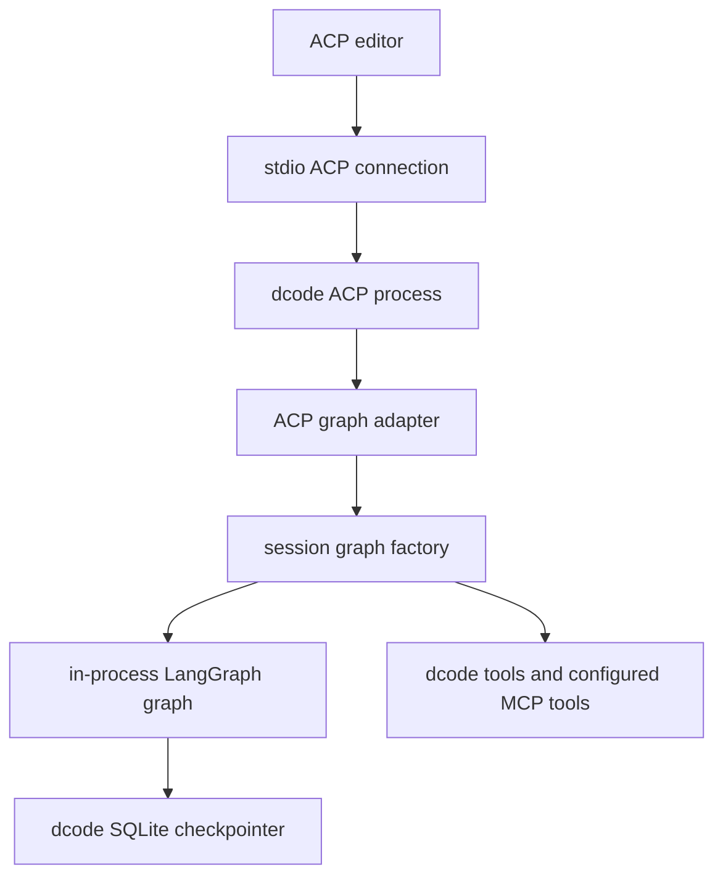
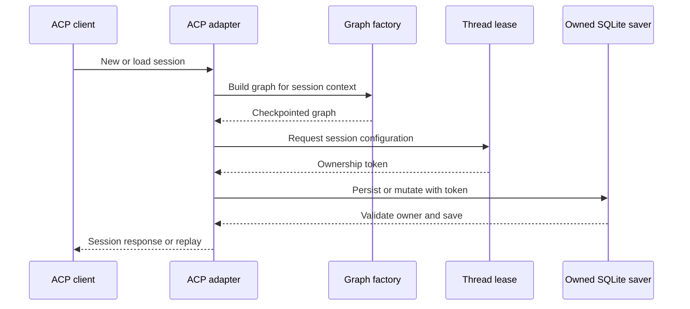
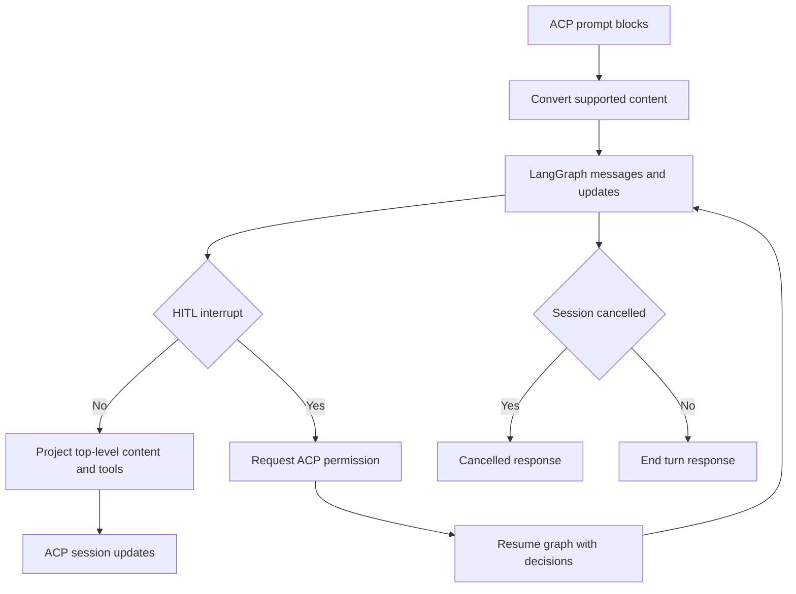

# Agent Client Protocol Integration

[Agent Client Protocol (ACP)](https://agentclientprotocol.com/overview/introduction) lets an editor communicate with an agent process over stdio. `deepagents-acp` provides `AgentServerACP`, a **graph/protocol adapter** from an ACP session to a LangGraph graph. It does not select a model, create dcode tools, choose approval policy, or impose checkpoint storage. Those are host responsibilities. `dcode --acp` is one host: it constructs a dcode graph and runs the ACP server in the same process rather than launching the Textual UI.

## Compatibility and embedding boundary

`deepagents-acp` 0.1.0 is an alpha package for Python `>=3.11,<4.0`; its runtime dependencies include unpinned `deepagents`, `agent-client-protocol>=1.0.0,<2.0.0`, and `python-dotenv>=1.2.2`. `deepagents-code` 0.2.15 declares `deepagents-acp>=0.1.0,<1.0.0` as a direct runtime dependency, pins `deepagents==0.7.42`, and requires Python `>=3.14,<3.15`. Therefore, installing dcode resolves the ACP adapter transitively, but a dcode ACP process follows dcode's narrower Python range, its pinned Deep Agents SDK release, and its adapter range—not the adapter's standalone Python floor or unconstrained SDK dependency.

This is package compatibility, not a dcode policy inherited by every adapter host. The generic server is served by `acp.run_agent` and accepts either a compiled graph or a factory accepting `AgentSessionContext(cwd, mode, model)`. Mode and model selectors are only meaningful with a factory and are rejected with a directly supplied compiled graph. The adapter dynamically resolves ACP's removed `SessionConfigOption` wrapper, so it can build config options under both ACP SDK 0.8.x and 0.9+ APIs even though its declared SDK dependency is ACP 1.x.



*An ACP request stays in the dcode process. The adapter selects a graph for the session; dcode owns the tools, policy, and persistence used by that graph.*

## Session lifecycle, recovery, and ownership

During `initialize`, the adapter advertises image prompt support and advertises `session/load` only when `load_sessions=True`. `new_session` creates an ID, records its cwd and ACP-provided MCP descriptors, initializes configured mode/model state, and—when loading is enabled—persists ACP metadata to the graph checkpoint. That ID is the LangGraph `thread_id`; metadata marks the thread as ACP-owned and records its original cwd and selected mode/model.

`session/load` is deliberately stricter than capability advertisement: it requires a graph with a checkpointer, a checkpoint marked as an ACP session, and a requested cwd equal to the recorded cwd. It restores only mode/model values still advertised by the host, rebuilds the factory graph if the restored selection differs, and replays persisted user messages, visible assistant content/reasoning, tool starts/results, and plans. Content marked `lc_source="local_context"` is excluded. A checkpointer must survive process restart for recovery to be durable. On a normal prompt, an otherwise unchecked graph is given `MemorySaver`, which permits the turn but does not make restart-safe loading possible.

Changing a `mode` or `model` config option requires a string, validates an advertised value, resets the graph, and persists the updated selector when loading is enabled. The base adapter retains one active graph instance, replacing it when the active session changes; a factory must therefore build from each `AgentSessionContext`, not assume an adapter-side multi-session graph cache.

Dcode fences that generic persistence. Its wrapper acquires a per-thread `ThreadLease` the first time session configuration is requested, adds the lease token to the graph configuration, and releases leases when a session is forgotten or serving ends. The owned SQLite saver validates that token while holding a cross-process writer guard for checkpoint and pending-write mutations. A released, stale, or concurrently held thread cannot be mutated. Deletion similarly obtains a temporary lease and guard, refusing to delete a thread open elsewhere.



*For dcode durable operations, graph construction precedes configuration generation, which acquires the lease and supplies its token to checkpoint writes.*

## Prompt and stream projection

For each prompt, `AgentServerACP` converts text and image blocks to LangChain content blocks. A resource URI under the session root is made relative; embedded text/blob resources become text (a blob is represented by a data URI). **Audio input is unsupported:** conversion raises `NotImplementedError`. Although the internal projection can emit an ACP audio block when a normalized assistant message supplies base64 audio, `initialize` advertises only image prompt capability; it does not advertise audio input support.

The adapter streams LangGraph `messages` and `updates` with subgraphs enabled, but sends only top-level assistant text and plaintext reasoning. Subagent text/reasoning and any message labeled `lc_source="local_context"` remain hidden; encrypted/redacted or otherwise non-plaintext reasoning has no visible reasoning field and is not emitted. Tool-call argument chunks are accumulated and a tool start is sent only once its JSON arguments parse. Common filesystem/shell operations are assigned ACP tool kinds; edits include a diff only when both old and new text are available; `execute` results are formatted; and `write_todos` activity becomes ACP plan updates. Replay uses the same content and tool projection helpers, preserving supported ordering across live and recovered output.

Cancellation is adapter-local and keyed by ACP session ID. `cancel` marks a session, a new prompt clears an old mark, and the prompt loop checks before and during streaming. Seeing the mark returns `stop_reason="cancelled"`; normal completion returns `end_turn`.



*The prompt loop projects supported graph output, detours through permission handling for supported interrupts, and checks cancellation at turn and stream boundaries.*

## Approval behavior

ACP permissions offer fixed decisions, so the adapter translates only Human-in-the-loop-style action requests. A free-form LangGraph `interrupt()` payload is rejected with a protocol error rather than guessed at. After receiving an interrupt update, it waits for the stream iterator to close before reading graph state, avoiding a stale persistent-checkpoint snapshot; it requests an ACP permission and resumes with `Command(resume={"decisions": ...})`. A cancelled editor permission dialog becomes rejection.

An "always allow" grant lives only in adapter memory and is scoped to one ACP session. Non-`execute` tools are reused by name. `execute` is narrower: the key is canonical JSON for the complete arguments plus current cwd, mode, and model. A different command, arguments, context, or session needs review. The remembered approval state is adapter-local rather than durable checkpoint state. A `write_todos` update is auto-approved only while an existing plan is incomplete; rejected or cancelled plan review clears the recorded plan.

Dcode resolves approval mode before ACP startup rather than trusting raw flags. YOLO requires a prior acknowledgement recorded in the interactive TUI, and `--auto-classifier-model` is accepted only in resolved Auto mode. In Auto mode dcode's ACP subclass writes trusted Auto state to its store, adds literal text-prompt metadata with a turn ID, and provides `CLIContextSchema` while streaming the graph.

## Startup operations and MCP boundary

`cli_main` recognizes raw `--acp` before Textual dependency checks, while remaining subject to the managed-configuration health gate. ACP dispatch validates the resolved approval mode, lazily imports ACP dependencies, and reports unavailable or incompatible dependencies with an upgrade hint and exit status 1. `--no-mcp` and `--mcp-config` are mutually exclusive and exit with status 2.

Before serving, `_run_acp_cli_async` resolves the initial model and advertised model list; adds dcode built-in tools and optional web search; loads configured MCP tools and subagents; and opens the checkpointer. Its per-session factory uses the editor-provided cwd and selected model in `create_cli_agent`; resolved mode supplies Auto routing or YOLO approval bypass. Missing explicit MCP configuration and fatal MCP loading failures are reported before the ACP runner begins. MCP resources are cleaned up when serving ends.

The generic adapter retains client-supplied `mcp_servers` descriptors as session data but does not place them in `AgentSessionContext` or turn them into tools. This is an authority boundary: dcode's tools come from dcode configuration and plugin discovery, under its MCP trust policy, not from an editor asking the bridge to launch a server. See [MCP Integration](mcp.md) for configuration precedence, trust, and authentication.

### Editor launch

Install dcode, which declares the ACP adapter as a runtime dependency, then configure an ACP-capable editor to run `dcode` over stdio:

```sh
uv tool install -U deepagents-code
```

Do not treat the generic adapter's Python floor as sufficient for this command: dcode's `>=3.14,<3.15` requirement still applies. An environment assembled manually must satisfy both manifests' ACP-adapter constraint and dcode's pinned `deepagents` version.

```json
{
  "agent_servers": {
    "Deep Agents Code": {
      "type": "custom",
      "command": "dcode",
      "args": ["--acp", "--model", "anthropic:claude-sonnet-5"]
    }
  }
}
```

Provider credentials, such as `ANTHROPIC_API_KEY`, are inherited from the process environment. Use `dcode --help` to inspect ACP and MCP flags.

## Focused verification

The adapter's stdio handshake test starts a real Python process running `acp.run_agent(AgentServerACP(...))`, negotiates the installed protocol version, and creates a session without building the supplied graph. This detects ACP transport or SDK API drift that in-process tests can miss. The dcode smoke test likewise runs `dcode --acp --no-mcp` in a subprocess, initializes ACP through stdio, and creates a session.

Adapter tests cover stream projection and ordering, local-context exclusion, cancellation isolation, durable load/replay and cwd validation, selector restoration, interrupt checkpoint timing, and always-allow reuse boundaries. Dcode ACP tests cover rejecting a classifier outside Auto mode, provider-based classifier resolution, releasing a lease at server exit, blocking another server from a held thread, and rejecting a stale write after ownership transfer.
