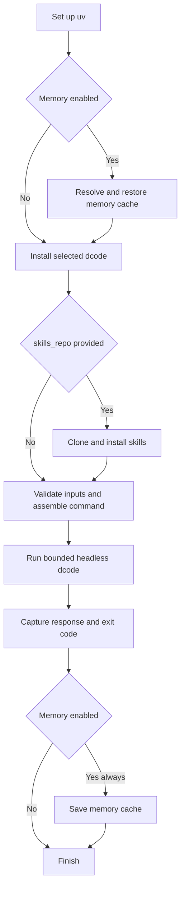

# GitHub Action Integration

The repository-root composite action, `langchain-ai/deepagents`, is the supported GitHub Actions adapter for one headless `dcode` task. `action.yml` declares its `with:` contract and three outputs; GitHub executes its setup, optional cache and skills steps, and run step as a composite action. It is a CLI adapter rather than the programmatic Deep Agents graph API: it installs the published `deepagents-code` distribution and invokes `dcode` in the requested workspace.

## Use in a job

Check out the repository before the action. `working_directory` defaults to `.`, which is the dcode workspace unless a sandbox is selected. Pin the action to a reviewed commit SHA and pin `cli_version` when repeatability is important. Grant only the job permissions and provider credentials needed for the task.

```yaml
name: dcode review
on:
  workflow_dispatch:

permissions:
  contents: read

jobs:
  review:
    runs-on: ubuntu-latest
    steps:
      - uses: actions/checkout@9c091bb21b7c1c1d1991bb908d89e4e9dddfe3e0 # v7.0.0
      - uses: langchain-ai/deepagents@<reviewed-commit-sha>
        with:
          prompt: "Review this repository and summarize the highest-risk issues."
          model: "openai:gpt-6-astra"
          openai_api_key: ${{ secrets.OPENAI_API_KEY }}
          shell_allow_list: "recommended,git,gh"
          max_turns: "8"
          task_timeout: "600"
          quiet: "true"
```

`github_token` defaults to `${{ github.token }}`. The run step exports it as `GITHUB_TOKEN`; provider inputs become `ANTHROPIC_API_KEY`, `OPENAI_API_KEY`, and `GOOGLE_API_KEY`. The optional skills clone uses the supplied GitHub token too. Consequently, the task can act with the job token and credentials made available to it.

## Execution lifecycle



*The action restores memory before dcode and attempts to save it after the run even if the task fails.*

The install step uses `uvx --from deepagents-code dcode --version` for the latest package, or `uvx --from "deepagents-code==${INPUT_CLI_VERSION}" dcode --version` for an exact version. It rejects a selected version below `0.1.0`; that floor only covers always-used flags, so an older valid pin may still lack an optional flag selected by the workflow.

The run step requires a nonempty prompt and assembles an argument array. The usual path runs `dcode ... --non-interactive "$prompt"`; `stdin: "true"` runs `dcode ... --stdin` and supplies the prompt on standard input. `stdin` cannot be combined with `skill`, because that combination without a positional prompt takes dcode's interactive path. `timeout` is the action's outer wall-clock limit in minutes (default `30`), while `task_timeout` is forwarded as dcode's `--timeout` in seconds.

The wrapper rejects invalid boolean forms and validates positive `timeout`, `max_turns`, `task_timeout`, and `rubric_max_iterations`; `max_retries` may be zero. When `jq` is available, nonempty `model_params` and `profile_override` must be JSON objects. `interpreter` is tri-state: `true` adds `--interpreter`, `false` adds `--no-interpreter`, and empty leaves dcode's default unchanged.

## Inputs, authority, and safety

All `with:` values are strings. Empty optional value inputs are omitted; a `true` boolean adds the associated CLI flag.

| Concern | Inputs | Effect |
| --- | --- | --- |
| Task and identity | `prompt`, `working_directory`, `agent_name`, `cli_version` | Select task, workspace, memory identity, and package release. |
| Model | `model`, `model_params`, `max_retries`, `profile_override` | Select the model and its configuration. |
| Bounds and output | `shell_allow_list`, `skill`, `startup_cmd`, `stdin`, `max_turns`, `task_timeout`, `timeout`, `quiet`, `no_stream`, `json` | Select shell policy, prompt delivery, task bounds, and response format. |
| Integrations | `mcp_config`, `no_mcp`, `trust_project_mcp`, `interpreter`, `interpreter_tools`, `sandbox`, `sandbox_id`, `sandbox_snapshot_name`, `sandbox_setup` | Forward supported MCP, interpreter, and sandbox controls. |
| Evaluation and memory | `rubric`, `rubric_model`, `rubric_max_iterations`, `enable_memory`, `memory_scope` | Configure rubric grading and persisted memory. |

`--auto-approve` is deliberately not exposed: adding a dcode option does not expose it through the action unless `action.yml` declares and maps it. `--non-interactive` runs one task without human tool approvals, and can modify files and access the network. At the dcode boundary, no shell allow list disables shell access; a restrictive list enables and gates shell commands; `all` permits any command and auto-approves tools. An empty `sandbox` means local runner execution, not isolation.

MCP is another execution boundary. An explicit MCP config has highest precedence over auto-discovered configuration, `no_mcp` disables MCP tool loading, and project stdio MCP remains disabled unless `trust_project_mcp` is set. Treat prompts, repository content, skills, MCP configuration, and agent output as untrusted input.

## Memory, skills, and outputs

With `enable_memory: "true"` (the default), the action restores and saves the named agent directory, global SQLite session database and WAL/SHM files, and `<working_directory>/.deepagents/AGENTS.md` through `actions/cache`. The namespace starts with `agent_name` (default `agent`) and applies `memory_scope`: `pr` uses a PR/issue number or ref, `branch` uses the ref, and `repo` is repository-wide and default. Unknown scopes warn and use the conservative PR/ref calculation. Save keys include `github.run_id` and the save step runs under `always()`.

When `skills_repo` is set, the action shallow-clones `owner/repo`, `owner/repo@ref`, or a full HTTPS/SSH URL into a temporary directory. It copies every directory containing `SKILL.md` into `.deepagents/skills`; clone failure or no discovered skill fails the action. Pin a reviewed skill revision because its contents become agent instructions.

| Output | Meaning |
| --- | --- |
| `response` | Combined dcode stdout and stderr. Treat as raw, untrusted agent output. |
| `exit_code` | Agent or outer-timeout status. The action exits with this code. |
| `cache_hit` | Result of memory restore, or empty when memory is disabled. |

The action captures the first pipeline stage via `PIPESTATUS[0]`, so a successful `tee` cannot hide a dcode or timeout failure. It uses a random `$GITHUB_OUTPUT` heredoc delimiter so agent output cannot forge output records. The stdin route uses process substitution rather than a `printf | timeout` pipeline, avoiding a producer SIGPIPE being mistaken for the task outcome.

## Published CLI compatibility

The action reference and `cli_version` select different artifacts: `uses: langchain-ai/deepagents@<ref>` chooses the root composite action, while `cli_version` chooses the latest `deepagents-code` distribution or the exact release passed to `uvx`. The distribution exposes both `dcode` and `deepagents-code` console scripts, each invoking `deepagents_code:cli_main`.

The source package currently declares `deepagents-code` `0.2.15`, Python `>=3.14,<3.15`, and an exact runtime SDK dependency, `deepagents==0.7.42`. A runner resolving the current package therefore needs Python 3.14 and receives that SDK version. The editable mappings in `[tool.uv.sources]` are repository-development wiring, not published dependency metadata; they do not change what `uvx --from deepagents-code` resolves. When changing an action-used flag, consider both the action's parser compatibility test and the oldest supported `cli_version`.

## Verification and safe changes

The focused action test parses `action.yml` and dcode's root parser to detect action-input-to-flag drift and ensure `--auto-approve` remains absent. It then executes the actual action run body with stubbed `uvx` and `timeout`, covering validation, stdin/skill exclusion, version construction, timeout arithmetic, exit propagation, and stdin SIGPIPE handling.

Run it from the repository root:

```bash
python -m pytest .github/scripts/tests/workflows/test_github_action.py -v
```

CI runs that test inside the helper-script suite in the `Validate Release Options` job after installing `packaging`, `pyyaml`, and `pytest` on Python 3.14. Update input declarations, shell mapping, parser expectations, and behavioral tests together when changing this boundary.
