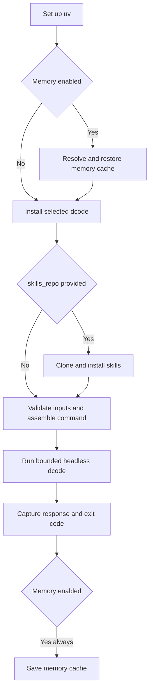

# GitHub Action Integration

The repository-root composite action, `langchain-ai/deepagents`, adapts one headless `dcode` task to a GitHub Actions step. Root `action.yml` is the public package: its declared `with:` inputs and three outputs are the supported action contract, while GitHub runs its implementation as a composite action. The wrapper installs the published `deepagents-code` distribution, validates and maps action inputs to CLI flags, then invokes `dcode` in the requested workspace.

This is a CLI adapter, not the application API: `create_deep_agent()` constructs and returns a compiled graph, whereas the action launches `dcode`. For the CLI's local interactive and headless-session behavior, see [Run a dcode Session](../workflows/run-dcode-session.md); for editor protocol serving, see [Agent Client Protocol Integration](./acp.md). The current source package publishes both `dcode` and `deepagents-code` console-script entrypoints to the same `cli_main` function.

## Use in a job

Check out the target repository first. `working_directory` defaults to `.`, so it is the dcode workspace unless a sandbox is selected. Pin a production action reference to a reviewed commit SHA, and give the job only the permissions and secrets that its task needs.

```yaml
name: dcode review
on:
  workflow_dispatch:

permissions:
  contents: read

jobs:
  review:
    runs-on: ubuntu-latest
    steps:
      - uses: actions/checkout@9c091bb21b7c1c1d1991bb908d89e4e9dddfe3e0 # v7.0.0
      - uses: langchain-ai/deepagents@<reviewed-commit-sha>
        with:
          prompt: "Review this repository and summarize the highest-risk issues."
          model: "openai:gpt-6-astra"
          openai_api_key: ${{ secrets.OPENAI_API_KEY }}
          shell_allow_list: "recommended,git,gh"
          max_turns: "8"
          task_timeout: "600"
          quiet: "true"
```

`github_token` defaults to `${{ github.token }}`. The run step exports it as `GITHUB_TOKEN`, and exports provider inputs as `ANTHROPIC_API_KEY`, `OPENAI_API_KEY`, and `GOOGLE_API_KEY`. The same supplied token authenticates an optional skills clone. The task consequently has the authority of the job token and credentials made available to that job.

## Lifecycle and failure boundary



*The composite action restores state before dcode and attempts cache saving after its run even when it fails.*

The installation step resolves latest `deepagents-code` with `uvx --from deepagents-code dcode --version`, or an exact `cli_version` with `uvx --from "deepagents-code==${INPUT_CLI_VERSION}" dcode --version`. A selected version below `0.1.0` fails before execution. That floor covers only always-used flags: an old pin can still reject an optional flag introduced later.

The run step requires a nonempty prompt and builds an argument array. By default it calls `dcode ... --non-interactive "$prompt"`; `stdin: "true"` instead calls `dcode ... --stdin` and supplies the prompt on standard input. `stdin` cannot be combined with `skill`, because piped input with a skill would select dcode's interactive route rather than headless execution. `timeout` is the wrapper's outer wall-clock limit in minutes (default `30`); `task_timeout` becomes dcode's `--timeout` in seconds.

It rejects unsupported boolean forms, validates positive numeric budgets (`timeout`, `max_turns`, `task_timeout`, and `rubric_max_iterations`), permits zero `max_retries`, and validates nonempty `model_params` and `profile_override` as JSON objects when `jq` is available. `interpreter` is tri-state: `true` adds `--interpreter`, `false` adds `--no-interpreter`, and empty preserves dcode's default.

## Public inputs and execution authority

All `with:` values are strings. Empty optional value inputs are normally omitted; boolean `true` inputs add their corresponding flag.

| Concern | Inputs | Effect |
| --- | --- | --- |
| Task and identity | `prompt`, `working_directory`, `agent_name`, `cli_version` | Select the task, workspace, memory identity, and CLI distribution. |
| Model | `model`, `model_params`, `max_retries`, `profile_override` | Map to the corresponding model flags. |
| Task bounds | `shell_allow_list`, `skill`, `startup_cmd`, `stdin`, `max_turns`, `task_timeout`, `timeout` | Set shell policy, startup behavior, prompt transport, and limits. |
| Response | `quiet`, `no_stream`, `json` | Map directly to dcode output flags. |
| Rubric | `rubric`, `rubric_model`, `rubric_max_iterations` | Pass acceptance criteria and grader controls. |
| Integrations | `mcp_config`, `no_mcp`, `trust_project_mcp`, `interpreter`, `interpreter_tools`, `sandbox`, `sandbox_id`, `sandbox_snapshot_name`, `sandbox_setup` | Direct mappings for supported MCP, interpreter, and sandbox controls. |
| Memory | `enable_memory`, `memory_scope` | Control the cache lifecycle. |

`--auto-approve` is intentionally absent from the action contract. Adding a dcode option does not expose it from the action; it must be declared and mapped deliberately in `action.yml`. In dcode, `--non-interactive` runs one task and exits without human tool approvals; it can still change files and access the network.

At the dcode boundary, no shell allow list disables shell access, a restrictive list enables and gates shell commands, and `all` permits unrestricted shell commands and auto-approves tools. Project stdio MCP is untrusted by default. An explicit MCP config path has highest precedence over auto-discovered configuration, `no_mcp` disables MCP tool loading, and `trust_project_mcp` explicitly grants project MCP loading. An empty `sandbox` means local runner execution, not isolation. Treat prompts, checked-out content, skills, MCP configuration, and agent output as untrusted.

## Memory and skills

With `enable_memory: "true"` (the default), the action caches the named agent memory directory, the global SQLite session database plus WAL/SHM files, and `<working_directory>/.deepagents/AGENTS.md`. Cache namespace begins with `agent_name` (default `agent`) and uses `memory_scope`: `pr` selects an issue/PR number or ref, `branch` selects the ref, and `repo` is repository-wide and default. Unknown scopes warn and fall back to the PR/ref calculation. Restore tries the selected prefix and then the agent-wide prefix; saves append `github.run_id` and run under `always()`. `cache_hit` is the restore result and is empty when memory is disabled.

If `skills_repo` is supplied, the action shallow-clones an `owner/repo`, `owner/repo@ref`, HTTPS, or SSH source into a temporary directory. Every directory containing `SKILL.md` is copied to `.deepagents/skills`; clone failure or no discovered skill fails the action. Pin a reviewed skill revision because this installs instructions into the agent workspace.

## Outputs and failure propagation

| Output | Meaning |
| --- | --- |
| `response` | Combined dcode stdout and stderr; raw, untrusted agent output. |
| `exit_code` | Agent or outer-timeout status; the action exits with this code. |
| `cache_hit` | Memory restore result, or empty when memory is off. |

The action pipes combined output to `tee` but captures `PIPESTATUS[0]`, so a successful `tee` cannot conceal a dcode or timeout failure. It writes `response` with a random `$GITHUB_OUTPUT` heredoc delimiter, preventing agent output from forging output records. The stdin branch uses process substitution rather than a `printf | timeout` pipeline, avoiding a producer SIGPIPE being reported as the task result.

## Package, release, and verification entrypoints

The action ref and `cli_version` select independent artifacts: `uses: langchain-ai/deepagents@<ref>` selects the root composite action, while `cli_version` selects either the latest `deepagents-code` distribution or the exact version passed to `uvx`. Pin both when reproducibility matters. The current source package is `deepagents-code` `0.2.8` and requires Python `>=3.14,<3.15`; the `0.2.0` changelog records that Python 3.14 requirement as a breaking change. A CLI pin is therefore also a Python-runtime compatibility choice.

For release and dependency-maintenance procedures, see [Development and Release Operations](../operations/development.md). The release-PR dependency-freshness workflow runs only for release-please PR titles, checks changed minimums against PyPI, builds the target wheel, validates wheel metadata, and installs that wheel into a fresh virtual environment with dependencies resolved from PyPI. It is a release-artifact gate, not a substitute for testing this composite action.

The focused action test parses `action.yml` and the dcode root parser to catch action-input-to-flag drift and ensure `--auto-approve` stays absent. It executes the actual action run body with stubbed `uvx` and `timeout`, covering validation, stdin/skill exclusion, version command construction, timeout arithmetic, exit propagation, and stdin SIGPIPE behavior.

Run it locally from the repository root:

```bash
python -m pytest .github/scripts/tests/workflows/test_github_action.py -v
```

CI runs that test through `python -m pytest .github/scripts/tests -v` in `Validate Release Options`, after installing `packaging`, `pyyaml`, and `pytest` on Python 3.14 (and Node 24 for other helper tests). The job runs unless change detection identifies a curated release-notes-only apply. It is the direct action coverage: root `action.yml` is not in the Code path selector, which otherwise selects `libs/code`, `libs/deepagents`, and shared CI workflow/action paths for Code lint and Python-3.14 sharded unit tests.
