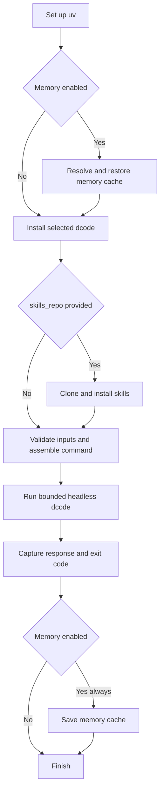

# GitHub Action Integration

The repository-root composite action, `langchain-ai/deepagents`, adapts one headless `dcode` task to a GitHub Actions step. Root `action.yml` is the public action package: its declared `with:` inputs and three outputs are the supported contract, while GitHub executes its steps through the composite-action mechanism. The wrapper installs the published `deepagents-code` distribution, validates and maps inputs to CLI flags, then runs `dcode` in the selected workspace.

This is a CLI adapter, not the application API: `create_deep_agent()` constructs and returns a compiled graph, whereas the action launches `dcode`. The distribution exposes both `dcode` and `deepagents-code` console-script names, each invoking `deepagents_code:cli_main`.

## Use in a job

Check out the target repository before invoking the action. `working_directory` defaults to `.`, so it is the dcode workspace unless a sandbox is selected. Pin a production action reference to a reviewed commit SHA, pin `cli_version` when reproducibility matters, and grant the job only the permissions and secrets required by its task.

```yaml
name: dcode review
on:
  workflow_dispatch:

permissions:
  contents: read

jobs:
  review:
    runs-on: ubuntu-latest
    steps:
      - uses: actions/checkout@9c091bb21b7c1c1d1991bb908d89e4e9dddfe3e0 # v7.0.0
      - uses: langchain-ai/deepagents@<reviewed-commit-sha>
        with:
          prompt: "Review this repository and summarize the highest-risk issues."
          model: "openai:gpt-6-astra"
          openai_api_key: ${{ secrets.OPENAI_API_KEY }}
          shell_allow_list: "recommended,git,gh"
          max_turns: "8"
          task_timeout: "600"
          quiet: "true"
```

`github_token` defaults to `${{ github.token }}`. The run step exports it only as `GITHUB_TOKEN`; provider inputs become `ANTHROPIC_API_KEY`, `OPENAI_API_KEY`, and `GOOGLE_API_KEY`. The optional skills clone uses the same supplied token. The task therefore has the authority of the job token and credentials made available to the job.

## Execution lifecycle



*The composite action restores state before dcode and attempts cache saving after its run even when it fails.*

The installation step resolves latest `deepagents-code` with `uvx --from deepagents-code dcode --version`, or an exact `cli_version` with `uvx --from "deepagents-code==${INPUT_CLI_VERSION}" dcode --version`. A version below `0.1.0` fails before execution. That floor covers only always-used flags: an old pin can still reject an optional flag added in a later dcode release.

The run step requires a nonempty prompt and builds an argument array. Normally it calls `dcode ... --non-interactive "$prompt"`; `stdin: "true"` instead calls `dcode ... --stdin` and supplies the prompt on standard input. `stdin` cannot be combined with `skill`, because piped input with a skill takes dcode's interactive route rather than the intended headless route. `timeout` is the wrapper's outer wall-clock limit in minutes (default `30`); `task_timeout` becomes dcode's `--timeout` in seconds.

It rejects unsupported boolean forms, validates positive numeric budgets (`timeout`, `max_turns`, `task_timeout`, and `rubric_max_iterations`), permits zero `max_retries`, and validates nonempty `model_params` and `profile_override` as JSON objects when `jq` is available. `interpreter` is tri-state: `true` adds `--interpreter`, `false` adds `--no-interpreter`, and empty preserves dcode's default.

## Inputs, authority, and safety boundary

All `with:` values are strings. Empty optional value inputs are omitted; `true` boolean inputs add their mapped flag.

| Concern | Inputs | Effect |
| --- | --- | --- |
| Task and identity | `prompt`, `working_directory`, `agent_name`, `cli_version` | Select the task, workspace, memory identity, and CLI distribution. |
| Model | `model`, `model_params`, `max_retries`, `profile_override` | Map to model-selection and retry flags. |
| Task bounds | `shell_allow_list`, `skill`, `startup_cmd`, `stdin`, `max_turns`, `task_timeout`, `timeout` | Set shell policy, startup behavior, prompt transport, and limits. |
| Response | `quiet`, `no_stream`, `json` | Map to dcode output flags. |
| Rubric | `rubric`, `rubric_model`, `rubric_max_iterations` | Pass acceptance criteria and grader controls. |
| Integrations | `mcp_config`, `no_mcp`, `trust_project_mcp`, `interpreter`, `interpreter_tools`, `sandbox`, `sandbox_id`, `sandbox_snapshot_name`, `sandbox_setup` | Map supported MCP, interpreter, and sandbox controls. |
| Memory | `enable_memory`, `memory_scope` | Control the cache lifecycle. |

`--auto-approve` is intentionally absent from the action contract. Adding a dcode option does not expose it from the action; it must be declared and mapped deliberately in `action.yml`. `--non-interactive` runs one task and exits without human approvals, but it can still change files and access the network.

At the dcode boundary, no shell allow list disables shell access; a restrictive list enables and gates shell commands; and `all` permits unrestricted shell commands and auto-approves tools. Project stdio MCP is untrusted by default. An explicit MCP config path takes precedence over auto-discovered configuration, `no_mcp` disables MCP tool loading, and `trust_project_mcp` explicitly permits project MCP loading. An empty `sandbox` means local runner execution, not isolation. Treat prompts, checked-out content, skills, MCP configuration, and agent output as untrusted.

## Memory, skills, and outputs

With `enable_memory: "true"` (the default), the action caches the named agent memory directory, the global SQLite session database plus WAL/SHM files, and `<working_directory>/.deepagents/AGENTS.md`. The cache namespace begins with `agent_name` (default `agent`) and uses `memory_scope`: `pr` selects an issue/PR number or ref, `branch` selects the ref, and `repo` is repository-wide and the default. Unknown scopes warn and fall back to the PR/ref calculation. Restore tries the selected prefix and then the agent-wide prefix; saves append `github.run_id` and run under `always()`. `cache_hit` is the restore result and is empty when memory is disabled.

If `skills_repo` is supplied, the action shallow-clones an `owner/repo`, `owner/repo@ref`, HTTPS, or SSH source into a temporary directory. Every directory containing `SKILL.md` is copied to `.deepagents/skills`; clone failure or no discovered skill fails the action. Pin a reviewed skill revision because this installs instructions into the agent workspace.

| Output | Meaning |
| --- | --- |
| `response` | Combined dcode stdout and stderr; raw, untrusted agent output. |
| `exit_code` | Agent or outer-timeout status; the action exits with this code. |
| `cache_hit` | Memory restore result, or empty when memory is off. |

The action pipes combined output to `tee` but captures `PIPESTATUS[0]`, so a successful `tee` cannot conceal a dcode or timeout failure. It writes `response` with a random `$GITHUB_OUTPUT` heredoc delimiter, preventing agent output from forging output records. The stdin branch uses process substitution rather than a `printf | timeout` pipeline, avoiding a producer SIGPIPE being reported as the task result.

## Published CLI and release contract

The action ref and `cli_version` select independent artifacts: `uses: langchain-ai/deepagents@<ref>` selects the root composite action, while `cli_version` selects either the latest `deepagents-code` distribution or the exact version passed to `uvx`.

### Installer-visible package contract

The source currently declares `deepagents-code` `0.2.14`. A normal package installation must satisfy its Python constraint, `>=3.14,<3.15`, and receives the exact runtime dependency `deepagents==0.7.41`; these are the constraints that matter to `uvx` and therefore to action consumers. The `0.2.0` changelog records the Python 3.14 requirement as a breaking change. Pin `cli_version` to a release compatible with the job environment and the flags supplied to the action.

### Editable repository development is different

The source checkout's `[tool.uv.sources]` maps `deepagents` and several integration packages to editable sibling directories. That mapping supports repository development and tests; it is not published package metadata and does not alter what the action's `uvx --from deepagents-code` installation resolves. In particular, do not infer the action's SDK from an editable checkout: keep the released exact SDK pin current when Code relies on SDK functionality, and validate the distribution path when changing this boundary.

`deepagents-code` is a release-managed PyPI package. The release workflow maps it to `libs/code`, builds from a resolved exact release SHA, and stamps that SHA into its build through `DEEPAGENTS_CODE_BUILD_COMMIT`; this keeps the distribution and eventual tag tied to the same source tree. Before publishing, the release checks that the code package's exact SDK pin is at least the workspace SDK version unless an operator explicitly enables `dangerous-skip-sdk-pin-check`. That bypass is for an intentional older pin, not routine release use.

For normal releases, release-please creates a package release PR after releasable changes on `main`; merging it dispatches the package-release workflow. The release workflow builds, performs pre-release checks and Test PyPI validation, publishes to PyPI, then creates the GitHub release. A manual dispatch requires a package, version, and normally an exact `release-sha`; the workflow verifies that the selected commit declares the requested version and is reachable from `main`. Do not move or recreate a tag for a version already published to PyPI: one version must continue to identify one artifact.

## Verification and safe changes

The focused action test parses `action.yml` and the dcode root parser to catch action-input-to-flag drift and ensure `--auto-approve` stays absent. It executes the actual action run body with stubbed `uvx` and `timeout`, covering validation, stdin/skill exclusion, version command construction, timeout arithmetic, exit propagation, and stdin SIGPIPE behavior.

Run it locally from the repository root:

```bash
python -m pytest .github/scripts/tests/workflows/test_github_action.py -v
```

Repository CI runs it through `python -m pytest .github/scripts/tests -v` in `Validate Release Options`, after installing `packaging`, `pyyaml`, and `pytest` on Python 3.14. The helper-script job runs unless change detection identifies a curated release-notes-only apply. When changing the action, update its input declarations, flag mapping, and this focused test together; when changing an action-used CLI flag, its parser compatibility assertion is the early warning that prevents publishing a broken adapter.
