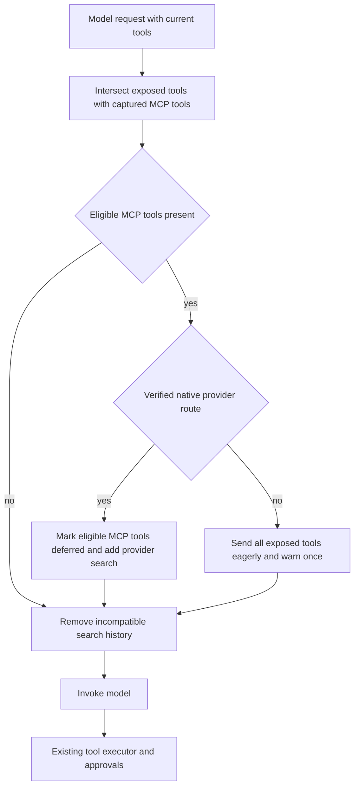

# MCP Integration

MCP configuration is executable integration input: a stdio server starts a local command, while a remote server can interpolate values into a URL or headers. dcode therefore separates discovery and project trust from disabled-server policy, environment construction, connection lifecycle, OAuth, tool adaptation, and invocation safeguards. Talon has a deliberately different model: its operator-selected MCP file is mediated by management tools and channel/CLI authorization.

## dcode discovery, trust, and activation

`resolve_and_load_mcp_tools()` is dcode's runtime entry point. Unless `no_mcp` is set, it searches the selected profile's user `.mcp.json`, then `<project-root>/.deepagents/.mcp.json`, then `<project-root>/.mcp.json`, in ascending precedence. Definitions merge by server name, so later layers win; plugin layers and an explicit configuration can add later layers, and an explicit configuration has highest precedence.

The winning definition retains its origin for trust evaluation. Project trust is evaluated *after* precedence: whole-project trust or a matching, definition-bound persisted approval can enable a project server, but an explicit denial wins. An unreadable trust policy disables whole-project trust. An explicit configuration is operator-selected and is validated before child-server startup; its load errors are fatal. Discovered files instead produce status/error entries while usable sibling servers continue.

`[mcp].disabled_servers` is a user-level persistent name deny list. A name applies to every same-named winning definition and is checked before connection, while metadata retains the disabled server for presentation. Managed and user denies combine; if managed deny policy cannot be read, dcode fails closed by disabling every server.

A project `.env` is not a trust channel. Project dotenv loading is controlled by `startup.read_project_dotenv`, resolved before reading the project file with managed, process, trusted-global-dotenv, TOML, and default precedence. If the global dotenv is unreadable, dcode skips the project dotenv. The project file cannot supply execution-affecting variables or project-MCP trust and approval controls, so a repository cannot pair `.env` with `.mcp.json` to self-approve a command, endpoint, or header.

## Server construction and lifecycle

`resolve_mcp_server_env` works on a deep copy of each server definition. It expands only braced `${VAR}` and `${VAR:-default}` expressions in `command`, `url`, `args`, `env`, `headers`, and OAuth settings; malformed expressions and unset required variables prevent that server's activation. dcode isolates validation, preflight, connection, schema adaptation, and tool-construction failure by server, reports outcomes as `MCPServerInfo`, and redacts failure details when the raw configuration interpolated environment values.

Remote loading uses explicit OAuth configuration or stored tokens unless a static `Authorization` header is present. The static header wins. When a server explicitly requests OAuth but has no stored token, dcode reports it as unauthenticated rather than attempting a connection; normal graph loading never prompts for login.

dcode exports provider-safe, deterministic `<server>_<tool>` names while keeping original server/tool identity in metadata. Exactly one non-empty `allowedTools` or `disabledTools` list may be used. Literal and `fnmatch` entries match original and exported names; unmatched entries warn without failing startup.

`MCPSessionManager` owns retained router/backend loads. Reload does not close a prior adopted load, preserving resources for in-flight calls; cleanup attempts every retained router and backend with bounded, best-effort shutdown. A truly stateless load releases discovery sessions and reconnects the owning server for each invocation. Passing an external manager takes precedence over this stateless conversion, so server-graph ownership retains the connected load.

At the invocation boundary, dcode omits an empty string only for optional string-like MCP parameters; required, `None`, and explicitly non-string values are retained. The MCP timeout is resolved as `mcp.tool_timeout` (default 120 seconds, accepted finite range 1–900 seconds). A timeout warns that the remote operation may still be running and retry could duplicate work; cancellation propagates rather than becoming a tool failure. A disconnected backend is invalidated without replaying the operation because it may already have completed.

## Optional provider-native MCP tool search

By default, `models.provider_tool_search` is enabled. It may be set with `[models].provider_tool_search` or `DEEPAGENTS_CODE_PROVIDER_TOOL_SEARCH`; an empty environment value disables it. This is a request-time model-serialization optimization, not a different MCP loading mode: dcode still discovers, trusts, connects, adapts, registers, filters, and protects MCP tools as above.

The agent installs `MCPProviderToolSearchMiddleware` only when the option is enabled and MCP tools exist, for both the primary agent and delegated subagent middleware stacks. On each model request, the middleware identifies eligible tools by the object identities captured from the current MCP tool set, then intersects them with `request.tools`. Thus it can defer only MCP tools actually exposed on that request; ordinary tools and removed/skill-scoped MCP tools are not deferred.

*Native search changes only the model request for eligible MCP tools exposed on the current request. It does not change tool executor registration or approval enforcement.*

Native search is restricted to exact `ChatOpenAI` and `ChatAnthropic` clients on their direct endpoints or recognized LangSmith gateway native-format routes. OpenAI additionally requires the Responses API; automatic model gates cover the supported model names, while a boolean model profile `provider_tool_search` can explicitly enable or disable the capability. Unsupported models, endpoints, and Chat Completions requests retain eager tool serialization and emit a warning once per model class/name pair when eligible MCP tools are present.

Provider-native search blocks are provider-specific history. Before every call, the middleware copies AI messages as needed and removes search call/output blocks that the selected provider cannot safely replay, including matching entries in `additional_kwargs.tool_outputs`. It preserves compatible blocks for the same provider and never mutates the checkpointed/original message object. This lets a conversation switch provider or fall back to eager tools without forwarding incompatible native-search protocol content.

A provider search result still identifies the same registered MCP tool. The normal HITL middleware, MCP timeout middleware, hooks, and the tool executor handle its call; deferred schemas are not a bypass for approval or policy.

## Talon: separate configuration, management, and authorization

Talon is experimental and does not reuse dcode's layered discovery or project-trust model. It loads one JSON file selected by `DEEPAGENTS_TALON_MCP_CONFIG` from the Talon runtime environment or process environment, otherwise `~/.deepagents/.mcp.json`. A missing file yields no MCP tools. The file must contain `mcpServers`; server names are restricted to letters, digits, `_`, and `-`. Talon resolves braced environment references from the runtime environment first, then the process environment.

`MCPToolProvider` serializes loading/reloading behind an async lock and revision counters. A configuration update or `reload_mcp_configuration` schedules refresh for a subsequent turn; it does not change capabilities of a running task. Each server is loaded independently with a 30-second tool-list budget. Talon prefixes tools as `<server>_<tool>`, applies mutually exclusive `allowedTools`/`disabledTools` glob filtering, sorts the result, and reports `ok`, `unauthenticated`, or `error` server metadata. A collision with a Talon management-tool name fails the load.

Talon's `skillOnly: true` adds a second disclosure boundary. Such tools are loaded and marked as Talon MCP tools, but are removed from the base agent tool list and supplied through skills middleware only after the relevant skill is read or pinned. This affects model visibility, not execution safeguards: once disclosed, the normal approval interrupt and `talon_mcp_middleware` still apply. That middleware normalizes optional empty-string arguments, binds the invocation's authorization context, and converts an MCP protocol error to a failed `ToolMessage`.

### Management path

`MCPConfigStore` exposes `get_mcp_configuration` and `update_mcp_server` rather than asking the model to read or edit the selected file. Reads redact strings except transport/auth enums and exact `${ENV_VAR}` references; values are not expanded. Updates use an HMAC-derived revision compare-and-swap, a bounded POSIX sidecar lock, and atomic replacement, then schedule a reload. They normally require Talon's approval policy.

Management mediation is not confidentiality isolation. The default shell backend can read an absolute config or token path. Put secrets in environment references or behind an OS/process boundary the agent cannot read; keeping the file outside the workspace only removes a relative-path route. If an auto-approved update restores a `<redacted>` stored value, Talon permits only tool-filter changes: it rejects changes to execution or routing settings that could reuse a hidden secret against a new command or endpoint. Talon also rejects dangerous stdio environment overrides and prohibits combining remote OAuth with an `Authorization` header.

### Authorization path

Normal Talon loading is non-interactive. A remote OAuth server without stored credentials becomes `unauthenticated` and directs the operator to `deepagents-talon mcp login <server>`. The CLI login is for remote SSE or streamable HTTP servers and forces authorization.

For an interactive channel turn, `authenticate_mcp_server` is a narrow management capability available only when an OAuth server exists. It validates the configured server name, uses the request-local authorization handler to deliver authorization events through the active channel, avoids a new flow when credentials already work unless `reauthenticate` is explicitly requested, and schedules a reload after credentials are persisted. A scheduled/background invocation has no conversation authorization handler, so it cannot prompt and must direct the operator to chat or the CLI. Completion remains meaningful even if teardown reports a sibling failure after credentials were saved.

## Operations and focused tests

For dcode, use `--no-mcp` to suppress MCP loading, `--mcp-config PATH` for an explicit configuration, and `--trust-project-mcp` only for project definitions you intend to trust. Use `dcode mcp login <server>` or `/mcp login <server>` for OAuth, then reconnect/restart to rebuild tools. Leave native provider search enabled unless an endpoint rejects native tool-search serialization; disable it with `[models].provider_tool_search = false` or `DEEPAGENTS_CODE_PROVIDER_TOOL_SEARCH=false` to retain eager MCP schemas.

For Talon, set `DEEPAGENTS_TALON_MCP_CONFIG` to select its one file and use `deepagents-talon mcp login <server>` for remote OAuth. Prefer the MCP configuration/status tools for agent-mediated changes, treat a successful reload as a next-turn capability change, and verify activation before relying on it.

Focused dcode coverage in `test_provider_tool_search.py` and `test_provider_tool_search_extra.py` verifies OpenAI and Anthropic serialization, supported endpoint/model gating, runtime model switching, opt-out, eager fallback, checkpoint/resume history behavior, async/streaming paths, and preservation of HITL execution. Talon's `test_skill_mcp.py` verifies skill-only disclosure, approval and authorization preservation after disclosure, typed `skillOnly` validation, managed configuration updates, and reload reclassification.

## Related pages

- [Code agent architecture](/openwiki/architecture/code-agent.md)
- [Configuration layering](/openwiki/concepts/config-layering.md)
- [Permissions and HITL](/openwiki/concepts/permissions-hitl.md)
- [Subagents and skills](/openwiki/concepts/subagents-skills.md)
- [Talon integration](/openwiki/integrations/talon.md)
- [Security operations](/openwiki/operations/security.md)
- [Testing guide](/openwiki/testing/testing-guide.md)
