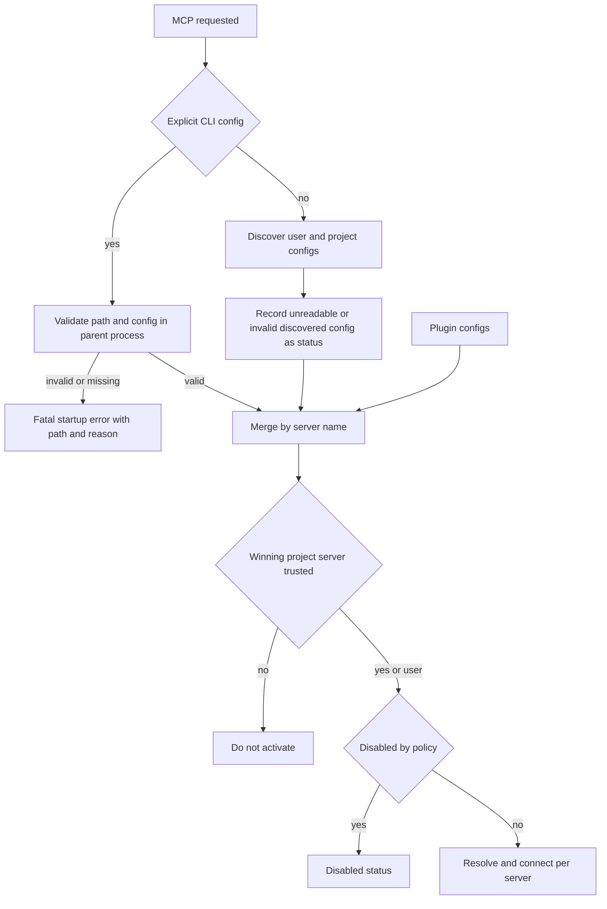
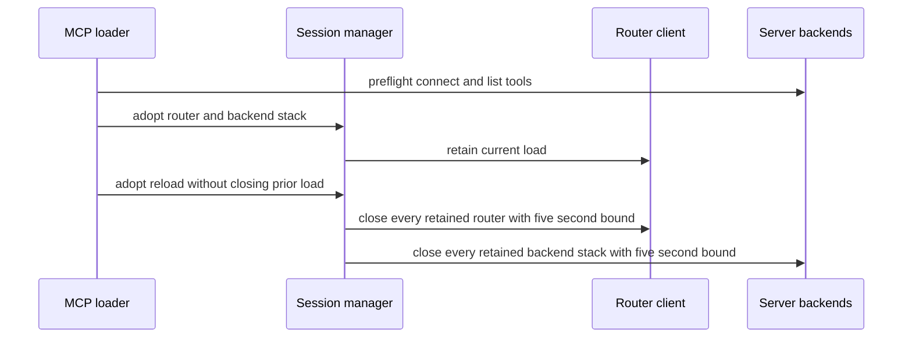
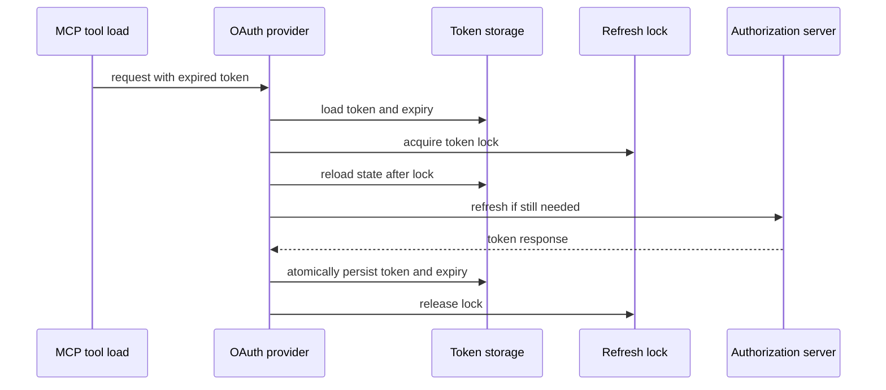
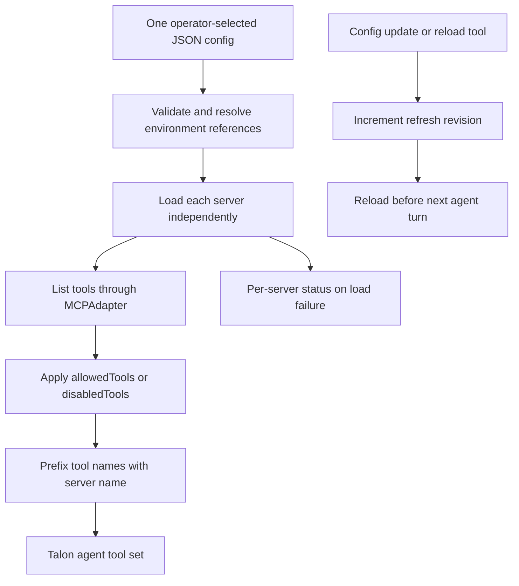

# MCP Integration

MCP configuration is executable integration input: a stdio entry starts a local command, while a remote entry may interpolate values into a URL or headers. dcode therefore separates configuration discovery and project trust, disabled-server policy, environment construction, connection lifecycle, OAuth login, and tool-call failure handling. An explicit configuration is operator-selected; it does not make a repository configuration self-authorizing.

## Discovery, precedence, and trust

`resolve_and_load_mcp_tools()` is the runtime entry point. Unless `no_mcp` is set, it searches the selected profile's user `.mcp.json`, then `<project-root>/.deepagents/.mcp.json`, then `<project-root>/.mcp.json`, in ascending precedence. Definitions merge by server name, so later layers win. Plugin layers and an explicit configuration can add later layers, with the explicit configuration highest.

The winning definition retains its origin for trust evaluation. Project trust is evaluated *after* precedence: whole-project trust or a matching, definition-bound persisted approval can enable a project server, but an explicit denial wins. Remote fixed-URL approvals can use the Git common directory and cover linked worktrees; local commands and environment-dependent remote definitions remain exact-worktree scoped. An unreadable trust policy disables whole-project trust.

This flow distinguishes an operator-selected explicit file, which is validated before the server subprocess starts and fails startup on error, from discovered user/project files, whose read and parse failures become visible error entries while usable servers continue. Precedence still selects the winning definition before project trust and disabled-server policy decide activation.

The separate `[mcp].disabled_servers` store persists names in user configuration. A name disables every same-named winning definition and is filtered before connection, though metadata keeps it visible in the UI. User and managed denies are combined; an unreadable managed deny policy disables all servers rather than allowing an uncertain configuration.

For the client/server launch path, `_preflight_validate_mcp_config()` calls `load_mcp_config()` before environment serialization, workspace scaffolding, or `langgraph dev` startup. It preserves `MCPConfigError`, maps a missing file and JSON/shape `ValueError` or `TypeError` to a path-bearing `MCPConfigError`, and deliberately does not relabel an unrelated `RuntimeError` as configuration input. `no_mcp` or no explicit path bypasses this preflight. The child graph repeats the normal explicit load; preflight improves the error reported to the operator rather than changing configuration authority.

## Environment inputs and project dotenv restrictions

MCP interpolation reads dcode's active environment, which can be a construction-scoped immutable snapshot rather than the process-global `os.environ`. This lets server construction use the environment selected for its workspace while keeping that selection local to the construction context.

A repository `.env` is deliberately not a project-MCP trust channel. Project dotenv discovery starts at the workspace and walks upward, and is enabled by default. `startup.read_project_dotenv` can disable only that project file; its precedence is managed policy, process environment, trusted global `~/.deepagents/.env`, `config.toml`, then the default. The toggle itself cannot be injected by either dotenv file. If the global dotenv cannot be read while it could have contained the user's opt-out, dcode skips the project dotenv rather than assuming permission to load it.

Values from a project `.env` can supply ordinary configuration inputs, including values referenced by an MCP definition, but they cannot inject process-execution keys such as `PATH`, dynamic-loader settings, interpreter startup/path settings, shell hooks, or Git configuration injection. They also cannot set the project-MCP allow/deny environment policy, MCP tool timeout, extension trust, auto-classifier controls, or other user-level capability and approval decisions. Those restrictions prevent a cloned repository from pairing `.env` with `.mcp.json` to self-approve a command, SSRF target, or interpolated header. Shell exports and the trusted global dotenv remain eligible sources where the relevant option allows them.

## Activation, connection, and status

`resolve_mcp_server_env` deep-copies one server definition and expands only braced `${VAR}` and `${VAR:-default}` references in `command`, `url`, `args`, `env`, `headers`, and `oauth`. The `:-` default is used for both unset and empty variables. Resolution occurs per server at activation: malformed references, unset required values, and invalid supported-field types fail that server rather than invalidating siblings. Slack app credentials in `oauth` are additionally restricted to `auth: oauth` Slack endpoints and to a `client_id` with an optional safe `client_secret`.

After validation, dcode performs stdio or remote preflight, builds a FastMCP transport, connects, and lists tools. Setup, connection, schema adaptation, and tool construction are isolated and concurrency-bounded per server. Failure details are redacted when the raw configuration contained interpolation, preventing resolved secret values from being surfaced.

Connected backends are mounted behind a FastMCP router. dcode routes the adapter through a hexadecimal server namespace, then exports a provider-safe `<server>_<tool>` name: unsafe characters are normalized and overlong or altered names receive a deterministic hash within the 64-character limit. It resolves collisions deterministically independent of configuration order and records the original server and tool identity in metadata, so schema lookup and later filtering do not depend on the exported name.

A server can specify exactly one non-empty list of `allowedTools` or `disabledTools`. Entries are literal names or `fnmatch` globs and match the original bare name as well as the prefixed/exported form; unmatched entries warn but do not fail startup, allowing a server version to change its tool list. Filtering happens after adaptation and before the server's `MCPToolInfo` metadata is published.

`MCPSessionManager` owns retained router/backend loads: a reload does not close an older adopted load, so in-flight calls survive; cleanup closes the router and backend stack for every retained load with a five-second per-resource bound and continues after ordinary failures. A stateless load uses its initial sessions only for discovery, cleans them up, and replaces each adapted tool coroutine with a wrapper that loads the owning server afresh for each invocation and cleans that temporary manager in `finally`. In server-graph construction, discovery is requested as stateless but passes the shared manager; that external ownership takes precedence, so the connected load is retained by the server-owned manager rather than being torn down or converted to a per-call wrapper.

This lifecycle shows why a reload preserves older resources for in-flight tools and why shutdown is bounded and best-effort across all adopted loads.

`MCPServerInfo` is the loader-to-UI contract. Only `ok` can carry tools and no error. Other states represent unauthenticated, `awaiting_reconnect`, error, or disabled servers; `pending_reconnect` is valid only on a disabled entry. The tool catalog and `/mcp` viewer consume this metadata to surface unavailable servers and OAuth or reconnect actions.

## Tool-call boundary: arguments, timeout, cancellation, and retry

Tool adaptation applies `normalize_mcp_arguments` directly to the adapted coroutine, and agent middleware applies it again at the generic tool-call boundary. For an optional string-like, ambiguous, or undeclared parameter, an empty string is removed so the MCP server sees omission. Required fields, `None`, and explicitly non-string typed fields remain unchanged.

Every marked MCP tool call receives `MCPToolMiddleware`; non-MCP tools pass through. The middleware obtains `mcp.tool_timeout` through the normal configuration resolver. The default is 120 seconds; accepted finite float values are bounded to 1–900 seconds, and invalid values fall through to a lower-precedence source or the default. The option is available as `[mcp].tool_timeout` and `DEEPAGENTS_CODE_MCP_TOOL_TIMEOUT`.

A timeout returns a failed `ToolMessage` naming the server, tool, and deadline. It warns that the operation may still be running at the server and that retrying may duplicate work—timeout is not proof that the remote side did nothing. `asyncio.CancelledError` is not converted to a tool error and propagates. Existing `ToolException` content is preserved. A nested `MCPReauthRequiredError` is converted to an actionable failed tool message that directs the user to login.

The backend proxy has a related but distinct recovery policy. On a closed or disconnected transport it serializes forced invalidation of that backend but **does not replay** the operation, because it may have completed. It returns an error asking the user to verify the outcome before retrying. If disconnect cleanup reveals a reauthentication failure, that login error is returned instead.

The timeout middleware is attached to both the primary agent stack and every delegated subagent stack when MCP tools are present. In the primary stack it is ordered inside the server-hooks wrapper, allowing timeout failures to participate in `PostToolUseFailure`.

## OAuth lifecycle, login, and provider policies

`FileTokenStorage` isolates credentials by a path-safe server identity and effective endpoint. It keeps token, client registration, OAuth metadata, and expiry in private atomically replaced files, and moves blocking storage work off the event loop. `_ExpiryAwareOAuthClientProvider` restores stored expiry and metadata and serializes refresh through a cross-process sidecar lock. After acquiring that lock it reloads credential state; if it cannot obtain the lock, it avoids an unlocked refresh that could reuse a rotating refresh token.

This is the refresh critical section: the post-lock reload prevents reuse of a refresh token another process may have rotated.

Runtime loading is non-interactive. Missing configured OAuth credentials, failed refresh, and authentication challenges become an unauthenticated server result; the provider raises `MCPReauthRequiredError` instead of prompting in an agent execution path. A configured static `Authorization` header takes precedence over stored OAuth credentials. Explicit OAuth with no stored token is reported as unauthenticated without connecting.

`dcode mcp login` resolves an explicit configuration alone or follows normal precedence and trust-gated discovery. Login is supported for remote `http` and `sse` transports, including servers discovered through a 401 challenge. Re-login hides existing tokens from the authorization flow instead of deleting them, preserving a prior credential if the new authorization is abandoned or fails. CLI and Textual presentation share the `OAuthInteraction` boundary for browser, callback or paste-back, and device-code steps. After successful Textual login, the server enters `awaiting_reconnect`, because the running agent still retains its prior tool construction.

Provider-specific behavior is an extension seam. `resolve_provider()` chooses the first URL-matching provider from an ordered registry (`SlackProvider`, `GitHubProvider`, then `GenericProvider`). The Slack provider can be constructed with validated app credentials from configuration. Policies supply client metadata, control loopback callback support, and may perform pre-handshake login work; `GenericProvider` is the final fallback for spec-compliant servers.

## Talon: a separate, operator-selected integration model

Talon is an experimental runtime. Unlike dcode, it has **one** MCP configuration: `DEEPAGENTS_TALON_MCP_CONFIG` from Talon's runtime environment or the process environment, otherwise `~/.deepagents/.mcp.json`. There is no project discovery, layer merge, or dcode-style project-trust decision. The file must contain `mcpServers`; each name is constrained to letters, digits, `_`, and `-`, and Talon resolves braced environment references against the runtime environment before the process environment. A missing configuration file simply produces no MCP tools.

This is Talon's single-file load path; an individual server failure becomes status metadata rather than preventing healthy servers from loading.

`MCPToolProvider` owns that load/reload boundary. It serializes reloads with an async lock and revision counters, and only reloads after a requested change (unless a forced reload is requested). It adds `get_mcp_server_status`, `authenticate_mcp_server` when an OAuth server exists, `reload_mcp_configuration`, and configuration-management tools. A successful reload changes capabilities for a later turn; running tasks retain their original tool set. MCP tool names are prefixed as `<server>_<tool>`, marked as Talon MCP tools, sorted, and then optionally selected by one of mutually exclusive `allowedTools` or `disabledTools` glob lists. Tool-name collisions with Talon's management tools fail the load.

Talon applies a 30-second budget while listing one server's tools and continues to the next server on a recognized connection, OAuth, validation, or timeout failure. It reports `ok`, `unauthenticated`, or `error` metadata and maintains the invariant that only `ok` has tools. Standard loading is non-interactive: an OAuth server without stored credentials becomes `unauthenticated` and directs the operator to `deepagents-talon mcp login <server>`.

### Talon configuration ownership and trust boundary

The provider's `MCPConfigStore` exposes `get_mcp_configuration` and `update_mcp_server` rather than asking the agent to read or edit the file. Reads redact strings except transport/auth enums and exact `${ENV_VAR}` references; writes use an HMAC-derived revision compare-and-swap, a bounded POSIX sidecar lock, and atomic replacement. Updates normally require the Talon approval policy. If an auto-approved update restores a `<redacted>` stored value, it may change only tool filters: a changed command, transport, URL, headers, or other managed execution/routing field is rejected so a secret cannot silently be reused against a new command or endpoint. Unmanaged fields are preserved but not shown.

This mediation is **not** a confidentiality boundary. Talon's default shell backend can read an absolute configuration or token path, so files located inside the agent workspace are warned about, not blocked. Use `${ENV_VAR}` references or an OS/process boundary that makes the secret unreadable by the agent process when confidentiality is required. Talon additionally rejects dangerous stdio environment overrides such as `LD_PRELOAD` and `PYTHONPATH`; remote OAuth cannot be combined with an `Authorization` header.

### Talon OAuth and channel interaction

Talon stores tokens under `~/.deepagents/mcp-tokens`, using a server-name plus endpoint-derived identity (and explicit OAuth settings when supplied), owner-only directories/files, a sidecar lock, and atomic writes. Refresh responses that omit a refresh token retain the stored refresh token; a fresh authorization grant deliberately does not carry it forward. Token reads and writes run off the event loop.

An interactive `deepagents-talon mcp login <server>` forces authorization for a remote SSE or streamable HTTP server. In a channel-driven agent run, the narrow `authenticate_mcp_server` tool binds authorization events to the active invocation and channel handler; it avoids an unnecessary flow when credentials already work, unless the user explicitly requests reauthentication. Completion schedules a reload. A scheduled job or background subagent without a conversation handler cannot prompt for OAuth and receives an instruction to authorize from chat or use the CLI. Authorization completion is retained even if session teardown subsequently reports a sibling error.

## Operations and focused tests

For dcode, use `--no-mcp` to suppress all MCP loading, `--mcp-config PATH` to select an explicit configuration, and `--trust-project-mcp` only when project definitions should receive whole-project trust. `dcode mcp config` displays the discovery paths without opening configuration files. Use `dcode mcp login <server>` or `/mcp login <server>` for authentication, then reconnect or restart to construct tools with the newly stored token.

For Talon, set `DEEPAGENTS_TALON_MCP_CONFIG` to select the single JSON configuration (otherwise use `~/.deepagents/.mcp.json`), inspect it through the management tool where available, and use `deepagents-talon mcp login <server>` for a remote OAuth flow. Treat a configuration change as a capability change: schedule or force reload, then verify it through Talon's agent-tool/status capabilities before relying on it.

Focused dcode tests cover environment expansion (including immutable input and Slack OAuth credential validation), token-file isolation, privacy, expiry, atomic/off-event-loop persistence, and refresh-state restoration. Configuration tests should also cover the project-dotenv deny lists and the `startup.read_project_dotenv` fail-closed path, because a regression there can turn repository content into MCP trust or process-execution input. Runtime tests cover per-server load isolation, argument normalization, configured timeout output, cancellation propagation, reauthentication conversion, no-replay disconnect recovery, and timeout propagation through custom, general-purpose, and forked delegated agents. Talon's MCP tests cover configuration validation and redaction, revision conflicts and approval-sensitive updates, isolated server load failures, reload scheduling, tool filtering, OAuth status/login, and credential persistence.

## Related pages

- [Code agent architecture](/openwiki/architecture/code-agent.md)
- [Configuration layering](/openwiki/concepts/config-layering.md)
- [Talon integration](/openwiki/integrations/talon.md)
- [Security operations](/openwiki/operations/security.md)
