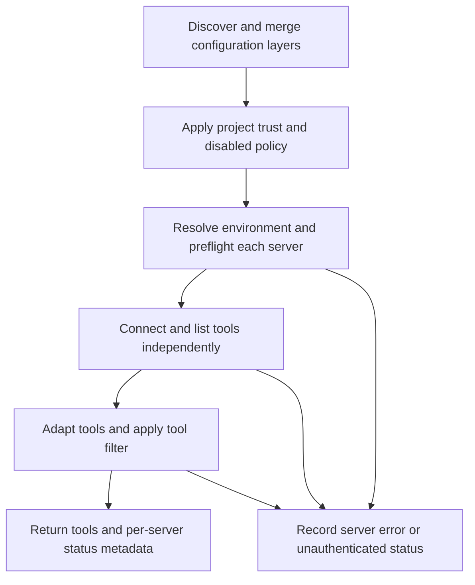
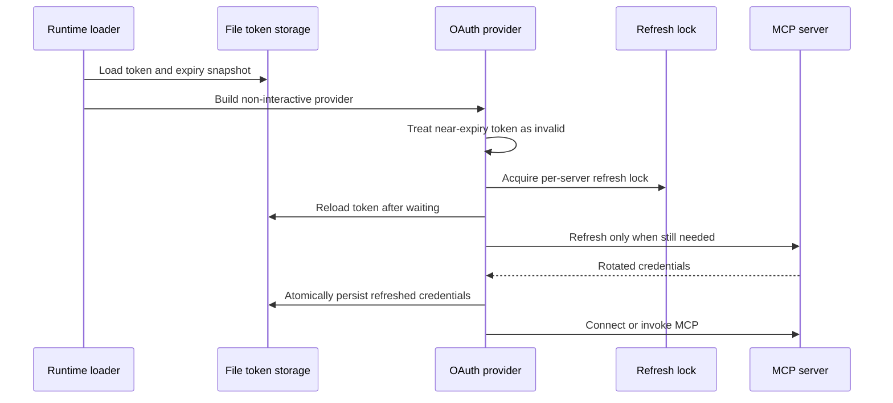

# MCP Integration

An MCP configuration can start a local process or direct authenticated requests to a remote endpoint. dcode consequently treats it as executable, security-sensitive input. Its integration boundary separates **where a definition comes from and whether it is trusted** from server activation, credential handling, tool adaptation, and the session that owns live connections.

## Configuration, precedence, and trust

`resolve_and_load_mcp_tools()` is the runtime entry point. In ascending precedence it discovers the selected profile's user `.mcp.json`, `<project-root>/.deepagents/.mcp.json`, and `<project-root>/.mcp.json`; definitions merge by server name, so a later definition replaces an earlier one. Plugin layers can contribute additional definitions, while `--mcp-config` is the highest-precedence, explicitly selected layer. Failure to load that explicit file is fatal; failures in discovered files become visible configuration-status errors and do not prevent usable sibling servers from loading.

Project definitions are not trusted merely because they were discovered. After precedence chooses the winning definition, dcode applies the user-owned project-server policy: a matching scoped approval or whole-project trust can allow a server, an explicit deny wins, and an unreadable policy refuses whole-project trust. This ordering matters: an approval for a lower-precedence definition cannot authorize a changed definition that shadows it.

The same boundary applies to remote servers: an untrusted project entry could exfiltrate an environment value through a header or target an internal endpoint before a tool is ever exposed. Plugins are an exception in provenance—installing a plugin is treated as the user's trust decision for its bundled servers—but user deny policy still applies and unreadable policy fails closed.

`[mcp].disabled_servers` is a persistent, name-based deny list applied after merging. A disabled name prevents connection for every same-named configuration but remains visible as a `disabled` `MCPServerInfo` row. If managed deny policy cannot be read, dcode disables every merged server rather than risk starting one that policy forbids.

### Environment is not a trust channel

`resolve_mcp_server_env()` deep-copies a server definition and expands only `${VAR}` and `${VAR:-default}` in `command`, `url`, `args`, `env`, `headers`, and `oauth`. Bare `$VAR` is literal; malformed braced syntax and an unset required value stop activation of that server. The default form also applies when the variable is set to an empty value. Supported-field types are checked as part of this pass; Slack app OAuth settings receive additional validation.

A repository's `.env` cannot use this mechanism to grant itself authority. Project dotenv loading is controlled by `startup.read_project_dotenv` and resolved before the project file with managed, process-environment, trusted-global-dotenv, TOML, and default precedence. Project dotenv values that affect execution or project-MCP approval/trust are blocked, and an unreadable global dotenv causes dcode to skip the project dotenv.

## Activation and isolated server outcomes

After policy and validation, dcode resolves each server independently. It preflights stdio configurations, builds a transport, connects, lists tools, adapts schemas, and applies tool filtering. A failure in environment resolution, preflight, connection, or tool construction produces a per-server `MCPServerInfo` outcome rather than abandoning other servers. Details are redacted when the raw definition used environment interpolation, avoiding an error path that echoes a resolved secret.

The resulting statuses are operational input as well as display data:

- `ok` has an authoritative tool list.
- `unauthenticated` means OAuth must be completed before its tools load.
- `error` records an activation/configuration failure.
- `disabled` records a persisted user disable without attempting a connection.
- `awaiting_reconnect` is a TUI-only transitional state after successful login but before the local LangGraph server has rebuilt its tool set.

Remote activation chooses a static `Authorization` header over OAuth. Otherwise dcode uses explicit `auth: "oauth"` configuration or previously stored OAuth credentials. An explicit OAuth server with no stored token is marked unauthenticated without attempting a connection; routine loading never opens a browser or prompts. Conversely, a remote server that returns an OAuth challenge, or whose refresh token has failed, is classified as unauthenticated with a login remedy instead of as an opaque connection error.

Exported tool names are deterministic and provider-safe (normally derived from server and tool names), while metadata retains the original identities. A server may specify exactly one non-empty `allowedTools` or `disabledTools` filter. Entries can be literals or globs and match either original or exported names; an unmatched entry warns but does not block startup.

*Activation failures are contained at the server boundary, so successful servers can still supply tools and every skipped server has status metadata.*

## OAuth: interactive login and safe refresh

`FileTokenStorage` persists tokens, client registration, public OAuth metadata, and an absolute `expires_at` sidecar under the selected profile's state directory. The token-file name includes the safe server name plus a hash of the resolved endpoint (and configured OAuth client ID when present), so same-named servers at distinct endpoints do not share credentials. Writes serialize same-file mutations, use atomic replacement, and create the token file with user-only permissions on platforms that support them. Token values must not be included in logs or raw exception formatting.

On a cold start, `_ExpiryAwareOAuthClientProvider` restores the persisted expiry and metadata that the upstream provider would otherwise omit. A token within 30 seconds of expiry is treated as needing refresh, allowing a refresh-token grant before a stale bearer token generates a 401. Missing legacy expiry data is conservatively treated as expired when a refresh token exists.

Refresh is serialized across processes and provider instances by a sibling lock file. Once the lock is acquired, the provider rereads storage because another process may have rotated the refresh token while it waited; it refreshes only if the reloaded token still needs it. A lock timeout or lock error deliberately avoids an unlocked refresh-token replay and falls through to reauthentication behavior. This protects providers that rotate refresh tokens and revoke a token family when a token is reused.

*The refresh lock covers the grant and the provider reloads credentials after acquiring it, preventing two processes from replaying a rotating refresh token.*

`dcode mcp login <server>` is the interactive credential entry point for HTTP and SSE servers. Login resolves the same config view and trust gate as runtime loading; auto-discovery excludes untrusted project entries, while `--mcp-config PATH` selects one explicitly trusted file. It resolves environment values before locating storage, so the credential identity uses the effective URL. Explicit login hides an existing token during the handshake so that it actually reauthorizes rather than reporting a silent success using old credentials. Browser loopback login can fall back to displaying an authorization URL and accepting a pasted callback URL when no usable browser or callback server is available.

The `dcode mcp login` command without a server is a status scan: it lists OAuth servers with no stored token, not merely expired ones. It returns success when every state was determined (including a nonempty “needs login” list), returns failure when token/config state is unreadable or incomplete, and returns 2 when no configuration file exists. `dcode mcp config` only displays the three discovery paths and their existence; it does not open configuration files or trigger trust interaction.

## TUI lifecycle and normal versus session execution

In the normal local TUI, `/mcp` opens `MCPViewerScreen`, a read-only server/tool viewer that prioritizes unauthenticated and reconnect-pending entries. Selecting a login-capable remote server starts the in-app OAuth flow; F2 persists a disable/enable change, and Ctrl+R requests a reconnect. The viewer offers login only when OAuth actually backs the connection, avoiding a misleading reauthorization action for a static `Authorization` header.

A successful TUI login writes credentials but cannot mutate the tools of an already-running LangGraph server. dcode marks the server `awaiting_reconnect` and offers a reconnect; it may restart immediately when idle or defer the restart until an active agent or shell task completes. A user can explicitly defer and later run `/mcp reconnect`, and `/mcp reconnect force` is the confirmation-gated escape hatch for stale configuration or tokens written in an earlier session. The TUI refuses in-app login against a remote server because it does not own a server process that can reload the resulting tools; the operator must relaunch locally.

Runtime connection ownership is intentionally different by execution mode. `MCPSessionManager` retains adopted FastMCP router/backend resources across reloads so in-flight calls keep their resources; cleanup is bounded and best-effort across all retained loads. A truly stateless load discards its discovery manager and wraps each tool so it reconnects its owning server for every invocation. An externally supplied manager takes precedence over stateless conversion.

The local LangGraph server uses that latter combination: discovery is stateless, but a process-wide manager bound to the server event loop lazily owns real invocation sessions. This avoids transferring event-loop-bound connections from startup discovery while retaining server-loop connections for use. Headless/non-interactive loading similarly never permits an OAuth browser or stdin reauthorization prompt: refreshable stored credentials can refresh, while a missing or unrecoverable credential becomes an actionable unauthenticated server outcome. In CI, grant project MCP trust explicitly before allowing repository-provided definitions.

## Operations and focused tests

Use `--no-mcp` to suppress loading, `--mcp-config PATH` for a selected configuration layer, and `--trust-project-mcp` only after reviewing project definitions. Use `dcode mcp config` to inspect discovery locations, `dcode mcp login` to list missing OAuth logins, and `dcode mcp login <server>` (or `/mcp login <server>` in the local TUI) to authorize a remote server. Restart/reconnect after login or a disable toggle before expecting the active tool list to change.

Focused coverage includes `client/commands/test_mcp.py` for CLI parser/config resolution, trust-gated login selection, list exit behavior, resolved URL identity, and corrupt-token reporting. `test_mcp_auth.py` covers token-file permissions and isolation, atomic/concurrent persistence, expiry sidecars, cold-start refresh behavior, cross-process refresh locking, OAuth discovery/reauthentication, and token-safe failures. `test_main.py` exercises main entry-point dispatch; MCP lifecycle and loader behavior are covered with the runtime tests that exercise `resolve_and_load_mcp_tools()` and server-graph construction.

## Related pages

- [Configuration layering](/openwiki/concepts/config-layering.md)
- [Permissions and HITL](/openwiki/concepts/permissions-hitl.md)
- [Plugins](/openwiki/concepts/plugins.md)
- [ACP integration](/openwiki/integrations/acp.md)
- [Security operations](/openwiki/operations/security.md)
- [Testing guide](/openwiki/testing/testing-guide.md)
- [Run a dcode session](/openwiki/workflows/run-dcode-session.md)
