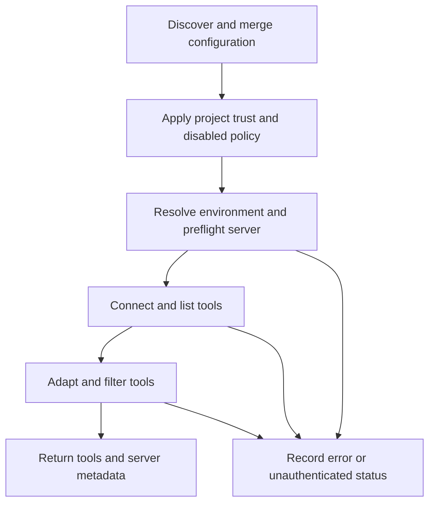
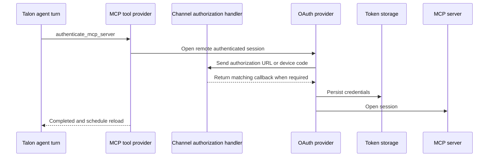

# MCP Integration

MCP configuration is security-sensitive: it can launch a local program, make remote requests, and attach credentials. dcode and Talon both turn configured servers into LangChain tools, but have different configuration ownership and interaction models. dcode layers user, project, plugin, and explicit configuration behind project trust controls; Talon uses one operator-selected configuration and exposes narrow management tools for it.

## dcode: configuration provenance, trust, and activation

`resolve_and_load_mcp_tools()` discovers the selected profile's user `.mcp.json`, then `<project-root>/.deepagents/.mcp.json`, then `<project-root>/.mcp.json`, merging by server name in ascending precedence. Plugin layers can add servers and `--mcp-config` is the highest-precedence source. An explicitly selected file failing to load is fatal; discovered-file failures become per-source status errors so usable siblings can still load.

Project definitions are not trusted merely because they are found. Once precedence chooses the definition, the user-owned project policy may allow it through a matching scoped approval or whole-project trust; an explicit deny wins. If the policy cannot be read, whole-project trust is unavailable. This ordering prevents an approval of a lower-precedence definition from approving a changed definition that shadows it. Plugin installation supplies provenance trust for bundled servers, but user deny policy still applies.

`[mcp].disabled_servers` is a persistent name-based deny list. It skips connection for every same-named definition while retaining a `disabled` `MCPServerInfo` row; an unreadable managed deny policy disables every merged server. Use `--no-mcp` to suppress loading and `--trust-project-mcp` only after reviewing project-provided definitions.

### Environment is not a trust channel

`resolve_mcp_server_env()` deep-copies the server definition and expands only `${VAR}` and `${VAR:-default}` references in `command`, `url`, `args`, `env`, `headers`, and `oauth`. Bare `$VAR` is literal. Malformed references or an unset required value fail that server's activation.

A repository `.env` cannot self-authorize MCP. `startup.read_project_dotenv` is decided before project dotenv loading using managed, process-environment, trusted-global-dotenv, TOML, and default precedence. Project dotenv values affecting execution and project-MCP approval/trust are blocked, and an unreadable global dotenv causes dcode to skip the project dotenv.

After policy, dcode resolves each server independently: preflight stdio, build a transport, connect, list tools, adapt schemas, then filter tools. Environment-resolution, preflight, connection, and adaptation failures become per-server `MCPServerInfo` outcomes rather than aborting sibling servers. If the raw configuration interpolated environment values, failure detail is redacted to avoid echoing a resolved secret.

Remote activation prefers a static `Authorization` header over OAuth. Otherwise explicit OAuth configuration or a stored OAuth token is used. An explicit OAuth server without a stored token is marked `unauthenticated` without a connection attempt, and routine loading never opens a browser or prompts. OAuth challenges and unusable refresh credentials likewise lead to an actionable unauthenticated outcome.

Exported tool names are deterministic and provider-safe while metadata retains the original tool identity. A server can have exactly one non-empty `allowedTools` or `disabledTools` filter; literal and glob entries match original or exported names. Unmatched entries warn but do not block startup.

*Each dcode server is activated in isolation, so a failed server reports status without withdrawing tools loaded from other servers.*

## dcode OAuth and session lifecycle

`FileTokenStorage` stores OAuth credentials, client registration, public OAuth metadata, and an absolute `expires_at` sidecar in the selected profile state directory. Its file identity combines a safe server name with a hash of the resolved endpoint and configured client identity, separating same-named servers at different endpoints. Writes serialize mutations, atomically replace the file, and attempt user-only permissions. Do not log tokens or exceptions that may render token objects.

The expiry-aware provider restores persisted expiry and OAuth metadata, treats a token near expiry as refreshable, and schedules refresh before expiry. A cross-process per-token-file lock serializes refresh grants. After acquiring it, the provider rereads storage and refreshes only if still needed, avoiding reuse of a rotating refresh token; lock failure avoids an unlocked replay and falls through to reauthorization behavior.

`dcode mcp login <server>` is the interactive entrypoint for remote HTTP/SSE transports. It resolves the effective, trust-gated configuration and environment before deriving storage identity. Forced login does not delete a working token but hides it for the first read, forcing a new authorization flow. Browser/loopback handling can fall back to showing an authorization URL and accepting a pasted callback. Bare `dcode mcp login` lists OAuth servers with no stored token and has distinct exit behavior for indeterminate state; `dcode mcp config` only reports discovery paths.

The local `/mcp` viewer provides OAuth login, persistent disable toggles, and reconnect requests. After a successful login it marks tools `awaiting_reconnect`, then restarts the app-owned LangGraph server immediately or after active work completes; it refuses login against a remote server it cannot restart.

`MCPSessionManager` retains FastMCP router/backend resources across reloads so in-flight tools retain their resources, and performs bounded best-effort cleanup. A truly stateless load releases discovery resources and reconnects the owning server on every tool invocation; an externally supplied manager takes precedence. The LangGraph server preloads metadata for the TUI, then uses stateless discovery with a process-wide manager bound to the server event loop for lazy invocation sessions. Headless loading is non-interactive: missing or unrecoverable credentials remain an unauthenticated outcome rather than causing a browser or stdin prompt.

## Talon configuration and tool loading

Talon is an experimental runtime. It reads one JSON `mcpServers` object from `DEEPAGENTS_TALON_MCP_CONFIG` in Talon's configured or process environment, or `~/.deepagents/.mcp.json` by default. A missing file yields no MCP servers. The whole document, server names, and enabled flags are validated before connecting; enabled definitions expand `${NAME}` and `${NAME:-default}` in command/URL, arguments, environment, and headers using the Talon environment first and then the process environment. Disabled entries are neither expanded nor connected.

Talon accepts `stdio`, `sse`, and streamable HTTP (`http` aliases to streamable HTTP). A stdio server must provide a command and string arguments; it cannot set execution-affecting environment variables such as `LD_PRELOAD`, `PYTHONPATH`, or `BASH_ENV`. Remote servers require a URL and string headers. An `Authorization` header cannot be combined with OAuth, and only `auth: "oauth"` is supported. Server-specific load failures—including the 30-second tool-list timeout—are recorded as `error` or `unauthenticated`, allowing sibling servers to load.

Discovered tool names are prefixed as `<server>_<tool>`, marked with `_deepagents_talon_mcp`, optionally marked skill-only, filtered through exactly one `allowedTools` or `disabledTools` list, and sorted. `MCPServerInfo` enforces that only `ok` rows can carry tools and errors, while non-OK rows require an error and cannot carry tools. Status is exposed through `get_mcp_server_status` without server error text.

`MCPToolProvider` owns the current OAuth-capable server set and supplies discovered tools plus management capabilities: `get_mcp_server_status`, `authenticate_mcp_server` when relevant, `reload_mcp_configuration`, and the configuration-store tools. It rejects a result that collides with a management-tool name. A refresh request increments a revision; serialized `refresh_if_needed()` reloads once for an unapplied revision. Cancellation leaves the revision pending for retry, while a failed reload is recorded as applied rather than retried indefinitely.

### Mediated configuration changes

`get_mcp_configuration` returns a redacted managed-field view and an HMAC revision, not file contents. Strings are `<redacted>` except transport/auth enum values and exact `${ENV_VAR}` references; references are never expanded. `update_mcp_server` uses that revision to add, replace, or remove one server. It performs a POSIX no-follow regular-file read, takes a bounded sidecar lock, rereads and compares the revision, validates without opening a session, and atomically replaces the file. Stale revisions and lock waits are conflicts; successful writes only schedule a reload, so tools become available after a successful reload before a later turn.

Repeating `<redacted>` at the same location preserves a stored string. When an update is auto-approved, a request that restores a redacted value may change only `allowedTools` or `disabledTools`; changing another managed routing/execution field is rejected because it could redirect an unseen credential. Unknown hand-authored fields remain hidden from the model but are retained across supported updates. This redaction is not containment: the execution-capable default shell can still read files available to the Talon process. Keep secret values in environment references whose values are unavailable to the agent, or use OS-level isolation/a sandbox; placement under the agent workspace only emits a warning.

## Talon OAuth, channel authorization, and unattended work

Talon `FileTokenStorage` keeps cleartext OAuth tokens, absolute expiry, and client registration in `~/.deepagents/mcp-tokens`, with a filename hashed from endpoint plus non-default OAuth configuration. Directories are tightened to `0700`, token files to `0600`, and writes are locked, fsynced, and atomically replaced. A refresh response that omits a refresh token preserves the existing refresh token, but a fresh interactive grant replaces it rather than retaining a possibly revoked prior grant.

The OAuth provider restores persisted expiry. OAuth discovery, registration, device authorization, and refresh use a proxy-ignoring guarded HTTPS client: endpoints must pass SSRF validation, redirects are rejected, OAuth responses are size-limited, and metadata issuer/endpoints are validated before credentials are sent. Device flow is used when discovered support and a suitable public client permit it; otherwise the authorization-code flow sends a URL and requires a callback matching the configured loopback redirect URI.

`deepagents-talon mcp login <server>` is terminal-interactive, forces authorization without deleting a saved token, and only accepts remote SSE or streamable HTTP. It treats a device-flow completion marker as success even if session teardown also reports an error after credential persistence; safe error formatting avoids exposing OAuth/network details.

Within an admitted Talon channel turn, `authenticate_mcp_server` binds OAuth prompts to the injected tool-call ID. It returns `already_authenticated` when existing credentials open a session, and only reauthorizes on an explicit request. Authorization URL, callback, device-code, completion, and failure events are delivered through the current channel authorization handler. If credentials were persisted, Talon schedules a reload even when later session teardown fails; cancellation still propagates after completion.

Unattended jobs and background subagents have no authorization handler. They cannot solicit a browser URL, callback, or device code: the flow fails with an error identifying the absent conversation and naming `deepagents-talon mcp login <server>` as the remedy. This complements channel admission: only an admitted, attended channel has the handler needed to authorize MCP access.

*Channel authorization is bound to a tool invocation; without a current handler, Talon rejects rather than initiating an unattended OAuth interaction.*

## Operations and focused verification

For dcode, inspect configuration with `dcode mcp config`, list missing OAuth logins with `dcode mcp login`, and authorize with `dcode mcp login <server>`. Reconnect or restart after changing authorization or disabled state. For Talon, use `deepagents-talon mcp config`, `deepagents-talon mcp login <server>`, and the scheduled reload/status tools; verify activation after reload because running tasks retain their original tool snapshot.

dcode command tests cover trust-gated resolution, login-list exits, resolved URL identity, and corrupt token reporting. Its OAuth tests cover isolation, permissions, concurrent persistence, expiry, and refresh. Talon MCP tests cover configuration selection and interpolation, per-server failure isolation, transport and stdio restrictions, filtering, status invariants, reload revision behavior, channel-auth completion/failure handling, and safe login errors. Talon OAuth tests cover credential permissions/isolation, persisted expiry, refresh-token preservation, device and authorization-code flows, callback validation, SSRF-safe endpoint discovery, no redirects, proxy isolation, bounded DNS resolution, and unattended authorization failure.

## Related pages

- [Talon Channel Admission](/openwiki/concepts/talon-channel-admission.md)
- [ACP integration](/openwiki/integrations/acp.md)
- [Talon Runtime Integration](/openwiki/integrations/talon.md)
- [Security operations](/openwiki/operations/security.md)
