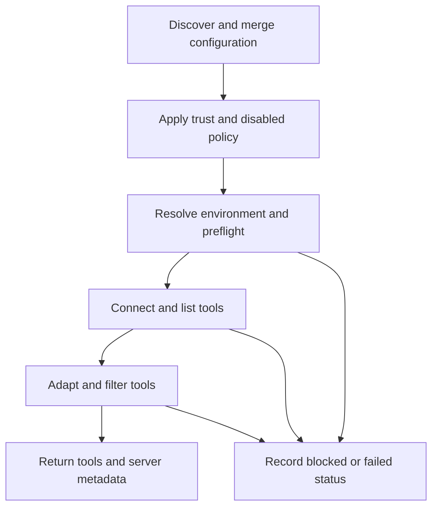
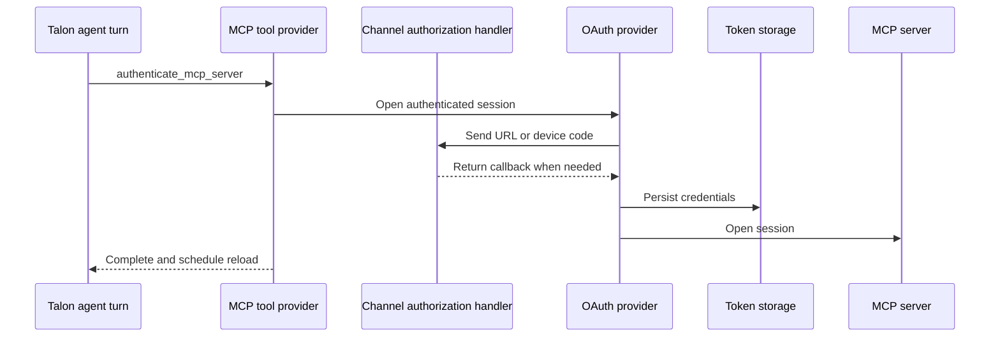

# MCP Integration

MCP configuration is security-sensitive: it can launch a local program, make remote requests, and attach credentials. dcode and Talon both turn configured servers into LangChain tools, but their configuration ownership and interaction models differ. dcode layers user, project, plugin, and explicit configuration behind project-trust controls; Talon loads one operator-selected configuration and offers narrow management tools for it.

> Discovery, provenance, project trust, environment interpolation, redaction, workspace placement, and sandbox choice are **not OS-level authorization boundaries**. They decide what the application will load or reveal; they do not prevent a process that can read a secret or execute a command from using it. Use OS-level isolation, a separate identity, a keyring, or a sandbox whose process cannot read the secret when that protection is required.

## dcode: ownership, precedence, trust, and activation

`resolve_and_load_mcp_tools()` discovers the selected profile's user `.mcp.json`, then `<project-root>/.deepagents/.mcp.json`, then `<project-root>/.mcp.json`; later definitions win by server name. Plugin layers can contribute servers and `--mcp-config` is the highest-precedence source. An explicitly selected file that cannot load is fatal. Discovered-file failures become status entries, allowing independent servers to remain usable.

Project discovery does not itself authorize a server. After precedence selects the winning definition, user-owned project policy can approve it by matching scoped approval or whole-project trust; explicit deny wins. Whole-project trust is unavailable if the policy cannot be read. This order matters: approval of a lower-precedence definition never approves a replacement that shadows it. Plugin installation is a trust decision for bundled servers, but user deny policy still applies.

`[mcp].disabled_servers` is a persistent, name-based deny list. It prevents connection for every same-named definition while retaining a `disabled` `MCPServerInfo` entry; unreadable managed deny policy fails closed by disabling all merged servers. Use `--no-mcp` to suppress loading and `--trust-project-mcp` only after reviewing project-provided definitions.

### Environment interpolation is not a trust channel

`resolve_mcp_server_env()` deep-copies the definition and expands only `${VAR}` and `${VAR:-default}` in `command`, `url`, `args`, `env`, `headers`, and `oauth`. Bare `$VAR` stays literal. The default form applies when the variable is unset or empty; malformed syntax and a missing required value fail that server. Explicit `oauth` settings are restricted to Slack `auth: oauth` servers and to a non-empty `client_id` plus optional non-empty `client_secret` without control characters.

A repository `.env` cannot self-authorize MCP. `startup.read_project_dotenv` is decided before project dotenv loading through managed, process-environment, trusted-global-dotenv, TOML, and default precedence. Project dotenv values that affect execution or project-MCP approval/trust are blocked, and an unreadable global dotenv causes dcode to skip the project dotenv.

After policy is applied, dcode independently resolves environment values, preflights stdio, builds a transport, connects, lists tools, adapts schemas, and filters tools. Environment-resolution, preflight, connection, and adaptation failures become per-server metadata rather than aborting siblings. When raw configuration interpolates environment values, setup, connection, and construction detail is redacted to avoid echoing resolved secrets.

*Each dcode server is activated in isolation, so one failure does not withdraw tools loaded from another server.*

### `MCPServerInfo` status contract

Both runtimes enforce a construction-time invariant: an `ok` row has no error; every non-`ok` row has an error and no tools. dcode statuses are `ok`, `unauthenticated`, `awaiting_reconnect`, `error`, `disabled`, and `untrusted`; Talon has all except `untrusted`. `untrusted` is dcode's representation of a project definition awaiting approval and is intentionally omitted from local-context prompt inventory.

`awaiting_reconnect` is a dcode UI status used after successful OAuth login while the LangGraph server has not reloaded tools. Separately, `pending_reconnect` is a Boolean flag valid **only** on a `disabled` entry: it preserves reconnect guidance when a TUI toggle has re-enabled a server but a reconnect is still required. Do not attach tools or clear the explanatory error before a new load creates an `ok` entry.

Remote activation prefers a static `Authorization` header over OAuth. Otherwise explicit OAuth configuration or a stored token is used. An explicitly OAuth-configured server with no stored token becomes `unauthenticated` without attempting a connection. Routine loading is non-interactive; OAuth challenges and unusable refresh credentials likewise produce an actionable unauthenticated outcome.

Exported dcode names are deterministic and provider-safe, while metadata retains the original tool identity. A definition may use exactly one `allowedTools` or `disabledTools` filter. Literal and glob entries match original or exported names; unmatched entries warn but do not block startup.

## dcode invocation and lifetime boundaries

Production agent stacks install `mcp_tool_middleware()` for MCP calls. It omits empty strings only for optional string-like arguments, preserving required and explicitly non-string values. It applies the bounded `mcp.tool_timeout` wall-clock budget. On timeout it cancels the local await and returns an error `ToolMessage` warning that server-side work may continue, so retry can duplicate work. The wrapper remains inside server hooks, allowing timeout failure policy to observe the failure; `ToolException` is left intact so tool-local actionable errors are not hidden.

`MCPSessionManager` retains FastMCP router and backend resources across reloads so in-flight tools retain their resources, then uses bounded best-effort cleanup. A genuinely stateless load closes discovery resources and reconnects the owning server per tool call; an externally supplied manager wins over that conversion. The LangGraph server preloads metadata for the TUI, then uses stateless discovery with a process-wide, event-loop-bound manager to create backend sessions lazily on invocation.

## dcode OAuth and local UI/reload boundary

`FileTokenStorage` isolates credentials by safe server identity plus resolved endpoint and configured client identity. It persists tokens, public OAuth metadata, client registration, and an absolute expiry sidecar under the selected profile state directory; mutations serialize, replace atomically, and attempt user-only permissions. The expiry-aware provider restores expiry and metadata, schedules refresh before expiry, and uses a cross-process token-file lock. It reloads storage after acquiring that lock before deciding whether to refresh, avoiding reuse of a rotated refresh token.

`dcode mcp login <server>` is the interactive entrypoint for remote HTTP/SSE transports. It resolves effective trust-gated configuration and environment before choosing storage identity. Forced login starts a new flow without deleting a working saved token; browser/loopback handling can fall back to an authorization URL and pasted callback. Bare `dcode mcp login` lists OAuth servers with no stored token and distinguishes indeterminate state in its exit code; `dcode mcp config` reports discovery paths without opening configuration files.

The local `/mcp` viewer shows login-capable servers, persistent disable toggles, error details, and reconnect requests. Following successful login, it records the transitional reconnect state and restarts an app-owned LangGraph server immediately or after active work completes. It refuses login when connected to a remote server it cannot restart. Thus credentials can be persisted successfully while currently running tasks keep their old tool snapshot; a successful reload/restart is what makes newly authenticated tools available.

## Talon configuration, tools, and mediated updates

Talon reads one JSON `mcpServers` configuration selected by `DEEPAGENTS_TALON_MCP_CONFIG` from Talon's environment or the process environment, defaulting to `~/.deepagents/.mcp.json`. A missing file means no servers. It validates the document, server names, and `enabled` flags before connection. Enabled definitions resolve `${NAME}` and `${NAME:-default}` in command/URL, arguments, environment, and headers using the Talon environment before the process environment; disabled entries are copied, not resolved or connected.

Talon supports stdio, SSE, and streamable HTTP (`http` is an alias). Stdio requires a command and string arguments and rejects dangerous execution-affecting environment variables. Remote servers require URL and string headers; OAuth cannot be combined with a static `Authorization` header. A per-server load failure, including the tool-list timeout, is contained as `error` or `unauthenticated`, so siblings can load.

Talon prefixes tool names as `<server>_<tool>`, marks them as Talon MCP tools, optionally marks them skill-only, filters one allow or deny list, and sorts output. `MCPToolProvider` adds status, OAuth authentication, scheduled reload, and configuration-management tools, and rejects name collisions with those management tools. Reload is serialized and revision-based: cancellation leaves work eligible to retry, but a non-cancellation failure is marked applied rather than retried indefinitely. A scheduled reload only changes future tool snapshots; use `get_agent_tools` to verify it.

`get_mcp_configuration` provides a redacted managed-field view and an HMAC revision, not raw file contents. `update_mcp_server` compares that revision while holding a bounded sidecar lock, reads only a regular no-follow file, validates without opening a session, atomically replaces the document, and schedules reload. Repeating `<redacted>` at the same position preserves the stored string. An auto-approved update that preserves a redacted value may only change tool filters; it cannot alter other managed execution/routing fields that could redirect an unseen credential. Unknown hand-authored fields are retained but hidden.

This mediation and redaction are not containment. Talon's execution-capable default shell can read accessible paths and bypass the management API. Keep secrets as `${ENV_VAR}` references whose values are unavailable to the agent, or place them beyond the Talon process using OS isolation; a workspace location produces a warning, not a deny rule.

## Talon OAuth and attended authorization

Talon token storage isolates credentials by endpoint and non-default OAuth settings, applies owner-only directory/file modes, uses locked atomic persistence, and stores absolute expiry. Refresh responses preserve an old refresh token only when the response omits one; a new interactive grant does not retain a potentially revoked old grant.

OAuth discovery, registration, device authorization, and refresh use a proxy-ignoring HTTPS-only SSRF-safe client. It validates and resolves endpoints, rejects redirects, bounds responses and DNS resolution, and validates metadata before credential-bearing requests. Device flow is used when supported by discovery and a suitable public client; otherwise authorization-code flow delivers a URL and requires a callback matching the configured loopback redirect.

Within an admitted channel turn, `authenticate_mcp_server` binds authorization to the tool invocation. It reports completion or failure through the current channel handler and schedules reload after persisted credentials even if later session teardown or event delivery fails. Unattended jobs and background subagents lack that handler, so they fail with an explicit `deepagents-talon mcp login <server>` remedy rather than initiating an OAuth interaction.

*Authorization is tied to an attended invocation; delivery failures cannot roll back credentials already persisted.*

## Operations and focused verification

For dcode, use `dcode mcp config` to inspect discovery paths, `dcode mcp login` to list missing OAuth login, and `dcode mcp login <server>` to authorize. Reconnect or restart after a login or disable-state change. Configure `mcp.tool_timeout` only with a bounded seconds value. For Talon, use `deepagents-talon mcp config`, `deepagents-talon mcp login <server>`, and the status/reload tools; verify activation after reload because active tasks retain the old capabilities.

Focused dcode tests cover precedence and project trust, environment resolution, tool adaptation/filtering, session lifetime, per-server failure isolation, token storage/refresh, middleware timeout behavior, and the TUI's status, filtering, toggle, reconnect, and login affordances. Talon tests cover configuration selection and interpolation, transport and stdio restrictions, per-server isolation and status invariants, revision reload behavior, managed configuration updates, OAuth credential storage, endpoint protections, and attended versus unattended authorization.

## Related pages

- [Configuration layering](/openwiki/concepts/config-layering.md)
- [Profiles and models](/openwiki/concepts/profiles-models.md)
- [Talon Runtime Integration](/openwiki/integrations/talon.md)
- [Security operations](/openwiki/operations/security.md)
- [Testing guide](/openwiki/testing/testing-guide.md)
