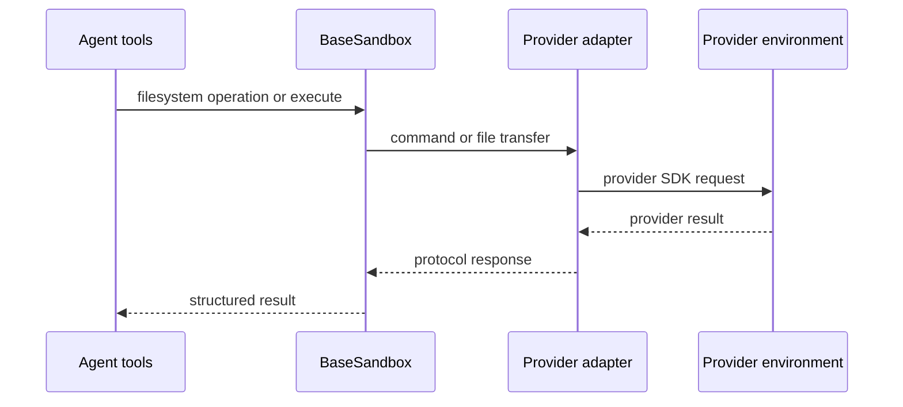
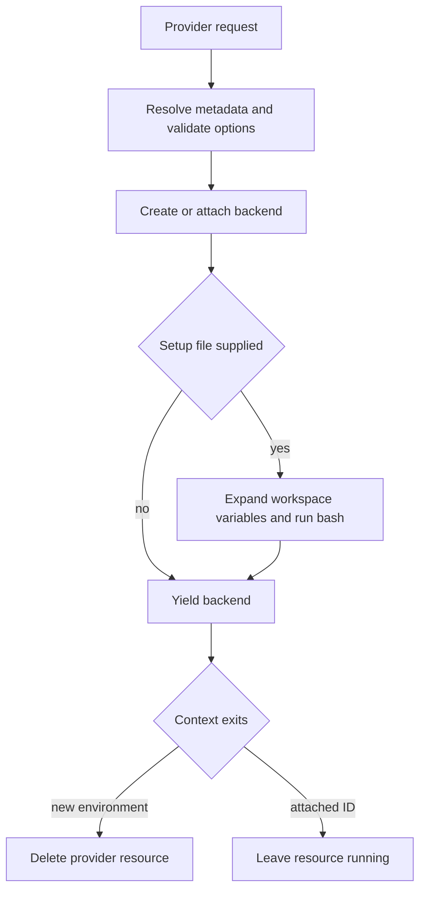
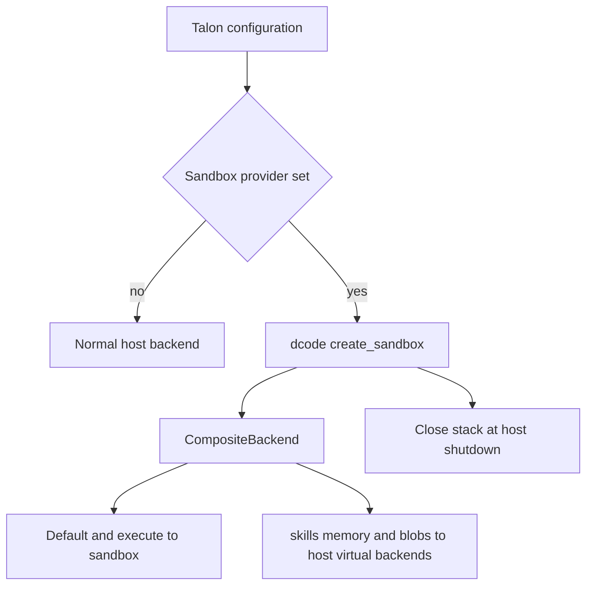

# Sandbox and Partner Integrations

A **sandbox provider** acquires or attaches to an environment that implements filesystem operations and shell execution. It is not `langchain-quickjs`: QuickJS is JavaScript REPL middleware in the agent process, not a selectable remote-sandbox provider. Provider containment, network policy, credentials, and retention are properties of the selected provider and deployment; protocol conformance alone is not an isolation guarantee.

## Shared backend contract

`SandboxBackendProtocol` extends the generic backend contract with an `id` and shell `execute()`/`aexecute()` methods. `BaseSandbox` implements the common filesystem interface from four adapter primitives: `id`, `execute()`, `upload_files()`, and `download_files()`. Transfers must return one response per input in input order and record per-file errors, allowing a batch to partially succeed.

`BaseSandbox` is a convenience layer, not a security boundary. Its filesystem helpers use the adapter's command-execution primitive. Recursive-delete quoting makes a path one shell argument but does not confine deletion to a workspace root. Capture-at-source output offload is opt-in: enabled adapters can retain large output in the sandbox and return a preview; a capture cap does not kill the command, preserving its exit code. The default disabled mode runs the command unwrapped and returns full output.



*Provider adapters supply the execution and transfer primitives used by the shared sandbox filesystem interface.*

### Adapter behavior remains observable

The shared contract does not normalize provider SDK behavior. Daytona creates a session per command and deletes it in `finally`; its timeout result has exit code `124`. Vercel starts detached `bash -lc` commands, attempts a best-effort kill on timeout, caps returned output at `100_000` bytes, and preserves a completed command's exit code if log retrieval fails. Test cancellation, timeout, output, and transfer behavior on a concrete adapter rather than assuming all `BaseSandbox` subclasses behave alike.

## dcode provider selection and installation

`deepagents-code` is version `0.1.84`, requires Python `>=3.12,<4.0`, and pins `deepagents==0.7.24`. It includes `langsmith[sandbox]>=0.14.7` and `langchain-quickjs>=0.3.4,<0.4.0` as base dependencies. LangSmith therefore needs no sandbox extra; QuickJS is installed with dcode but remains middleware. The backwards-compatible `quickjs` extra is empty.

The curated remote adapters are optional extras:

| Provider | dcode extra and adapter constraint | Partner package and SDK |
| --- | --- | --- |
| `agentcore` | `agentcore`: `langchain-agentcore-codeinterpreter>=0.0.5,<1.0.0` | AgentCore adapter |
| `daytona` | `daytona`: `langchain-daytona>=0.0.7` | `langchain-daytona` `0.0.8`; `daytona` |
| `modal` | `modal`: `langchain-modal>=0.0.5` | `langchain-modal` `0.0.6`; `modal` |
| `runloop` | `runloop`: `langchain-runloop>=0.0.6` | `langchain-runloop` `0.0.7`; `runloop-api-client` |
| `vercel` | `vercel`: `langchain-vercel-sandbox>=0.0.1` | `langchain-vercel-sandbox` `0.0.2`; `vercel>=0.5.9,<0.6` |

```bash
pip install 'deepagents-code[daytona]'
pip install 'deepagents-code[agentcore,daytona,modal,runloop,vercel]'
pip install 'deepagents-code[all-sandboxes]'
```

The four listed partner distributions require Python `>=3.11,<4.0` and `deepagents>=0.7.0,<0.8.0`; dcode's stricter Python and exact Deep Agents requirements govern a combined installation. Installing an adapter does not configure provider credentials or deployment policy.

`SandboxProviderMetadata` lets the registry and CLI advertise a working directory, capability flags, and an install hint without constructing a credential-dependent provider. Providers implement synchronous `get_or_create()` and `delete()`; their async counterparts delegate through `asyncio.to_thread`.

The registry merges built-ins, third-party entry points in `deepagents_code.sandbox_providers`, and `[sandboxes.providers]` declarations. Collisions resolve config first, then entry point, then built-in. A config `class_path` imports executable Python and is trusted operator configuration. A configured `[sandboxes].default` is used only after sandbox mode is explicitly enabled; it does not silently enable remote execution.

Built-in metadata defines working directories: AgentCore `/tmp`, Daytona `/home/daytona`, LangSmith `/root`, Modal `/workspace`, Runloop `/home/user`, and Vercel `/vercel/sandbox`. Snapshot names are supported by Daytona, LangSmith, and Runloop; Vercel does not support them, and AgentCore does not support attachment by sandbox ID. Extensions must advertise truthful capability metadata because the factory validates requests from it.

Runloop maps the generic snapshot argument to a blueprint name. It reuses a build-complete same-name blueprint or creates one; `RUNLOOP_SANDBOX_BLUEPRINT_ID` takes precedence and boots by ID without lookup or building.

## Factory lifecycle and ownership

`create_sandbox()` reads provider metadata before construction. It rejects unsupported snapshot names and `snapshot_name` combined with `sandbox_id`, since a snapshot only applies to a new sandbox. Configured provider parameters are copied first, then explicit parameters override them; the snapshot is forwarded as `snapshot`. After acquisition, an optional host setup file is read, expands `${VAR}` from the active workspace environment, and runs as `bash -c` inside the sandbox. A nonzero setup command raises an error.



*The factory owns and deletes only a sandbox it created; attaching by ID leaves lifecycle ownership with the caller.*

The `finally` block also cleans up an owned sandbox if setup fails or the caller raises. Cleanup failures are reported but do not mask the original error. Focused factory tests cover unsupported or conflicting snapshots, setup file and execution failures, setup-failure ownership, context-exit ownership, and preservation of the original error if deletion also fails.

A dcode server holds this context for the process lifetime and registers closure at exit. Its runtime factory is cached because recreating it would duplicate sandbox creation and cleanup registration. The first sandboxed workspace claims that process-wide backend; another workspace is rejected rather than sharing that remote filesystem and credential context. Use a different server process for an independent sandboxed workspace.

## Talon reuse and routing

Talon reuses dcode's factory and working-directory lookup rather than implementing separate provider adapters. `DEEPAGENTS_TALON_SANDBOX` opts in; when unset, Talon yields no sandbox and uses its normal host backend. `DEEPAGENTS_TALON_SANDBOX_ID` attaches an existing resource, while `DEEPAGENTS_TALON_SANDBOX_SNAPSHOT` and `DEEPAGENTS_TALON_SANDBOX_SETUP` select a snapshot and setup file.

For a new LangSmith sandbox, Talon defaults the snapshot to `talon-<assistant_id>`. An explicit Talon snapshot wins; when `LANGSMITH_SANDBOX_SNAPSHOT_NAME`, including its `DEEPAGENTS_CODE_` override path, is set, Talon defers to that provider-level selection. It keeps the context open for host lifetime, deletes owned resources, and retains attached ones. A configured sandbox that cannot start raises `SandboxStartupError` rather than falling back to host execution. The cancellation handoff closes the lifecycle stack even if threaded startup finishes after its awaiting task is cancelled.



*Talon uses dcode for provider lifecycle, then splits agent paths between the remote default backend and explicit host routes.*

In sandbox mode, `CompositeBackend` routes every default filesystem operation and every `execute` call to the remote sandbox. It routes only assistant `skills/`, `memory/`, and `/blobs/` to host virtual filesystem backends; host blobs let offloaded media outlive a recreated sandbox. `tools.json` and other assistant state do not use host routes. MCP and web tools, channel media handling, and provider credentials remain in the Talon process rather than moving into or being forwarded to the sandbox.

## QuickJS is not a remote sandbox

`langchain-quickjs` `0.3.8` is a JavaScript REPL middleware package requiring Python `>=3.11,<4.0`. It depends on `quickjs-rs>=0.2.5,<0.3.0`, not a sandbox-provider SDK. Its direct framework dependencies are `deepagents>=0.7.0,<0.8.0`, `langchain>=1.4.4,<2.0.0`, `langchain-core>=1.6.10,<2.0.0`, `langgraph>=1.2.14,<2.0.0`, and `bsdiff4>=1.2.6,<2.0.0`.

`CodeInterpreterMiddleware` exposes an `eval` tool. Its JavaScript evaluator has no direct filesystem, network, or real-clock access. `thread` mode is the default and assigns each LangGraph thread an isolated QuickJS slot; `turn` retains state only within a turn, and `call` creates a fresh REPL for each evaluation. Memory and VM execution budgets are distinct from host-call wall time.

Programmatic tool calling is an explicit trust boundary: an allowlist can expose tools as `tools.<camelCase>(input)`, but bridge calls do not pass through the normal `ToolNode` path, so per-call `interrupt_on` and HITL approval are not applied. The optional `task(...)` subagent API dispatches inside an approved `eval` call under the same constraint. Gate `eval`, use approval inside subagent specifications, or disable PTC/subagents when that bypass is unacceptable. Persisted thread snapshots receive integrity checks only when `snapshot_signing_key` is configured.

## Extension and verification guidance

- Implement the four `BaseSandbox` primitives, plus `SandboxProvider` lifecycle methods and accurate metadata, for a new adapter. Publish a third-party provider through `deepagents_code.sandbox_providers`, or use a trusted config `class_path` for local deployment.
- Verify create, attach, snapshot validation, setup-failure cleanup, context-exit ownership, and ordered partial-success transfers. `libs/code/tests/unit_tests/test_sandbox_factory.py` exercises core factory lifecycle and optional-dependency paths.
- After changing Talon selection, ownership, cancellation, or routing, run `libs/talon/tests/unit_tests/test_sandbox.py`.
- Before selecting a provider for sensitive work, assess its image, filesystem persistence, network controls, credential exposure, and deletion policy. Neither `BaseSandbox` nor Talon routing changes provider-level controls.
