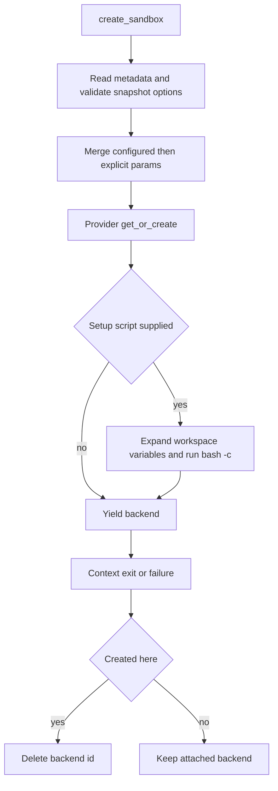

# Sandbox and Partner Integrations

A sandbox provider supplies a `SandboxBackendProtocol`: a backend with an ID and shell execution which can also serve the shared filesystem interface. It is an integration boundary, not a blanket security boundary. In particular, selecting a sandbox **does not automatically contain MCP tools, web tools, channel handling, or host credentials**. Those integrations, their credentials, and their network/data policies must be configured and isolated independently.

`langchain-quickjs` is related as a partner integration but is not a remote sandbox provider. It provides JavaScript REPL middleware in the agent process.

## Shared backend surface

`SandboxBackendProtocol` extends the ordinary backend contract with `id`, `execute()`, and `aexecute()`. `BaseSandbox` derives most filesystem behavior from execution and file-transfer primitives: listing, globbing, grep, and reading execute within the environment; writes upload bytes; and edits use server-side replacement (using temporary uploaded payloads for large strings). Batch transfers permit per-file errors, so callers must handle partial success in input order.

This reuse keeps content in the remote environment where practical, but it does **not** add a filesystem authorization layer beyond the provider's command execution. A concrete provider determines identity, network egress, workspace restrictions, timeouts, cancellation, retention, and credential exposure. Treat shell execution as the governing privilege and verify those properties with the provider.

`BaseSandbox.execute_with_offload()` is disabled unless capture offload is enabled. Its shell/coreutils-based wrapper caps captured output without killing the child process, preserving the command exit code. If wrapper metadata cannot be parsed, it returns the original response rather than rerunning the command.

## Provider discovery and metadata

`SandboxRegistry` combines three sources under a provider name:

1. Curated built-ins in dcode.
2. Python package entry points in `deepagents_code.sandbox_providers`.
3. Trusted configuration in `[sandboxes.providers]`.

Resolution is deliberately **configuration over entry point over built-in**. Therefore an operator can replace even a curated name; entry points can replace a built-in when configuration does not. Entry-point enumeration failures degrade to the built-in/config set rather than preventing registry construction. Provider construction is lazy.


*Provider selection follows configuration, entry point, then built-in precedence.*

Metadata decouples discovery from remote startup. It carries the default working directory, an optional installation hint, `supports_sandbox_id`, `supports_snapshot_name`, and optionally a backend module for a lightweight dependency probe. Built-in and configured metadata can be read without instantiating a provider that needs credentials. Entry-point metadata requires provider construction; if that probe fails, discovery uses a conservative `/workspace` placeholder. A package can publish a provider through the entry-point group by implementing `SandboxProvider`, including synchronous `get_or_create()` and `delete()`; its supplied async methods run those operations in worker threads.

A `[sandboxes.providers.<name>]` table can define `class_path`, `working_dir`, `package`, capability flags, and `params`. `class_path` has the same trust model as a model class path: loading it imports and executes Python named by operator-controlled configuration. Configured `params` are copied and forwarded to `get_or_create()`.

```toml
[sandboxes]
default = "acme"

[sandboxes.providers.acme]
class_path = "my_package:AcmeSandboxProvider"
working_dir = "/workspace"
package = "acme-dcode-sandbox"
supports_snapshot_name = true

[sandboxes.providers.acme.params]
region = "us-east-1"
```

A configured default is only consulted after a caller explicitly chooses sandbox mode; it never silently enables remote execution. Invalid or unreadable user configuration is recorded as a configuration error while unrelated startup can continue, and malformed provider entries are ignored or fail at use according to the invalid field.

### Curated providers and installation

The current curated names are `agentcore`, `daytona`, `langsmith`, `modal`, `openshell`, `runloop`, and `vercel`. Their metadata supplies provider-specific working directories and advertised capability flags. `langsmith[sandbox]` is a normal dcode dependency. The other six adapters are opt-in extras:

```bash
uv run --with 'deepagents-code[daytona]' dcode
```

`agentcore`, `daytona`, `modal`, `openshell`, `runloop`, and `vercel` can also be installed together through `deepagents-code[all-sandboxes]`. The retained `deepagents-code[quickjs]` extra is intentionally empty for compatibility with older install commands: QuickJS is already a normal dependency. Before spawning its server, dcode can perform a metadata-driven `find_spec` preflight and provide the appropriate `dcode install …` or `/install …` command for a missing adapter module.

## Acquisition, setup, and cleanup

`create_sandbox()` is the common context-managed lifecycle. It reads metadata, rejects a snapshot for a provider that does not advertise snapshot support, and rejects `snapshot_name` combined with `sandbox_id`: a snapshot is only meaningful when creating a fresh environment. It copies configured parameters, lets explicit `params` override them, and forwards the accepted snapshot under the provider argument `snapshot`.



*The factory deletes only the resource it created; attachment leaves lifecycle ownership with the caller.*

A setup file is read from the host, expands `${VAR}` against dcode's active workspace environment rather than the server process environment, and executes inside the sandbox as `bash -c`. A missing/unreadable script or nonzero setup result fails startup. Once a fresh backend has been acquired, the context manager attempts deletion on setup failure, caller failure, and ordinary exit. A deletion failure is reported but does not replace the original exception. Passing `sandbox_id` means attach: the factory never deletes that resource, including after setup failure.

Provider metadata advertises attachment support, but the factory's universal preflight validation is for snapshots; attachment behavior is ultimately implemented by the selected provider. For example, a provider can reject a supplied ID. Operators should not assume that the metadata flag alone turns an arbitrary provider ID into a portable attachment mechanism.

## Talon: consumer of the dcode surface

Talon is experimental and reuses `create_sandbox()` and `get_default_working_dir()` from dcode rather than maintaining another adapter registry. `DEEPAGENTS_TALON_SANDBOX` selects a provider; when it is unset, Talon yields no remote session and uses host execution. Its companion variables are `DEEPAGENTS_TALON_SANDBOX_ID`, `DEEPAGENTS_TALON_SANDBOX_SNAPSHOT`, and `DEEPAGENTS_TALON_SANDBOX_SETUP`.

A fresh LangSmith Talon session defaults to snapshot `talon-<assistant_id>` unless the operator supplies a snapshot or the provider-specific snapshot-name environment setting takes precedence. Talon wraps configured startup failures in `SandboxStartupError` and does not fall back to host execution. It retains the factory context for the host lifetime; its thread handoff closes the context if cancellation races completion of sandbox startup, avoiding a late-created owned sandbox leak.

In sandbox mode, Talon's `CompositeBackend` sends the default filesystem and every `execute` call to the remote sandbox. It deliberately keeps only `skills/`, `memory/`, and `/blobs/` on host virtual filesystem backends. This preserves assistant skills/memory and makes blobs survive recreation while preventing sandbox tools from reaching `tools.json` and other assistant state through a host route. It does not move MCP, web, or channel media execution into the sandbox, nor forward provider credentials into it; see Talon's own operational/security documentation before treating it as an exposure boundary.

## QuickJS partner boundary

`langchain-quickjs` 0.3.9 is independently versioned JavaScript REPL middleware, not a remote backend. It depends on QuickJS Rust bindings, Deep Agents, LangChain, LangGraph, and `bsdiff4`; dcode ships it as a normal dependency. The partner packages own their manifests, environments, Makefiles, and tests; the locally developed manifests point their Deep Agents dependency at the editable core source, and dcode maps partnered adapters and QuickJS to editable local sources.

`CodeInterpreterMiddleware` gives each LangGraph thread a distinct QuickJS slot (worker, runtime, and context). Its `thread`, `turn`, and `call` modes respectively retain state across turns, for a turn, or for a single evaluation. Thread snapshots are size-bounded and may be HMAC-signed with a slot-bound key; unsigned persistence is retained for compatibility but has no integrity verification.

QuickJS separately bounds heap, VM time, output, programmatic tool calls, and per-REPL subagent concurrency. The VM timeout excludes time awaiting Python host bridges, so it is not a whole-request timeout. `ptc` exposes explicitly allowed tools to JavaScript and `task()` can expose subagent dispatch. Those bridge dispatches bypass normal `ToolNode` processing, including parent per-dispatch `interrupt_on` and HITL approval. Gate the outer `eval` tool, add approvals to subagent specifications, or disable bridges when ordinary per-dispatch approval is required.

## Focused verification and change guidance

- Registry tests cover discovery, collisions and precedence, metadata fallback, malformed configuration visibility, and dependency hints in `libs/code/tests/unit_tests/test_sandbox_registry.py` and `test_sandbox_factory.py`.
- Lifecycle changes should test snapshot/attachment incompatibility, setup-file failure, owned cleanup, attached-resource retention, and cleanup errors that preserve the initiating exception.
- Test a new provider's actual backend behavior in addition to the registry contract: execution timeout/cancellation, transfer ordering and partial failures, setup semantics, identity/credentials, cleanup, and isolation claims.
- For QuickJS changes, run the package's tests and preserve tests for thread isolation, persistence/reset behavior, snapshot signature rejection, VM versus host-bridge timing, and bridge approval behavior.
