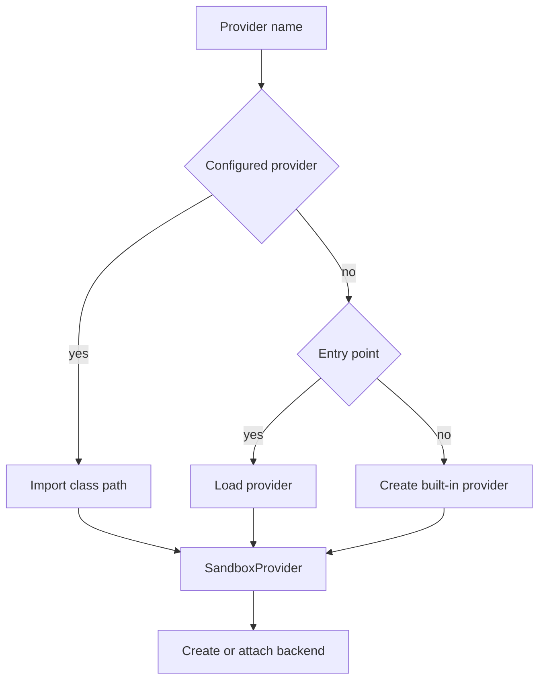
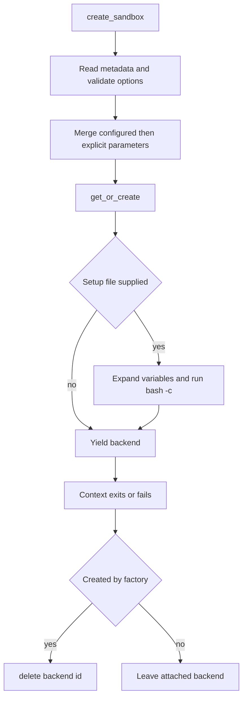
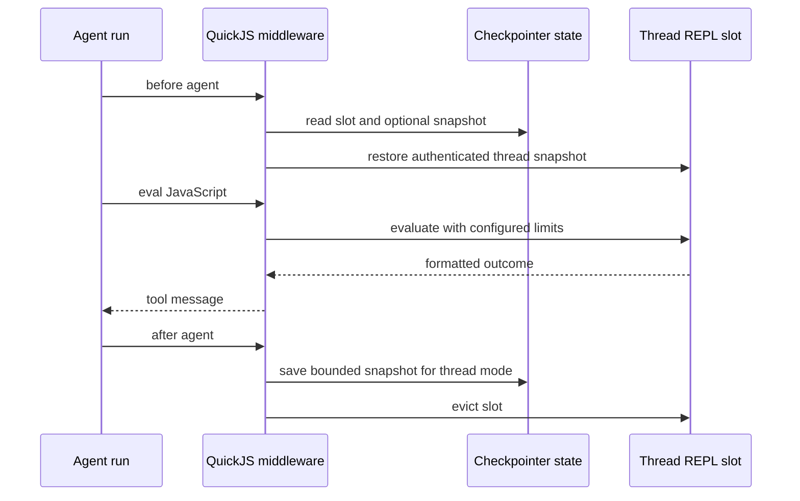

# Sandbox and Partner Integrations

A dcode sandbox provider supplies a `SandboxBackendProtocol`: an execution and filesystem backend identified by `id`. The dcode registry and factory select and manage that backend; a partner package owns its provider SDK, credentials, remote-resource semantics, and backend implementation. Selecting a sandbox changes the execution/filesystem backend, not project trust, authorization, or a general isolation policy. See [Deep Agents Code Architecture](/openwiki/architecture/code-agent.md) and [Run a dcode Session](/openwiki/workflows/run-dcode-session.md).

## Provider contract and selection

A `SandboxProvider` implements synchronous `get_or_create(sandbox_id=..., **kwargs)` and `delete(sandbox_id=..., **kwargs)`. Its `aget_or_create()` and `adelete()` helpers dispatch those blocking calls to worker threads. `SandboxProviderMetadata` lets dcode validate and describe a provider before acquisition: working directory, installation hint, attachment and named-snapshot capability, and an optional backend module for dependency probing.

`SandboxRegistry` merges these sources under one provider name:

1. Curated built-ins: `agentcore`, `daytona`, `langsmith`, `modal`, `openshell`, `runloop`, and `vercel`.
2. Installed entry points in the `deepagents_code.sandbox_providers` group.
3. Operator entries from `[sandboxes.providers]`.

Resolution is **configuration, then entry point, then built-in**. Entry-point enumeration is best-effort, so a discovery failure leaves configured and built-in providers available. Built-in and configured metadata is static; looking up an entry-point provider's metadata constructs it, with a conservative `/workspace` fallback if construction fails.



*Provider resolution is configuration over entry point over built-in.*

A configuration entry can declare `class_path`, `working_dir`, an installation package, capability flags, and parameters forwarded to creation:

```toml
[sandboxes]
default = "acme"

[sandboxes.providers.acme]
class_path = "my_package:AcmeSandboxProvider"
working_dir = "/workspace"
package = "acme-dcode-sandbox"
supports_snapshot_name = true

[sandboxes.providers.acme.params]
region = "us-east-1"
```

`class_path` is trusted operator configuration: resolving it imports arbitrary Python. On the normal default-path load, a managed configuration with a `[sandboxes]` section takes precedence over the user section. A corrupt or unreadable user file is exposed as a registry configuration error while usable managed policy remains applicable; malformed provider entries that are not TOML tables are ignored. Supplying an explicit configuration path excludes managed policy. A configured default is used only when the caller explicitly opts into sandbox mode; it never enables sandboxing merely by existing.

## Factory lifecycle and ownership

`create_sandbox()` is the common synchronous context-managed lifecycle. It reads metadata before acquisition, rejects a `snapshot_name` that the provider does not support, and rejects a snapshot combined with `sandbox_id`: snapshots apply only to fresh resources. It copies configured provider `params`, overlays explicit `params`, translates `snapshot_name` to `snapshot`, and invokes `get_or_create()`.



*The factory cleans up a resource it created, never one the caller supplied by ID.*

The setup file is read on the host after acquisition. `${VAR}` expansion uses dcode's active workspace environment, rather than the server process environment, and the expanded contents run inside the backend as `bash -c`. A missing or unreadable script, execution exception, or nonzero exit prevents the context body from running. Once a fresh backend exists, the `finally` path attempts deletion after setup failure, caller failure, or normal exit. Cleanup failures are reported without masking the initiating exception. An attached `sandbox_id` is retained even if setup fails.

The server enters the context in a worker thread and keeps the successfully opened context for the process lifetime, registering an `atexit` close. If caller cancellation arrives after the context entered, it closes that context before re-raising cancellation. A configured sandbox creation failure is surfaced as startup failure; dcode does not silently fall back to another backend.

## Modal: provider provisioning and backend behavior

The built-in `_ModalProvider` is dcode's lifecycle adapter around the independently distributed `langchain-modal` backend. It resolves `MODAL_TOKEN_ID` and `MODAL_TOKEN_SECRET` from the workspace configuration. When both are supplied it creates a credentialed Modal client; when exactly one is supplied it fails closed rather than allowing Modal's default process authentication to substitute a potentially broader identity. When neither is supplied, Modal's normal default authentication is used. The provider looks up or creates the `deepagents-sandbox` app.

For a supplied `sandbox_id`, the provider reattaches with `modal.Sandbox.from_id`. For a new resource, it creates a sandbox with `workdir="/workspace"`, then polls `echo ready` at two-second intervals until the configured startup timeout. A sandbox that terminates during startup fails immediately; a sandbox that does not become ready is terminated before the provider raises. The factory's ownership rule remains decisive: a fresh Modal sandbox is deleted on context exit, while an attached one is not.

`ModalSandbox` wraps `modal.Sandbox` and implements the common backend protocol. `execute()` invokes `bash -c`, waits for the Modal process, and returns combined stdout/stderr with the Modal return code; an omitted timeout defaults to 30 minutes and Modal treats `timeout=0` as indefinite. It does not claim output truncation.

For direct file transfer, each path must be absolute. The adapter opens files in binary mode and closes handles best-effort. It returns per-item responses, so one failing item does not stop later uploads or downloads. It maps ordinary filesystem failures to the protocol's `file_not_found`, `permission_denied`, and `is_directory` errors; Modal's `FilesystemExecutionError` is classified as directory only when its message says so, otherwise as not found. This direct transfer behavior is distinct from the higher-level filesystem operations inherited from `BaseSandbox`.

## Daytona: provider-specific command boundaries

The built-in dcode Daytona provider creates a client from its API key and optional `DAYTONA_API_URL`, then creates a fresh sandbox. It does not implement attachment by `sandbox_id`. It polls `echo ready` every two seconds up to its startup timeout and best-effort deletes a sandbox that never becomes ready. For snapshots, `DAYTONA_SANDBOX_SNAPSHOT_ID` wins; otherwise an explicit snapshot name overrides `DAYTONA_SANDBOX_SNAPSHOT_NAME`, and a missing named snapshot can be built from `snapshot_image` or the default image. A named snapshot in a non-ready state is rejected rather than rebuilt.

`DaytonaSandbox` is the partner backend around that SDK resource. For a finite command timeout, it applies one monotonic deadline across session creation, command start, polling, and final-log retrieval. Requests and polling are bounded by time remaining; `timeout=0` leaves command-phase requests unbounded. On expiry it returns exit code `124` and best-effort partial logs. Log recovery and session deletion share a two-second cleanup budget; cleanup errors are logged rather than replacing the command result. Its transfer implementation rejects relative paths with `invalid_path`, preserves download order, and maps absent content to `file_not_found`. These deadline and transfer details are Daytona-specific, not generic provider guarantees.

## Installation and package boundaries

The six curated external adapters—AgentCore, Daytona, Modal, OpenShell, Runloop, and Vercel—are optional `deepagents-code` extras and are aggregated by `deepagents-code[all-sandboxes]`. `langsmith[sandbox]` is a normal dcode dependency. The compatibility `deepagents-code[quickjs]` extra intentionally remains empty because `langchain-quickjs` is already a normal dcode dependency and QuickJS is middleware, not a remote sandbox adapter. Missing optional adapter imports provide provider-specific `dcode install` or in-app `/install` guidance.

The `openshell` extra installs `langchain-nvidia-openshell>=0.1.1`. dcode's local editable development mappings cover Daytona, Modal, QuickJS, Runloop, and Vercel; they do not make those packages dcode-owned and do not add an OpenShell checkout.

Checked-in partner adapters are independently versioned distributions. In particular, Daytona, Modal, Runloop, and Vercel each declare Deep Agents plus their provider SDK; Modal currently requires `deepagents>=0.7.32,<0.8.0` and `modal`. Each partner owns its environment, `pyproject.toml`, `Makefile`, and tests. dcode's curated registry owns discovery, optional-install packaging, parameter forwarding, and factory lifecycle—not the adapter implementation. A third party can publish an entry point, while an operator can use a configured `class_path` for an internal provider.

## QuickJS is an in-process middleware, not a sandbox provider

`langchain-quickjs` is a separate partner distribution for JavaScript REPL middleware. `CodeInterpreterMiddleware` adds an `eval` tool to a LangChain agent and maintains a distinct QuickJS slot for each LangGraph thread, so JavaScript globals do not cross conversations. The tool declares no filesystem, network, or real-clock access. dcode enables it separately as the JavaScript interpreter (`js_eval`); it neither participates in the sandbox registry nor controls remote sandbox lifecycle.



*Thread mode restores and persists a per-thread interpreter snapshot; non-thread modes evict without persisting it.*

The default `thread` persistence mode retains JavaScript state across turns; `turn` retains it only within a turn, and `call` creates a fresh REPL per evaluation. In thread mode, `before_agent` restores a stored snapshot and `after_agent` serializes it, stores a patch-chain update, then evicts the in-memory slot. A snapshot exceeding `max_snapshot_bytes` is dropped. With `snapshot_signing_key`, the middleware HMAC-signs the materialized snapshot and rejects a missing or mismatched signature before restore; without a key, legacy snapshots are not integrity checked. Restore and snapshot failures are best-effort and clear the persisted data rather than aborting the agent run.

The default 64 MiB heap limit is shared by contexts under a runtime; the default five-second timeout measures QuickJS VM execution, not total wall-clock time spent awaiting Python-hosted tool calls. Programmatic tool calling can expose selected agent tools as `tools.<camelCase>(input)`, but those calls do not use the normal `ToolNode` path and therefore do not receive per-call `interrupt_on` or HITL approval. The default `max_ptc_calls=256` bounds bridge calls per `eval`; setting it to `None` removes that protection and is unsafe for untrusted prompts. Likewise, subagent `task(...)` dispatches inside an already approved `eval`; gate `eval`, add subagent approval middleware, or disable subagents when each dispatch needs parent approval.

## Operating and changing integrations

- Use `--sandbox <provider>` to choose a provider, or bare `--sandbox` only when `[sandboxes].default` is configured. Unknown providers and unsupported snapshot options fail before normal startup. Capability metadata drives validation and UX; it is not proof of isolation or authorization.
- Preserve the factory ownership boundary: only a fresh factory-created resource may be deleted, and setup failures must take the same cleanup path.
- Treat provider credentials, identity, network, retention, cancellation, timeout, and isolation semantics as adapter-specific operational concerns. In particular, Modal's paired workspace credentials are intentionally fail-closed.
- Do not generalize Daytona's `124` result, deadline accounting, polling policy, or cleanup grace to Modal or another provider without implementing and testing it there.
- The dcode unit suite covers registry precedence, entry-point metadata fallback, malformed configuration, snapshot validation, setup failure, attachment ownership, and cleanup reporting. Its optional integration suites exercise real creation, command execution, transfers, and filesystem operations, but are skipped in the release pipeline and retain several explicitly skipped provider error-path cases.
- Modal unit tests verify per-item transfer continuation, binary content preservation, file-handle closure, and protocol error mapping. Use its package-local `make test` for deterministic tests; `make integration_test` is the credentialed integration surface.
- QuickJS tests cover persistence modes, snapshots and signing, programmatic tool-call budgets, sync/async end-to-end behavior, and the middleware's limits. Use its own package-local `make test`; its Makefile keeps locks frozen and disables non-Unix sockets for unit tests.
- When adding a partner package, add its independent release and CI wiring, including sandbox credentials and integration-test matrix surfaces where applicable. See [Development](/openwiki/operations/development.md) and [Run Evaluations and Harbor Benchmarks](/openwiki/workflows/run-evals.md).
