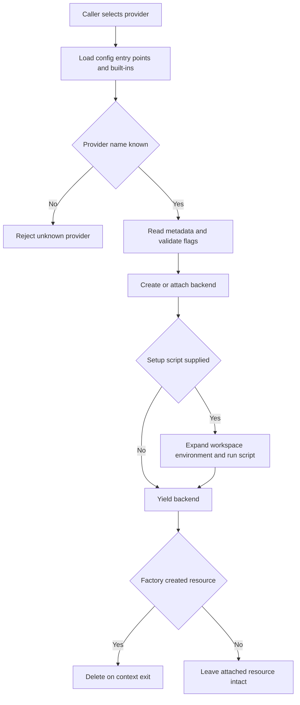
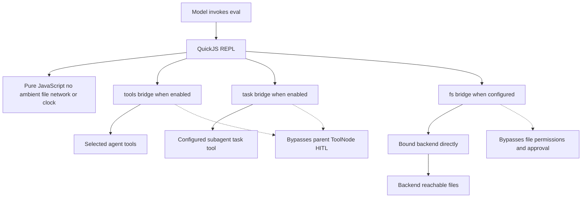
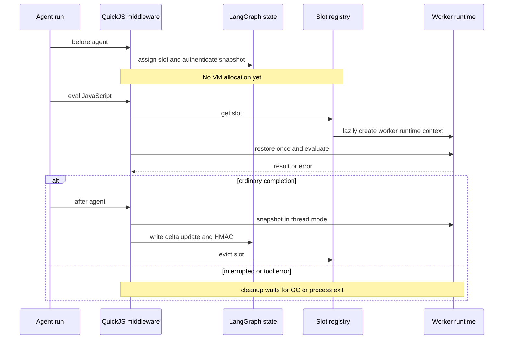

# Sandbox and Partner Integrations

A dcode sandbox provider supplies a `SandboxBackendProtocol`: an execution and filesystem backend identified by `id`. dcode owns discovery, selection, factory context, and the lifetime of resources it creates; a provider package owns its SDK, credentials, remote-resource behavior, and backend implementation. Selecting a sandbox changes the execution/filesystem backend. It is not by itself a project-trust, authorization, or general isolation policy.

QuickJS is deliberately different. `langchain-quickjs` embeds an interpreter in the **agent process** as middleware; it is not registered in dcode's remote sandbox-provider registry. The interpreter advertises no ambient filesystem, network, or real-clock access, but explicitly bridged tools and subagents confer authority. A remote sandbox instead executes in a provider-managed environment with its own identity, mounts, egress, credentials, quotas, and lifecycle. Treat these as separate boundaries. See [Permissions and Human Approval](/openwiki/concepts/permissions-hitl.md), [State, Threads, and Persistence](/openwiki/concepts/state-persistence.md), and [Tools and Filesystem](/openwiki/concepts/tools-filesystem.md).

[Talon](/openwiki/integrations/talon.md) is a concrete remote-provider consumer: host shell and file tools are the default, while `DEEPAGENTS_TALON_SANDBOX` selects a dcode provider for them. Its sandboxing is opt-in and does not cover MCP or web tools, channel media handling, or host-held skills and memory. It is therefore neither a whole-agent nor a multi-tenant security boundary. Talon deletes a sandbox it creates, but never one selected by `DEEPAGENTS_TALON_SANDBOX_ID`.

## Remote provider contract and resolution

A `SandboxProvider` implements synchronous `get_or_create(sandbox_id=..., **kwargs)` and `delete(sandbox_id=..., **kwargs)`; async helpers run those blocking operations in worker threads. `SandboxProviderMetadata` describes a default working directory, installation hint, attach and named-snapshot capabilities, and an optional dependency-probe module.

`SandboxRegistry` merges configured providers, installed `deepagents_code.sandbox_providers` entry points, and curated built-ins. A name collision resolves as **configuration, then entry point, then built-in**. Entry-point enumeration is best-effort. A configured `class_path` is trusted operator configuration: resolving it imports arbitrary Python. A configured default only records the backend selected by a bare `--sandbox`; it does not turn sandbox mode on.

Provider *availability* is intentionally a discovery result, not a runtime security decision or proof that a provider can start. `is_available()` means the name occurs in configuration, entry points, or curated metadata. Constructing an entry-point provider can still fail, and remote credentials or optional packages can still be missing. CLI validation rejects unknown names and unsupported attach/snapshot flags before launch; a malformed user configuration is surfaced as a configuration note while discovery falls back to usable sources.

`[sandboxes].default` is a selector, not a containment policy. With no `--sandbox`, dcode runs on the host even if managed configuration names a default, and emits a note explaining that choice. When a managed default is applied to a sandboxed launch, dcode rejects an unavailable name rather than passing it to the factory. Operators who require remote execution must enforce the invocation/policy path that supplies `--sandbox`; setting a default alone cannot require isolation.

`create_sandbox()` looks up metadata before acquisition. It rejects an unsupported `snapshot_name`, or a snapshot combined with `sandbox_id`; overlays explicit `params` over configured parameters; then runs an optional setup script in the acquired backend after expanding variables from the bound workspace environment. The factory deletes only a resource it created, never an attached resource. A cleanup failure is reported but does not mask the initiating failure.



*Provider discovery and metadata validation occur before acquisition; ownership, rather than mere access, determines cleanup.*

### Curated capability surface

This table records dcode's built-in metadata. `sandbox_id` means dcode permits attaching an existing resource; `snapshot_name` means the factory accepts a named source for a fresh resource. Provider implementations may still reject or further constrain an operation, and configuration or entry-point providers can replace this metadata.

| Provider | dcode delivery | Default working directory | `sandbox_id` | `snapshot_name` |
| --- | --- | --- | --- | --- |
| `agentcore` | `agentcore` extra | `/tmp` | No | No |
| `daytona` | `daytona` extra | `/home/daytona` | Yes | Yes |
| `langsmith` | bundled `langsmith[sandbox]` dependency | `/root` | Yes | Yes |
| `modal` | `modal` extra | `/workspace` | Yes | No |
| `openshell` | `openshell` extra | `/sandbox` | Yes | No |
| `runloop` | `runloop` extra | `/home/user` | Yes | Yes |
| `vercel` | `vercel` extra | `/vercel/sandbox` | Yes | No |

## Package, release, and lock ownership

Partner packages are independently versioned distributions. Each owns its environment, `pyproject.toml`, `Makefile`, tests, and package-local `uv.lock`; they are not owned by dcode's curated provider registry. A lock is generated resolution for that package's development/CI environment, not a second dependency manifest. Do not hand-edit it.

The current release manifest lists `deepagents-code` `0.2.7`, `langchain-daytona` `0.0.9`, `langchain-modal` `0.0.7`, `langchain-runloop` `0.0.7`, `langchain-vercel-sandbox` `0.0.2`, and `langchain-quickjs` `0.3.12`. Daytona, Modal, Runloop, and Vercel each require Python `>=3.11,<4.0`, bound Deep Agents to `>=0.7.35,<0.8.0`, and declare their provider SDK. dcode requires Python `>=3.14,<3.15`, pins `deepagents==0.7.35`, bundles LangSmith sandbox support, and exposes the other curated remote providers through optional extras.

A manifest or local-path-source change can invalidate reverse consumers' locks as well as its own. Refresh the affected closure rather than changing a lock by hand, and keep dependency/lockfile churn separate from a bump-worthy feature or fix when release scope matters. The repository's targeted refresher and checker select the appropriate interpreter and report the required closure:

```bash
python .github/scripts/checks/refresh_lockfiles.py libs/code/pyproject.toml
python .github/scripts/checks/check_lockfiles_pre_commit.py libs/code/pyproject.toml
```

## QuickJS middleware entrypoint and capability boundary

Install and attach the middleware to an agent:

```python
from deepagents import create_deep_agent
from langchain_quickjs import CodeInterpreterMiddleware

agent = create_deep_agent(
    model="claude-sonnet-4-6",
    middleware=[CodeInterpreterMiddleware()],
)
```

`CodeInterpreterMiddleware` contributes an `eval` tool (customizable with `tool_name`) and a system-prompt addendum on model calls. `REPLState` keeps an opaque private slot ID plus, in thread mode, an optional DeltaChannel snapshot and HMAC—not a public LangGraph `thread_id`. dcode requires `langchain-quickjs>=0.3.12,<0.4.0`; the partner release is `0.3.12`, which bounds Deep Agents, LangChain, LangGraph, `quickjs-rs`, and `bsdiff4` in its own manifest. dcode's `quickjs` extra remains empty only for backwards-compatible install commands because QuickJS is already a normal dependency.

The lack of ambient host APIs confines pure JavaScript computation but is not complete isolation. `console` is an optional host bridge; PTC and `task()` expose selected agent tools or subagents. Use a remote sandbox when the desired boundary is provider-managed execution isolation, and separately secure every host capability that QuickJS may invoke.

### Direct bridges bypass the normal tool path

`fs` is disabled by default. Passing a backend, or `fs=True` when `create_deep_agent` binds the agent backend, adds an asynchronous Node-style `fs` global with UTF-8-text `readFile`, `writeFile`, `readdir`, `access`, and `rm` APIs plus `fs.promises`. It calls that backend directly rather than file tools: `FilesystemMiddleware` rules, `create_deep_agent` `permissions`, and `interrupt_on` do not govern individual filesystem operations. Thus `fs` has all authority of the supplied backend; on a non-virtual `FilesystemBackend` or local shell backend this can mean host files. Do not enable it for an agent whose file policy depends on those guards. A middleware with `fs=True` must be bound before its first model call and may serve only one non-interchangeable backend.



*QuickJS starts without ambient host access; every arrow leaving the REPL is an explicitly configured authority boundary, and bridge calls do not take the normal parent tool or file-policy route.*

The bridge budgets filesystem operations with PTC calls: each `fs.*` operation consumes `max_ptc_calls`, even when PTC tool exposure is otherwise not configured. File content is omitted from the fs runnable's trace output, and a response too large or deeply nested to marshal into QuickJS produces a per-eval `MarshalError` rather than crashing the run. The focused filesystem tests cover state, disk, and composite-backend routing; text-only API/error behavior; root-traversal containment; call-budget accounting; snapshot restoration; binding errors; and trace redaction.

## Slot lifecycle, persistence, and cleanup

`before_agent` allocates a private `qjs_...` slot ID if needed and authenticates persisted state, but **does not create a VM**. The first `eval` calls `_Registry.get(slot_id)`, which creates one dedicated `ThreadWorker`, one `Runtime`, and one `_ThreadREPL` context for that slot. QuickJS values remain on the owning worker because they cannot safely cross threads. Runtime creation uses `SourceTransform.TOP_LEVEL_CONST_TO_VAR` so top-level `const` declarations can remain persistent globals. Overlapping evaluation surfaces `ConcurrentEval`; it is not queued.

| `mode` | State lifetime | Reset and final release |
| --- | --- | --- |
| `"thread"` (default) | Across eval calls and resumed agent runs that retain private state | On ordinary `after_agent`, snapshot an allocated REPL then evict its slot. |
| `"turn"` | Across eval calls within one agent run | `after_agent` evicts without persisting. |
| `"call"` | One `eval` call | The eval `finally` replaces only the REPL context; `after_agent` evicts the retained worker and runtime. |



*The slot ID keys live process-local resources. Thread persistence stores bytes rather than a live VM.*

Only thread mode reads or writes persisted JavaScript state. When signing is configured, `before_agent` verifies HMAC authenticity; parsing and restoration remain lazy until the first eval. Missing, altered, wrong-key, or cross-slot signatures are cleared before restoration. A restore failure clears saved fields and does not execute the requested JavaScript. On normal thread-mode completion, snapshot creation enforces `max_snapshot_bytes` (defaulting to `memory_limit`); oversized payloads and creation failures clear payload and HMAC.

Snapshots are a `DeltaChannel` patch chain rather than an in-memory cache. A first or non-beneficial update writes an anchor, while a smaller `bsdiff4` representation writes a patch. Replay deterministically applies anchors, patches, and clears, so forks, time travel, and checkpoint reconstruction do not rely on the process-local registry.

Normal `after_agent` completion releases a used interpreter. An interruption or unrelated tool exception can skip that hook; destruction of the middleware then best-effort closes remaining slots. During interpreter finalization, cleanup deliberately does not wait for workers to avoid an interpreter-exit deadlock. Shutdown tests cover normal completion, interruption, tool error, and garbage collection.

## Request-scoped bridges, limits, and approvals

On every model call, `wrap_model_call` or `awrap_model_call` prepares bindings from the current `ModelRequest` after upstream tool filtering. With PTC enabled, it applies the allowlist, excludes its own eval tool, reserves `task` rather than exposing `tools.task`, and caches selected tool instances and rendered prompt text by private slot and tool identity. The active `globalThis.tools` namespace is rebuilt from those bindings, so inactive names disappear.

If `subagents=True` and the current request has a recognized Deep Agents task tool, middleware adds `task()` guidance and installs a top-level task bridge. It runs configured subagent work through the active outer runtime and has a per-REPL semaphore of 32 simultaneous dispatches by default. This is neither a process-wide admission limit nor a total-dispatch limit.

`timeout` defaults to five seconds and limits QuickJS VM execution per eval; `timeout=None` disables that deadline. It does not limit wall-clock time spent in Python-hosted `tools.*` or `task()` calls. PTC is opt-in and has a 256-call per-eval bridge budget by default; `max_ptc_calls=None` removes that budget and is unsafe for untrusted prompts.

PTC and `task()` bypass the parent `ToolNode` path, so parent `interrupt_on`/HITL approval does not separately run for each bridged action. The `eval` invocation is the parent approval boundary. Gate `eval`, put approval middleware inside subagent specifications, use normal parent tool calls for per-action review, or disable subagents.

## Focused verification

For dcode provider discovery, precedence, factory ownership, and invalid-option behavior, run the registry and factory tests. For QuickJS lifecycle and prompt contracts, use the partner Makefile:

```bash
make -C libs/code test TEST_FILE=tests/unit_tests/test_sandbox_registry.py
make -C libs/code test TEST_FILE=tests/unit_tests/test_sandbox_factory.py
make -C libs/partners/quickjs test TEST_FILE=tests/unit_tests/test_repl_middleware.py
make -C libs/partners/quickjs test TEST_FILE=tests/unit_tests/test_fs.py
make -C libs/partners/quickjs test TEST_FILE=tests/unit_tests/test_snapshot.py
make -C libs/partners/quickjs test TEST_FILE=tests/unit_tests/test_shutdown.py
```

The focused tests cover configuration/entry-point precedence and degraded discovery, factory cleanup on setup/body failures, QuickJS lazy allocation, independent workers and runtimes, context-only call-mode reset, filesystem backend routing and failure isolation, snapshot reconstruction and signing failures, and shutdown paths. Treat changes to provider capability metadata, policy selection, bridge authority, filesystem reach, or persistence reset scope as behavior changes requiring their corresponding tests.
