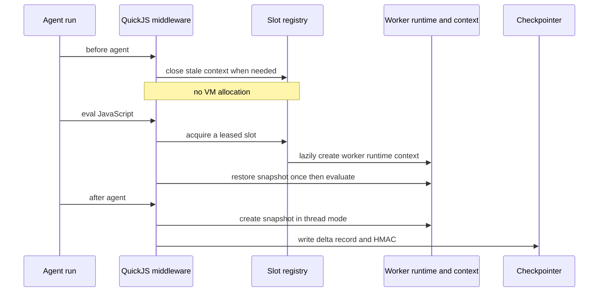
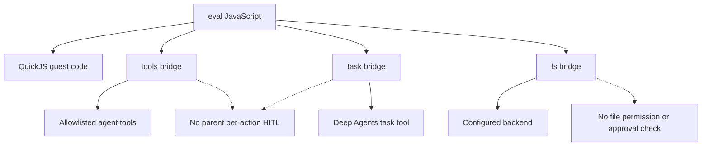

# Sandbox and Partner Integrations

`langchain-quickjs` 0.4.0 is an optional Deep Agents middleware, not a remote sandbox provider. `CodeInterpreterMiddleware` contributes a configurable `eval` tool and prompt guidance, then runs QuickJS through `quickjs-rs` **inside the agent process**. It lets a model retain JavaScript values between evaluations and orchestrate loops or `Promise.all` work without returning to the model after every host call.

QuickJS guest isolation starts with no ambient filesystem, network, `fetch`, `require`, process, or real-clock capability. That containment applies only to pure guest JavaScript: it does **not** authorize PTC, `task()`, or filesystem bridges. Each bridge is an explicit grant of host authority and must be configured as such. In particular, `fs` bypasses normal filesystem permission and approval middleware.

## Installation and attachment

```bash
uv add langchain-quickjs
```

```python
from deepagents import create_deep_agent
from langchain_quickjs import CodeInterpreterMiddleware

agent = create_deep_agent(
    model="claude-sonnet-4-6",
    middleware=[CodeInterpreterMiddleware()],
)
```

The package requires Python `>=3.11,<4.0`; its bounded dependencies include Deep Agents, LangChain, LangGraph, `quickjs-rs`, and `bsdiff4`. Defaults are a 64 MiB runtime heap limit, five-second VM timeout, `max_ptc_calls=256`, console capture, subagent bridging when an eligible `task` tool is present, and `mode="thread"`.

`timeout` counts VM execution time, not Python time spent awaiting a tool, task, or filesystem host call. A slow bridge can therefore exceed the wall-clock duration implied by `timeout`. `timeout=None` removes the VM deadline and should only be used with an external process or workflow limit that can stop runaway code. The runtime memory limit is shared by contexts below that runtime; result text and captured stdout are independently capped by `max_result_chars` (4,000 by default).

## Interpreter, context, and slot lifecycle

Middleware private state holds a generated `qjs_...` slot ID and, in thread mode, optional snapshot payload and HMAC. The slot ID is not the public LangGraph `thread_id`. A process-wide registry keys warm slots by that ID and the interpreter configuration. Each lazy slot owns its worker, runtime, and context because QuickJS objects must remain on their owning worker thread.

No VM is allocated merely by attaching middleware or taking a model-only turn. The first `eval` leases a slot and lazily creates its worker, runtime, and context. The runtime transforms top-level `const` declarations to persistent globals, so top-level bindings survive later evaluations in one context. Evaluations deliberately do not queue: an overlap returns `ConcurrentEval`, rather than silently serializing model work.



*The checkpoint stores reconstructible interpreter state; a warm slot is only a process-local optimization.*

| `mode` | Context state lifetime | End-of-run behavior |
| --- | --- | --- |
| `"thread"` (default) | Across evaluations and completed runs for the checkpointed state | Snapshot after the agent run; the matching context may remain warm. |
| `"turn"` | Across evaluations in one agent run | Close the context after the run; do not persist a snapshot. |
| `"call"` | One evaluation | Dispose the context in eval cleanup, including on an eval error. |

On a later non-resume `before_agent`, a live context that is not known to match the checkpoint snapshot is closed. This prevents uncheckpointed changes from a failed or cancelled run leaking into a subsequent run; the worker and runtime may remain warm. Graph resume does not rerun `before_agent`, allowing an interrupted run to continue with its live context. The registry keeps at most 32 warm slots per process and evicts least-recently-used slots only when they are unleased and not evaluating.

## Persistent snapshots and restoration failures

Thread mode serializes the whole QuickJS heap after a successful agent run. The state channel records an anchor (`snap`), a `bsdiff4` delta (`patch`), or a reset (`clear`) rather than storing a complete heap at every checkpoint. Replay folds these records deterministically into bytes for process restart, checkpoint fork, and time-travel replay. A patch is selected only when it is smaller than a new anchor.

`max_snapshot_bytes` defaults to `memory_limit`. An oversized snapshot or snapshot-creation failure clears both stored payload and signature. Restore is lazy, so a model-only turn neither creates an interpreter nor restores one.

Set `snapshot_signing_key` when the checkpointer is not fully trusted. The middleware HMAC-SHA256-signs materialized snapshot bytes with domain separation and binds the tag to the private slot ID. It signs before delta encoding and verifies after replay, detecting altered, missing, wrong-key, and cross-slot snapshots. Without a key, snapshots retain legacy unauthenticated behavior.

If signature verification fails during preparation, the payload and tag are cleared and never restored. If QuickJS rejects an authenticated snapshot at the first `eval`, the eval reports a restore error, clears saved state, and does **not** execute requested JavaScript. This avoids executing against a potentially partial state.

## Bridges are authority grants



*Guest isolation constrains pure QuickJS only. Every bridge arrow grants the guest the authority of the host capability it reaches.*

### Programmatic tool calling

PTC is disabled unless `ptc` is a list of tool names and/or explicit `BaseTool` instances. For each model call, the middleware filters the live upstream tool list, excludes `eval`, deduplicates names, validates the camel-case JavaScript identifiers, and rebuilds `globalThis.tools` from current bindings. The Deep Agents `task` tool is reserved for top-level `task()` and cannot appear under `tools.*`.

A PTC invocation travels through the REPL bridge, not the normal `ToolNode` path. The bridge supplies the enclosing runtime, state, store, context, callbacks, and a synthetic call ID where supported. It can apply a `Command(update={...})` except `messages`; routing, graph, resume, or non-dictionary update commands produce `UnsupportedCommand`. Standard tool lifecycle callbacks and streaming remain visible, but the inner calls are not graph messages and visibility is not authorization.

The per-eval call budget is shared by `tools.*` and `fs` bridge calls. Leave `max_ptc_calls` bounded for untrusted code: `None` permits unbounded host-call loops. Because PTC bypasses `ToolNode`, parent `interrupt_on` and human-in-the-loop policy are not applied per inner tool call. Treat the PTC allowlist and approval of `eval` as the relevant boundary.

### Filesystem bridge

`fs` is disabled by default. Supply a backend explicitly, or set `fs=True` with `create_deep_agent` to bind that agent's backend. It exposes asynchronous UTF-8 `readFile`, `writeFile`, `readdir`, `access`, and `rm`, including `fs.promises`; a host value that cannot fit or marshal into JavaScript becomes `MarshalError`.

The bridge calls its backend directly rather than agent file tools. Therefore `FilesystemMiddleware` rules, `create_deep_agent` permissions, and parent `interrupt_on` approval do not protect individual filesystem operations. It grants all filesystem reach of the selected backend, including host files for a local or non-virtual backend. Do not enable it when file-level permission or approval is the authorization boundary; choose a backend whose sandbox and credentials restrict the intended files.

### Subagents, tracing, and observability

When `subagents=True` and the live tools contain a recognized Deep Agents task tool, top-level `task()` validates `description`, `subagentType`, optional `label`, and optional response schema. A per-REPL semaphore allows 32 simultaneous dispatches by default. It is not a process-wide admission limit or a total dispatch budget. `GraphInterrupt` propagates so graph resumption remains possible.

Both synchronous and asynchronous eval handlers patch the enclosing runtime callback configuration to the eval invocation. PTC calls and task dispatches therefore trace as children of `eval`, rather than the agent tools step. This is attribution only: it does not restore parent `ToolNode` per-action `interrupt_on` or HITL enforcement. Gate `eval`, use ordinary tool calls where every action needs review, add approval middleware in subagent specifications, or disable `subagents` as appropriate.

Task dispatch emits custom-stream `subagent` events in `start`, then `complete` or `error` phases. With a parent eval ID, its dispatch ID derives deterministically from the parent ID, task name, host-invocation ordinal, and request payload, enabling replay correlation. Consumers should upsert repeated `start` events. Without a parent eval ID, the ID is random. Telemetry writer failures are swallowed and do not stop dispatch.

## Code integration: durable JavaScript subagent costs

The `deepagents_code` agent factory uses `CostAwareCodeInterpreterMiddleware` when `enable_interpreter=True`, names its tool `js_eval`, and rejects that interpreter mode when a remote sandbox is selected. This subclass keeps ordinary QuickJS behavior but adds an **async-only accounting transport** for JavaScript-originated subagents; its synchronous tool wrapper is pass-through.

For an outer `js_eval`, the wrapper gives the active task tool a proxy. Each dispatch receives an isolated checkpoint namespace derived from its description, subagent type, response schema, and occurrence; it also receives an owner token for the enclosing eval and synchronous durability. Cost tracking records each child node's local cost/breakdown as a separately checkpointed receipt under that owner. Existing receipt checkpoints are retained on replay rather than overwritten.

After the eval's active dispatches settle, the outermost owner aggregates its receipts and returns an `_session_cost_transfers` update to the parent checkpoint scope. Nested owners do not emit a second transfer, preventing double counting. The design transports accounting only: it does not cache JavaScript or forward subagent state. It preserves graph cancellation and interrupt control flow; ordinary subagent exceptions become retryable JavaScript-visible failure objects. A checkpointer is required for this receipt path, so no receipt transfer is produced without one.

## Focused verification

Run the QuickJS package tests with its Makefile:

```bash
make -C libs/partners/quickjs test TEST_FILE=tests/unit_tests/test_snapshot_persistence.py
make -C libs/partners/quickjs test TEST_FILE=tests/unit_tests/test_subagent_replay.py
make -C libs/partners/quickjs test TEST_FILE=tests/unit_tests/test_end_to_end.py
```

Snapshot tests cover cross-turn bindings, top-level await, lazy model-only operation, signing, and restore failure behavior. Subagent replay verifies stable fan-out identities through repeated checkpoint resumes. End-to-end coverage exercises sync and async PTC, native tool streaming, and eval-parented callbacks.

`libs/code/tests/unit_tests/test_js_cost_tracking.py` exercises the code-agent adapter: durable accounting in every persistence mode, nested and parallel dispatches, failure/cancellation/interrupt resume, receipt idempotency, and partial or zero-price usage. `test_js_cost_sync.py` confirms the cost-aware wrapper leaves synchronous eval and ordinary tool execution intact.
