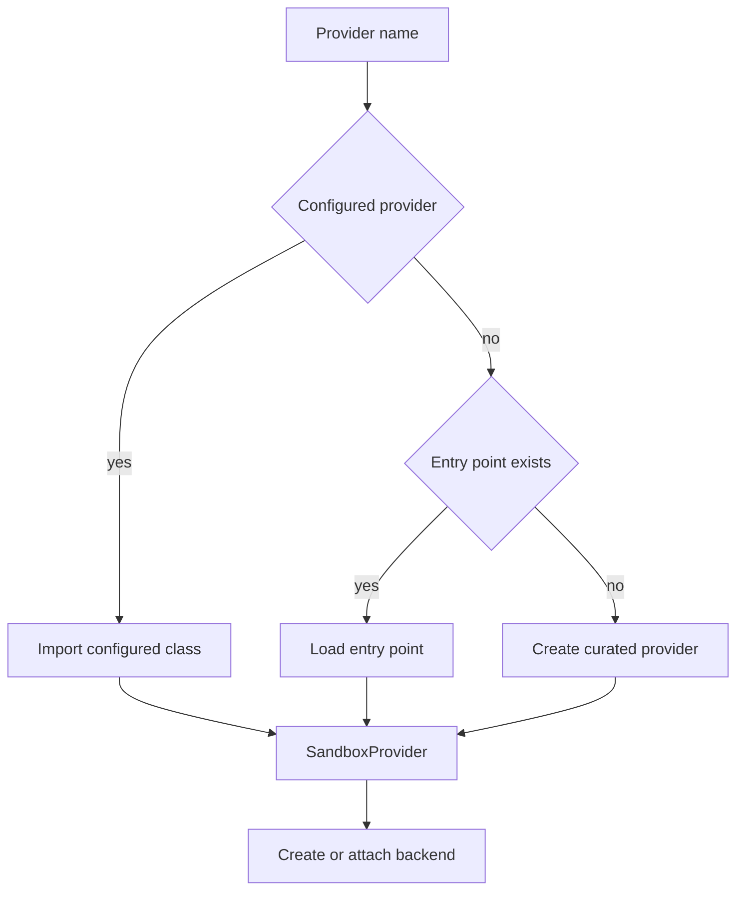
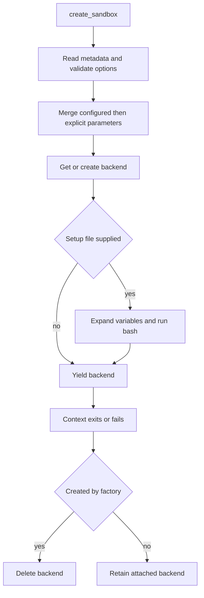
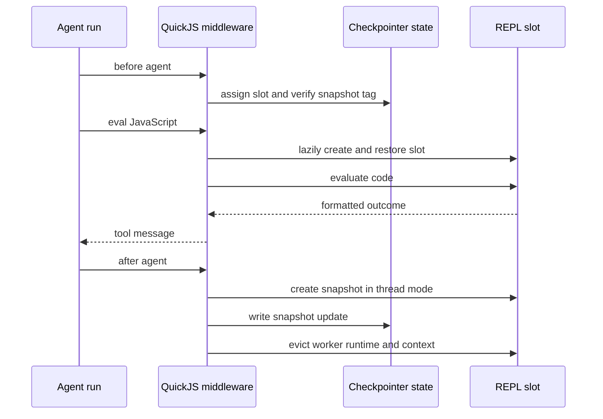

# Sandbox and Partner Integrations

A dcode sandbox provider supplies a `SandboxBackendProtocol`: an execution and filesystem backend identified by `id`. dcode owns provider selection and factory lifecycle; a partner distribution owns its provider SDK, credentials, remote-resource semantics, and backend implementation. Selecting a sandbox changes the execution/filesystem backend. It is not a project-trust, authorization, or general isolation policy. See [Deep Agents Code Architecture](/openwiki/architecture/code-agent.md), [Architecture Overview](/openwiki/architecture/overview.md), and [Talon](/openwiki/integrations/talon.md).

## Provider contract, discovery, and lifecycle

A `SandboxProvider` implements synchronous `get_or_create(sandbox_id=..., **kwargs)` and `delete(sandbox_id=..., **kwargs)`. Its async convenience methods dispatch those blocking operations to worker threads. `SandboxProviderMetadata` carries the provider working directory, install hint, attachment and named-snapshot capability flags, and an optional backend module for a dependency preflight check.

`SandboxRegistry` merges configured providers, installed `deepagents_code.sandbox_providers` entry points, and curated built-ins. A name collision resolves in this order: configuration, entry point, then built-in. The curated names are `agentcore`, `daytona`, `langsmith`, `modal`, `openshell`, `runloop`, and `vercel`. Entry-point enumeration is best-effort. Configured and built-in metadata is static; to obtain entry-point metadata the registry constructs the provider, falling back to `/workspace` if that probe fails.

*Provider resolution is configuration over entry point over built-in.*

A configuration entry may set `class_path`, working directory, installation package, capability flags, and creation parameters. `class_path` is trusted operator configuration: resolving it imports arbitrary Python. A configured default does not enable sandbox mode on its own; the caller must explicitly opt in. On the default configuration path, a managed `[sandboxes]` section takes precedence over the user section. An unreadable or invalid user configuration is exposed as `parse_error` while applicable managed policy remains available; an explicit configuration path excludes managed policy.

`create_sandbox()` reads metadata before acquisition. It rejects `snapshot_name` when unsupported and rejects a snapshot combined with `sandbox_id`, because a snapshot only applies to a newly created resource. It overlays explicit `params` on configured provider parameters, translates `snapshot_name` to `snapshot`, and invokes `get_or_create()`.

*The factory deletes only a resource it created; it does not delete a backend supplied by the caller’s ID.*

The factory reads a setup file on the host after acquisition, expands `${VAR}` from the active workspace environment, and executes the result in the backend using `bash -c`. A file error, command exception, or nonzero result prevents the context body. A factory-owned backend is still deleted after setup failure, caller failure, or normal completion; an attached backend is retained. Cleanup errors are reported but do not replace the initiating exception.

The server enters the factory context in a worker thread, retains a successfully opened context for the server process lifetime, and registers it for `atexit` cleanup. If cancellation arrives after context entry, it closes the context before preserving the cancellation. Startup failures are surfaced rather than silently falling back to host execution.

## Curated adapters

The built-in `_ModalProvider` is a dcode lifecycle adapter around the independently distributed `langchain-modal` backend. It requires either both workspace `MODAL_TOKEN_ID` and `MODAL_TOKEN_SECRET` or neither; exactly one token fails closed. It attaches by ID or creates a `/workspace` sandbox under the `deepagents-sandbox` app, polls readiness, and terminates a newly created sandbox that fails startup. `ModalSandbox.execute()` uses `bash -c` and returns combined stdout and stderr. Its direct transfers require absolute paths, handle ordinary filesystem failures per item, close handles best-effort, and translate failures to standardized protocol errors.

The dcode Daytona provider creates fresh sandboxes, does not attach by `sandbox_id`, polls readiness through its startup timeout, and best-effort deletes a sandbox that never becomes ready. An explicit `DAYTONA_SANDBOX_SNAPSHOT_ID` takes precedence over snapshot names. The `DaytonaSandbox` partner adapter applies one monotonic deadline across session creation, command start, polling, and final-log retrieval when a finite timeout is given; `timeout=0` leaves command-phase requests unbounded. A timeout returns exit code `124` with best-effort logs, sharing a two-second cleanup budget between log recovery and session deletion. Its transfer adapter rejects relative paths, preserves download order, and maps missing downloaded content to `file_not_found`. These are adapter-specific semantics, not generic sandbox guarantees.

## Packaging, ownership, and local development

Six curated external adapters—AgentCore, Daytona, Modal, OpenShell, Runloop, and Vercel—are optional `deepagents-code` extras and are aggregated by `deepagents-code[all-sandboxes]`. `langsmith[sandbox]` is a normal dcode dependency. `langchain-quickjs>=0.3.11,<0.4.0` is also a normal dcode dependency; the empty `deepagents-code[quickjs]` extra remains solely for backwards-compatible installation commands. The OpenShell extra installs `langchain-nvidia-openshell>=0.1.1`.

The checked-in manifests define a deliberately compatible release line: `deepagents-code` 0.2.2 requires Python `>=3.14,<3.15` and `deepagents==0.7.32`; the Daytona 0.0.9, Modal 0.0.7, Runloop 0.0.7, Vercel 0.0.2, and QuickJS 0.3.11 partner packages require `deepagents>=0.7.32,<0.8.0`. They require Python `>=3.11,<4.0`, so dcode's Python requirement is the stricter constraint in a combined installation. The provider adapters respectively declare `daytona>=0.197.0`, unbounded `modal`, unbounded `runloop-api-client`, and `vercel>=0.5.9`; QuickJS declares `quickjs-rs>=0.2.5,<0.3.0`, LangChain, LangGraph, and `bsdiff4>=1.3.0`. Widen these independently versioned constraints only after testing the integration boundary, rather than assuming the dcode extra's lower bound certifies every partner release.

Partner packages are independently versioned distributions with their own environment, `pyproject.toml`, `Makefile`, and tests. The dcode development environment maps Daytona, Modal, QuickJS, Runloop, and Vercel to editable local checkouts; it does not map OpenShell. This supports co-development without changing the ownership boundary: dcode's registry owns discovery and dcode's factory owns lifecycle, while a partner owns its backend behavior.

Third parties can publish a provider entry point; an operator can configure an internal provider class. For a new repository partner, the partner guidance also requires wiring repository release, CI, test-matrix, credential, labeling, and package-management surfaces.

## QuickJS: in-process middleware, not a remote sandbox

`langchain-quickjs` is a partner distribution for JavaScript REPL middleware, not a registered dcode sandbox provider. `CodeInterpreterMiddleware` exposes an `eval` tool to a LangChain agent and stores a private slot identifier in LangGraph state. The registry gives each active slot a dedicated worker thread, QuickJS runtime, and context, isolating live JavaScript globals between slots; a model-only turn does not allocate a runtime. The eval schema advertises no filesystem, network, or real-clock access. This capability boundary is not a remote sandbox or general security boundary.

Runtime construction rewrites top-level `const` and `let` declarations to persistent globals. Overlapping evaluation against a shared context returns `ConcurrentEval` rather than being queued. Console output and returned result blocks are bounded before they are sent to the model.

### Slot and snapshot lifecycle

The default `mode="thread"` preserves state across calls and turns. `mode="turn"` preserves state only for one agent turn, while `mode="call"` resets the REPL after each `eval`. `before_agent` assigns a private slot if absent and authenticates an existing thread snapshot without allocating a VM. Restore happens lazily on the first evaluation. `after_agent` snapshots an existing thread REPL and evicts its in-memory slot; non-thread modes evict without persisting.

*Thread mode restores only when evaluation needs a slot, persists at the end of the run, and then releases in-process resources.*

QuickJS heap snapshots are full serializations, but state persistence uses a `DeltaChannel` patch chain. When no smaller `bsdiff4` delta is available, it writes a `("snap", payload)` anchor; otherwise it writes a `("patch", bsdiff4_patch)`. Reconstruction deterministically replays anchors, patches, and clears. Encoding calculates against the materialized prior snapshot, so it needs no in-process cache and remains valid across checkpoint reconstruction, forks, and time travel.

`max_snapshot_bytes` defaults to the memory limit. An oversized snapshot or snapshot-creation failure clears both payload and authentication tag. When configured, `snapshot_signing_key` HMAC-SHA256-signs the materialized snapshot while binding it to the slot ID; a missing, altered, or cross-slot tag is rejected and cleared before restore. Without that key, legacy snapshots are restored without integrity verification. A restore failure returns a recoverable error, clears persistence, and does not execute the requested JavaScript.

## Programmatic tool calls and operational limits

With `ptc` configured, selected tools are exposed as asynchronous `tools.<camelCase>(input)` functions; the REPL tool itself is excluded. Bindings and rendered prompts are slot-specific and are prepared from the current request tool list. The default `max_ptc_calls=256` limits bridge calls per eval; an overflow returns `PTCCallBudgetExceeded` before invoking the tool. Setting it to `None` removes that protection and is unsafe for untrusted prompts.

QuickJS's five-second default is VM execution time, not wall-clock time spent in Python-hosted `tools.*` calls. Programmatic calls bypass the normal `ToolNode` route, so ordinary `interrupt_on` and HITL approval do not run for each bridge call. The optional top-level `task(...)` subagent bridge likewise runs within an already approved `eval`; it has a per-REPL concurrency limit of 32, not a total dispatch budget. Gate `eval`, add approval middleware inside subagent specifications, or disable subagents when dispatch-level approval is required. See [Security](/openwiki/operations/security.md).

## Testing and safe changes

- dcode unit tests cover registry precedence and metadata fallback, configuration errors, snapshot validation, parameter forwarding, setup failure, attachment ownership, and cleanup reporting. The optional integration suites exercise real provider creation, command execution, transfers, and filesystem operations, but release-pipeline skips and explicit skipped error paths mean they do not replace deterministic unit tests.
- Preserve factory ownership: only a newly created resource may be deleted, and setup failures must take the same cleanup path. Do not generalize Daytona's deadline, polling, or `124` behavior to another adapter without implementing and testing it there.
- QuickJS tests cover snapshot round trips, mode reset behavior, invalid restore clearing, snapshot caps, delta-chain replay and fork recovery, signing failures, lazy allocation, concurrent evaluation, and PTC call budgets. The partner `pyproject.toml` owns its test environment and warning policy. See [Testing Guide](/openwiki/testing/testing-guide.md).
- For a shared or untrusted checkpointer, configure a high-entropy `snapshot_signing_key` consistently across processes resuming the same state. Rotate it by starting fresh threads; omission is a deliberate trusted-store compatibility decision.
