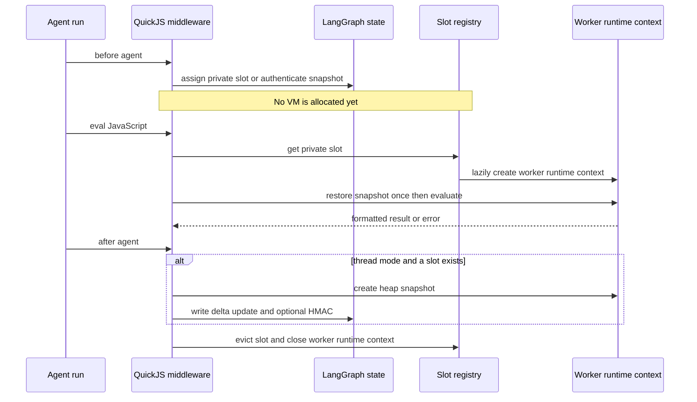

# Sandbox and Partner Integrations

A dcode sandbox provider supplies a `SandboxBackendProtocol`: an execution and filesystem backend identified by `id`. dcode owns provider selection and factory lifecycle; a partner distribution owns its provider SDK, credentials, remote-resource semantics, and backend implementation. Selecting a sandbox changes the execution/filesystem backend. It is not a project-trust, authorization, or general isolation policy.

QuickJS is different: `langchain-quickjs` is middleware that embeds an interpreter in the agent process. It is a restricted in-process capability boundary, **not** a remote sandbox. It has no ambient filesystem, network, standard-library, or real-clock capability, but explicitly bridged tools and subagents add authority. See [SDK Middleware Assembly](/openwiki/architecture/middleware-stack.md), [Permissions and Human Approval](/openwiki/concepts/permissions-hitl.md), [State, Threads, and Persistence](/openwiki/concepts/state-persistence.md), and [Security and Trust Boundaries](/openwiki/operations/security.md).

## Remote sandbox providers

A `SandboxProvider` implements synchronous `get_or_create(sandbox_id=..., **kwargs)` and `delete(sandbox_id=..., **kwargs)`; async convenience methods send those blocking operations to worker threads. `SandboxProviderMetadata` describes working directory, installation hint, attach and named-snapshot support, and an optional dependency-probe module.

`SandboxRegistry` merges configured providers, installed `deepagents_code.sandbox_providers` entry points, and curated built-ins. A collision resolves as **configuration, then entry point, then built-in**. Entry-point enumeration is best-effort. A configured `class_path` is trusted operator configuration because resolving it imports arbitrary Python; a configured default does not enable sandbox mode unless the caller explicitly opts in.

`create_sandbox()` reads metadata before acquisition. It rejects unsupported named snapshots and a snapshot combined with `sandbox_id`, overlays explicit parameters on configured parameters, and runs an optional setup file in the acquired backend after expanding workspace environment variables. The factory deletes only a resource it created—not an attached resource—and logs a cleanup failure without replacing an initiating error. The server holds a successfully opened factory context for its process lifetime and closes it at exit; cancellation after context entry also closes the factory-owned context.

Curated external adapters are optional extras, while LangSmith sandbox support and QuickJS are ordinary dcode dependencies. Partner packages remain independently versioned distributions with their own manifests, environments, and tests. Their backend details are adapter-specific: for example, the dcode Daytona provider creates fresh sandboxes rather than attaching by ID, while Modal creates or attaches sandboxes in its own provider domain. Do not mistake a dcode factory lifecycle adapter or a remote sandbox backend for the QuickJS REPL described below.

## QuickJS middleware entrypoint and capability boundary

Install and attach the middleware to an agent:

```python
from deepagents import create_deep_agent
from langchain_quickjs import CodeInterpreterMiddleware

agent = create_deep_agent(
    model="claude-sonnet-4-6",
    middleware=[CodeInterpreterMiddleware()],
)
```

`CodeInterpreterMiddleware` registers the `eval` tool (customizable with `tool_name`) and appends a system-prompt addendum on model calls. The public tool description advertises JavaScript execution with no filesystem, network, or real clock. It also documents the configured persistence mode. The interpreter uses `quickjs-rs`; the partner distribution depends on Deep Agents, LangChain, LangGraph, `quickjs-rs`, and `bsdiff4`.

The absence of ambient host APIs is valuable confinement for pure computation, but not a complete security boundary. `console` is an optional host bridge, and enabling programmatic tool calling (PTC) or subagent dispatch gives JavaScript the authority of the selected agent tools or subagents. A remote sandbox instead moves execution to a provider-managed environment with its own identity, mounts, egress, credentials, quotas, and lifecycle. Choose and secure each boundary independently.

## Slot identity, lazy allocation, and reset modes

The middleware stores an opaque `qjs_...` slot identifier in **private LangGraph state**. It is generated by `before_agent` when absent. This is not the LangGraph `thread_id`, despite older registry comments that use that name: the registry is keyed by this private slot ID, and snapshots are bound to it.

A slot is deliberately lazy. `before_agent` assigns or authenticates state but does not create a VM. A model-only run therefore allocates no worker, runtime, or context. The first `eval` gets the slot from `_Registry`, which constructs one `ThreadWorker`, one QuickJS `Runtime`, and one `_ThreadREPL` context for that slot. QuickJS objects remain on that worker because they are not safely transferable across threads. Runtime construction enables `SourceTransform.TOP_LEVEL_CONST_TO_VAR`, making top-level `const` and `let` bindings persist as globals in that context. Concurrent evaluation of one context is reported as `ConcurrentEval`; it is intentionally not queued.

| `mode` | State lifetime | Reset action |
| --- | --- | --- |
| `"thread"` (default) | Across eval calls and agent runs that retain the private slot state | Snapshot after a run that allocated a REPL, then evict the slot. |
| `"turn"` | Across eval calls in one agent run only | `after_agent` evicts the slot without writing a snapshot. |
| `"call"` | One `eval` call | The eval `finally` block replaces its REPL context while retaining that slot's worker and runtime; `after_agent` subsequently evicts the slot. |

The call-mode distinction matters: its immediate reset is **not** a full worker/runtime rebuild. `reset_repl()` closes and replaces only `_ThreadREPL`; final eviction closes context, runtime, and worker. In all modes, `after_agent` removes cached prompt/binding data for the slot. The middleware destructor best-effort closes every remaining registry slot.



*The private slot ID—not the public graph thread ID—keys lazy live resources; thread mode persists data, not a live VM, between agent runs.*

## Snapshot persistence and recovery

Only thread mode reads or writes persisted JavaScript state. `before_agent` checks HMAC authenticity when `snapshot_signing_key` is configured, but leaves parsing and restoration lazy until the first eval. A valid payload is restored once before evaluation. If restore fails, the tool returns a recoverable restore error, clears both persisted fields, and does not run the requested JavaScript.

After a thread-mode run that created a REPL, `after_agent` serializes its heap, enforces `max_snapshot_bytes` (defaulting to `memory_limit`), then evicts the live slot. Snapshot failure or an oversized payload clears both payload and HMAC rather than retaining stale state. If no eval allocated a slot, there is nothing to snapshot or evict.

The snapshot channel is a `DeltaChannel`, not an in-memory cache. A first or non-beneficial update writes a `("snap", payload)` anchor; a smaller `bsdiff4` encoding writes `("patch", patch)`. Replay deterministically applies anchors, patches, and clears to materialize bytes, so checkpoint reconstruction, forks, and time travel do not depend on a process-local registry.

With `snapshot_signing_key`, HMAC-SHA256 covers the materialized bytes and private slot ID. Missing, altered, wrong-key, or copied-to-another-slot tags are rejected and cleared before restoration. Without a key, legacy snapshots remain restorable without integrity verification. Use one high-entropy key across processes that resume the same state, and rotate it by starting fresh threads.

## Request-scoped prompt and tool bindings

On every model call, `wrap_model_call` or `awrap_model_call` calls `_prepare_for_call()` with the current `ModelRequest`. The base prompt is cached only by construction-time configuration; the request-sensitive portion is not assumed to be global:

- The current request tool list is read after upstream middleware may have filtered it.
- With `ptc` configured, `filter_tools_for_ptc()` applies its explicit allowlist and excludes the REPL tool itself. The selected `BaseTool` instances are cached by private slot ID, and the rendered `tools.<camelCase>(input)` API reference is cached only while the same tool identities remain exposed for that slot.
- At eval time, the slot installs or updates the `globalThis.tools` namespace from those current bindings. The namespace is rebuilt to contain only active names; host bridges already registered in a live context may be reused, but inactive names are removed from `tools`.
- A `task(...)` guidance section is appended only when `subagents=True` **and** the current request contains a recognized Deep Agents `task` tool. Thus the model is not prompted to dispatch subagents merely because the middleware exists.

The middleware can expose a top-level `task` bridge when subagents are enabled. It validates `description` and `subagentType`, optionally accepts `label` and `responseSchema`, and locates the current outer runtime's task tool when invoked. It executes the subagent on the caller's event loop where needed. The per-REPL semaphore defaults to 32 simultaneous calls; it is a concurrency limit, not a process-wide admission policy or a total-dispatch budget. The system guidance tells models to use `Promise.all` for independent work and to pass complete, self-contained descriptions and file/symbol locators rather than pasted contents.

## Timeouts, approvals, and bridged authority

`timeout` defaults to five seconds and bounds QuickJS VM execution per eval; `timeout=None` disables the VM deadline. It does **not** bound total wall-clock time: time awaiting Python-hosted `tools.*` calls or `task()` runs is outside the VM budget. Do not claim that the timeout will terminate a slow host tool. Use a workflow, process, or service limit that can stop the work when an end-to-end deadline is required; disabling the VM timeout is appropriate only with such an external control.

PTC is opt-in (`ptc=None` by default). It exposes selected tools as async JavaScript functions and forwards outer runtime state, store, context, callbacks, config, and a synthesized tool-call ID. `max_ptc_calls=256` is a per-eval bridge-call budget; overflow occurs before the extra tool invocation. `None` removes that limit and is unsafe for untrusted prompts because JavaScript can make unbounded bridged calls.

Neither PTC nor `task()` travels through the parent `ToolNode` path. Consequently parent `interrupt_on` / HITL approval does not run separately for each bridged call or subagent dispatch. The `eval` invocation itself is the approval boundary. If per-action review is necessary, gate `eval`, configure approval middleware within the subagent specification, use normal parent tool calls outside JavaScript, or set `subagents=False`. A tool allowlist, a review rule, and the no-ambient-capabilities interpreter are complementary controls—not substitutes for a remote sandbox or backend-level isolation.

## Configuration and focused verification

Important constructor controls are `memory_limit` (64 MiB by default), `timeout`, `max_result_chars`, `capture_console`, `subagents`, `max_subagent_concurrency`, `ptc`, `mode`, `max_snapshot_bytes`, and `snapshot_signing_key`. Result and console blocks are bounded before returning to the model; disabling console capture omits the global console bridge.

Run QuickJS tests through the owning package Makefile:

```bash
make -C libs/partners/quickjs test TEST_FILE=tests/unit_tests/test_repl_middleware.py
make -C libs/partners/quickjs test TEST_FILE=tests/unit_tests/test_snapshot.py
make -C libs/partners/quickjs test TEST_FILE=tests/unit_tests/test_prompt_modes.py
make -C libs/partners/quickjs test TEST_FILE=tests/unit_tests/smoke_tests/test_system_prompt.py
```

The unit coverage exercises slot laziness, independent worker/runtime allocation, call-mode context replacement, eviction, snapshot caps and failed restores, delta replay, HMAC failures, persistence modes, PTC binding isolation and budgets, subagent concurrency, and timeout behavior. Prompt smoke tests compare a complete agent prompt with committed snapshots, including the no-timeout case: when `timeout=None`, the prompt intentionally mentions memory but contains no timeout wording. Update those snapshots only for an intentional prompt-contract change. See [Testing Guide](/openwiki/testing/testing-guide.md).
