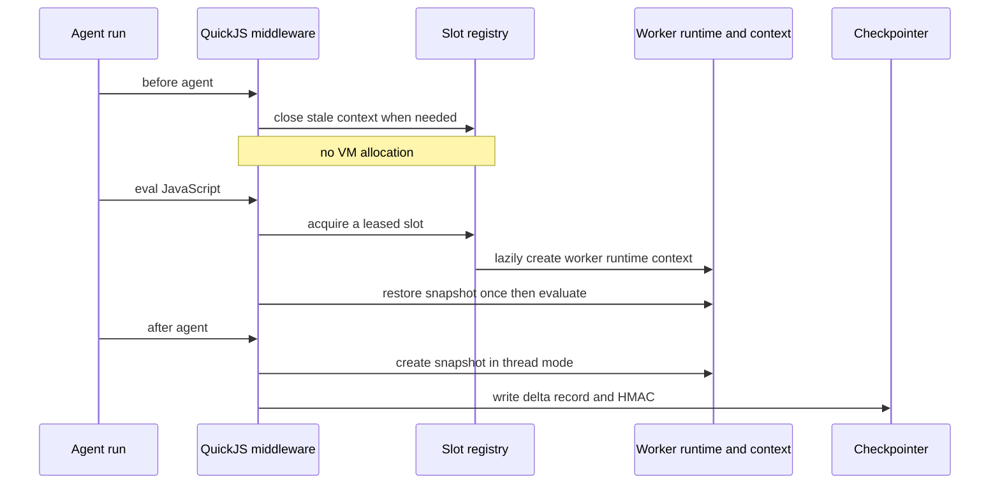
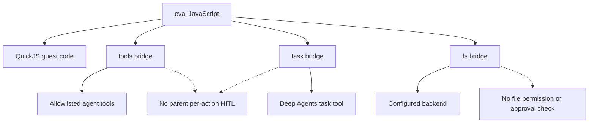

# Sandbox and Partner Integrations

`langchain-quickjs` 0.4.0 is an optional Deep Agents middleware, not a remote sandbox provider. `CodeInterpreterMiddleware` adds a configurable `eval` tool and a prompt addendum; it runs QuickJS through `quickjs-rs` in the **agent process**. It is useful when the model needs to retain JavaScript values and orchestrate work in one evaluation, including concurrent `Promise` work, rather than return to the model for every individual tool call.

QuickJS starts with no ambient filesystem, network, process, `require`, or real-clock capability. That is a useful containment property for pure guest JavaScript, but it is **not** a complete authorization boundary. `tools.*`, `task()`, and `fs` are explicit host bridges: once enabled, guest code can exercise the authority granted through each bridge. A remote execution environment likewise needs its own identity, filesystem, egress, secret, and quota policy.

## Install and attach the middleware

```bash
uv add langchain-quickjs
```

```python
from deepagents import create_deep_agent
from langchain_quickjs import CodeInterpreterMiddleware

agent = create_deep_agent(
    model="claude-sonnet-4-6",
    middleware=[CodeInterpreterMiddleware()],
)
```

The package requires Python `>=3.11,<4.0` and pins compatible Deep Agents, LangChain, LangGraph, `quickjs-rs`, and `bsdiff4` ranges. The default middleware configuration is a 64 MiB QuickJS runtime memory limit, a five-second VM timeout, a `max_ptc_calls` limit of 256, captured console output, enabled subagent support when a recognized task tool is present, and `thread` persistence mode.

`timeout` measures time executing inside the QuickJS VM, not Python wall-clock time spent awaiting a tool, task, or filesystem host call. Thus a slow bridge can outlive the timeout. `timeout=None` removes the VM deadline; use it only with an external process or workflow limit that can stop runaway JavaScript. Results and captured stdout are independently bounded by `max_result_chars` (default 4,000).

## Interpreter, context, and slot lifecycle

The middleware keeps private state: a generated `qjs_...` slot identifier and, in thread mode, optional snapshot bytes and an HMAC. The identifier is implementation state, not the public LangGraph `thread_id`. A process-wide registry keys warm slots by that identifier and interpreter configuration. A slot owns one worker thread, QuickJS runtime, and context because QuickJS objects must remain on their owning thread.

No worker, runtime, or context is constructed merely because the middleware is attached or a model takes a no-`eval` turn. The first `eval` acquires a slot and lazily creates its worker, runtime, and context. The runtime transforms top-level `const` declarations to persistent globals, allowing top-level bindings to survive subsequent evaluations in the same context. Evaluations on one context are deliberately not queued: an overlapping request returns `ConcurrentEval` rather than silently serializing execution.



*The checkpoint stores reconstructible interpreter state; a warm slot is only a process-local optimization.*

The persistence modes define the JavaScript state lifetime:

| `mode` | Context state lifetime | End-of-run behavior |
| --- | --- | --- |
| `"thread"` (default) | Across eval calls and later completed runs for the same checkpointed state | Snapshot state after the agent run; the matching context may remain warm. |
| `"turn"` | Across eval calls in one agent run | Close the context after the run; do not persist a snapshot. |
| `"call"` | One eval call | Dispose the context in the eval cleanup path, even on an eval error. |

At the next non-resume `before_agent`, a live context that is not known to match the checkpoint snapshot is closed. This prevents uncheckpointed mutations left by a failed or cancelled run from leaking into the next run; the worker and runtime can remain warm. A graph resume does not rerun `before_agent`, so an interrupted run can continue with its live context. The registry holds at most 32 warm slots per process. When the cap is exceeded, it evicts least-recently-used slots only when they have no lease and no running eval; slot closing is done outside the registry lock.

## Persistent snapshots and restore failure

Thread mode serializes the whole QuickJS heap after a successful agent run. The state channel holds compact records rather than a full heap at every checkpoint: `snap` anchors set a full base, `patch` applies a `bsdiff4` delta to the base, and `clear` resets it. Replay folds those records deterministically, so the full bytes can be reconstructed for a new process, checkpoint fork, or time-travel replay. A patch is used only when it is smaller than a fresh anchor.

`max_snapshot_bytes` defaults to `memory_limit`. An oversized snapshot or a snapshot-creation failure clears both the saved payload and its signature rather than leaving stale state. Restoration is lazy: a model-only turn neither creates an interpreter nor restores one.

Set `snapshot_signing_key` for deployments whose checkpointer is not fully trusted. The middleware HMAC-SHA256-signs the **materialized** snapshot bytes with domain separation and binds the tag to the private slot identifier. The signature is created before delta encoding and verified after replay, which detects altered, missing, wrong-key, and cross-slot snapshots. Without a key, legacy snapshots are not integrity checked.

If a signature fails verification during preparation, the saved payload and tag are cleared and never restored. If QuickJS rejects an otherwise accepted snapshot at the first `eval`, the tool returns a restore error, clears both saved fields, and does **not** execute the requested JavaScript. This makes a restore failure recoverable without running code against an unknown partial state.

## Granted bridges and approval limitations



*Guest isolation constrains only pure QuickJS; every bridge arrow is an authority grant to the host capability it reaches.*

### Programmatic tool calling

PTC is disabled unless `ptc` is a list of tool names and/or explicit `BaseTool` instances. The middleware filters against the live upstream tool list for each model call, excludes its own eval tool, deduplicates names, validates that their camel-case forms are valid JavaScript identifiers, and rebuilds `globalThis.tools` from the current bindings. The Deep Agents `task` tool is reserved: it cannot be placed under `tools.*`, because subagent dispatch has its own top-level `task()` interface.

PTC calls invoke the selected tool through the REPL bridge rather than the normal `ToolNode` route. The bridge injects the enclosing runtime, state, store, context, and a synthetic tool-call ID where supported; it applies supported `Command(update={...})` state updates except `messages`. Routing or resume commands cannot be applied inside `eval` and surface as `UnsupportedCommand`.

The per-eval call budget is shared by `tools.*` and `fs` bridge calls. Set `max_ptc_calls=None` only in trusted deployments: it permits unbounded host-call loops. The bridge preserves ordinary tool lifecycle callbacks, but callback visibility does not add a per-call authorization check.

### Filesystem bridge

`fs` is disabled by default. Supply a backend explicitly, or use `fs=True` with `create_deep_agent` so it binds the agent backend. It exposes asynchronous UTF-8 text `readFile`, `writeFile`, `readdir`, `access`, and `rm`, including `fs.promises`. A middleware instance configured with `fs=True` cannot be reused for unrelated non-state backends.

The filesystem bridge calls its backend directly, not agent file tools. Therefore `FilesystemMiddleware` rules, `create_deep_agent` permissions, and parent `interrupt_on` approval do not protect individual filesystem operations. It grants all reach of the chosen backend, potentially host files for a local or non-virtual backend. Do not enable it where file-level approval is the authorization boundary; choose a backend whose own sandbox and credentials limit the intended files. A result that cannot fit or marshal into JavaScript becomes `MarshalError`.

### Subagents, callbacks, and observability

When `subagents=True` and the live tool set has a recognized Deep Agents task tool, top-level `task()` validates `description`, `subagentType`, optional `label`, and optional response schema. A per-REPL semaphore permits 32 simultaneous dispatches by default; it is neither a process-wide admission control nor a total-dispatch limit. `GraphInterrupt` propagates so graph resumption remains possible.

Both sync and async eval handlers replace the enclosing runtime callback configuration with the eval invocation callbacks. Consequently PTC tool calls and subagent task dispatches are callback children of `eval`, rather than children of the agent tools step. This is trace attribution only: it does not restore parent `ToolNode` per-action `interrupt_on` or human-in-the-loop enforcement. Gate the `eval` tool if that is the desired approval boundary, use normal tool calls when each action needs review, and place approval middleware inside subagent specifications when appropriate.

Subagent dispatch emits custom-stream events with `type: "subagent"` in `start`, then `complete` or `error` phases. With a parent eval tool-call ID, the dispatch ID is a deterministic hash of that ID, the task tool name, host-invocation ordinal, and request payload; replay in the same invocation order reproduces it. A UI should treat repeated `start` events as upserts. Without a parent eval ID, an ID is random. Writer failures are swallowed so telemetry does not break dispatch.

## Focused verification

The most relevant tests are the package test files, run through its Makefile:

```bash
make -C libs/partners/quickjs test TEST_FILE=tests/unit_tests/test_snapshot_persistence.py
make -C libs/partners/quickjs test TEST_FILE=tests/unit_tests/test_snapshot.py
make -C libs/partners/quickjs test TEST_FILE=tests/unit_tests/test_slot_cleanup.py
make -C libs/partners/quickjs test TEST_FILE=tests/unit_tests/test_subagent_replay.py
make -C libs/partners/quickjs test TEST_FILE=tests/unit_tests/test_end_to_end.py
```

Snapshot tests cover cross-turn bindings, model-only lazy allocation, signing, delta-chain reconstruction, and the guarantee that failed restoration clears state before requested code runs. Slot-cleanup tests cover failed, cancelled, and interrupted runs, stale-context cleanup, and warm-context reuse. The replay test verifies stable subagent identities across checkpoint resumes. The end-to-end callback test establishes eval-parented trace attribution for both sync and async paths.
