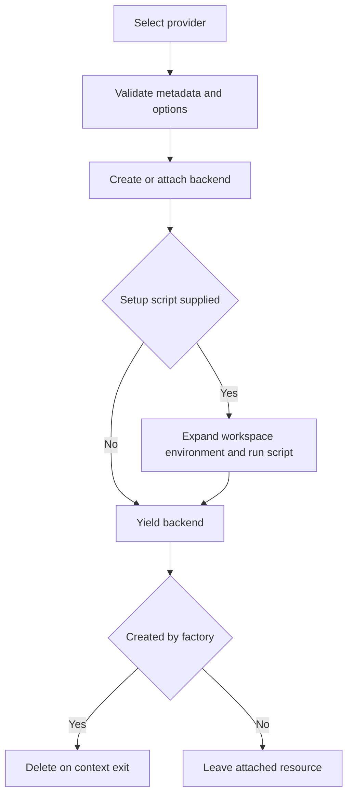
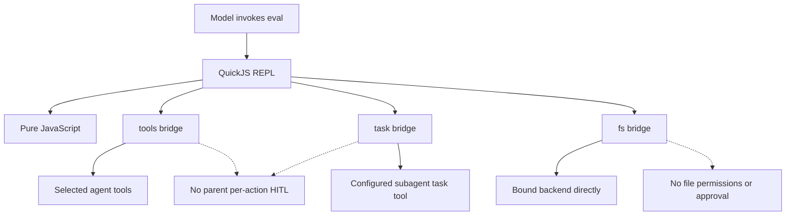
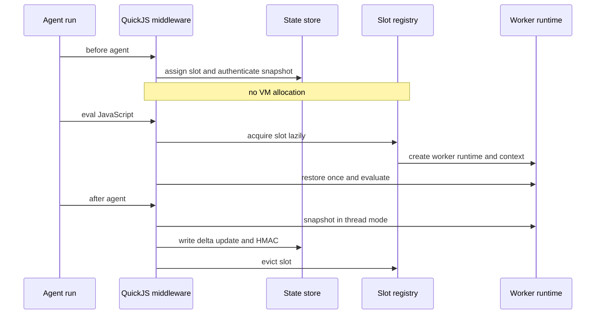

# Sandbox and Partner Integrations

A dcode sandbox provider supplies a `SandboxBackendProtocol`: an execution and filesystem backend identified by `id`. dcode selects the provider and manages the lifetime of a resource it creates; the provider package owns its SDK, credentials, remote-resource behavior, and backend adapter. A remote sandbox changes where command and filesystem operations execute, but it is not alone a complete authorization policy: assess the provider environment, identity, mounts, egress, credentials, and quotas.

QuickJS is a separate integration. `langchain-quickjs` is middleware running an embedded interpreter in the **agent process**, not a dcode remote-sandbox provider. Pure JavaScript has no ambient filesystem, network, or real-clock API, but configured bridges grant host authority. Therefore neither a QuickJS interpreter nor a remote sandbox should be described as a complete authorization boundary. In particular, direct filesystem access, programmatic tool calls (PTC), and subagent dispatch do not take the normal parent tool/file approval route. See [Permissions and Human Approval](/openwiki/concepts/permissions-hitl.md) and [Security](/openwiki/operations/security.md).

## Remote sandbox lifecycle and Modal

A provider implements synchronous `get_or_create(sandbox_id=..., **kwargs)` and `delete(sandbox_id=..., **kwargs)`; its async helpers run that blocking work in worker threads. `create_sandbox()` obtains provider metadata before acquisition, rejects unsupported snapshots and the `snapshot_name` plus `sandbox_id` combination, overlays explicit `params` on configured parameters, and can execute a setup script after substituting values from the bound workspace environment. It deletes only a resource it created, including when setup fails; cleanup failure is reported without masking the original failure.



*The factory validates before acquisition and uses ownership, not access, to decide cleanup.*

### Modal identity, startup, and adapter

The dcode Modal provider resolves `MODAL_TOKEN_ID` and `MODAL_TOKEN_SECRET` from the workspace environment, including `DEEPAGENTS_CODE_`-prefixed resolution. Both values produce a credentialed Modal client. A partial pair is rejected rather than silently falling back to the server identity; with neither value, Modal default authentication is used. The selected client looks up or creates the `deepagents-sandbox` app.

For a new resource, it creates a Modal sandbox with `/workspace` as the working directory and polls `echo ready` until the startup deadline; if that deadline expires, it terminates the sandbox before raising. A supplied ID is attached with `Sandbox.from_id`. The result is a `ModalSandbox`, which exposes Modal `object_id` as its backend ID and executes commands through `bash -c`, returning combined stdout/stderr, the Modal exit code, and `truncated=False`. Its default command timeout is 30 minutes; explicit `0` keeps Modal's indefinite-wait meaning.

`ModalSandbox` performs byte transfers one item at a time, preserving request order. Non-absolute paths become `invalid_path`; recognized Modal filesystem errors are normalized to `file_not_found`, `permission_denied`, or `is_directory`. Unrecognized provider errors, such as `SandboxFilesystemFileTooLargeError`, propagate; a mapped error for one item does not prevent later items from running. Its inherited `BaseSandbox` listing, search, read, write, and edit helpers are conveniences built on shell execution and raw transfer primitives, and do not reduce the shell-capability trust boundary.

The Modal integration suite supplies real credentials only when both `MODAL_TOKEN_ID` and `MODAL_TOKEN_SECRET` exist, wraps the created remote resource in `ModalSandbox`, and terminates it after the shared conformance tests.

## Partner package compatibility

Partner integrations are independently released distributions. The release manifest currently lists Deep Agents `0.7.40`, dcode `0.2.11`, Daytona `0.0.9`, Modal `0.0.8`, Runloop `0.0.7`, Vercel Sandbox `0.0.2`, and QuickJS `0.3.12`. Daytona, Modal, Runloop, and Vercel require Python `>=3.11,<4.0` and Deep Agents `>=0.7.40,<0.8.0`. dcode requires Python `>=3.14,<3.15`, pins `deepagents==0.7.40`, depends normally on `langchain-quickjs>=0.3.12,<0.5.0`, and makes the `quickjs` extra empty solely for backwards-compatible install commands. Its remote-provider extras include `langchain-modal>=0.0.8`.

`langchain-quickjs` itself is version `0.3.12`, supports Python `>=3.11,<4.0`, and bounds Deep Agents, LangChain, LangGraph, `quickjs-rs`, and `bsdiff4` in its package manifest. Maintain each package's dependency manifest and lock independently rather than hand-editing a lockfile.

## QuickJS entrypoint and capability boundary

Attach `CodeInterpreterMiddleware` to an agent; it contributes an `eval` tool (customizable with `tool_name`) and a model-call system-prompt addendum.

```python
from deepagents import create_deep_agent
from langchain_quickjs import CodeInterpreterMiddleware

agent = create_deep_agent(
    model="claude-sonnet-4-6",
    middleware=[CodeInterpreterMiddleware()],
)
```

`REPLState` stores a private `qjs_...` slot ID and, only for thread persistence, an optional `DeltaChannel` snapshot plus HMAC. It is not a public LangGraph `thread_id`. Each slot owns a worker, runtime, and context, so QuickJS objects remain on their owning thread. Runtime creation transforms top-level `const` declarations into persistent globals. Concurrent evaluations against one context fail as `ConcurrentEval`; they are intentionally not queued.

The `console` object is an optional bridge. PTC can expose an allowlisted set of agent tools as `tools.*`; `task()` is available only when subagents are enabled and the current tool set contains a recognized Deep Agents task tool. `fs` is disabled by default. It can be supplied with a backend or set to `True` for the backend bound by `create_deep_agent`, and exposes async UTF-8-only `readFile`, `writeFile`, `readdir`, `access`, and `rm` APIs, including `fs.promises`.



*Every host bridge is an explicit authority grant; pure QuickJS capability restrictions do not constrain the capabilities reached through an arrow.*

### Approval bypasses and operational limits

`fs` calls the backend directly, not file tools. Consequently, `FilesystemMiddleware` rules, `create_deep_agent` `permissions`, and `interrupt_on` do not govern its individual reads, writes, or deletions. It has the full reach of the supplied backend, which can include host files for a non-virtual `FilesystemBackend` or local shell backend. Enable it only when that backend itself limits reach appropriately. A single `fs=True` middleware instance can serve one non-interchangeable backend and must be bound before the model call.

PTC excludes the middleware's own `eval` tool, applies its allowlist after upstream tool filtering, and rebuilds the active `globalThis.tools` namespace from current bindings. Both PTC and `fs` consume the per-eval `max_ptc_calls` budget (default 256); `None` removes the budget and permits unbounded host-call loops. A host result too large or too deeply nested to marshal becomes a per-eval `MarshalError`. `timeout` defaults to five seconds and limits VM execution, not wall-clock time in Python-hosted `tools.*` or `task()` work.

PTC and `task()` execute outside the normal parent `ToolNode` path. The eval handlers patch the enclosing `ToolRuntime` with the eval invocation's callbacks, so bridged tool calls and dispatched tasks are trace children of `eval`, not of the agent tools step. That callback nesting is observability attribution, not authorization: parent per-action `interrupt_on`/HITL does not run for every bridged action. Gate `eval` if it is the intended approval boundary, use normal tool calls where per-action review is required, put approval middleware inside subagents, or disable subagent bridging.

## Slot lifecycle and persistence integrity

`before_agent` assigns a private slot ID, authenticates a saved thread snapshot when signing is configured, and closes any stale live slot from a prior failed run; it does **not** allocate a VM. The first `eval` lazily acquires or creates the slot. On normal completion, `after_agent` snapshots and evicts a thread-mode REPL, or simply evicts turn and call modes. Call mode additionally replaces its context after each eval while retaining the slot worker/runtime until final eviction.

| `mode` | JavaScript state lifetime | Persistence and cleanup |
| --- | --- | --- |
| `"thread"` (default) | Across eval calls and later runs retaining private state | Snapshots on normal `after_agent`, then evicts. |
| `"turn"` | Across eval calls in one run | Evicts without persisting at normal completion. |
| `"call"` | One `eval` call | Resets the REPL context in the eval `finally`, then evicts worker/runtime after the run. |



*The state store holds reconstructible bytes, not a live interpreter; a live slot is process-local.*

Thread snapshots are full heap bytes encoded as a `DeltaChannel` chain: the first/non-beneficial update is a `snap` anchor and a smaller `bsdiff4` delta is a `patch`; replay deterministically applies anchors, patches, and clears. This supports checkpoint reconstruction, forks, and time travel without relying on the process-local registry. A snapshot exceeding `max_snapshot_bytes` (default `memory_limit`) or failing to create is cleared.

Without `snapshot_signing_key`, stored snapshots are not integrity checked. With one, the HMAC binds full materialized snapshot bytes to the slot ID; missing, altered, wrong-key, or cross-slot data is discarded before restoration. Restoration is lazy on the first eval. A restoration error clears saved fields and does not execute the requested JavaScript.

Runs that error, are cancelled, close their stream, or pause indefinitely can skip `after_agent`, leaving a live slot whose unsnapshotted state must not be reused by a later run. The next `before_agent` for that state evicts it and restores the last saved snapshot. Separately, `idle_ttl` defaults to one hour: acquire and eviction close unleased expired slots, while leased slots are never expired. `idle_ttl=None` disables expiry. Garbage collection best-effort closes remaining slots, except interpreter finalization deliberately avoids waiting for workers to prevent shutdown deadlock.

## Subagent dispatch and focused verification

A `task()` call runs through the active outer runtime and has a per-REPL semaphore of 32 simultaneous dispatches by default. This is neither a process-wide admission limit nor a total-dispatch limit. It emits custom-stream `subagent` events in `start`, then `complete` or `error` phases. The dispatch ID is derived from the parent eval ID, task tool name, dispatch ordinal, and request payload when an eval tool-call ID exists; replay with the same host-invocation order reproduces it. Consumers should treat a repeated `start` as an upsert. If no parent ID exists, the dispatch ID is random. Stream-writer failures are swallowed, while `GraphInterrupt` propagates for graph resume.

Use focused tests when changing these seams:

```bash
make -C libs/code test TEST_FILE=tests/unit_tests/test_sandbox_factory.py
make -C libs/partners/modal test TEST_FILE=tests/unit_tests/test_sandbox.py
make -C libs/partners/quickjs test TEST_FILE=tests/unit_tests/test_end_to_end.py
make -C libs/partners/quickjs test TEST_FILE=tests/unit_tests/test_slot_cleanup.py
make -C libs/partners/quickjs test TEST_FILE=tests/unit_tests/test_subagent_events.py
make -C libs/partners/quickjs test TEST_FILE=tests/unit_tests/test_subagent_replay.py
```

The end-to-end callback recorder is the decisive test for trace parentage because it verifies both sync and async eval paths make PTC and `task` children of `eval`. `test_slot_cleanup.py` covers failed, cancelled, and interrupted-run behavior, stale-slot eviction, idle expiry, and the invariant that leased slots are not expired. Modal unit tests cover batch continuation after mapped errors and propagation of unmapped provider failures; the integration test runs the shared backend conformance suite with real credentials.
