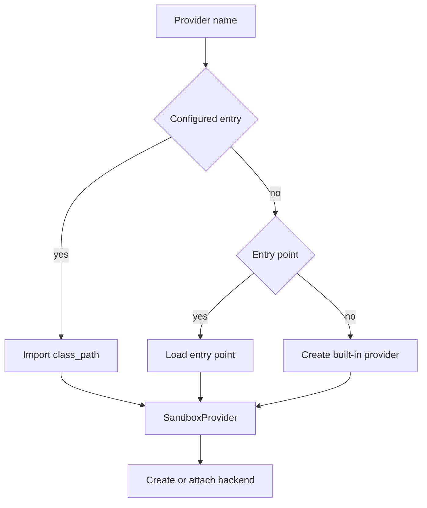
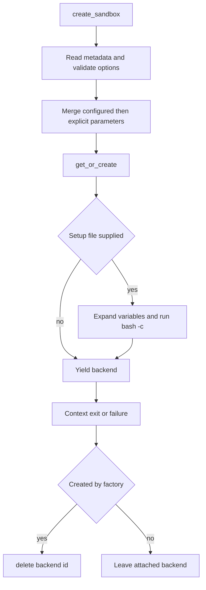

# Sandbox and Partner Integrations

A dcode sandbox provider supplies a `SandboxBackendProtocol`: an execution and filesystem backend identified by `id`. The registry and factory are the dcode-facing integration layer; the provider package remains responsible for its provider SDK, credentials, environment semantics, and backend implementation. Selecting a sandbox routes the execution/filesystem backend; it is not, by itself, a general authorization or isolation policy. See [Backends](/openwiki/concepts/backends.md), [Tools and filesystem](/openwiki/concepts/tools-filesystem.md), and [Security](/openwiki/operations/security.md).

## Provider contract and discovery

A `SandboxProvider` implements synchronous `get_or_create(sandbox_id=..., **kwargs)` and `delete(sandbox_id=..., **kwargs)`. Its `aget_or_create()` and `adelete()` convenience methods run those synchronous operations in worker threads. A provider may advertise `SandboxProviderMetadata`: default working directory, installation hint, whether attachment by ID and named snapshots are supported, and an optional backend module for dependency probing.

`SandboxRegistry` combines three sources under one name:

1. Curated built-ins: `agentcore`, `daytona`, `langsmith`, `modal`, `openshell`, `runloop`, and `vercel`.
2. Installed Python entry points in the `deepagents_code.sandbox_providers` group.
3. Operator-declared providers in `[sandboxes.providers]`.

On a name collision, resolution is **configuration, then entry point, then built-in**. Entry-point enumeration is best-effort, so a discovery error leaves the remaining sources usable. Built-in and configured metadata can be read without constructing a provider. To obtain an entry-point provider's metadata, the registry instantiates it; if that fails, discovery presents a conservative `/workspace` metadata fallback rather than failing the provider list.



*Provider resolution is configuration over entry point over built-in.*

A configuration entry can provide `class_path`, `working_dir`, `package`, capability flags, and provider `params`:

```toml
[sandboxes]
default = "acme"

[sandboxes.providers.acme]
class_path = "my_package:AcmeSandboxProvider"
working_dir = "/workspace"
package = "acme-dcode-sandbox"
supports_snapshot_name = true

[sandboxes.providers.acme.params]
region = "us-east-1"
```

`class_path` is trusted operator configuration: resolving it imports Python. A malformed or unreadable user configuration is recorded as a visible registry configuration error while unrelated startup can continue; malformed provider values that are not TOML tables are ignored. The configured default names the provider selected by a bare `--sandbox`; it never turns on sandbox mode for an invocation that did not opt in. Configuration layering and managed policy are described in [Configuration layering](/openwiki/concepts/config-layering.md).

## Factory lifecycle and ownership

`create_sandbox()` is the common synchronous context-managed lifecycle. It reads provider metadata before acquisition, validates that the provider supports a requested `snapshot_name`, and rejects a snapshot combined with `sandbox_id`: a snapshot applies only when creating a fresh sandbox. It then copies configured provider `params`, overlays explicit `params`, translates `snapshot_name` to the provider's `snapshot` argument, and calls `get_or_create()`.



*The factory deletes a new resource, but never an attached one.*

A setup file is read on the host after acquisition. `${VAR}` expansion uses dcode's active workspace environment—not the server process environment—and the resulting script executes inside the sandbox as `bash -c`. A missing/unreadable setup file, an execution exception, or a nonzero exit prevents the context body from running. Once a fresh backend has been acquired, the `finally` path attempts deletion after setup failure, caller failure, or normal exit. Cleanup errors are reported but do not mask the original exception. Supplying `sandbox_id` changes this ownership rule: the factory attaches and does not delete the supplied resource, including after setup failure.

For the server runtime, dcode enters this context in a worker thread and stores the context for the process lifetime; it registers an `atexit` close after successful startup. If startup is cancelled after a context has entered, the cancellation path closes that context before re-raising cancellation, avoiding a factory-owned sandbox leak. A configured sandbox creation failure is surfaced as startup failure rather than silently replacing the requested backend.

## Installation and optional package boundary

The six curated external adapters—AgentCore, Daytona, Modal, OpenShell, Runloop, and Vercel—are optional `deepagents-code` extras, collectively available through `deepagents-code[all-sandboxes]`. `langsmith[sandbox]` is a regular dcode dependency. The compatibility `deepagents-code[quickjs]` extra intentionally remains empty because QuickJS is already a normal dependency and is middleware rather than a remote sandbox adapter. Missing optional provider imports produce provider-specific installation guidance.

In particular, the `openshell` extra installs `langchain-nvidia-openshell>=0.1.1`. dcode's local development source mappings point at the Daytona, Modal, QuickJS, Runloop, and Vercel partner directories; they do not turn those packages into dcode-owned code or add an OpenShell checkout.

The checked-in Daytona, Modal, Runloop, and Vercel adapters are separate partner distributions. Each depends on Deep Agents and its respective provider SDK and owns its own version, environment, `pyproject.toml`, `Makefile`, and tests. dcode's curated names provide discovery, optional-install packaging, parameter forwarding, and lifecycle policy—not ownership of the adapter implementation. A third-party package can extend the registry by publishing an entry point in `deepagents_code.sandbox_providers`; an operator can instead use a configured `class_path` for an internal or local provider.

## Operating and changing integrations

- Use `--sandbox <provider>` to choose a provider, or bare `--sandbox` only when `[sandboxes].default` is configured. Unknown providers and unsupported ID/snapshot options are rejected before normal startup.
- Treat provider metadata as declarations that drive dcode validation and UX, not proof that the provider enforces a security property. Verify provider-specific identity, credential, network, retention, timeout, cancellation, and isolation behavior separately.
- Preserve the factory's ownership boundary when adding a provider: only fresh factory-created resources may be deleted. Ensure setup failures take the same cleanup path.
- The focused unit tests cover registry precedence, entry-point metadata fallback, malformed configuration, snapshot validation, setup failure, attachment ownership, and cleanup error reporting. The optional integration suites exercise real creation, command execution, file transfer, and filesystem operations; they are skipped in the release pipeline and some error-path cases remain explicitly skipped pending provider support.
- For repository work on an adapter, follow the partner-package guidance: adding a partner also requires its independent release and CI wiring, including sandbox credential/integration-test surfaces where applicable.

See [Development](/openwiki/operations/development.md) for repository workflows and [Run a dcode session](/openwiki/workflows/run-dcode-session.md) for the end-user session path.
