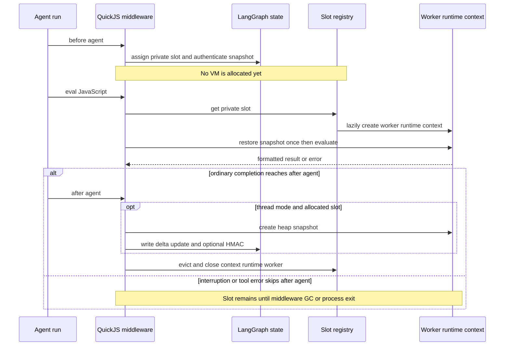

# Sandbox and Partner Integrations

A dcode sandbox provider supplies a `SandboxBackendProtocol`: an execution and filesystem backend identified by `id`. dcode owns provider selection and the factory context; the provider package owns its SDK, credentials, remote-resource behavior, and backend implementation. Selecting a sandbox changes the execution/filesystem backend. It is not, by itself, a project-trust, authorization, or general isolation policy.

QuickJS is deliberately different. `langchain-quickjs` embeds an interpreter in the **agent process** as middleware; it is not registered in dcode's remote sandbox-provider registry. The interpreter advertises no ambient filesystem, network, or real-clock access, but explicitly bridged tools and subagents confer authority. A remote sandbox instead executes in a provider-managed environment with its own identity, mounts, egress, credentials, quotas, and lifecycle. Treat those as separate boundaries. See [Permissions and Human Approval](/openwiki/concepts/permissions-hitl.md), [State, Threads, and Persistence](/openwiki/concepts/state-persistence.md), [Tools and Filesystem](/openwiki/concepts/tools-filesystem.md), and [Security and Trust Boundaries](/openwiki/operations/security.md).

## Remote sandbox providers

A `SandboxProvider` implements synchronous `get_or_create(sandbox_id=..., **kwargs)` and `delete(sandbox_id=..., **kwargs)`; its async helpers run those blocking operations in worker threads. `SandboxProviderMetadata` describes a default working directory, installation hint, attach and named-snapshot capabilities, and an optional dependency-probe module.

`SandboxRegistry` merges configured providers, installed `deepagents_code.sandbox_providers` entry points, and curated built-ins. A collision resolves as **configuration, then entry point, then built-in**. Entry-point enumeration is best-effort. A configured `class_path` is trusted operator configuration: resolving it imports arbitrary Python. A configured default merely records a default; it does not turn sandbox mode on without an explicit caller choice.

`create_sandbox()` looks up metadata before acquisition. It rejects an unsupported `snapshot_name`, or a snapshot combined with `sandbox_id`, overlays explicit `params` over configured parameters, then runs an optional setup script in the acquired backend after expanding variables from the bound workspace environment. The factory deletes only a resource it created, never an attached resource. A cleanup failure is reported but does not mask the initiating failure.

### Curated capability surface

This table is the registry metadata dcode validates before acquisition. `sandbox_id` means the metadata permits attaching an existing resource; `snapshot_name` means the factory accepts a named source for a fresh resource. Provider implementation may still reject or further constrain an operation, and configured or entry-point providers can replace this metadata.

| Provider | dcode delivery | Default working directory | `sandbox_id` | `snapshot_name` |
| --- | --- | --- | --- | --- |
| `agentcore` | `agentcore` extra | `/tmp` | No | No |
| `daytona` | `daytona` extra | `/home/daytona` | Yes | Yes |
| `langsmith` | bundled `langsmith[sandbox]` dependency | `/root` | Yes | Yes |
| `modal` | `modal` extra | `/workspace` | Yes | No |
| `openshell` | `openshell` extra | `/sandbox` | Yes | No |
| `runloop` | `runloop` extra | `/home/user` | Yes | Yes |
| `vercel` | `vercel` extra | `/vercel/sandbox` | Yes | No |

### Package and ownership contracts

The sandbox partners are independently versioned distributions; each owns its environment, `pyproject.toml`, `Makefile`, and tests rather than belonging to dcode's provider registry. The release manifest records `deepagents-code` `0.2.5`, `langchain-daytona` `0.0.9`, `langchain-modal` `0.0.7`, `langchain-runloop` `0.0.7`, `langchain-vercel-sandbox` `0.0.2`, and `langchain-quickjs` `0.3.12`.

The four listed sandbox partner manifests each require Python `>=3.11,<4.0` and `deepagents>=0.7.34,<0.8.0`; they declare their respective provider SDKs. dcode itself requires Python `>=3.14,<3.15`, pins `deepagents==0.7.34`, bundles LangSmith sandbox support, and exposes the other curated providers through optional extras.

## QuickJS middleware entrypoint and capability boundary

Install and attach the middleware to an agent:

```python
from deepagents import create_deep_agent
from langchain_quickjs import CodeInterpreterMiddleware

agent = create_deep_agent(
    model="claude-sonnet-4-6",
    middleware=[CodeInterpreterMiddleware()],
)
```

`CodeInterpreterMiddleware` contributes an `eval` tool (customizable with `tool_name`) and a system-prompt addendum on model calls. `REPLState` keeps an opaque private slot ID plus, in thread mode, an optional DeltaChannel snapshot and HMAC—not a public LangGraph `thread_id`. dcode requires `langchain-quickjs>=0.3.11,<0.4.0`; the current partner release is `0.3.12`, requiring `deepagents>=0.7.34,<0.8.0`, `langchain>=1.4.9,<2.0.0`, `langchain-core>=1.7.6,<2.0.0`, `langgraph>=1.2.20,<2.0.0`, `quickjs-rs>=0.2.6,<0.3.0`, and `bsdiff4>=1.3.0`. The dcode `quickjs` extra remains empty only for backwards-compatible install commands because QuickJS is already a normal dependency.

The lack of ambient host APIs confines pure JavaScript computation but is not complete isolation. `console` is an optional host bridge; PTC and `task()` expose selected agent tools or subagents. Use a remote sandbox when the desired boundary is provider-managed execution isolation, and separately secure every host capability that QuickJS is allowed to invoke.

## Slot lifecycle, allocation, and cleanup

`before_agent` allocates a private `qjs_...` slot ID if necessary and authenticates persisted state, but **does not create a VM**. The first `eval` calls `_Registry.get(slot_id)`, which creates one dedicated `ThreadWorker`, one `Runtime`, and one `_ThreadREPL` context for that slot. QuickJS values remain on the owning worker because they cannot safely cross threads. Runtime creation uses `SourceTransform.TOP_LEVEL_CONST_TO_VAR`, so top-level `const` and `let` declarations persist as globals. Overlapping evaluation on one context returns `ConcurrentEval`; it is not silently queued.

| `mode` | State lifetime | Reset and final release |
| --- | --- | --- |
| `"thread"` (default) | Across eval calls and resumed agent runs that retain private state | On ordinary `after_agent`, snapshot an allocated REPL then evict its slot. |
| `"turn"` | Across eval calls within one agent run | `after_agent` evicts without persisting. |
| `"call"` | One `eval` call | The eval `finally` replaces only the REPL context; `after_agent` evicts the retained worker and runtime. |

Eviction closes the context and runtime on the owning worker, then closes that worker; it suppresses teardown failures so shutdown cannot be held hostage by a misbehaving runtime. Call mode's immediate reset is narrower: it closes and replaces `_ThreadREPL` while retaining the slot's worker and runtime until final eviction. In all modes, `after_agent` drops cached PTC prompt and tool-binding data for the slot.



*The private slot ID keys live resources. Thread persistence stores bytes, not a live VM; the live worker, runtime, and context are always per-slot and process-local.*

This distinction is operationally important. Normal completion releases a used interpreter through `after_agent`. An interrupt or unrelated tool exception can skip that hook and leave the slot live while the middleware is reachable; destroying the middleware causes its destructor to best-effort close all remaining slots. During interpreter finalization the destructor intentionally does not wait for workers—waiting can deadlock process shutdown while the OS will reclaim memory. Thus completion, interruption, tool-error, garbage-collection, and process-exit paths are all bounded, but prompt release after an interrupted/error run depends on retaining neither the middleware nor the process indefinitely.

## Thread snapshots and recovery

Only thread mode reads or writes persisted JavaScript state. `before_agent` verifies HMAC authenticity when `snapshot_signing_key` is configured, but parsing and restoration remain lazy until the first eval. A restore failure returns a recoverable error, clears saved fields, and does not execute the requested JavaScript.

After an ordinary thread-mode run that allocated a REPL, `after_agent` serializes its heap, enforces `max_snapshot_bytes` (default: `memory_limit`), and evicts the live slot. Creation failures and oversized payloads clear both payload and HMAC rather than retaining stale state. If eval was never called, there is no slot to snapshot or evict.

The payload is a `DeltaChannel` patch chain rather than an in-memory cache. A first or non-beneficial update writes a `("snap", payload)` anchor; a smaller `bsdiff4` representation writes `("patch", patch)`. Replay deterministically applies anchors, patches, and clears, so forks, time travel, and checkpoint reconstruction do not rely on a process-local registry.

When configured, HMAC-SHA256 covers materialized snapshot bytes and the private slot ID. Missing, altered, wrong-key, or cross-slot signatures are rejected and cleared before restoration. Without a key, legacy snapshots remain restorable without integrity verification. Use a high-entropy shared key for processes that resume the same state; rotate it by starting fresh threads.

## Request-scoped bridges, limits, and approvals

On every model call, `wrap_model_call` or `awrap_model_call` calls `_prepare_for_call()` with the current `ModelRequest`. It reads tools after upstream middleware filtering. With PTC enabled, it applies the allowlist, excludes its own eval tool, reserves `task` rather than exposing `tools.task`, and caches selected `BaseTool` instances and rendered prompt text by private slot and tool identity. At evaluation, the active `globalThis.tools` namespace is rebuilt from those bindings; host bridges already registered in a context may be reused, but inactive names disappear from `tools`.

If `subagents=True` and the current request has a recognized Deep Agents task tool, middleware adds `task()` guidance and installs a top-level task bridge. It validates task payload fields and runs subagent work through the active outer runtime. A per-REPL semaphore defaults to 32 simultaneous calls; it is neither a process-wide admission limit nor a total dispatch limit.

`timeout` defaults to five seconds and limits QuickJS VM execution per eval; `timeout=None` disables that deadline. It does not bound wall-clock time waiting on Python-hosted `tools.*` or `task()` calls. Use workflow, process, or service limits for an end-to-end deadline. PTC is opt-in and defaults to a 256-call per-eval bridge budget; `max_ptc_calls=None` removes that limit and is unsafe for untrusted prompts.

PTC and `task()` bypass the parent `ToolNode` path, so parent `interrupt_on`/HITL approval does not separately run for each bridged action. The `eval` invocation is the parent approval boundary. Gate `eval`, place approval middleware inside subagent specifications, use normal parent tool calls when per-action review is required, or disable subagents. These controls complement but do not substitute for remote sandbox isolation.

## Focused verification

Run focused package tests through its Makefile, which disables network sockets for unit tests:

```bash
make -C libs/partners/quickjs test TEST_FILE=tests/unit_tests/test_repl_middleware.py
make -C libs/partners/quickjs test TEST_FILE=tests/unit_tests/test_snapshot.py
make -C libs/partners/quickjs test TEST_FILE=tests/unit_tests/test_shutdown.py
make -C libs/partners/quickjs test TEST_FILE=tests/unit_tests/smoke_tests/test_system_prompt.py
```

The lifecycle tests cover lazy allocation, independent workers/runtimes, context-only call-mode reset, ordinary eviction, and shutdown behavior. `test_shutdown.py` launches child processes for normal completion, interruption, and a tool error, and checks that a garbage-collected middleware releases QuickJS worker threads. Prompt smoke tests snapshot the full assembled agent prompt; use `make -C libs/partners/quickjs update_snapshots` only for intentional prompt-contract changes. See [Testing Guide](/openwiki/testing/testing-guide.md).
