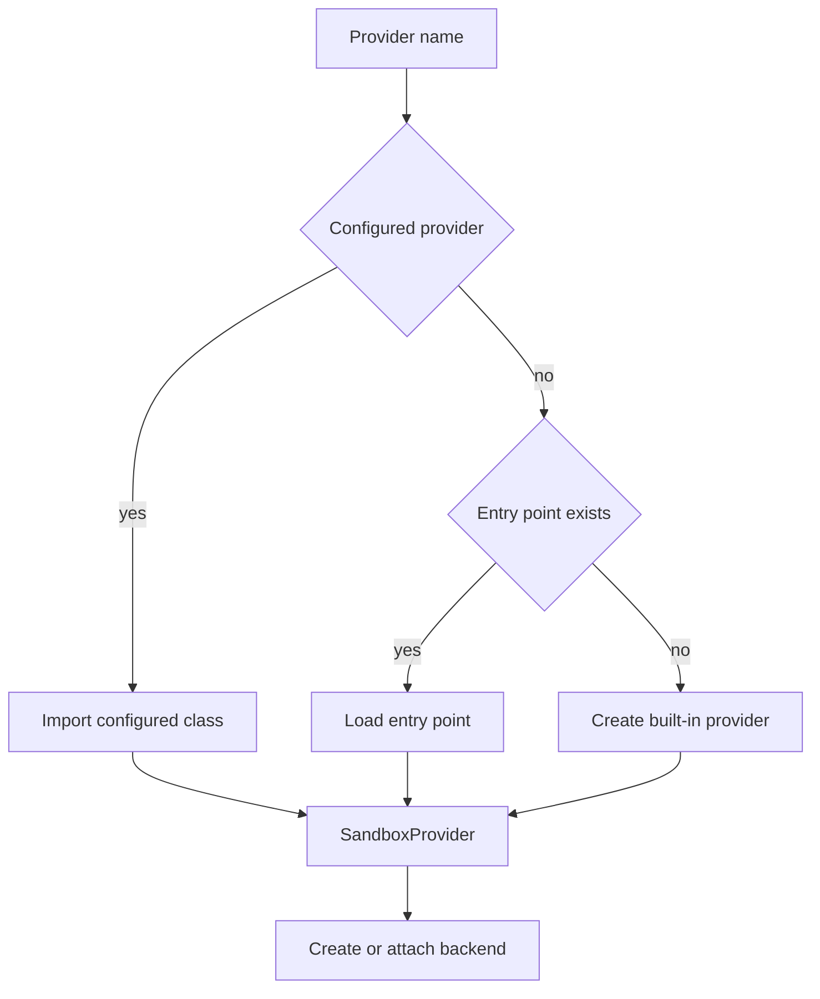
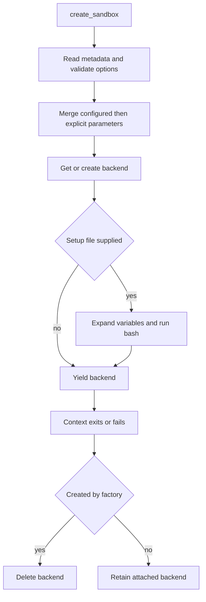
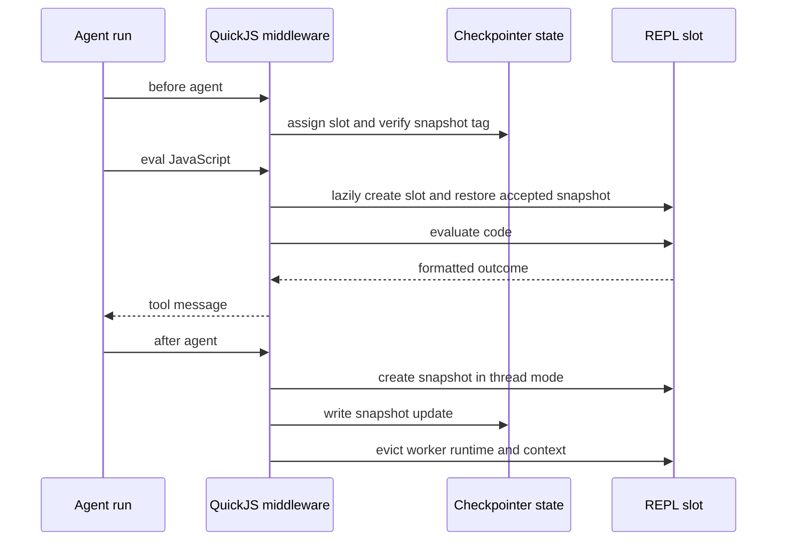

# Sandbox and Partner Integrations

A dcode sandbox provider supplies a `SandboxBackendProtocol`: an execution and filesystem backend identified by `id`. The dcode registry and factory select and manage that backend, while a partner package owns its provider SDK, credentials, remote-resource semantics, and backend implementation. Selecting a sandbox changes the execution/filesystem backend; it is not a project-trust, authorization, or general isolation policy. See [Deep Agents Code Architecture](/openwiki/architecture/code-agent.md), [State Persistence](/openwiki/concepts/state-persistence.md), and [Cost and Sessions](/openwiki/operations/cost-and-sessions.md).

## Provider contract, discovery, and lifecycle

A `SandboxProvider` implements synchronous `get_or_create(sandbox_id=..., **kwargs)` and `delete(sandbox_id=..., **kwargs)`. Its async convenience methods run those blocking operations in worker threads. `SandboxProviderMetadata` describes the working directory, installation package, attachment and named-snapshot capabilities, and an optional backend module used for dependency probing.

`SandboxRegistry` resolves a name in this order: operator configuration, an installed `deepagents_code.sandbox_providers` entry point, then a curated built-in. The curated names are `agentcore`, `daytona`, `langsmith`, `modal`, `openshell`, `runloop`, and `vercel`. Entry-point enumeration is best-effort. Configured and built-in metadata is static; metadata discovery for an entry point constructs the provider, falling back to `/workspace` if that probe fails.

*Provider resolution is configuration over entry point over built-in.*

A configuration entry can specify a `class_path`, working directory, installation package, capability flags, and creation parameters. A configured `class_path` is trusted operator input because resolving it imports arbitrary Python. On the default configuration path, a managed `[sandboxes]` section wins over user values; an unreadable or invalid user file is reported as `parse_error` while applicable managed policy can remain available. An explicit configuration path excludes managed policy. A configured default is used only after the caller opts into sandbox mode.

`create_sandbox()` reads metadata before acquisition. It rejects an unsupported `snapshot_name`, and rejects a snapshot combined with `sandbox_id` because snapshots apply to newly created resources only. It starts with configured provider `params`, overlays explicit `params`, translates `snapshot_name` to `snapshot`, and calls `get_or_create()`.

*The factory cleans up only a resource it created, never one supplied by the caller’s ID.*

The setup file is read on the host after acquisition; `${VAR}` expansion reads the active workspace environment and the result executes in the backend through `bash -c`. A missing or unreadable file, command exception, or nonzero result prevents the context body. A factory-owned backend is still deleted after setup failure, caller failure, or normal completion. Cleanup failures are reported but do not replace the initiating exception; an attached backend is retained even if setup fails.

The server enters the factory context in a worker thread, retains a successfully opened context for the process lifetime, and closes it at `atexit`. If cancellation arrives after context entry, it closes that context before re-raising cancellation. Provider startup failure is surfaced rather than silently falling back.

## Provider-specific behavior

The built-in `_ModalProvider` is a dcode lifecycle adapter around the independently distributed `langchain-modal` backend. It reads paired workspace `MODAL_TOKEN_ID` and `MODAL_TOKEN_SECRET`; exactly one token fails closed, both make a credentialed client, and neither permits Modal’s normal default authentication. It attaches by ID or creates a `/workspace` sandbox under the `deepagents-sandbox` app, polls readiness, and terminates a newly created sandbox that fails startup.

`ModalSandbox.execute()` uses `bash -c` and returns combined stdout and stderr. Direct transfers require absolute paths, process items independently, close opened handles best-effort, and map filesystem failures to protocol errors. These transfer rules are adapter behavior, not generic sandbox guarantees.

The dcode Daytona provider creates fresh sandboxes, does not attach by `sandbox_id`, polls readiness until startup timeout, and best-effort deletes a sandbox that never becomes ready. An explicit snapshot ID takes precedence over snapshot names. `DaytonaSandbox` applies one monotonic finite timeout across session creation, command start, polling, and final-log retrieval; `timeout=0` leaves command-phase requests unbounded. Timeout returns code `124` with best-effort logs, and log recovery plus session deletion share a two-second cleanup budget. Its transfer adapter rejects relative paths, preserves download order, and reports absent downloaded content as `file_not_found`.

## Packaging and extension boundaries

The six curated external adapters—AgentCore, Daytona, Modal, OpenShell, Runloop, and Vercel—are optional `deepagents-code` extras, aggregated by `deepagents-code[all-sandboxes]`. `langsmith[sandbox]` is a regular dependency. `langchain-quickjs` is also a regular dcode dependency; the empty `deepagents-code[quickjs]` extra remains solely for backwards-compatible install commands. The OpenShell extra installs `langchain-nvidia-openshell>=0.1.1`.

Partner packages are independently versioned distributions with their own environment, `pyproject.toml`, `Makefile`, and tests. The checked-in Daytona, Modal, Runloop, and Vercel packages each declare Deep Agents and their provider SDK. dcode’s editable development mappings cover Daytona, Modal, QuickJS, Runloop, and Vercel, not OpenShell. The registry owns discovery and dcode owns factory lifecycle; neither makes a partner implementation dcode-owned. Third parties can publish an entry point, while operators can configure an internal provider class.

## QuickJS: in-process JavaScript middleware, not a remote sandbox

`langchain-quickjs` is a partner distribution for JavaScript REPL middleware, not a registered dcode sandbox provider. `CodeInterpreterMiddleware` adds an `eval` tool to a LangChain agent. Its private slot identifier is carried in LangGraph agent state; a registry gives each active slot a dedicated worker, QuickJS runtime, and context. Thus live JavaScript globals are isolated between slots, while a model-only turn does not allocate a runtime. The eval schema advertises no filesystem, network, or real-clock access. This is an execution capability boundary, not a remote sandbox or security boundary.

The registry creates the runtime with `TOP_LEVEL_CONST_TO_VAR`, allowing top-level `const` and `let` declarations to behave as persistent REPL globals. It deliberately does not queue overlapping evaluations on one context: a concurrent eval returns a `ConcurrentEval` outcome rather than silently serializing shared state. Console output is bounded, and results are formatted as tool messages.

### Slot and snapshot lifecycle

The default `mode="thread"` carries state across calls and turns. `mode="turn"` carries state only for the current agent turn, while `mode="call"` replaces the REPL after every `eval`. `before_agent` assigns a private slot if absent and authenticates any existing thread-mode snapshot without allocating a VM. Actual restore is lazy: the first `eval` creates its slot and restores the accepted payload once. `after_agent` snapshots an existing thread-mode REPL and always evicts its in-memory slot; non-thread modes simply evict.

*Thread mode restores state only when evaluation needs a slot, persists it at the end of the run, and releases the in-process resources afterward.*

Snapshots are full heap serializations, but persistence uses a `DeltaChannel` patch chain: the first or non-beneficial delta is a `("snap", payload)` anchor, otherwise a `("patch", bsdiff4_patch)` is calculated against the materialized prior snapshot. Replay deterministically folds anchors, patches, and clear records. This stateless diff-against-prior design works after checkpoint reconstruction, forks, and time travel without an in-process snapshot cache.

`max_snapshot_bytes` defaults to the memory limit; an oversized payload or snapshot-creation failure clears both payload and tag. With `snapshot_signing_key`, the middleware HMAC-SHA256-signs the complete materialized payload before delta encoding, binding it to the slot ID. Before restore, a missing, mismatched, or cross-slot tag is rejected and the stored payload and tag are cleared. Without a signing key, legacy snapshots are restored without integrity verification. If authenticated bytes cannot be restored, the eval returns a recoverable restore error, clears persistence, and does not execute the requested JavaScript.

## Programmatic tool calls and operational limits

With `ptc` configured, selected tools are exposed as asynchronous `tools.<camelCase>(input)` functions in the REPL; the REPL tool itself is excluded. Bindings and their rendered prompt are slot-specific and are prepared from the current request tool list. Bridge calls inject the outer runtime/state/store when required and execute on the outer loop when one is available. The default `max_ptc_calls=256` is per eval; overflowing it returns `PTCCallBudgetExceeded` before the tool is invoked. `None` removes this protection and is unsafe for untrusted prompts.

QuickJS’s five-second default is VM execution time, not wall-clock time in Python-hosted `tools.*` calls. PTC calls bypass the usual `ToolNode` route, so ordinary per-call `interrupt_on` and HITL approval are not enforced. Likewise, the optional top-level `task(...)` subagent bridge runs inside an already-approved `eval`; it has a per-REPL concurrency limit of 32, but no total dispatch budget. Gate `eval`, add approval middleware within subagent specifications, or disable subagents when dispatch-level approval is required. See [Subagents and Skills](/openwiki/concepts/subagents-skills.md).

## Testing and safe changes

- The dcode unit suite covers registry precedence, metadata fallback, malformed configuration, snapshot validation, setup failure, attachment ownership, and cleanup reporting. Optional integration suites exercise real provider creation, commands, transfers, and filesystem operations; release-pipeline skips and explicitly skipped error paths mean they are not a substitute for deterministic unit coverage.
- Keep factory ownership intact: only a newly created resource may be deleted, and setup failures must follow the same cleanup path. Do not generalize Daytona’s deadline, polling, or `124` behavior to another adapter without implementing and testing it there.
- QuickJS tests cover sync and async snapshot round trips, turn and call reset behavior, invalid restore clearing, snapshot size caps, delta-chain reconstruction and fork recovery, HMAC tampering and cross-slot replay rejection, lazy allocation, and PTC call budgets. Run `make test` in `libs/partners/quickjs`; it uses frozen dependencies and disables non-Unix sockets for unit tests. See [Testing Guide](/openwiki/testing/testing-guide.md).
- When operating a shared or untrusted checkpointer, configure one high-entropy `snapshot_signing_key` consistently across processes that resume the same state, and start fresh threads when rotating it. Treat absence of that key as an explicit trusted-store compatibility choice, not as authentication.
