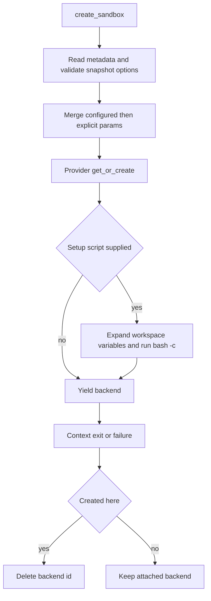
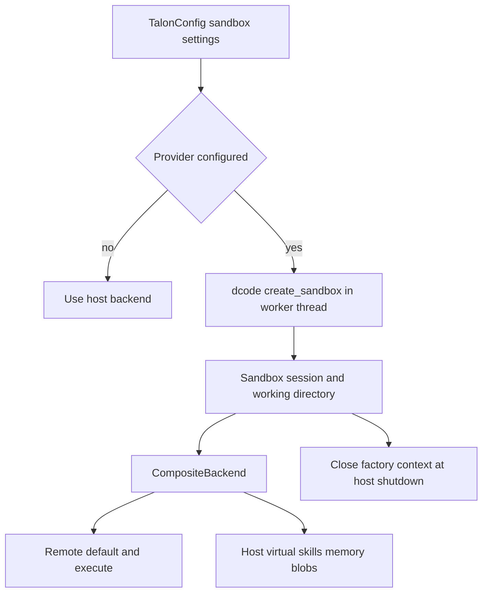

# Sandbox and Partner Integrations

A sandbox provider supplies a `SandboxBackendProtocol`: a filesystem backend with an ID and shell execution. It is an integration boundary, not a blanket security boundary. Selecting a sandbox does **not** admit channel users, contain MCP or web tools, forward host credentials into a remote environment, or create tenant isolation. Configure those properties independently.

`langchain-quickjs` is included here as a partner integration, but it is JavaScript REPL middleware in the agent process—not a remote sandbox provider.

## Shared backend surface

`SandboxBackendProtocol` extends the backend contract with `id`, `execute()`, and `aexecute()`. `BaseSandbox` derives listing, globbing, grep, and reads by running commands in the environment; writes upload bytes; and edits use server-side replacement, uploading temporary payloads for large strings. Batch transfer responses can contain per-file errors, so callers must handle partial success in input order.

This reuse keeps content in the remote environment where practical, but does **not** introduce an authorization layer beyond the provider's command execution. A provider controls identity, workspace restrictions, network egress, timeouts, cancellation, retention, and credential exposure. Treat shell execution as the governing privilege and verify those properties with the selected provider.

`BaseSandbox.execute_with_offload()` is opt-in. Its wrapper caps captured output without terminating the child process and preserves the command exit code. If its metadata cannot be parsed, it returns the original response instead of rerunning the command.

## Provider discovery and lifecycle

`SandboxRegistry` merges curated dcode providers, Python entry points in `deepagents_code.sandbox_providers`, and trusted `[sandboxes.providers]` configuration. Name resolution is **configuration over entry point over built-in**; entry-point discovery failure is best-effort, and provider construction is lazy.


*Provider selection follows configuration, entry point, then built-in precedence.*

Metadata makes discovery possible without necessarily starting a remote environment. It records a default working directory, installation hint, attachment and snapshot capability flags, and optionally a backend module for a dependency probe. Configured and built-in metadata are static; an entry-point provider is instantiated to obtain its metadata, with a conservative `/workspace` fallback when that probe fails. A provider implements synchronous `get_or_create()` and `delete()`; its supplied async operations run those calls in worker threads.

A configured provider can declare `class_path`, `working_dir`, `package`, capability flags, and `params`:

```toml
[sandboxes]
default = "acme"

[sandboxes.providers.acme]
class_path = "my_package:AcmeSandboxProvider"
working_dir = "/workspace"
package = "acme-dcode-sandbox"
supports_snapshot_name = true

[sandboxes.providers.acme.params]
region = "us-east-1"
```

`class_path` is trusted operator configuration: resolving it imports Python. A configured default is only used after a dcode caller has explicitly selected sandbox mode; it does not itself enable remote execution. Invalid or unreadable user configuration becomes a visible configuration error while unrelated startup can continue, and non-table provider entries are ignored.

The curated names are `agentcore`, `daytona`, `langsmith`, `modal`, `openshell`, `runloop`, and `vercel`. `langsmith[sandbox]` and `langchain-quickjs` are normal dcode dependencies. The other six adapters are optional provider-specific extras and can be installed together with `deepagents-code[all-sandboxes]`; the `deepagents-code[quickjs]` extra remains empty for backwards-compatible install commands. In particular, the current `openshell` extra installs `langchain-nvidia-openshell>=0.1.1`, and OpenShell is included in `all-sandboxes`. Metadata can support a lightweight missing-dependency probe and an appropriate `dcode install …` or `/install …` hint.

### Package ownership and local development

A curated provider name is a dcode discovery and lifecycle surface, not ownership of its adapter package. Partner packages are independently versioned and each owns its environment, `pyproject.toml`, `Makefile`, and tests. The checked-in sandbox adapter packages are `langchain-daytona`, `langchain-modal`, `langchain-runloop`, and `langchain-vercel-sandbox`; each depends on Deep Agents and its provider SDK. Their backend APIs can be used directly, while dcode supplies the registry selection, setup, parameter merge, and cleanup policy described above.

For repository development, dcode's `[tool.uv.sources]` replaces `langchain-daytona`, `langchain-modal`, `langchain-quickjs`, `langchain-runloop`, and `langchain-vercel-sandbox` with editable local paths under `../partners/`. The same five directories are `ty` extra paths. This is a development-resolution convenience, not a change to package ownership or the optional-install contract. `agentcore` and `openshell` are not given local editable source mappings in dcode; OpenShell remains an optional published dependency selected by its extra.

### Factory ownership rules

`create_sandbox()` is the common context-managed lifecycle. It reads metadata before acquisition, rejects a snapshot for a provider that does not advertise snapshot support, and rejects a `snapshot_name` combined with `sandbox_id`, since a snapshot applies only to a fresh environment. Configured parameters are copied first and explicit `params` override them; an accepted snapshot is passed to the provider as `snapshot`.



*The factory deletes only a resource it created; attaching leaves ownership with the caller.*

A setup file is read from the host, expands `${VAR}` using dcode's active workspace environment, then runs inside the sandbox as `bash -c`. An unreadable script or nonzero setup result fails startup. After a fresh backend is acquired, exit attempts deletion on setup failure, caller failure, and normal completion. Cleanup failure is reported without replacing the initiating exception. With `sandbox_id`, the factory attaches and never deletes the resource, even if setup fails. Provider metadata advertises attachment support, but the selected provider implements the actual attachment behavior and can reject an ID.

## Talon: opt-in consumer of dcode

Talon is experimental. `TalonConfig.from_env()` validates the assistant ID, chooses the assistant home, and records only recognized runtime environment values. Its sandbox property is deliberately narrow: `DEEPAGENTS_TALON_SANDBOX` is the required provider selector, with optional `DEEPAGENTS_TALON_SANDBOX_ID`, `DEEPAGENTS_TALON_SANDBOX_SNAPSHOT`, and `DEEPAGENTS_TALON_SANDBOX_SETUP`. Whitespace-only values are treated as unset. Thus Talon does **not** consult dcode's configured sandbox default: without `DEEPAGENTS_TALON_SANDBOX`, it requests no remote session and the runtime uses host execution.

For a fresh `langsmith` session, Talon supplies `talon-<assistant_id>` as a default snapshot. An explicit Talon snapshot wins; otherwise, if the provider's `LANGSMITH_SANDBOX_SNAPSHOT_NAME` override is set, Talon defers to it. An attached sandbox has no default snapshot. The factory still performs provider-capability and snapshot-versus-ID validation.



*Talon chooses a remote backend only for its filesystem and execution path; a composite backend retains three host-local virtual routes.*

`open_sandbox()` holds the dcode factory context for the Talon host lifetime. A configured startup failure is wrapped in `SandboxStartupError` and fails closed rather than falling back to host execution. A new sandbox is deleted when that context closes; one specified by `DEEPAGENTS_TALON_SANDBOX_ID` is retained. Startup runs in a worker thread, so the handoff coordinates cancellation: if cancellation races a completed startup, whichever side observes abandonment closes the context and prevents an owned sandbox leak.

In sandbox mode, `sandbox_backend()` creates a `CompositeBackend` whose default is the remote backend, including every `execute` call. Only `skills/`, `memory/`, and `/blobs/` use host virtual `FilesystemBackend` routes. This preserves assistant skills and memory and lets binary blobs outlive a recreated sandbox, while sandbox filesystem tools cannot reach `tools.json` or other assistant state through a host route. `DEEPAGENTS_TALON_SKILLS_DIRS` is warned about in sandbox mode because those extra paths resolve inside the sandbox; it does not add another host skill route.

This route selection neither moves MCP tools, web tools, or channel media handling into the sandbox nor grants or revokes any of those capabilities. Provider credentials are read by the Talon process to create the sandbox and are not forwarded as a general remote-environment credential mechanism. In particular, sandbox selection and Talon message configuration are not channel admission, MCP containment, or multi-tenant isolation.

## QuickJS partner boundary

`langchain-quickjs` 0.3.9 is separately versioned JavaScript REPL middleware. It directly depends on `quickjs-rs`, Deep Agents, LangChain, LangGraph, and `bsdiff4`; dcode installs it as a normal dependency rather than as a sandbox adapter.

`CodeInterpreterMiddleware` assigns each LangGraph thread a distinct QuickJS slot containing a worker, runtime, and context. Its persistence modes are `thread` (across calls and turns), `turn` (within one turn), and `call` (one evaluation). Thread snapshots are bounded by `max_snapshot_bytes`, defaulting to the memory limit. With `snapshot_signing_key`, snapshots are HMAC-signed and verified against their slot ID before restore; an absent or invalid tag is discarded. Without that key, legacy persistence has no integrity verification.

QuickJS separately bounds VM heap, VM execution time, console/result output, programmatic-tool calls per evaluation, and subagent concurrency per REPL. VM time excludes time awaiting a Python host bridge, so it is not a whole-request timeout. `max_ptc_calls=None` disables the programmatic-call budget and is unsafe for untrusted prompts.

Programmatic `tools.*` calls and `task()` subagent dispatch are REPL bridges, not normal `ToolNode` dispatch. Parent `interrupt_on` and HITL approval therefore do not apply per bridge call. Gate the outer `eval` tool, put approvals in subagent specifications, or disable `ptc` and/or `subagents` when normal per-dispatch approval is required.

## Focused verification and safe changes

- Registry and factory tests cover discovery precedence, metadata fallback, malformed configuration, dependency hints, snapshot/attachment validation, setup failure, ownership, and cleanup error handling in `libs/code/tests/unit_tests/test_sandbox_registry.py` and `libs/code/tests/unit_tests/test_sandbox_factory.py`.
- Talon's focused sandbox tests in `libs/talon/tests/unit_tests/test_sandbox.py` cover parsing its four sandbox settings, LangSmith snapshot precedence, host-route construction, owned cleanup, cancellation during startup handoff, disabled mode, and fail-closed startup. Runtime tests separately verify graph/backend wiring and tool reload behavior.
- When adding a provider, test actual provider behavior as well as registry conformance: execution timeout and cancellation, transfer ordering and partial failures, setup semantics, identity and credentials, cleanup, and any claimed isolation.
- For QuickJS changes, retain tests for thread isolation, persistence/reset behavior, snapshot-signature rejection, VM versus host-bridge timing, and bridge approval behavior.
