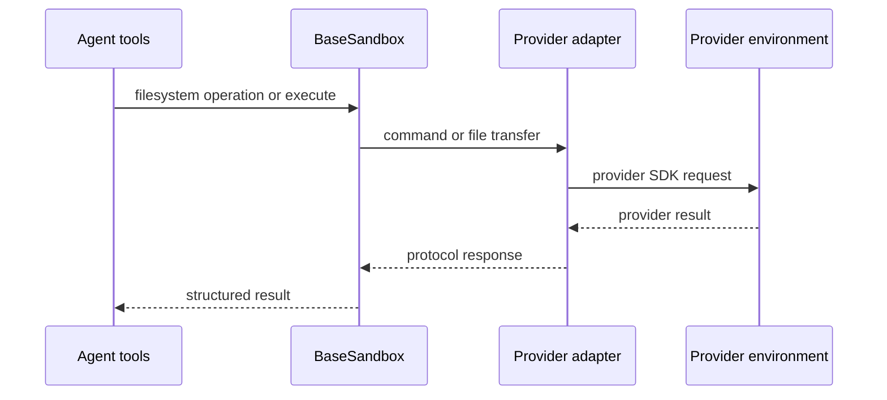
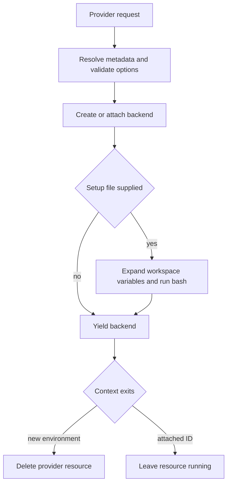
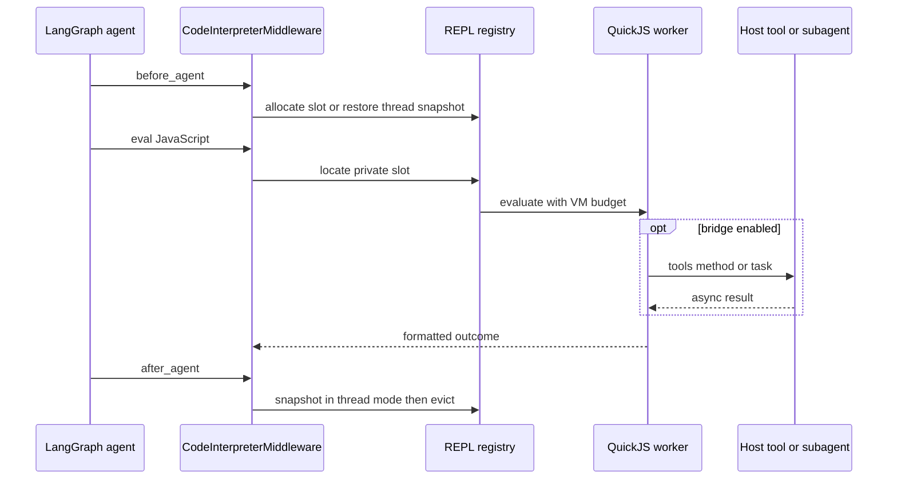

# Sandbox and Partner Integrations

A **sandbox provider** acquires or attaches to an environment that implements filesystem operations and shell execution. It is not `langchain-quickjs`: QuickJS is JavaScript REPL middleware in the agent process, not a selectable remote-sandbox provider. Provider containment, network policy, credentials, and retention are properties of the selected provider and deployment; protocol conformance alone is not an isolation guarantee. See [Backends](/openwiki/concepts/backends.md) for the general backend model and [Security](/openwiki/operations/security.md) when evaluating a provider boundary.

## Shared sandbox contract and derived operations

`SandboxBackendProtocol` extends the generic backend contract with an `id` and shell `execute()`/`aexecute()` methods. `BaseSandbox` supplies the inherited filesystem interface from four adapter primitives: `id`, `execute()`, `upload_files()`, and `download_files()`. Transfers must return one response per input in input order and record per-file errors, allowing a batch to partially succeed.

*Provider adapters supply the execution and transfer primitives used by the shared sandbox filesystem interface.*

### What the base class guarantees

The base class keeps work in the sandbox where practical: `read()` runs server-side, line-paginated reading and caps text returned over the transport at about 500 KiB; non-UTF-8 data is returned as base64. `write()` first creates/checks parent directories, then transfers UTF-8 bytes through `upload_files()`, rather than putting content in a shell command. Small edits execute a server-side replace; large edits upload only the old and new strings to temporary files and perform the replacement server-side, so the source file does not leave the sandbox. An empty `old_string` is rejected before any dispatch.

These are derived-operation guarantees, not a new authorization boundary. `BaseSandbox` does not reduce the trust implied by `execute()`. In particular, recursive-delete quoting ensures one literal shell argument, but does not confine the reachable path to a workspace root. Adapter authors must also preserve the partial-success transfer contract and should test malformed remote output and unknown exit status, not just happy paths.

`execute_with_offload()` is opt-in through `enable_capture_offload`, which defaults to `False` because its wrapper assumes shell and coreutils support. When enabled, it captures combined output in the sandbox, returns inline output below `max_inline_bytes`, and otherwise leaves full output at the supplied path while returning a preview. `max_capture_bytes` caps stored output without killing the command, preserving the child exit code; `response.truncated` signals either that cap or backend truncation. If wrapper metadata is missing or malformed, it logs and returns the original response as non-offloaded rather than rerunning the command. With offload disabled, it runs unwrapped and returns full output with `offloaded=False`.

### Adapter behavior remains observable

The shared protocol does not normalize provider SDK behavior. Daytona creates a session per command and deletes it in `finally`; its timeout result has exit code `124`. Vercel starts detached `bash -lc` commands, attempts a best-effort kill on timeout, caps returned output at `100_000` bytes, and preserves a completed command's exit code if log retrieval fails. Test cancellation, timeout, output, and transfer behavior on a concrete adapter rather than assuming all `BaseSandbox` subclasses behave alike.

## dcode provider selection and lifecycle

`deepagents-code` is version `0.1.84`, requires Python `>=3.12,<4.0`, and pins `deepagents==0.7.24`. It includes `langsmith[sandbox]>=0.14.8` and `langchain-quickjs>=0.3.4,<0.4.0` as base dependencies. LangSmith therefore needs no sandbox extra; QuickJS is installed with dcode but remains middleware. The backwards-compatible `quickjs` extra is empty.

The curated remote adapters are optional extras: `agentcore`, `daytona`, `modal`, `runloop`, and `vercel`; `all-sandboxes` installs all five. The curated Daytona, Modal, Runloop, and Vercel distributions are respectively `0.0.8`, `0.0.6`, `0.0.7`, and `0.0.2`; each requires Python `>=3.11,<4.0` and `deepagents>=0.7.0,<0.8.0` and declares its provider SDK dependency. Installing an adapter does not configure provider credentials or deployment policy.

`SandboxProviderMetadata` lets the registry and CLI advertise a working directory, capability flags, and an install hint without constructing a credential-dependent provider. Providers implement synchronous `get_or_create()` and `delete()`; their async counterparts delegate through `asyncio.to_thread`. The registry merges built-ins, third-party entry points in `deepagents_code.sandbox_providers`, and `[sandboxes.providers]` declarations. Collisions resolve config first, then entry point, then built-in. A config `class_path` imports executable Python and is trusted operator configuration. A configured `[sandboxes].default` is used only after sandbox mode is explicitly enabled; it does not silently enable remote execution.

Built-in metadata defines provider working directories: AgentCore `/tmp`, Daytona `/home/daytona`, LangSmith `/root`, Modal `/workspace`, Runloop `/home/user`, and Vercel `/vercel/sandbox`. Snapshot names are supported by Daytona, LangSmith, and Runloop; Vercel does not support them, and AgentCore does not support attachment by sandbox ID. Runloop maps the generic snapshot argument to a blueprint name, reusing a build-complete same-name blueprint or creating one; `RUNLOOP_SANDBOX_BLUEPRINT_ID` takes precedence and boots by ID without lookup or building.

`create_sandbox()` reads provider metadata before construction. It rejects unsupported snapshot names and `snapshot_name` combined with `sandbox_id`, since a snapshot applies only to a new sandbox. Configured provider parameters are copied first, then explicit parameters override them; the validated snapshot is forwarded as `snapshot`. After acquisition, an optional host setup file is read, expands `${VAR}` from the active workspace environment, and runs as `bash -c` inside the sandbox. A nonzero setup command raises an error.

*The factory owns and deletes only a sandbox it created; attaching by ID leaves lifecycle ownership with the caller.*

The `finally` block also cleans up an owned sandbox if setup fails or the caller raises. Cleanup failures are reported but do not mask the original error. Focused factory tests cover unsupported or conflicting snapshots, setup file and execution failures, setup-failure ownership, context-exit ownership, and preservation of the original error if deletion also fails.

A dcode server holds this context for the process lifetime and registers closure at exit. Its runtime factory is cached because recreating it would duplicate sandbox creation and cleanup registration. The first sandboxed workspace claims that process-wide backend; another workspace is rejected rather than sharing that remote filesystem and credential context. Use a different server process for an independent sandboxed workspace.

## Talon reuse and routing

Talon reuses dcode's factory and working-directory lookup rather than implementing separate provider adapters. `DEEPAGENTS_TALON_SANDBOX` opts in; when unset, Talon yields no sandbox and uses its normal host backend. `DEEPAGENTS_TALON_SANDBOX_ID` attaches an existing resource, while `DEEPAGENTS_TALON_SANDBOX_SNAPSHOT` and `DEEPAGENTS_TALON_SANDBOX_SETUP` select a snapshot and setup file.

For a new LangSmith sandbox, Talon defaults the snapshot to `talon-<assistant_id>`. An explicit Talon snapshot wins; when `LANGSMITH_SANDBOX_SNAPSHOT_NAME`, including its `DEEPAGENTS_CODE_` override path, is set, Talon defers to that provider-level selection. It keeps the context open for host lifetime, deletes owned resources, and retains attached ones. A configured sandbox that cannot start raises `SandboxStartupError` rather than falling back to host execution. The cancellation handoff closes the lifecycle stack even if threaded startup finishes after its awaiting task is cancelled.

In sandbox mode, `CompositeBackend` routes every default filesystem operation and every `execute` call to the remote sandbox. It routes only assistant `skills/`, `memory/`, and `/blobs/` to host virtual filesystem backends; `tools.json` and other assistant state do not use host routes. MCP and web tools, channel media handling, and provider credentials remain in the Talon process rather than moving into or being forwarded to the sandbox.

## QuickJS REPL integration boundary

`langchain-quickjs` `0.3.9` is a JavaScript REPL middleware package requiring Python `>=3.11,<4.0`. It depends on `quickjs-rs>=0.2.5,<0.3.0`, not a sandbox-provider SDK. Its direct framework dependencies include `deepagents>=0.7.0,<0.8.0`, `langchain>=1.4.5,<2.0.0`, `langchain-core>=1.6.10,<2.0.0`, `langgraph>=1.2.15,<2.0.0`, and `bsdiff4>=1.2.6,<2.0.0`.

`CodeInterpreterMiddleware` exposes an `eval` tool whose documented JavaScript environment has no direct filesystem, network, or real-clock access. That does **not** make an enabled bridge safe by itself: `ptc` and `subagents` deliberately cross from JavaScript into host tools. Treat `eval` as the approval and capability boundary, alongside the permissions and HITL configuration described in [Permissions and HITL](/openwiki/concepts/permissions-hitl.md).

### State modes and slot lifecycle

The default `thread` mode gives every LangGraph thread a private QuickJS slot. A slot owns a `ThreadWorker`, `Runtime`, and context; QuickJS objects remain on that worker because they are not sendable across threads. `turn` keeps one REPL only for the current agent turn, while `call` resets the REPL after every `eval` but retains its worker and runtime until the slot is evicted. The middleware must initialize private slot state in `before_agent`; an `eval` without it fails instead of silently creating fallback state.

*Thread mode restores and re-snapshots state across turns; every mode closes the in-memory slot after an agent turn.*

For `thread` mode, `after_agent` serializes the context, stores either a full snapshot anchor or a smaller binary delta against the materialized previous snapshot, then evicts the live slot. `before_agent` restores the materialized snapshot into a fresh slot. Snapshot creation or restore failure clears the stored payload rather than running it; payloads larger than `max_snapshot_bytes` (defaulting to `memory_limit`) are dropped. `turn` and `call` neither restore nor persist snapshots.

Set `snapshot_signing_key` when the checkpointer is not fully trusted. In thread mode, the middleware HMAC-signs the full reconstructed snapshot together with its slot ID before storage and verifies it before restore. Missing, altered, wrong-key, or cross-slot tags cause the payload and tag to be discarded. Without a key, snapshots retain legacy unauthenticated behavior. Use the same key for processes that resume the same thread and start fresh threads when rotating it.

### Resource limits and failure behavior

The default QuickJS heap limit is 64 MiB per runtime and the default VM evaluation budget is five seconds. VM time does not include Python wall time while awaiting `tools.*` bridge calls, so it is not a total request timeout. Each evaluation also has a default 256 programmatic-tool-call budget; setting `max_ptc_calls=None` disables that protection and permits unbounded host-call loops. Console collection and model-facing result blocks are bounded by `max_result_chars` (default 4,000); console overflow records the number of omitted characters.

The REPL formats JavaScript errors, VM timeouts, out-of-memory failures, deadlocked unresolved promises, and concurrent evaluations as outcomes. It intentionally does not queue overlapping evaluations against one context: concurrent use fails loudly rather than serializing potentially unexpected shared-state mutations. A final promise expression is awaited before marshaling, and a non-marshalable value is represented as a handle description.

### Programmatic tools and approval limitation

With `ptc`, an allowlist exposes eligible tools as asynchronous `tools.<camelCase>(input)` functions. The bridge normalizes JavaScript input, allocates a synthetic tool-call ID, injects runtime/state/store arguments where a normal `ToolNode` would, and invokes the tool coroutine on the parent event loop when applicable. Bindings are refreshed from the live agent tool list; the REPL tool itself is excluded to avoid recursion. The optional top-level `task(...)` bridge similarly dispatches the configured Deep Agents task tool and limits simultaneous dispatches per REPL to `max_subagent_concurrency` (default 32).

These bridge calls do **not** traverse the normal `ToolNode` path. Consequently, parent per-tool `interrupt_on` and HITL approval do not run for each `tools.*` or `task(...)` dispatch; a `GraphInterrupt` from subagent execution still propagates. Gate and approve the outer `eval` tool, put approval middleware inside subagent specifications, or set `ptc=None` and/or `subagents=False` if each dispatch needs ordinary parent approval. Do not disable the PTC call budget or raise subagent concurrency without separate admission controls.

## Verification and extension guidance

- For a new sandbox adapter, implement the four `BaseSandbox` primitives, provide accurate `SandboxProvider` metadata, and publish a third-party provider through `deepagents_code.sandbox_providers` or use a trusted local `class_path`.
- Exercise derived-operation behavior as well as provider calls: paginated and binary reads, preflighted writes, small and large edits, ordered partial-success transfers, capture-wrapper parse failure, and preserved child exit code. `libs/deepagents/tests/unit_tests/backends/test_sandbox_backend.py` covers these base semantics.
- For QuickJS changes, focus tests on thread isolation, mode reset/eviction, snapshot round trips and HMAC rejection, VM versus host-call budgets, PTC call-budget exhaustion, loop affinity, and approval-aware subagent replay. The focused middleware tests live in `libs/partners/quickjs/tests/unit_tests/`.
- Before selecting a provider or enabling a bridge for sensitive work, assess image, filesystem persistence, network controls, credential exposure, deletion policy, and the approval path. Neither `BaseSandbox` nor the QuickJS VM changes provider-level or host-tool controls.
