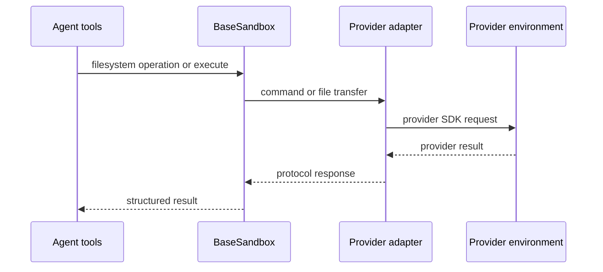
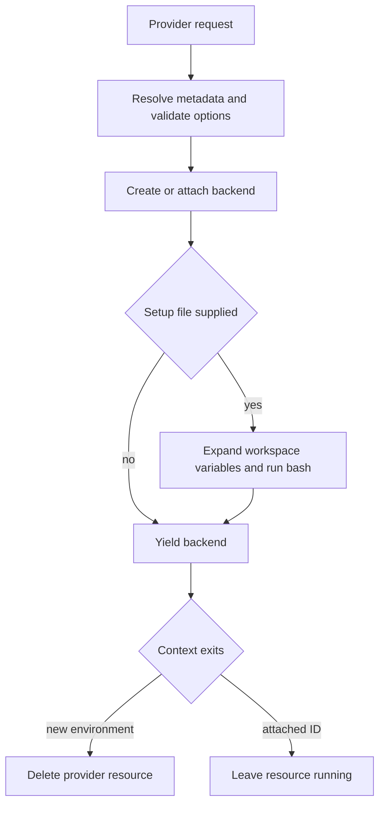
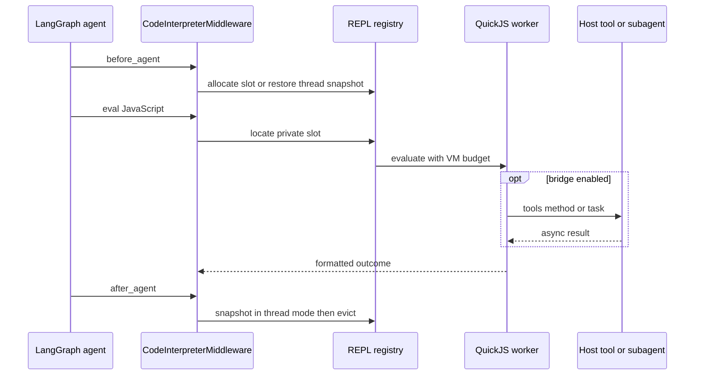

# Sandbox and Partner Integrations

Sandbox providers and QuickJS are **optional integrations**, not required runtime components. A provider supplies a backend that executes commands and stores files in a selected remote environment. `langchain-quickjs`, in contrast, is JavaScript REPL middleware running with the agent: it is not a remote sandbox provider. Provider containment, networking, credentials, persistence, and deletion policy therefore remain deployment and provider concerns; satisfying the shared backend protocol is not an isolation guarantee.

## Package roles, installation, and compatibility

`deepagents` 0.7.26 is the required core package and supports Python `>=3.11,<4.0`. Its `quickjs` extra installs `langchain-quickjs>=0.3.9`; it does not make a provider backend part of the core runtime.

`deepagents-code` (the `dcode` CLI) is version 0.1.85, requires Python `>=3.12,<4.0`, and pins `deepagents==0.7.26`. It includes `langsmith[sandbox]>=0.14.9` and `langchain-quickjs>=0.3.4,<0.4.0` in its normal dependencies. Thus LangSmith sandbox support and the QuickJS middleware package are present with dcode, but neither changes the distinction between a provider backend and a REPL. The retained `quickjs` dcode extra is empty for backwards-compatible install commands.

The dcode extras `agentcore`, `daytona`, `modal`, `runloop`, and `vercel` install the five curated external sandbox adapter distributions; `all-sandboxes` combines them. They are optional because no provider selection or credentials are implied by installation. The provider packages are independently versioned: `langchain-daytona` 0.0.8, `langchain-modal` 0.0.6, `langchain-runloop` 0.0.7, and `langchain-vercel-sandbox` 0.0.2. Each declares Python `>=3.11,<4.0` and `deepagents>=0.7.0,<0.8.0`; their manifests also own the provider-SDK dependency and any tighter constraint (for example, Vercel's `vercel>=0.5.9,<0.6`).

`langchain-quickjs` 0.3.9 is JavaScript REPL middleware rather than a remote sandbox provider. Its manifest requires Python `>=3.11,<4.0`, `deepagents>=0.7.0,<0.8.0`, `quickjs-rs>=0.2.5,<0.3.0`, `langchain>=1.4.6,<2.0.0`, `langchain-core>=1.6.11,<2.0.0`, `langgraph>=1.2.15,<2.0.0`, and `bsdiff4>=1.2.6,<2.0.0`. Treat these manifest ranges as the compatibility boundary; do not infer support for a wider core or framework version.

### Local source relationships and releases

The manifests deliberately use editable local sources during repository development. Every curated provider package and QuickJS points `deepagents` at `../../deepagents`. The dcode manifest points to `../deepagents` and, in addition, maps the Daytona, Modal, QuickJS, Runloop, and Vercel distributions to their `../partners/...` directories as editable sources. These mappings make local integration changes visible without publishing packages; they do not alter the published dependency constraints above.

Partner packages own their own environment, manifest, Makefile, and tests. They are also individually release-please managed: the release configuration has a separate Python package entry, changelog, version files, and test exclusion for each curated provider and QuickJS. Adding a new partner requires wiring it into the repository's release, CI, labeling, dependency, credential, and—in the sandbox case—Harbor and integration-test surfaces, rather than merely adding a directory.

## Shared sandbox contract

`SandboxBackendProtocol` extends the generic backend contract with a stable `id` and synchronous/asynchronous shell execution. `BaseSandbox` implements the inherited filesystem interface from `execute()`, `upload_files()`, `download_files()`, and `id`. Transfer implementations must return a response for each input in input order and can report per-file errors, so a batch can partially succeed.

*Provider adapters supply the execution and transfer primitives used by the shared sandbox filesystem interface.*

The base class keeps work in the remote environment where possible. `read()` uses a server-side, line-paginated script, caps returned text at about 500 KiB, and returns non-UTF-8 content as base64. `write()` creates/checks parent directories and transfers UTF-8 bytes instead of embedding content in a shell command. Small edits use a server-side replacement; large edits upload old and new strings to temporary files and replace server-side. An empty `old_string` is rejected before dispatch.

These are convenience and data-movement properties, not an additional authorization boundary. `BaseSandbox` does not reduce the trust implied by `execute()` or confine it to a workspace root. Test a concrete adapter's timeout, cancellation, output and transfer semantics rather than assuming that all subclasses normalize provider SDK behavior.

`execute_with_offload()` is opt-in through `enable_capture_offload`, which defaults to `False` because its capture wrapper assumes shell and coreutils support. With offload enabled, combined command output is captured in the sandbox: small output returns inline, while large output remains at the requested path and yields a preview. The capture cap does not kill the child command, preserving its exit code. If wrapper metadata is absent or invalid, parsing returns the original, unoffloaded response rather than rerunning the command.

## dcode provider selection and lifecycle

dcode resolves providers through a registry of curated built-ins, third-party entry points in `deepagents_code.sandbox_providers`, and trusted `[sandboxes.providers]` configuration. Name precedence is configuration, then entry point, then built-in. Static metadata advertises a working directory, capability flags, and an install hint without first constructing a provider that might require credentials. A configured `class_path` imports executable Python and is therefore trusted operator configuration, not untrusted application data.

The built-ins are AgentCore, Daytona, LangSmith, Modal, Runloop, and Vercel. Their metadata defines their working directories and declares whether attachment by sandbox ID or snapshot name is supported. LangSmith is bundled via the normal dcode dependency; the other curated remote providers correspond to the optional extras. Setting a configured default chooses a provider only after sandbox mode is explicitly requested; it does not silently enable remote execution.

`create_sandbox()` reads metadata before construction. It rejects snapshot names for unsupported providers and rejects `snapshot_name` with `sandbox_id`, since a snapshot applies only to a newly created environment. Configuration parameters are copied before explicit parameters override them; the accepted snapshot is forwarded as `snapshot`. If supplied, a host setup file is expanded from the active workspace environment and executed inside the sandbox with `bash -c`; a nonzero result aborts startup.

*The factory owns and deletes only a sandbox it created; attaching by ID leaves lifecycle ownership with the caller.*

The context manager also attempts owned-resource cleanup if setup or caller work fails; cleanup errors are reported without masking the original failure. Implementers supply synchronous `get_or_create()` and `delete()`; the base provider's asynchronous variants delegate those operations through `asyncio.to_thread`.

## Talon sandbox routing

Talon is an experimental runtime that reuses dcode's factory and working-directory lookup rather than defining its own provider adapters. `DEEPAGENTS_TALON_SANDBOX` opts into a remote backend; without it, Talon yields no sandbox and retains host execution. `DEEPAGENTS_TALON_SANDBOX_ID` attaches rather than creates, while `DEEPAGENTS_TALON_SANDBOX_SNAPSHOT` and `DEEPAGENTS_TALON_SANDBOX_SETUP` select a snapshot and setup script. A new LangSmith sandbox defaults to `talon-<assistant_id>` unless Talon or the provider's own snapshot-name setting overrides that choice.

A configured sandbox that cannot start raises `SandboxStartupError`; Talon does not silently fall back to the host. Its lifecycle holds the dcode context for the host lifetime, deletes only owned resources, and closes a late-starting resource if cancellation races threaded startup. In sandbox mode, the composite backend sends default filesystem operations and `execute` to the remote sandbox, but routes only `skills/`, `memory/`, and `/blobs/` to host virtual backends. This deliberately keeps `tools.json` and other assistant state out of the host routes.

## QuickJS middleware boundary

`CodeInterpreterMiddleware` exposes an `eval` tool. Its JavaScript environment documents no direct filesystem, network, or real-clock access, but enabled bridges deliberately cross into host capabilities: `ptc` exposes selected tools and `subagents` can expose `task(...)`. Treat the outer `eval` tool as an approval and capability boundary.

### State and lifecycle

The default `thread` mode gives each LangGraph thread a private QuickJS slot, which owns a `ThreadWorker`, runtime, and context. This keeps non-sendable QuickJS objects on their worker and prevents globals leaking between conversations. `turn` preserves a REPL only for the current agent turn. `call` resets the REPL after every `eval`, but retains its worker/runtime until slot eviction. Middleware initialization in `before_agent` is required; an `eval` without private slot state fails rather than creating fallback state.

*Thread mode restores and re-snapshots state across turns; every mode closes the in-memory slot after an agent turn.*

In thread mode, `after_agent` serializes state, stores a full snapshot anchor or a binary delta, and evicts the live slot. `before_agent` restores a materialized snapshot into a new slot. Oversized payloads are dropped; `max_snapshot_bytes` defaults to `memory_limit`. `turn` and `call` do not restore or persist snapshots. With `snapshot_signing_key`, thread snapshots are HMAC-signed with their slot ID and verified before restore; missing, altered, wrong-key, or cross-slot data is discarded. Without a key, persistence is unauthenticated for legacy behavior.

### Limits, bridges, and approval

QuickJS separately bounds the VM heap (64 MiB by default), VM execution (five seconds by default), console/result output (4,000 characters by default), programmatic tool calls (256 by default), and per-REPL subagent concurrency (32 by default). The VM timeout excludes time awaiting a Python host bridge, so it is not a total request timeout. `max_ptc_calls=None` removes the host-call budget and can allow unbounded call loops.

With `ptc`, an allowlist becomes asynchronous `tools.<camelCase>(input)` functions. The bridge normalizes JavaScript input, mints a synthetic tool-call ID, injects runtime/state/store arguments as needed, and invokes the coroutine on the parent loop. `task(...)` similarly dispatches the configured Deep Agents task tool. Both paths bypass the normal `ToolNode`, so the parent's per-dispatch `interrupt_on` and HITL approval do not run. Gate and approve `eval`, add approval middleware to subagent specifications, or disable `ptc` and/or `subagents` where every child dispatch requires ordinary parent approval.

## Focused verification

- For a provider adapter, test the base semantics as well as provider calls: ordered partial transfers, paginated/binary reads, write preflight, small and large edits, and capture-wrapper parse failure with the original exit code retained.
- For dcode lifecycle changes, test capability validation, parameter precedence, setup failure, ownership on context exit, and cleanup failure that must not replace the original exception.
- For QuickJS changes, run its package tests with `make test` in `libs/partners/quickjs`. Focus on thread isolation, persistence-mode reset and eviction, snapshot/HMAC rejection, VM versus host-call budgets, bridge loop affinity, and approval-aware subagent behavior.
