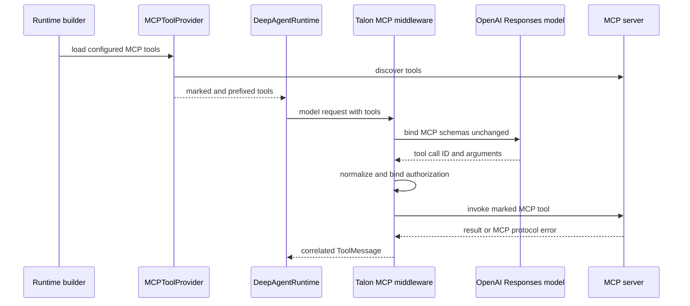

# Talon Runtime Integration

Talon is an experimental runtime. Its MCP integration has two deliberately separate responsibilities: `MCPToolProvider` loads and labels configured MCP tools, while `talon_mcp_middleware()` adapts only those labeled tools at the agent model-binding and invocation boundary. The middleware is not an MCP server implementation or a general error handler; ordinary tools and non-protocol failures retain their normal LangChain behavior.

This page documents that adapter boundary. For MCP server configuration, transport, OAuth login, and reload operations, see [MCP integration](mcp.md). For the wider request lifecycle, see [runtime behavior](../architecture/runtime-behavior.md), and for approvals see [permissions and HITL](../concepts/permissions-hitl.md).

## Entry points and ownership

At runtime construction, Talon creates an `MCPToolProvider`, loads the configured tools, and supplies them to `DeepAgentRuntime` along with refresh and explicit-reload callbacks. It also installs one `talon_mcp_middleware()` instance in the main runtime's middleware list. Fresh local subagents install the same middleware, so MCP calls made after delegation receive the same schema, argument, authorization, and protocol-error treatment.

`load_mcp_tools()` is the provenance boundary. For each configured server, it opens a FastMCP transport, discovers tools through `MCPAdapter`, prefixes every discovered tool name with `<server>_`, and marks its metadata with `_deepagents_talon_mcp`. A `skillOnly` server receives an additional metadata marker, allowing the runtime to keep its tools out of the ordinary main-agent catalog until a skill discloses them. The middleware uses the MCP marker—not tool name or transport—to decide which behavior applies.



*The focused boundary begins after server discovery: only tools marked by Talon receive MCP-specific model binding and invocation handling.*

## Preserve schemas for OpenAI Responses

LangChain's ordinary tool conversion can alter an MCP tool schema when binding tools to an OpenAI Responses API model. Before either synchronous or asynchronous model invocation, `_TalonMCPMiddleware` checks for `BaseChatOpenAI` with `use_responses_api` enabled. It replaces only marked MCP `BaseTool` values with `convert_to_openai_tool(tool, strict=False)` and passes all other tools through unchanged.

This conversion preserves the MCP tool's OpenAI function definition instead of mutating the loaded tool or its stored schema. In particular, open object parameters and optional nested object/null schemas remain available to the model and are forwarded during invocation. The `strict=False` setting belongs to the generated MCP definition; it is not applied to unrelated local tools. For non-Responses models, the request is passed through without this override.

## Invocation semantics

For a marked MCP tool call, the middleware makes a derived request with normalized `args` and then calls the standard tool handler inside `_run_authorized()` using the tool-call ID as the authorization invocation ID. The ID is therefore available to the active OAuth flow to bind browser/device/callback events to the exact model invocation. `_run_authorized()` always restores its authorization context variables; `DeepAgentRuntime.invoke()` separately installs the host's request-specific authorization handler and resets it when the turn exits.

Argument normalization is intentionally narrow:

- An optional argument whose value is `""` is omitted only when its property is string-like or unspecified.
- A required argument with `""` is retained.
- An explicitly non-string property retains `""`, as do non-empty values, `null`, empty objects, and nested values.
- If the input schema is not a dictionary, arguments are copied unchanged.

This prevents optional generated empty strings from overriding server defaults without changing meaningful empty strings or structured values.

### Protocol failures are model-visible and correlated

If the delegated call raises `mcp.shared.exceptions.MCPError`, the middleware returns an error `ToolMessage` rather than raising it through the agent graph. The message contains only `MCP protocol error <code>: <message>`, has `status="error"`, and carries the original tool name and `tool_call_id`. It does not attach `MCPError.data`, avoiding disclosure of protocol error payloads to the model. Errors that are not `MCPError` are deliberately re-raised for the normal graph/runtime failure path.

The same adapter does not auto-answer MCP elicitation. When the graph emits an MCP elicitation interrupt, Talon's runtime validates the request keys and resumes each request with an `action: "cancel"` response because Talon currently has no elicitation UI. Malformed elicitation payloads fail validation rather than being treated as tool approval requests.

## Authorization and lifecycle limits

The authorization scope is a correlation mechanism, not a permission grant. The host owns the `authorization_handler`; the runtime puts it in a turn-local context, and the MCP middleware puts the currently executing call ID and authorization attempt in nested context. A handler failure while delivering a completion/failure status does not undo OAuth state or expose status-delivery errors.

MCP tool availability is likewise snapshot-based. `MCPToolProvider.request_refresh()` records a revision for a later turn; reload work is serialized. `DeepAgentRuntime` rebuilds its graph only after it obtains replacement tools. If refresh fails, it logs that saved changes are inactive and leaves the preceding graph usable; a running turn or task continues with the graph and capabilities it started with. This is an availability and consistency property, not revocation of already-running work.

## Configuration and operations

Talon reads its MCP configuration from `DEEPAGENTS_TALON_MCP_CONFIG` when set, otherwise from `~/.deepagents/.mcp.json`. The loader validates server names, expands `${NAME}` and `${NAME:-default}` references in supported configuration strings, and supports `stdio`, `sse`, and streamable HTTP transports. Stdio server environment values reject known loader/path-injection variables. A server failure produces a per-server status (`error` or `unauthenticated`) so other servers can still load.

Remote OAuth servers without usable credentials are reported as unauthenticated during normal loading rather than prompting. Operators can use `deepagents-talon mcp config` to print the selected path and `deepagents-talon mcp login <server>` for interactive remote login. At runtime, the management tools can report status, schedule configuration reload, and, for configured OAuth servers, begin channel-mediated authentication. Reloaded tools are available only after a successful reload and only to subsequent turns.

Treat every MCP definition as authority-bearing configuration: a stdio entry starts a process, and remote URLs, headers, and environment expansion can access network or credentials. Tool filtering and Talon's metadata markers control exposure in the graph; they do not make an MCP server safe or isolate it from the Talon process.

## Focused verification

The narrow middleware tests assert that marked calls omit only optional empty string arguments, bind and later clear the exact tool-call authorization ID, return a correlated redacted `ToolMessage` for `MCPError`, and re-raise non-protocol errors. Adapter integration tests use an in-process FastMCP server without network access to verify prefixed tool invocation, preserved Responses schema definitions, structured/open argument forwarding, reload safety for an in-flight tool, elicitation cancellation, and stdio process lifecycle. Skill-MCP tests verify that disclosed MCP tools still preserve approval and authorization behavior.

From `libs/talon`, run the focused suites through the package target:

```bash
make test TEST_FILE="tests/test_mcp.py tests/test_mcp_middleware.py tests/unit_tests/test_mcp_adapter.py tests/unit_tests/test_skill_mcp.py"
```

The Makefile runs the bridge prerequisite and then pytest with sockets disabled except Unix sockets, a 10-second timeout, and coverage settings. See the [testing guide](../testing/testing-guide.md) for package-wide test conventions.
