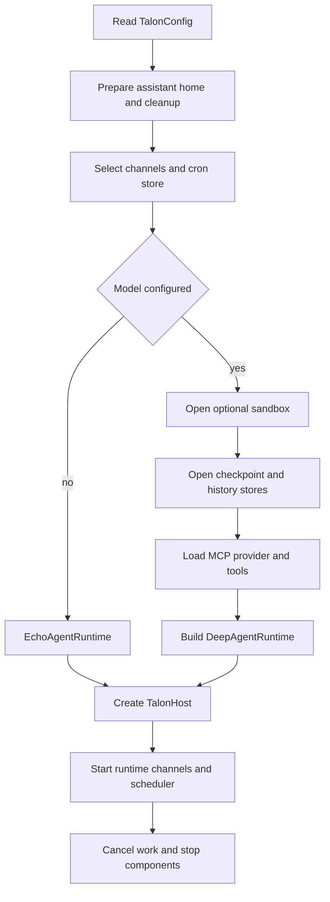
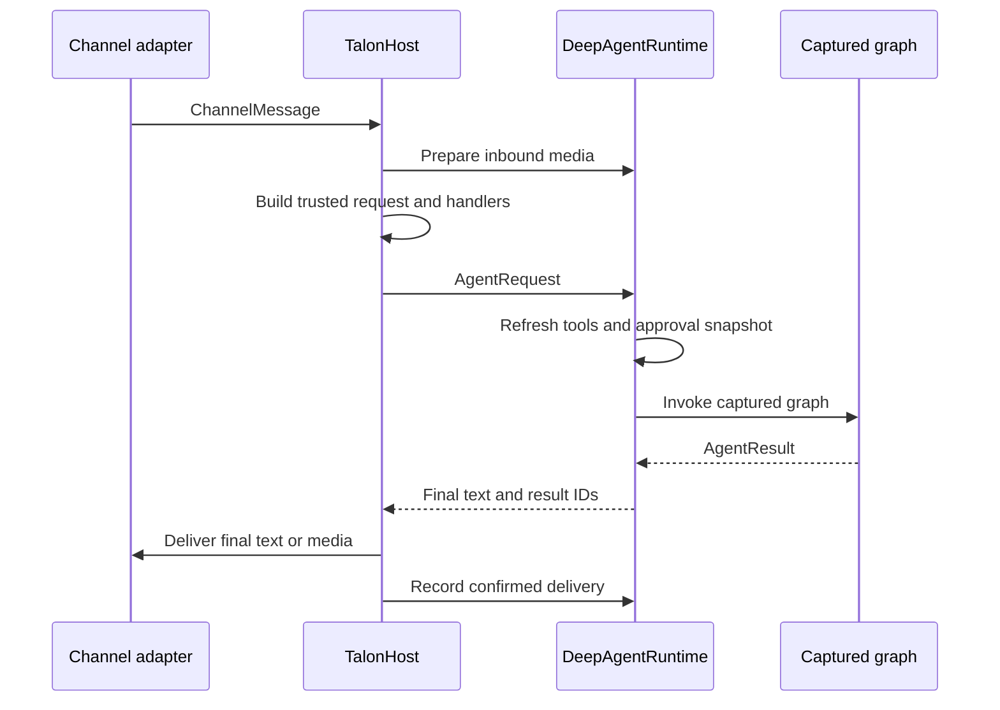
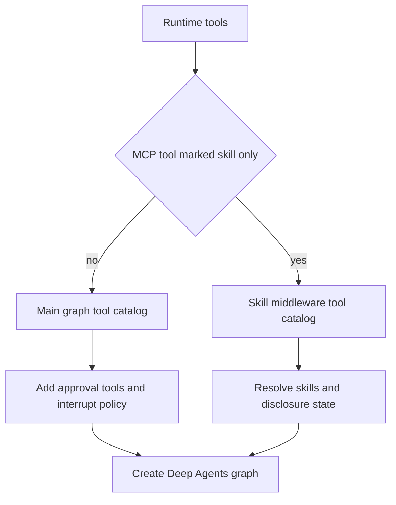
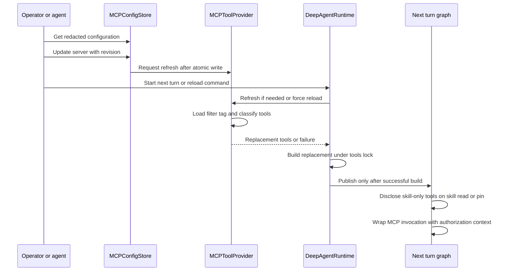

# Talon Runtime Integration

> **Experimental, single-operator software.** Talon is an alpha local runtime, not a production or multi-tenant security boundary. Admitting a sender effectively gives that sender access to the operator's agent, model credentials, configured MCP tools, and, without a sandbox, host resources. Approval prompts, configuration redaction, and an opt-in execution sandbox are useful controls; they do not provide channel-administrator isolation, complete HITL policy, or MCP containment. See [channel admission](../concepts/talon-channel-admission.md), [permissions and HITL](../concepts/permissions-hitl.md), and [security](../operations/security.md).

Talon separates transport, coordination, and execution:

- **Channel adapters** admit and deliver provider-specific messages; they do not invoke an agent graph.
- **`TalonHost`** binds channel callbacks, serializes and supersedes conversation work, fixes reply routing, and confirms final delivery.
- **`DeepAgentRuntime`** builds Deep Agents graphs and binds request-local state. It can publish replacement graphs between turns, but cannot choose a channel destination from model input.

## Starting and stopping the host

Run from `libs/talon` (or add `--directory libs/talon` from the repository root):

```bash
uv sync --group test
AGENT_ASSISTANT_ID=local AGENT_MODEL=<provider>:<model-id> uv run deepagents-talon --once
```

The CLI prepares assistant state and retention cleanup, selects enabled channel adapters and a cron store, then selects a runtime. A configured model opens the optional sandbox, checkpoint and history resources, wraps the saver in `ConversationSaver`, loads MCP capabilities, and creates `DeepAgentRuntime`. Without a model, it uses `EchoAgentRuntime`, which is useful for channel wiring but has no persistent history tools. `--once` starts and immediately stops the assembled host.



This is the CLI-owned resource lifetime and host-managed process lifecycle. The host starts the runtime before channels and the scheduler. A partial start unwinds in reverse order; shutdown cancels active work and continues stopping every component even when one stop fails.

Conversation coordination is in memory. A conversation-root lock serializes work, a newer message can interrupt active work, `/stop` cancels, and `/new` starts fresh context. Talon waits up to 30 seconds for cancellation rather than running a replacement beside a stuck task. Durable checkpoints, history, approvals, cron jobs, and MCP configuration are separate state owners.

## Turn path and graph assembly

The host prepares inbound media before model content, merges inbound metadata before trusted route metadata, and supplies closures whose reply destination cannot be redirected by model arguments. An interactive `AgentRequest` carries request-scoped progress, approval, and authorization handlers; scheduled and background turns intentionally omit interactive approval and authorization.



This shows an interactive turn. The runtime binds the captured graph, selected model, approval snapshot, history, cron origin, authorization handler, progress handler, and message state with context variables, then resets them even on failure or cancellation. The final-reply route remains a host responsibility.

Graph construction includes filesystem middleware, clock and breakout tools, optional progress, archive, cron, approval, subagent, web, and help capabilities, configured runtime tools, and middleware. Tool assembly now deliberately distinguishes **eager** from **skill-only** MCP tools:



The graph uses normal tools in the main catalog. A tool loaded from a server with `skillOnly: true` is removed from that catalog and supplied to skill middleware instead; it is disclosed when the corresponding skill is read or pinned, rather than being eagerly exposed. If no skill-only tools exist, ordinary Deep Agents skill loading is used. The attachment report from `get_agent_tools` distinguishes active attachments, saved-but-inactive changes, and capabilities retained by the current or running task.

`DEEPAGENTS_TALON_VERBOSITY` accepts only `1`, `2`, and `3`: level 1 omits `send_message`; level 2 allows two interim messages per invocation; level 3 has no fixed budget. `ProgressMessages` forwards visible main-agent narration immediately before a tool call only when the message has calls and does not explicitly call `send_message`; subagent narration is excluded. Progress budgets and handlers are invocation-local, whereas final replies are separately delivered and recorded only after successful delivery.

With a remote sandbox, documents are staged only after inbound-root, regular-file, symlink, and size checks. The model sees document path notices rather than inline contents, and eligible images become bounded base64 blocks. Markdown media from a final response becomes channel media only after outbound-root containment checks.

## Approvals and replacement invariants

`tools.json` is a bounded, validated, non-symlink exact-name mapping from tool name to boolean. Its byte-hash revision makes `ToolApprovalStore` updates lock-protected compare-and-swap operations. Approval-management tools distinguish the saved policy from the snapshot active in the current invocation; trusted operator metadata is additionally required to update policy.

At startup the graph is made from the saved approval snapshot. Before each invocation captures a graph, the runtime rereads that policy under the tools lock. A different snapshot builds a graph before publishing it. A policy-read or graph-construction failure blocks that turn while retaining the old graph and active snapshot. Consequently, active turns retain their captured graph and policy rather than seeing a partial change.

The construct-before-publish rule also applies to runtime tool refresh, explicit MCP reload, subagent reload, and helper-model changes. A failed reload leaves the previous usable graph; successful replacement affects later turns, not active work or already delegated tasks. This is availability-preserving, not immediate capability revocation.

## MCP configuration, disclosure, and authorization

Talon reads `~/.deepagents/.mcp.json` by default, or the path in `DEEPAGENTS_TALON_MCP_CONFIG`. It supports stdio, SSE, and streamable HTTP servers. Server names are validated, string fields can use `${ENV_VAR}` or `${ENV_VAR:-default}` expansion at load time, and a stdio server cannot set dangerous loader-influencing environment variables. `allowedTools` and `disabledTools` are mutually exclusive non-empty glob lists, matched against both the namespaced and original tool name. Loaded tools are renamed `<server>_<tool>`, tagged as Talon MCP tools, and one failing server contributes status rather than preventing tools from other servers from loading.

A `skillOnly` server setting must be boolean. It marks every loaded tool from that server as skill-only; it does not change the tool's name, approval policy, or authorization treatment. Put a matching skill under the normal skills hierarchy and declare its `metadata.include_tools`, for example `records_search`, so the capability becomes available only when that skill is disclosed or pinned. `skillOnly: false` leaves the same tool eager. Reloading reclassifies the replacement graph even for an existing conversation.

The provider adds management tools: `get_mcp_server_status`, `reload_mcp_configuration`, the redacted configuration tools, and `authenticate_mcp_server` only when an OAuth-configured server is present. `reload_mcp_configuration` schedules refresh before the next agent turn; `/mcp-reload` invokes an immediate runtime reload without calling the agent. `get_agent_tools` is the activation check, not a guarantee about an already-running graph.



This lifecycle shows configuration update, next-turn reload, skill disclosure, and per-call authorization. A provider refresh is serialized. A non-cancelled failed refresh consumes the requested revision and reports saved changes inactive until a later explicit update or reload; cancellation is propagated so the revision remains retryable. The runtime catches automatic-refresh failure to keep the old graph usable, while explicit reload surfaces its failure and likewise preserves the old graph.

`MCPConfigStore` gives tools a narrow redacted view. It opens only a regular non-symlink file, computes a process-keyed revision, uses a bounded POSIX sidecar lock, validates a complete replacement server, atomically writes mode `0600`, and reports generic read/write errors. `<redacted>` preserves an existing stored string on update; exact `${ENV_VAR}` references remain visible and are not expanded by this management layer. A stale revision produces a conflict rather than overwriting another writer.

Configuration management mediates supported edits, but **is not a confidentiality boundary**. The default `LocalShellBackend` can use absolute paths and execute `cat` or redirection, bypassing redaction, the revision CAS, file-opening safeguards, and approval interrupt. A path within the agent workspace is warned about rather than rejected because moving it outside the workspace alone does not prevent absolute-path access. Keep credentials as environment references, or use an OS/keyring/sandbox boundary that the agent process cannot read; no tool-level filesystem permission makes an execution-capable backend safe for secret files. When approval for `update_mcp_server` is disabled, an update reusing `<redacted>` values may change only `allowedTools` or `disabledTools`; changing other managed settings is rejected because it could redirect a credential the caller never saw.

For MCP calls, Talon's middleware applies only to metadata-marked loaded MCP tools. It removes optional empty string arguments while preserving required or explicitly non-string values, binds the tool-call ID as authorization invocation context, and converts `MCPError` into an error `ToolMessage` without protocol artifact data. Other exceptions propagate. Fresh local subagents also receive this middleware, so their selected MCP tools retain the same authorization context and protocol-error behavior.

Remote OAuth servers have an interactive channel flow and a terminal fallback:

```bash
deepagents-talon mcp config
deepagents-talon mcp login <server>
```

`authenticate_mcp_server` is restricted to configured OAuth server names. It opens the authorization flow through the request-bound channel handler, so links and callbacks do not pass through model content. A completed authorization schedules a refresh so newly available tools are loaded for a later turn. In unattended cron and background work there is no interactive authorization handler; operators must use an interactive chat or the CLI flow instead.

## Persistence, history, and background delivery

Talon validates assistant IDs, creates restrictive assistant-local state directories, and installs defaults without overwriting an existing `tools.json`. Checkpoint URI selection and history URI selection are independent: checkpoint backends choose a LangGraph saver, history opens an assistant-namespaced archive, and `ConversationSaver` combines them. The checkpoint factory supports built-in SQLite/file, PostgreSQL, and MongoDB schemes before trusted entry-point plugins; setup errors are credential-safe configuration errors.

The host records final replies in history only after channel delivery succeeds. On supersession, pre-delivery cancellation, or delivery failure, it requeues background-result IDs carried by `AgentResult`. A post-start dispatcher finds idle current conversations with pending results, starts a synthetic follow-up with the original reply route and progress handler but no interactive approval or authorization handler, and applies exponential retry backoff capped at 60 seconds.

## Focused verification

From `libs/talon`, run the targeted coverage for graph replacement, MCP management and disclosure, plus the pre-existing runtime safeguards:

```bash
uv sync --group test
uv run --group test pytest tests/test_runtime.py tests/test_mcp.py tests/test_mcp_middleware.py tests/unit_tests/test_mcp_config.py tests/unit_tests/test_skill_mcp.py tests/unit_tests/test_tool_approval_runtime.py tests/test_media.py tests/unit_tests/test_attachments.py tests/unit_tests/test_messaging.py tests/unit_tests/test_verbosity.py
```

The MCP tests cover server loading and partial failure, authentication/reload revisions, argument normalization and protocol-error containment, redacted CAS updates and unsafe-secret redirect rejection, and skill-only disclosure with approval and authorization retained. The skill integration test specifically verifies read, pin, disabled, eager, rejection, and reload-reclassification paths.
