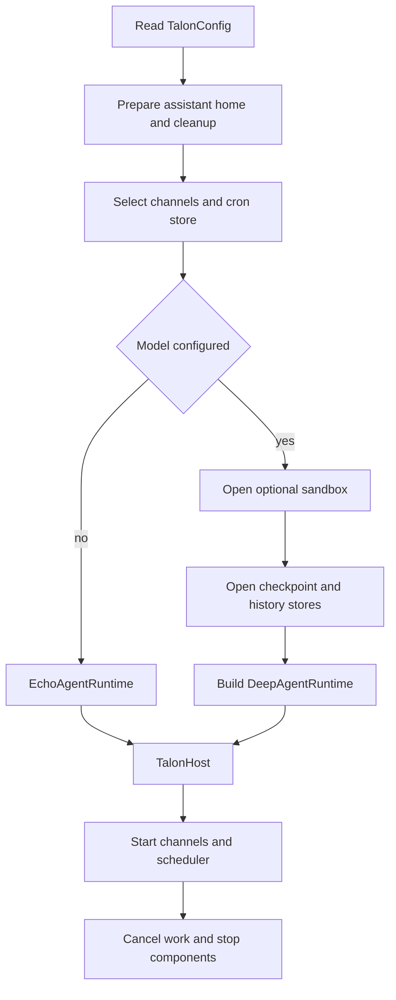
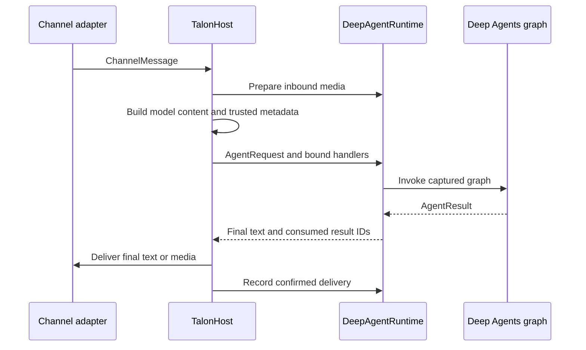

# Talon Runtime Integration

> **Experimental, single-operator software.** Talon is an alpha local runtime, not a production or multi-tenant security boundary. Admitting a channel sender effectively gives that sender access to the operator's agent, model credentials, configured MCP tools, and—when no sandbox is selected—host resources. Tool prompts and the opt-in execution sandbox are useful controls, but neither supplies complete HITL policy, channel-administrator isolation, or MCP containment. See [channel admission](../concepts/talon-channel-admission.md), [permissions and HITL](../concepts/permissions-hitl.md), and [security](../operations/security.md).

Talon has three distinct roles:

- **Channel adapters** admit and transport provider-specific messages. They implement the channel protocol; they do not invoke an agent graph themselves.
- **`TalonHost`** owns process and conversation coordination: it binds channel callbacks, serializes and supersedes conversation work, supplies trusted routing callbacks, and performs final delivery.
- **`DeepAgentRuntime`** owns the Deep Agents graph and request-local execution context. It constructs replacement graphs when capabilities or approval policy change; it does not decide a channel destination from model input.

## Starting the local host

Run commands from `libs/talon` (or add `--directory libs/talon` from the repository root):

```bash
uv sync --group test
AGENT_ASSISTANT_ID=local AGENT_MODEL=<provider>:<model-id> uv run deepagents-talon --once
```

`deepagents-talon` reads `TalonConfig`, creates the assistant home, and applies startup retention cleanup before selecting adapters. `--whatsapp`, `--telegram`, `--discord`, and `--slack` enable their respective adapters; the matching `DEEPAGENTS_TALON_<CHANNEL>_ENABLED` environment settings work too. If at least one channel is enabled, the CLI installs a persistent cron scheduler whose runner and delivery callback are host methods.

A configured model selects the full runtime: Talon opens the optional sandbox, checkpointer, and history archive for the host lifetime, wraps checkpoint storage in `ConversationSaver`, loads MCP tools, then builds `DeepAgentRuntime`. With no model configured, it deliberately uses `EchoAgentRuntime`; this is useful for checking channel and host wiring but does not provide persistent history tools. `--once` starts the assembled host and immediately stops it.



This is the CLI-owned resource lifetime and the host-managed process lifecycle.

### Startup and shutdown invariants

The host ensures the home, starts the runtime, binds each channel handler and starts channels, then starts the scheduler. A partially failed start is unwound in reverse order, including a channel that failed partway through its own start. On shutdown, the host cancels active work, stops channels in reverse order, then scheduler and runtime. It logs a component stop failure but continues stopping the rest. `run_until_stopped()` installs signal handling, waits for the stop event, and always attempts that teardown.

Conversation coordination is in memory. A conversation-root lock serializes work; a new message can interrupt the active turn, while `/stop` cancels and `/new` starts fresh context. Talon waits up to 30 seconds for cancellation rather than running a replacement alongside a stuck task. When a conversation has no task, blocked turn, pending approval or authorization, or background route, the host drops its coordination maps; durable state belongs in the configured stores rather than these maps.

## Request path and ownership boundaries

A channel message first passes through host preparation. Voice transcription and an optional runtime media hook happen before model content is built. The host merges inbound metadata first and then trusted route metadata, so inbound values cannot overwrite host-defined channel, trigger, sender, or routing fields. It captures selected model and effort too. The closures passed in `AgentRequest` fix the reply destination: model arguments cannot redirect progress, approval, or OAuth/authorization presentation.



The diagram shows an interactive turn. Scheduled and background follow-up turns reuse runtime invocation but intentionally withhold interactive approval and authorization handlers.

`DeepAgentRuntime` owns Deep Agents graph construction: it combines filesystem middleware, the built-in clock, conditionally included progress tools, configured runtime tools, optional archive and cron tools, approval tools, subagents, and optional web/help capabilities before the host invokes it through `AgentRequest`. For each interactive turn, the host supplies request-scoped delivery, tool-approval, and authorization handlers plus trusted metadata; the runtime binds invocation graph, model, approval, history, cron, authorization, and message state in context variables and resets them after invocation.

### Media and final delivery

With a remote sandbox, the runtime stages document attachments only after checking the configured inbound-media root, regular-file status, symlink safety, and size. It replaces a usable host alias with the sandbox path; a staging failure is represented as unavailable, not as a claim that the agent can read the file. Documents arrive in model content as untrusted path notices rather than prompt-inlined bytes. Eligible images become bounded base64 blocks. For final responses, Markdown image/video references are turned into channel media only after configured outbound-root containment checks; arbitrary model-selected paths do not become host file access.

Progress messages are distinct from final delivery. The host records a final reply in history only after a successful channel delivery. If a completed response is superseded, cancelled before delivery, or undeliverable, background-result IDs carried by `AgentResult` are requeued so unreported work can be offered again.

## Graph construction, request context, and progress

`DEEPAGENTS_TALON_VERBOSITY` accepts only `1`, `2`, and `3`. Level 1 omits `send_message` from the graph; level 2 adds it and gives each invocation a two-message budget; level 3 adds it with no fixed budget. This controls interim updates, not the final response or host-visible tool activity.

`send_message` uses the request-bound channel handler, rejects blank text, and reports sanitized delivery failures rather than transport details. `ProgressMessages` can also forward visible main-agent narration immediately before a tool call, but only when that message has calls and does not explicitly call `send_message`; subagent narration is excluded. The progress handler and sparse budget are context variables. Concurrent calls in one invocation share the budget, while concurrent turns receive separate handlers and budgets; cleanup restores both bindings even when the invocation raises or is cancelled.

## Approval policy and safe graph replacement

`tools.json` in the assistant home is an exact-name JSON mapping from tool name to a boolean. A `true` entry creates an approve/reject interrupt; an absent or `false` entry does not request a prompt. The persisted policy is deliberately separate from the snapshot captured by a running invocation:

- `ToolApprovalStore` accepts only a bounded, non-symlink regular file and records a hash of its source bytes as the revision.
- The update tool is lock-protected compare-and-swap: callers provide the revision they read, updates merge rather than replace unrelated entries, and successful changes say `next_invocation`.
- `get_tool_approvals` reports both saved and active snapshots, allowing a turn to explain that its own graph still uses the old policy. Updating additionally requires trusted operator metadata, even if prompting for that tool was disabled.

At runtime start, the graph is created from the saved approval snapshot. Before an invocation captures its graph, the runtime rereads the policy under the tools lock. A changed snapshot produces a new graph before publication. A malformed policy or failed construction blocks that invocation but leaves the old graph and active snapshot untouched; a later invocation retries after correction. Thus active turns retain their captured graph and policy rather than observing a partial policy transition.

The same construct-before-publish rule applies to capability changes. The refresh callback can detect changed MCP configuration between turns. Explicit MCP reload and subagent reload construct a replacement under the tools lock and publish only after success; failures leave the prior usable graph in place. Reloads affect later work, not active turns or already-delegated tasks, so they are not immediate capability revocation.

## Checkpoints, history, and assistant-local state

Assistant identity comes from `DEEPAGENTS_TALON_ASSISTANT_ID` or `AGENT_ASSISTANT_ID`; it is validated and defaults to `default`. The default home is `~/.deepagents/<assistant_id>/`, with `DEEPAGENTS_TALON_HOME` selecting its parent. `ensure_home()` creates owner-only home, manifest, agents, cron, channels, and inbound-media directories; packaged defaults and `tools.json` are installed without overwriting existing configuration. Keep this home and MCP configuration outside an agent-writable workspace: same-UID shell access can bypass tool-level policy.

Checkpoint and history selection are independent. `DEEPAGENTS_TALON_CHECKPOINT_URI` chooses a LangGraph saver; built-in SQLite/file, PostgreSQL, and MongoDB schemes take precedence, and a trusted installed package may supply exactly one plugin factory for another scheme. Setup errors are reduced to a credential-safe configuration error. Remote checkpoint thread IDs are not automatically assistant-namespaced, so isolate assistants at the database or backend level.

`DEEPAGENTS_TALON_HISTORY_URI` independently selects the archive backend. The archive is assistant-namespaced and is combined with the saver through `ConversationSaver`, which enables history tools and confirms final reply delivery. This separation permits independent retention and migration decisions: changing either URI does not move the other store's existing data. See [state persistence](../concepts/state-persistence.md).

## Scheduling, background work, and MCP

Cron is attached only when channels exist because scheduler delivery resolves the origin channel. Scheduled work is unattended: it cannot use interactive authorization or approval handlers, and a channel-less OAuth prompt must direct the operator to a chat or `deepagents-talon mcp login <server>` instead. See [Talon scheduling](../concepts/talon-scheduling.md).

Background-capable runtimes get a post-start dispatcher. It scans pending results once per second, skips busy or no-longer-current conversations, and claims a synthetic follow-up turn only for an idle current owner. The follow-up has no interactive approval or authorization handler; the runtime inserts pending results before its follow-up instruction and acknowledges them after successful invocation. Repeated claims use exponential backoff capped at 60 seconds.

MCP tools are loaded from the configured MCP file as stdio, SSE, or streamable HTTP connections. Talon namespaces loaded tools by server and can retain other servers when one fails. The terminal entry point is `deepagents-talon mcp login <server>`; interactive channel authorization uses the request-local host handler so its presentation and callback do not need to pass through model content. MCP remains host-side even when filesystem execution uses a sandbox.

## Focused verification

From `libs/talon`, run the focused regression layer for the mechanisms documented here:

```bash
uv sync --group test
uv run --group test pytest tests/test_runtime.py tests/test_media.py tests/unit_tests/test_attachments.py tests/unit_tests/test_messaging.py tests/unit_tests/test_tool_approval_runtime.py tests/unit_tests/test_verbosity.py
```

These tests cover transactional runtime-tool and graph replacement, media containment and prompt shaping, sandbox attachment staging, progress ordering and isolation, approval snapshot activation/failure behavior, and verbosity-specific progress-tool assembly and budgets. Host tests additionally exercise lifecycle, cancellation, delivery, and background dispatch behavior.
