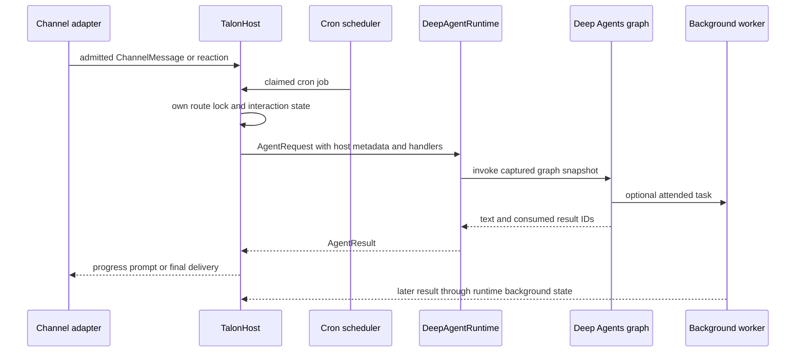

# Talon Runtime Integration

Talon is an experimental long-running assistant host. Its key ownership boundary is deliberate: channel adapters translate provider events, `TalonHost` owns conversation routing, turn replacement, delivery, and interactive channel state, while `DeepAgentRuntime` owns graph construction, checkpointed execution, runtime tool snapshots, and in-process background workers. The host is the only component that turns a channel or scheduler event into an `AgentRequest`; adapters do not invoke the runtime directly.

See [Talon channel admission](../concepts/talon-channel-admission.md) for provider trust and routing, [Talon scheduling](../concepts/talon-scheduling.md) for the durable cron model and worker delivery lifecycle, [MCP integration](mcp.md) for the broader MCP/OAuth model, and the [testing guide](../testing/testing-guide.md) for repository conventions.

## Composition and ownership

The CLI builds the configured channels and, when channels exist, a `PersistentCronScheduler` whose callbacks are `TalonHost.run_scheduled_job` and scheduled-result delivery. For a model-backed assistant, it first loads `MCPToolProvider`, logs per-server outcomes, and constructs `DeepAgentRuntime` with its tools, refresh/reload callbacks, async-subagent loader, cron store, checkpointer, sandbox backend when configured, and one `talon_mcp_middleware()`.

`TalonHost.start()` starts the runtime first, binds each channel's message and optional reaction callbacks before starting it, then starts the scheduler. If startup fails, it unwinds the started scheduler/channels in reverse order and stops the runtime. On normal shutdown it cancels the background dispatch loop and active work, stops channels and scheduler, then stops the runtime; individual stop failures are logged without preventing subsequent cleanup.



*The host owns channel-facing lifecycle and delivery; the runtime owns a graph snapshot and the worker table used during execution.*

`AgentRequest` is the integration contract: it carries a resolved conversation ID, text, host-supplied metadata, and optional approval, authorization, progress, breakout, and question handlers. `AgentResult` returns text plus the IDs of background results that the runtime has acknowledged; the host alone knows whether that text was actually delivered and can requeue those IDs if it discards the reply. Optional runtime protocols isolate capabilities such as inbound-media staging, model selection, MCP reload, background work, delivery indexing, and history erasure from the base `AgentRuntime` interface.

## Graph construction and per-turn state

`DeepAgentRuntime.start()` resolves subagents, snapshots the per-assistant approval store, and creates the graph. Graph assembly combines Talon's filesystem middleware, selected-model summarization and selection, progress messages, a human-in-the-loop middleware built from the approval snapshot, server hooks, task selection, configured background workers, optional summarization-tool middleware, skill middleware, and caller-supplied middleware. It adds approval-management and attachment-inspection tools, keeps skill-only MCP tools out of the ordinary main tool list until skill disclosure, and prepares local subagents against the actual tool catalog.

The runtime uses a checkpointer so turns in one conversation can share history. Before each invocation it refreshes tools if needed, rebuilds the graph if approvals changed, then stores the current graph in a context variable. That captured graph snapshot means a concurrent replacement cannot alter an in-flight turn. If a tool refresh or graph rebuild fails, the previous graph stays usable and saved MCP changes remain inactive. At shutdown, runtime resource cleanup is intentionally skipped if a background worker outlives the cancellation wait, avoiding writes through a closed checkpointer.

For a channel turn, the host derives a provider-qualified conversation root, serializes it, and composes host-owned identity and history metadata. Within that lock, commands win; a matching pending approval, OAuth callback, or question reply is processed before an ordinary message may replace the active agent turn. A replacement increments the generation, cancels the previous task, and attempts checkpoint recovery. Settlement checks both generation and conversation ID before sending, so a stale result or progress update cannot arrive in a newer conversation. See [Talon channel admission](../concepts/talon-channel-admission.md) for the detailed admission and metadata trust boundary.

## Questions, approvals, and unattended authority

Tool approval and `ask_user` clarification are separate interactions. For an attended run with an identified sender, the host stores pending approval/question state by agent conversation and sends prompts on the originating channel. Approval replies and reactions are bound to that sender; a missing sender is rejected rather than creating a pending approval. Question sessions serialize a batch into channel prompts and return no answers if cancelled or delivery fails, so the model must not assume an answer.

The runtime sets `APPROVAL_OPERATOR` only when host metadata says the requester is an operator and the request is neither cron nor background delivery. It scopes the authorization, question, progress, hook, cron-origin, background-result, and graph context around the invocation and resets them in `finally`. Cron and background-delivery requests therefore have no channel approval, authorization, or question handler; cron is additionally rejected by the approval operator gate. This prevents an interaction from outliving the attended turn that could answer it.

## Background delegation and cron

`BackgroundSubagents` turns attended `task` and `start_async_task` calls into process-local jobs owned by the current runtime thread. The shared job table is bounded, running capacity is shared across configured graph copies, and each worker runs under a fresh task thread with no authorization handler and no approval operator. Results are capped and failures, timeouts, remote stream errors, and approval interrupts become safe result text rather than propagated arguments or credentials. Only the owning conversation can list, inspect, message, or cancel its jobs; inspection exposes bounded lifecycle metadata rather than reasoning or message bodies.

The host polls for completed owner results. It skips locked, active, blocked, superseded, or result-less conversations, uses capped exponential backoff, and creates an unattended `background_delivery` follow-up only when eligible. The runtime injects keyed results into that main-agent turn, acknowledges them after it completes, and reports their IDs in `AgentResult`. If the host later suppresses or fails to deliver that reply, it requeues only those IDs. A failed processing attempt is counted and eventually dropped rather than retried forever.

Cron is different: it has no later attended turn. During a `trigger: "cron"` invocation, `task` and `start_async_task` run inline under a separate semaphore and timeout, nested delegation remains forbidden, and all failure paths become a safe tool error. `TalonHost.run_scheduled_job` creates a fresh run conversation under a stable per-job lock, bounds execution, and can read—but does not append execution transcript to—the trusted origin history. The scheduler's durable claim-before-run and delivery semantics are documented in [Talon scheduling](../concepts/talon-scheduling.md).

## MCP tools, configuration, and reloads

Talon wires one `talon_mcp_middleware()` into the main `DeepAgentRuntime` and installs the same middleware in freshly compiled local subagents, so both paths receive the MCP adapter behavior.

`load_mcp_tools()` discovers each configured server through `MCPAdapter`, prefixes discovered tool names with the server name, and marks their metadata as Talon MCP tools; `skillOnly` servers receive an additional metadata marker. For OpenAI Responses API model requests, Talon's MCP middleware converts only marked MCP `BaseTool` values with `convert_to_openai_tool(..., strict=False)` and otherwise leaves the request tools unchanged; non-Responses models are passed through.

For a marked MCP invocation, the middleware removes only optional empty string arguments for string-like or unspecified properties, retains required empty strings and explicitly non-string properties, and invokes the handler under the exact tool-call ID as authorization context, restoring that context afterward. The middleware converts an `MCPError` into an error `ToolMessage` correlated to the original tool name and tool-call ID and exposes only the code and message, while non-MCP errors propagate through the normal runtime path. Talon has no MCP elicitation UI: recognized elicitation interrupts are resumed with a cancel action for each valid request key, while malformed elicitation payloads are rejected instead of being processed as approval requests.

MCP refresh is serialized and revision-driven; the runtime retains its prior graph after a refresh failure, while successful replacement builds a new graph, so running work retains the capabilities of the graph it began with. The selected MCP config comes from `DEEPAGENTS_TALON_MCP_CONFIG` or `~/.deepagents/.mcp.json`; it validates/expands enabled server definitions, supports stdio, SSE, and streamable HTTP, and reports individual server failures without withdrawing sibling tools. Disabled servers are not expanded, connected, or offered authentication.

`MCPConfigStore` exposes a redacted configuration view with an HMAC revision and an update capability that locks, rereads, compare-and-swaps the revision, validates a single-server replacement, writes atomically, and schedules refresh only after a successful write. Reads redact stored strings except allowed enum values and exact environment references, preserve unseen unmanaged fields across supported updates, and return generic errors rather than file contents. This mediation is not filesystem isolation because Talon's execution-capable shell can bypass it. Reusing a `<redacted>` value without active approval rejects changed managed routing/execution settings except tool filters, preventing a restored credential from being redirected; a required approval policy permits a human-reviewed update.

Fresh local subagents receive only applicable approval rules and add `HumanInTheLoopMiddleware` when such rules exist. Talon refuses precompiled subagents because approval policy cannot be enforced inside them. A senderless Telegram channel post cannot create a pending tool approval, even when the exposure mode otherwise admits that conversation.

## Observability and operational signals

Activity logging is opt-in through `DEEPAGENTS_TALON_AGENT_ACTIVITY_LOGGING`. Per invocation, `AgentActivityCallback` emits structured run, model-thinking, and tool start/completion/failure events with stable hashed activity and conversation references, durations, model/tool names, and bounded input/output previews. Preview traversal, depth, item count, and string length are bounded; secret-named fields, bearer credentials, assignments, URL credentials, and query data are redacted before logging.

LangSmith tracing is separately enabled only when both `LANGSMITH_TRACING` is truthy and `LANGSMITH_API_KEY` is present. The trace context is tagged with Talon and assistant identity, optionally trigger, and carries assistant, conversation, and request metadata. A cancelled root run explicitly marked as user interruption attempts to create LangSmith feedback, but observability failures never prevent cancellation. Operators should still treat request metadata as potentially sensitive and limit access to trace/log sinks.

## Focused validation seams

`libs/talon/tests/test_host.py` is the principal integration seam: startup unwind/shutdown, provider-qualified routing and metadata, replacement/cancellation recovery, generation suppression, approvals/reactions, questions, background delivery, scheduled execution, and final delivery are exercised against small runtime/channel doubles. `libs/talon/tests/test_runtime.py` exercises graph construction, request context scopes, tool replacement, approval interruption, and cron behavior; `libs/talon/tests/test_observability.py` verifies trace opt-in, structured event shape, redaction, and bounded previews.

Focused Talon MCP tests exercise middleware argument and authorization handling, protocol-error behavior, Responses schema preservation and real-adapter invocation, elicitation cancellation, in-flight reload behavior, stdio lifecycle, and skill-scoped MCP disclosure. Configuration tests cover redacted round trips, stale and concurrent CAS updates, lock contention, atomic-write behavior, enable/disable refresh, and approval-policy protection against credential redirection.

From `libs/talon`, a useful focused run is:

```bash
make test TEST_FILE="tests/test_host.py tests/test_runtime.py tests/test_observability.py tests/test_mcp_middleware.py tests/unit_tests/test_mcp_adapter.py tests/unit_tests/test_mcp_config.py tests/unit_tests/test_mcp_enabled.py tests/unit_tests/test_telegram_approvals.py"
```

When changing the integration, preserve the host/runtime ownership split, generation checks, handler-free unattended work, graph snapshot replacement, and redaction boundary. Those invariants matter more than the particular channel or model implementation.
