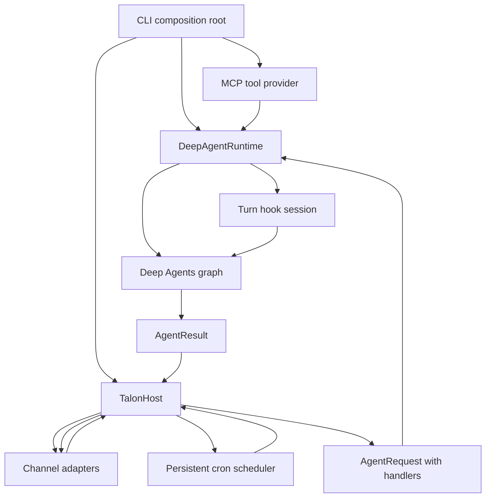
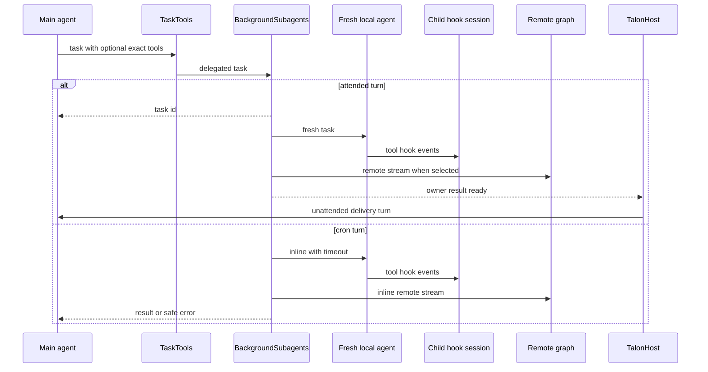

# Talon Runtime Integration

Talon is an experimental local host for long-running Deep Agents channels and schedules. Its boundary is deliberate: channel adapters admit and translate provider events; `TalonHost` owns routing, interactive callbacks, delivery, and shutdown; `DeepAgentRuntime` owns graph construction, checkpointed execution, and process-local background jobs. Adapters do not invoke the runtime directly.

See [Subagents and skills](../concepts/subagents-skills.md), [Talon channel admission](../concepts/talon-channel-admission.md), [Talon scheduling](../concepts/talon-scheduling.md), [MCP integration](mcp.md), and [Security](../operations/security.md).

## Composition and ownership

The `deepagents-talon` CLI is the production composition root. For a configured model it loads MCP tools, opens checkpoint and history resources, and constructs `DeepAgentRuntime` with the assistant directory, async-subagent loader, cron store, sandbox backend when configured, and `talon_mcp_middleware()`. It gives the runtime and adapters to `TalonHost`. A `PersistentCronScheduler` exists only when channels exist, and calls back through the host to execute and deliver jobs.

`AgentRequest` is the host-to-runtime contract: it contains the host-resolved conversation ID, text, trusted metadata, selected model/effort, and optional approval, authorization, progress, breakout, and question handlers. `AgentResult` carries output and acknowledged background IDs. The runtime can acknowledge that the model consumed a result, but the host alone knows whether its channel reply was delivered and must requeue IDs when it was not.



*Channels and the scheduler enter through the host. Hooks and interactive authority are bound only while the runtime executes one request.*

### Lifecycle

`TalonHost.start()` ensures the home directory, starts the runtime, binds and starts channels, then starts the scheduler. A failed partial start is unwound in reverse order. Shutdown cancels the background dispatcher and active conversation work before stopping channels in reverse order, scheduler, and runtime; a component-stop failure is logged without preventing remaining cleanup.

`DeepAgentRuntime.stop()` cancels background workers before closing its graph/checkpointer. If a worker outlives cancellation, it raises and leaves those resources open rather than allow a worker to write through a closed checkpointer.

## Graph assembly, reload, and attachments

At start, the runtime resolves subagents, reads a `ToolApprovalStore` snapshot, and builds a graph. It creates a catalog from filesystem and ordinary runtime tools, removes MCP tools marked `skillOnly` from the main tool list, attaches approval-management and `get_agent_tools`, resolves local frontmatter tool names exactly against that catalog, then configures background delegation against the resolved agents.

The graph includes filesystem support, selected-model summarization and selection, progress, human-in-the-loop approval, server hooks, `TaskTools`, background delegation, optional context-size tools, skills, and caller-supplied middleware. `get_agent_tools` reports configured attachments separately from names selectable per task; opaque compiled or remote agents report unknown tools. Saved MCP/subagent changes require reload, and running turns/tasks retain their original graph and capabilities.

Before an invocation, the runtime refreshes supplied tools, then holds its tools lock while reading approval policy and rebuilding only if that snapshot changed. It publishes a replacement graph only after construction succeeds and places the selected graph and approval snapshot in context variables. Consequently, failed reloads preserve the prior graph and an in-flight turn cannot gain or lose capabilities mid-execution.

Selected model choice is also turn-scoped. An unavailable saved selection falls back to the default, and summarization caches a selected-model-specific summarizer while subagents use their startup summarizer.

## Hooks, approvals, and MCP are invocation capabilities

The runtime loads `hooks.json` from the trusted assistant home at the beginning of every invocation. It opens it without following symlinks and accepts only a regular file. Missing configuration means no hooks; malformed content becomes diagnostics and an empty hook snapshot so the turn can continue. Workspace/project hooks are deliberately excluded because the workspace is untrusted. Legacy configuration is migrated where safe and emits deprecation diagnostics.

A `TalonHooks` session owns that turn's snapshot, transcript runtime, prompt identity, and completed hook responses. It accepts only `PreToolUse`, `PostToolUse`, `PostToolUseFailure`, and `Stop` server events. Resume validates interrupt ID uniqueness and verifies snapshot, thread, and prompt identities before fulfilling an invocation; duplicate fulfillment is cached. The runtime resets `ACTIVE_HOOKS` in `finally`, so a concurrent or later turn does not inherit this session.

A hook denial blocks its tool call before ordinary approval. A hook allow does **not** bypass Talon approval: `hook_approval_required` still asks for approval unless the hook denied that specific call. This preserves host ownership of user interaction. `APPROVAL_OPERATOR` is enabled only for a host-designated operator request that is neither cron nor background delivery; authorization, question, breakout, progress, history, hook, pending-result, model, and cron state are likewise installed only for the invocation and reset afterward.

Talon wires one `talon_mcp_middleware()` into the main `DeepAgentRuntime` and installs the same middleware in freshly compiled local subagents, so both paths receive the MCP adapter behavior. It preserves marked MCP schemas for OpenAI Responses calls, normalizes optional empty-string arguments, scopes authorization to the tool-call ID, and returns a correlated, data-safe `ToolMessage` for `MCPError`. Talon has no elicitation UI, so MCP elicitation interrupts are resumed as cancellation.

## Fresh local subagents and task tool replacement

Talon replaces the SDK `SubAgentMiddleware` with `TaskTools` under the same middleware name, preventing duplicate `task` tools. The replacement accepts a `tools` list only for a named local subagent. Every name must be unique and present in the current selectable catalog; selected tools augment, rather than replace, its configured tools for that task. The subagent is freshly compiled with a fresh message state: it does not inherit parent history, memory, skills, or delegation tools.

Fresh local agents receive `talon_mcp_middleware()`, control middleware, only the approval rules applicable to their resolved tools, and `HumanInTheLoopMiddleware` only when such rules exist. For a hook-enabled parent turn, each local execution gets a child hook session with the same immutable snapshot but new thread/prompt/agent identities and a separate transcript. It does not emit `Stop`; it can resume its own hook interrupts and preserves the parent's working directory. This lets concurrent local tasks remain isolated while applying the parent turn's hook policy.

A precompiled runnable is opaque. If any approval policy is active, Talon substitutes a refusal rather than execute it; otherwise it may run with task-only state. Remote `AsyncSubAgent` definitions are likewise opaque and stream the configured remote graph with the task description as user input, requesting cancellation on disconnect. `fork` mode is rejected for every subagent source.



*Local tasks have a child hook session derived from the current invocation. Attended tasks detach for host delivery; scheduled tasks wait inline because no interactive follow-up is available.*

## Delegation and delivery behavior

For attended turns, `BackgroundSubagents` makes in-memory, conversation-owned jobs and enforces a process-shared running limit. Workers clear approval-operator and authorization-handler authority, block nested delegation, bound result text, and convert timeout, failure, remote error, and approval interrupt into safe results. Listing, inspection, cancellation, and control are limited to the owning conversation; queued guidance is available only to Talon-built local agents.

The host dispatches eligible completed results using an unattended `background_delivery` request, which has no approval, authorization, or question handlers. It requeues result IDs if it cannot deliver the reply and limits failed delivery retries. For cron requests, delegation runs inline under a separate semaphore and timeout; nested delegation remains refused and failure becomes a safe tool error rather than an escaping graph retry.

## Operations and validation

The package is alpha/experimental, requires Python 3.14, and exposes the `deepagents-talon` command. Relevant configuration includes the assistant manifest/home, model and context settings, optional sandbox, MCP configuration, `DEEPAGENTS_TALON_MAX_BACKGROUND_TASKS`, and `DEEPAGENTS_TALON_VERBOSITY`. Validate a normal attended turn and a cron turn separately: their authority and delegation lifecycle intentionally differ.

When changing this integration:

- Keep the host as the sole owner of provider delivery and interactive callback lifetime.
- Treat hooks, approval authority, authorization, questions, and progress handlers as per-invocation capabilities; never leak them to a background worker or delivery turn.
- Build replacement graphs before publishing them and preserve per-invocation graph/policy snapshots.
- Keep task attachment catalog-based, exact-name, and fresh-context; do not give a role parent history, all tools, or an approval bypass.
- Treat compiled and remote agents as opaque policy boundaries.
- Preserve trusted-home-only hook loading and child-session isolation for local agents.

Focused tests in `tests/unit_tests/test_hooks.py` cover hook wire payloads, denial versus approval, failure events, trusted file loading and symlink resistance, diagnostics/legacy migration, reload between turns, and local-subagent snapshot/transcript isolation. `tests/unit_tests/test_research_subagents.py` covers fresh context, explicit attachments, dynamic tool selection, MCP protections, and approval enforcement for opaque agents.

```bash
pytest tests/unit_tests/test_hooks.py tests/unit_tests/test_research_subagents.py
```
