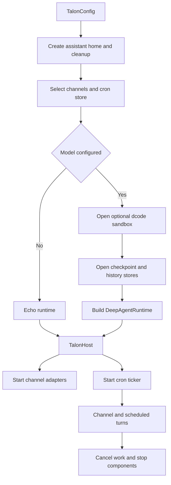

# Talon Runtime Integration

> **Experimental alpha software.** Talon is a local, single-operator runtime subject to change or removal; it is not intended for production or enterprise use. It does not supply multi-tenant isolation, complete HITL policy, or channel-administrator security boundaries. Treat channel admission as granting access to the operator's agent, configured model credentials, MCP tools, and—without a sandbox—local host resources. An opt-in sandbox does not contain MCP, web, or channel code. See [channel admission](../concepts/talon-channel-admission.md), [scheduling](../concepts/talon-scheduling.md), [state persistence](../concepts/state-persistence.md), [sandbox partners](sandbox-partners.md), and [security](../operations/security.md).

Talon runs one assistant as one coordinated event-loop process. `deepagents-talon` builds `TalonConfig`, prepares assistant-local state and retention cleanup, selects any enabled channel adapters, and starts a `TalonHost`. With a model configured, the CLI opens the selected checkpoint and conversation-history stores and wraps the checkpoint saver in `ConversationSaver`; it then builds `DeepAgentRuntime`. With no model it intentionally uses the echo runtime, which is useful for checking host and channel wiring but does not provide persistent history tools.

## Process composition and lifecycle

The CLI selects WhatsApp, Telegram, Discord, and Slack adapters through flags or their `DEEPAGENTS_TALON_<CHANNEL>_ENABLED` settings. When channels are present, it installs `PersistentCronScheduler` with the host's scheduled-job runner and delivery callback. A model-backed startup optionally opens a dcode sandbox first, then opens checkpoint and history resources for the duration of the host. `--once` starts and immediately stops this assembled host.



This shows the resources owned by the CLI and the components owned by `TalonHost` during one process lifetime.

The host starts the runtime, binds each channel's inbound handlers, starts channels, then starts the scheduler. If a component fails during startup, it stops the scheduler and already-tracked channels in reverse order and stops the runtime, so partial startup does not leave a channel connection or subprocess running. On shutdown it cancels active work, stops channels in reverse order, stops the scheduler, and stops the runtime; a failure in one stop is logged without preventing the remaining cleanup. Signal-driven `run_until_stopped()` waits for the shutdown event and always runs this teardown.

A conversation lock serializes turns for the same host conversation root. A new message interrupts active work for that conversation; `/stop` cancels it, while `/new` begins a fresh thread/context. If cancellation does not finish within 30 seconds, Talon does **not** start the new message alongside the stuck run and instructs the operator to restart. Host task, approval, authorization, and background-routing maps are in-memory coordination state and are forgotten once a conversation is idle.

`DeepAgentRuntime` owns Deep Agents graph construction: it combines filesystem middleware, built-in clock and progress tools, configured runtime tools, optional archive and cron tools, approval tools, subagents, and optional web/help capabilities before the host invokes it through `AgentRequest`. For each interactive turn, the host supplies request-scoped delivery, tool-approval, and authorization handlers plus trusted metadata; the runtime binds invocation graph, model, approval, history, cron, authorization, and message state in context variables and resets them after invocation.

## Assistant home and deliberately separate state lifecycles

`DEEPAGENTS_TALON_ASSISTANT_ID` (or `AGENT_ASSISTANT_ID`) selects an ID limited to letters, digits, `_`, `-`, and `.`. Its default home is `~/.deepagents/<assistant_id>/`; `DEEPAGENTS_TALON_HOME` changes the parent. Talon creates the home and its manifest, agents, cron, channel, and inbound-media directories as owner-only directories. Defaults and `tools.json` are installed without overwriting existing material. Keep this home and MCP configuration outside an agent-writable workspace: same-UID shell access can bypass tool-level policy.

Do not conflate the following stores and retention rules:

| Data class | Owner and default location | What it is for | Lifecycle |
| --- | --- | --- | --- |
| **Checkpoints** | LangGraph saver; `checkpoints.sqlite` in the assistant home by default | Resumable graph/thread state and current conversational context | Persistent by default; independent checkpoint URI selection does not migrate prior data. `/reset-all-history` removes the current chat's checkpoints when history support is active. |
| **Conversation archive/history** | `ConversationSaver` plus a history store; default SQLite store uses the checkpoint database but a separate connection and assistant namespace | Searchable, durable transcripts and message revisions for history tools, including after context compaction | No automatic expiry. `/new` preserves prior sessions; reset/deletion affects the current chat scope and can be partial on failure. Scheduled runs do not add archive history. |
| **Assistant-local files** | Assistant home: manifests, `AGENTS.md`, `skills/`, `memory/`, `agents/`, `tools.json`, model/conversation state, cron and channel state | Operator-controlled configuration and local runtime state | Persist across restarts unless an operator removes or a targeted command resets them. Cron completion retention and inbound-media retention are cleaned at CLI startup. |
| **Sandbox data** | Selected dcode provider, or host workspace when sandboxing is off | Shell/file work and most ordinary sandbox filesystem output | A Talon-created sandbox is deleted at process exit; use `DEEPAGENTS_TALON_SANDBOX_ID` to attach to—and retain—an existing sandbox. It is not a replacement for assistant state or an isolation boundary. |

Checkpoint selection uses `DEEPAGENTS_TALON_CHECKPOINT_URI`: SQLite/file URIs are built in, PostgreSQL needs the `postgres` extra, and MongoDB needs `mongodb`. Built-in schemes take precedence; a trusted installed package can register exactly one `deepagents_talon.checkpoint_backends` entry point for another scheme. The factory receives the unchanged URI and must yield an initialized async `BaseCheckpointSaver`; unknown/duplicate schemes and invalid backend configuration fail startup. Connection/setup errors are presented without exposing URI credentials. Remote checkpoint thread IDs are not automatically namespaced by assistant ID, so use separate databases or a backend that isolates assistants.

Conversation archive selection is separate: `DEEPAGENTS_TALON_HISTORY_URI` supports SQLite, PostgreSQL, MongoDB, and trusted `deepagents_talon.history_backends` plugins. Archive records are namespaced as `("talon", assistant_id)`, unlike remote checkpoint thread IDs. This distinction permits independent durability, migration, and operational decisions: changing either URI does not move the other data. Archives require a single writer per assistant; retrieval is deliberately bounded, and optional semantic indexing can send archive text and queries to the configured embedding provider.

Cron jobs are persisted under `cron/jobs.json`. At process startup, `DEEPAGENTS_TALON_CRON_RETENTION_DAYS` (default 30) prunes completed cron records and `DEEPAGENTS_TALON_INBOUND_MEDIA_RETENTION_HOURS` (default 24) deletes old inbound-media files. This cleanup does not purge checkpoints, transcripts, manifests, skills, memory, token files, traces, or sandbox data.

## Channels and unattended scheduling

Channels turn admitted inbound messages into host-managed agent turns. The host fixes the reply destination and supplies trusted turn metadata; the runtime must not infer authority from model arguments or untrusted inbound metadata. Tool-approval policy is an assistant-wide `tools.json` snapshot: changes are atomic compare-and-swap and take effect on a later invocation, while in-flight turns retain their snapshot.

Cron uses a persistent minute ticker. It removes finished jobs before a scan, claims and runs due jobs one at a time, records a run or delivery error in the store, suppresses `[SILENT]` output, and logs a failed scan before retrying at its normal interval rather than silently dying. The scheduler is attached only when the host has channels, because delivery resolves the job's origin channel.

Scheduled turns, background subagents, and background-result follow-up turns have no authorization handler; a channel-less OAuth prompt fails with guidance to authorize from a chat or use `deepagents-talon mcp login <server>` instead of leaving an interactive flow stranded. Scheduled work also cannot initiate background delegation that needs a later channel follow-up. This is an authority boundary, not just a UX choice.

## Optional dcode sandbox reuse

Without `DEEPAGENTS_TALON_SANDBOX`, filesystem and shell tools use the host workspace (the current directory unless `DEEPAGENTS_TALON_WORKSPACE` is set). Set a provider name such as `langsmith` to use the `deepagents-code` sandbox factory. Providers including `agentcore`, `daytona`, `modal`, `openshell`, `runloop`, and `vercel` may require their matching dcode extra; credentials stay in the Talon process rather than being forwarded to the sandbox.

Talon creates one sandbox for the entire host lifetime, not one per turn. It passes the resulting backend and provider working directory into `DeepAgentRuntime`, which adds a prompt telling the agent where sandbox shell/file work occurs. `DEEPAGENTS_TALON_SANDBOX_ID` attaches to an existing sandbox that Talon never deletes. Otherwise the context manager owns cleanup; cancellation during thread-backed startup also closes a sandbox that finishes starting after the caller has gone away. A configured sandbox that cannot start fails closed—Talon does not silently fall back to host execution.

The composite backend routes `skills/`, `memory/`, and offloaded media blobs to host filesystem backends, while the sandbox receives `execute` and other paths. Thus sandbox recreation does not discard host skills, memory, or blobs, and sandbox tools cannot reach host `tools.json` through those routes. In sandbox mode, configured memory paths outside the assistant's `memory/` directory are ignored. Conversely, MCP tools, web tools, model/provider traffic, and channel media handling remain host-side; sandboxing is useful execution separation, not tenant isolation.

For LangSmith, Talon defaults the snapshot name to `talon-<assistant_id>` unless the operator supplies a snapshot, attaches by ID, or the provider-specific snapshot override is already set. A first snapshot build can outlast the provider wait; the process reports startup failure and a later start can reuse the completed snapshot. If a SIGTERM arrives while startup is still in progress, attach by ID if retaining the sandbox matters.

## MCP and OAuth boundary

Talon loads configured MCP servers as stdio, SSE, or streamable HTTP connections, validates their configuration and dangerous stdio environment variables, forbids combining remote OAuth with an Authorization header, namespaces loaded tools by server, and reports an unavailable server without preventing other servers from loading. `MCPToolProvider` adds management capabilities for status, configuration reload, and OAuth authentication; its serialized reload only supplies newly loaded tools after success, while active tasks retain their original capabilities.

MCP OAuth has separate terminal and channel presentation modes: terminal login prints an authorization URL and accepts a pasted callback, whereas a channel flow sends typed authorization events through the request-local host handler and parses only a matching redirect callback. The host binds a channel OAuth attempt to provider, reply conversation, sender, agent conversation, invocation, expiry, and redirect URI; it intercepts callback-shaped messages before model input and rejects or withholds callbacks that do not match that active flow.

OAuth discovery and token traffic use an HTTPS-only SSRF-safe transport that ignores proxy environment settings, does not follow redirects, preserves the validated connection address while retaining hostname-based TLS and Host behavior, and applies bounded resolution and HTTP timeouts. `FileTokenStorage` persists tokens, expiry, and OAuth client registration in an owner-restricted per-server-and-OAuth-identity file, atomically updates it under a path lock, preserves an old refresh token only for a refresh response that omits one, and restores persisted expiry to the provider. Keep these cleartext credentials outside an agent-writable workspace.

## Focused verification

From `libs/talon`, install the test group and run focused lifecycle tests:

```bash
uv sync --group test
uv run --group test pytest tests/unit_tests/test_checkpoint_backends.py tests/unit_tests/test_sandbox.py tests/unit_tests/test_history_backends.py tests/unit_tests/test_scheduled_history.py
```

The checkpoint tests prove SQLite persistence, plugin cleanup, invalid URI rejection, and sanitized startup errors. Sandbox tests cover default/attached ownership, LangSmith snapshot selection, fail-closed startup and cancellation cleanup, and routing that keeps `memory/` and blobs host-side while preventing traversal to `tools.json`. History and scheduled-history tests are the relevant regression layer for archive scope and the fact that scheduled runs do not become conversation history. OAuth transport, host, MCP-auth, and approval/authorization tests additionally cover the MCP security boundary.
