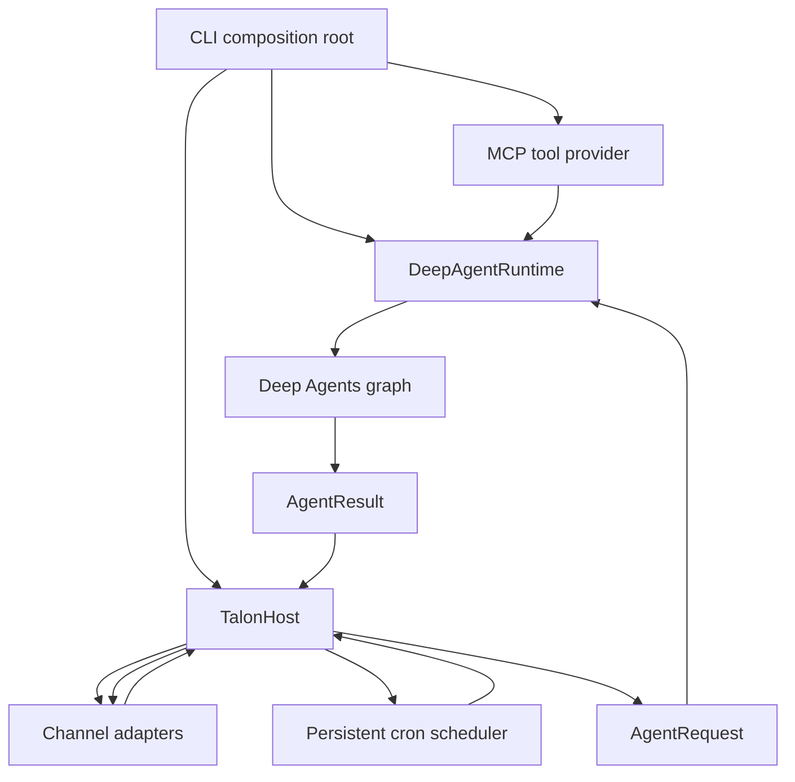
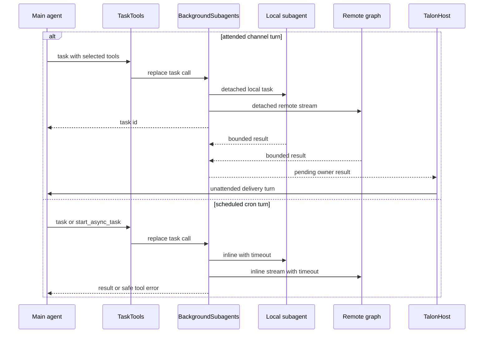

# Talon Runtime Integration

Talon is an experimental local host for long-running Deep Agents channels and schedules. Its primary boundary is intentional: channel adapters admit and translate provider events, `TalonHost` owns routing, interactive state, replacement, and delivery, and `DeepAgentRuntime` owns graph construction, checkpointed agent execution, and its process-local background jobs. Adapters do not invoke the runtime directly.

See [Runtime behavior](../architecture/runtime-behavior.md) for the general execution model, [Subagents and skills](../concepts/subagents-skills.md) for authoring boundaries, [Talon channel admission](../concepts/talon-channel-admission.md) for trust and routing, [Talon scheduling](../concepts/talon-scheduling.md) for durable cron semantics, and [MCP integration](mcp.md) for server configuration and OAuth details.

## Composition and ownership

The `deepagents-talon` CLI is the production composition root. With a configured model it loads MCP tools, opens checkpoint and history resources, and creates `DeepAgentRuntime` with the assistant directory, async-subagent loader, cron store, optional sandbox backend, and `talon_mcp_middleware()`. It then gives that runtime and the configured adapters to `TalonHost`. A `PersistentCronScheduler` is installed only when at least one channel is configured; its execution and result-delivery callbacks go back through the host.

`AgentRequest` is the host-to-runtime contract. It carries the resolved agent conversation ID, text, trusted host metadata, selection settings, and optional interaction callbacks. `AgentResult` returns the final text plus IDs of background results consumed by the model: the runtime can acknowledge model consumption, but only the host can know whether the final channel reply was delivered and therefore whether those IDs must be requeued.



*The host owns provider-facing work and the runtime owns graph execution; cron and channel input both enter the graph as host-built requests.*

### Startup and shutdown seam

`TalonHost.start()` ensures the home directory and starts the runtime before it binds and starts channels, then starts the scheduler. A partial startup is unwound in reverse: scheduler, started channels, then runtime. On normal shutdown, the host first stops its background dispatcher and cancels active conversation work, then stops channels in reverse order, the scheduler, and the runtime. Component-stop exceptions are logged and do not prevent later cleanup.

`DeepAgentRuntime.stop()` first cancels its background workers. If any worker survives the cancellation wait, it raises and deliberately leaves graph/checkpointer resources open rather than allowing an outliving worker to write through a closed checkpointer. The host treats that as one component-stop failure while continuing its own cleanup.

## Graph assembly and snapshot invariants

`DeepAgentRuntime.start()` resolves configured subagents, obtains the assistant's `ToolApprovalStore` snapshot, and creates a graph. Construction resolves the runtime tool catalog, removes MCP tools marked `skillOnly` from the ordinary main-agent list, adds approval-management and attachment-inventory tools, resolves requested tool names for local agents, and configures `BackgroundSubagents` against the resulting agents.

The middleware stack provides a Talon filesystem backend, selected-model-aware summarization, per-turn model selection, progress messages, human-in-the-loop approval interruption, server hooks, task-tool replacement, background delegation, optional context-size summarization tools, skills, and caller-supplied middleware. `ServerHooksMiddleware` receives the current MCP tool objects; hooks are loaded per invocation from the assistant/home and workspace context.

Every invocation refreshes externally supplied tools before taking `_tools_lock`. While holding that lock it reads the approval store, rebuilds if the approval snapshot changed, and places the chosen graph and approval snapshot in context variables. Replacement creates a complete new graph before assigning it. Thus a tool or policy reload failure leaves the previous graph usable, and an in-flight invocation keeps its captured graph rather than changing capabilities mid-turn.

Selected models are a per-turn choice, not a graph rebuild: `ModelSelectionMiddleware` swaps the resolved selected model into main-agent model calls. `SelectedModelSummarization` caches a summarizer per selected model and sizes it from that model's context profile, while delegated subagents use their startup summarizer. If a saved selected model can no longer be built, the runtime logs the condition once and uses the default for that turn.

## Approval, questions, hooks, and MCP

The runtime enables `APPROVAL_OPERATOR` only for a request whose host metadata identifies a tool-approval operator and which is neither a cron run nor background-result delivery. It installs authorization, breakout, question, progress, hook, history, cron-origin, selected-model, graph, and pending-result state only around that invocation, then resets it in `finally`. This prevents unattended work from retaining a channel interaction capability.

For attended channel work, `TalonHost` supplies the approval, authorization, question, progress, and breakout handlers. Approval replies and question answers are tied to the identified sender and originating conversation. Before an ordinary replacement turn, the host serializes by provider-qualified conversation root and gives commands, pending approval, authorization callback, and question handling precedence.

Talon wires one `talon_mcp_middleware()` into the main `DeepAgentRuntime` and installs the same middleware in freshly compiled local subagents, so both paths receive the MCP adapter behavior. The middleware preserves marked MCP schemas for OpenAI Responses requests, normalizes optional empty string arguments according to the MCP schema, scopes authorization to the tool-call ID, and converts `MCPError` into a correlated safe error `ToolMessage`. Local fresh subagents also receive a child `ServerHooksMiddleware`; the parent hook context is derived for the local agent and can resume hook interruptions. Talon has no elicitation UI, so recognized MCP elicitation interrupts are resumed with cancellation.

## Delegation: replacement, local, remote, and scheduled

Talon replaces the Deep Agents SDK `SubAgentMiddleware` by publishing `TaskTools` under the same middleware name. The replacement preserves the SDK `task` contract but lets a main-agent call select extra exact tool names from `get_agent_tools`; names must be unique and available, additions are allowed only for a named local agent, and they augment rather than replace configured tools. The selected local agent is freshly compiled for that task with a fresh message context—parent history and skills are not inherited.

Fresh local subagents receive only approval rules that apply to their resolved tools and install `HumanInTheLoopMiddleware` only when such rules exist. They always get MCP middleware and control middleware, can expose hook-aware execution, and can receive queued guidance at a later model step. A precompiled runnable is opaque to Talon's enforcement: whenever any approval policy is active, Talon replaces it with a refusal rather than run it. Remote `AsyncSubAgent` definitions are also opaque; `start_async_task` streams their configured graph using the task description as the user input and requests cancellation on disconnect.



*Attended delegation detaches and is delivered in a later handler-free turn; a scheduled run waits inline because it has no later interactive delivery turn.*

For attended turns, `BackgroundSubagents` intercepts `task` and `start_async_task`, creates an in-memory job owned by the current agent conversation, and enforces a process-shared running-worker limit. A worker gets its own thread ID, clears approval-operator and authorization-handler authority, blocks nested delegation, bounds result text, and turns failures, timeouts, remote errors, and approval interrupts into safe result text. Listing, inspection, cancellation, and messaging are restricted to the owning conversation; messaging is supported only for Talon-built local agents.

The host's dispatcher looks for eligible completed owner results and creates a `background_delivery` follow-up request without approval, authorization, or question handlers. Runtime acknowledgement occurs only after that main-agent turn completes. If the host suppresses or cannot deliver its reply, it requeues exactly the returned IDs; failed processing is counted and eventually dropped, avoiding unbounded retries.

A cron request sets the scheduled-turn context. Delegation runs inline behind a separate semaphore and timeout, `start_async_task` invokes the remote target directly rather than leave a polling task, and nested delegation remains refused. Exceptions and expiry become safe tool errors, so an error does not escape and cause graph retry to relaunch sibling work.

## Operations and safe change points

The package is explicitly alpha/experimental and requires Python 3.14. Its core dependencies include Deep Agents, LangChain/LangGraph, FastMCP, Discord and Slack clients; optional extras add history embeddings, OpenShell, PostgreSQL/MongoDB, and media support. The CLI entry point is `deepagents-talon`.

Important runtime configuration seams include `DEEPAGENTS_TALON_MAX_BACKGROUND_TASKS` for the shared detached-worker ceiling, `DEEPAGENTS_TALON_VERBOSITY` for progress output, the configured model and assistant manifest directory, optional sandbox configuration, and model/context settings used by graph construction. Validate a change across both a normal attended turn and a cron turn: their delegation and human-authority behavior is intentionally different.

When changing this integration, preserve these invariants:

- Build replacement graphs before publishing them, and capture the graph/approval snapshot per invocation.
- Keep the host as the only owner of channel delivery and interactive callback lifetime.
- Do not grant a detached worker or background-delivery turn approval, authorization, or question authority.
- Keep local task tool selection catalog-based and fresh-context; do not silently give a role parent history, all tools, or a bypass around approval policy.
- Treat remote and precompiled agents as opaque execution boundaries rather than assuming their internal tool policy.

## Focused validation

`tests/unit_tests/test_background.py` covers detached worker capacity and ownership, job cancellation, result acknowledgement/requeue behavior, scheduled inline delegation, remote-stream cancellation, and host delivery interaction. `tests/unit_tests/test_research_subagents.py` covers fresh-context research boundaries, explicit tool attachment, task-tool selection, MCP protections in local agents, approval enforcement/refusal for compiled agents, and hook behavior.

For a focused run from `libs/talon`:

```bash
pytest tests/unit_tests/test_background.py tests/unit_tests/test_research_subagents.py
```

Host lifecycle and routing behavior is covered separately by `tests/test_host.py`; MCP behavior and configuration have focused tests under `tests/unit_tests/test_mcp_*.py` and `tests/test_mcp_middleware.py`.
