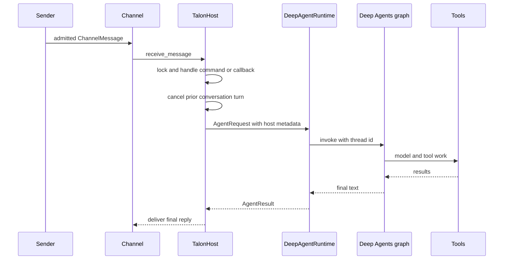

# Talon Runtime Integration

Talon is an **experimental** personal-agent runtime. `TalonHost` owns the boundary between an admitted channel event and an `AgentRequest`; `DeepAgentRuntime` owns graph invocation and the turn-local context used by the graph. This boundary provides routing, lifecycle management, and mediated features such as approvals and progress delivery. It is **not** tenant isolation, prompt-injection protection, or containment of a model, MCP server, or local shell.

Channel adapters decide whether an event is admitted before it reaches the host. Admission is access to the configured assistant and its authority, not operator status or a sandbox. See [channel admission](../concepts/talon-channel-admission.md), [security](../operations/security.md), and [Talon scheduling](../concepts/talon-scheduling.md).

## From channel event to agent turn

The host binds callbacks before starting each channel. It starts the runtime first, then channels, then the scheduler; a partial startup is unwound in reverse order. On shutdown it cancels work before stopping channels, scheduler, and runtime, while logging component-stop failures so one failure does not prevent the remaining cleanup.

For an inbound message, the host handles `/help` immediately. For other messages it derives a provider-qualified conversation root, serializes access with history and conversation locks, and consumes host commands, pending approval replies, and bound OAuth callback messages before an agent request can be created. A normal message replaces the active turn for that conversation: the prior task is cancelled and recovered where possible; if cancellation reaches the timeout, the new request is refused rather than run concurrently.



*The host, rather than channel metadata, establishes the agent conversation, host-set metadata, callbacks, and the reply destination.*

Before invocation, the host can transcribe voice input, stage inbound documents when the runtime is using a remote sandbox, and create model content for media. It overlays host-owned metadata last, including channel, sender, message, history scope, trigger, and whether the sender is an approval operator. `AgentRequest` also carries optional approval, authorization, progress, and breakout callbacks. These are runtime capabilities scoped to the originating turn; channel-provided metadata cannot replace the host-set fields.

A model selection and reasoning-effort override are captured when a turn begins and passed with that request. Consequently, `/model` or `/effort` changes affect later work, not a running turn. Effort settings are validated and installed in a turn-local context and reset in `finally`; model-selection middleware applies them to main-agent calls, not delegated subagents. See [profiles and models](../concepts/profiles-models.md) for the control details.

## Runtime invocation and state

`DeepAgentRuntime.invoke()` refreshes pending MCP tools, snapshots tool-approval policy, and rebuilds its graph if that policy changed. It then scopes approval authority, cron origin, authorization and breakout handlers, hooks, pending background results, progress delivery, conversation history, selected model, and effort settings around one graph invocation. Context variables and invocation-graph references are reset in `finally`, including when the graph fails or is cancelled.

The graph uses the request conversation ID as its LangGraph `thread_id`. When the configured checkpointer is a `ConversationSaver`, the runtime protects that session while invoking and records a final reply in semantic history only after the host confirms delivery. Persistent conversation history and checkpoints have separate backend configuration; see [Talon history storage](../concepts/talon-history-storage.md).

The runtime retries only classified transient provider, transport, parsing, and context-limit errors, with exponential delays capped at 10 seconds and `max_retries` attempts. If a graph yields no final text, it sends up to `max_continuations` continuation nudges and finally requests a tool-free summary. A non-cancellation failure is logged by the host and returns a generic channel failure rather than the upstream exception text.

Background results are acknowledged when the runtime consumes them, but the result IDs remain on `AgentResult` until the host knows its final reply was delivered. If delivery is discarded or fails, the host can requeue those results for a later turn. Scheduled and background work has different approval/delivery semantics; consult [Talon scheduling](../concepts/talon-scheduling.md).

## Progress updates

`send_message` is a runtime tool whose destination is fixed by the host callback for the originating chat. `ProgressMessages` also forwards visible main-agent narration before tool execution when the assistant message contains tool calls. It excludes subagents and messages that call `send_message` itself, preventing delegated chatter and duplicate updates.

`DEEPAGENTS_TALON_VERBOSITY` is validated as `1`, `2`, or `3` per assistant process:

| Value | Interim updates |
| --- | --- |
| `1` (default) | Disabled |
| `2` | At most two per invocation |
| `3` | Unrestricted |

The budget is shared by narration and explicit `send_message` calls for a turn. Blank text, absent originating channel, exhausted budget, transport exceptions, and unsuccessful delivery are returned to the model as a bounded status rather than propagated as transport details. Final replies and host-visible tool activity are not governed by this budget. The host additionally rejects stale progress: a cancelled/replaced generation, reset conversation, or terminal authorization flow cannot keep posting to the old chat.

## MCP configuration and reload boundary

At runtime construction, `MCPToolProvider` loads MCP tools and adds status, authorization, reload, and configuration-management tools. An update made through `update_mcp_server` is guarded by a revision token and a bounded sidecar lock, atomically writes the configuration, and schedules a refresh. It is available only after a successful reload; running turns retain their original graph and capabilities. A host `/mcp-reload` requests an explicit reload.

The management view redacts stored strings except safe enums and literal `${ENV_VAR}` references, and preserves unmanaged fields during a managed edit. Auto-approved edits are rejected when they would introduce new code execution while reusing stored secrets. These are useful mediation controls, but **not a confidentiality boundary**: Talon's default execution-capable shell can read an absolute configuration path or overwrite it outside those tools. Put credentials in unexpanded environment references or, preferably, somewhere the agent process cannot read. See [MCP integration](mcp.md).

## Sandbox selection and limits

Set `DEEPAGENTS_TALON_SANDBOX` to select a `deepagents-code` sandbox provider. Optional `DEEPAGENTS_TALON_SANDBOX_ID`, `DEEPAGENTS_TALON_SANDBOX_SNAPSHOT`, and `DEEPAGENTS_TALON_SANDBOX_SETUP` select an existing sandbox, snapshot, and setup script. With no sandbox setting, Talon uses the runtime's default local-shell backend. When a sandbox is configured but cannot start, startup fails; Talon does not silently fall back to host execution.

A sandbox created by Talon is closed at host exit, while an attached sandbox ID is retained. Cancellation during thread-based startup is handled so a sandbox that finishes starting after cancellation is still closed. The sandbox backend receives execution and most filesystem work. Talon routes only assistant `skills/`, `memory/`, and artifact blobs to host-backed virtual filesystems, so a sandboxed agent cannot rewrite assistant state such as `tools.json`; inbound documents are staged into the sandbox working directory.

This routing is not complete containment. Host-side skills, memory, blobs, process configuration, MCP endpoints, provider credentials, sandbox identity, mounts, and egress each have their own trust boundary. A setup script and MCP definition can themselves introduce authority. Configure the sandbox provider's identity, networking, mounts, resource limits, and secrets independently. See [sandbox partners](sandbox-partners.md) and [security](../operations/security.md).

## Observability and safe operations

LangSmith tracing is opt-in: it requires both truthy `LANGSMITH_TRACING` and `LANGSMITH_API_KEY`. For each host invocation Talon supplies a context with the selected project (default `deepagents-talon`), stable Talon/assistant/trigger tags, and request metadata including assistant, conversation, channel, sender, and approval status. Treat external tracing as a data export and configure it accordingly.

Structured local events are JSON records prefixed with `talon_event`. Logging redacts identifiers under known PII keys, secret-like keys, bearer strings, secret assignments, URL credentials, and query strings. `DEEPAGENTS_TALON_AGENT_ACTIVITY_LOGGING` separately opts into per-run model and tool lifecycle events. Its tool input/output previews are recursively bounded, redacted, and truncated to 1,000 characters, but redaction is heuristic—not a guarantee that arbitrary sensitive content is safe to log.

Useful operational checks include:

- Review channel exposure and operator IDs before connecting a channel; admission and command authority are distinct.
- Configure a real sandbox for untrusted input rather than relying on redaction, MCP mediation, or HITL.
- Check logs when an MCP reload remains inactive; the runtime intentionally keeps the previous graph after a refresh failure.
- Set tracing and activity logging only after deciding where metadata and redacted previews may be retained.

## Focused verification

The host tests exercise lifecycle unwind, callback interception, cancellation/replacement behavior, metadata ownership, delivery, approvals, authorization binding, and failure sanitization. Observability tests verify trace opt-in/context metadata, JSON event structure, redaction of IDs and credentials, and bounded activity previews. From `libs/talon`, run:

```bash
uv sync --group test
uv run --group test pytest tests/test_host.py tests/test_observability.py
```
