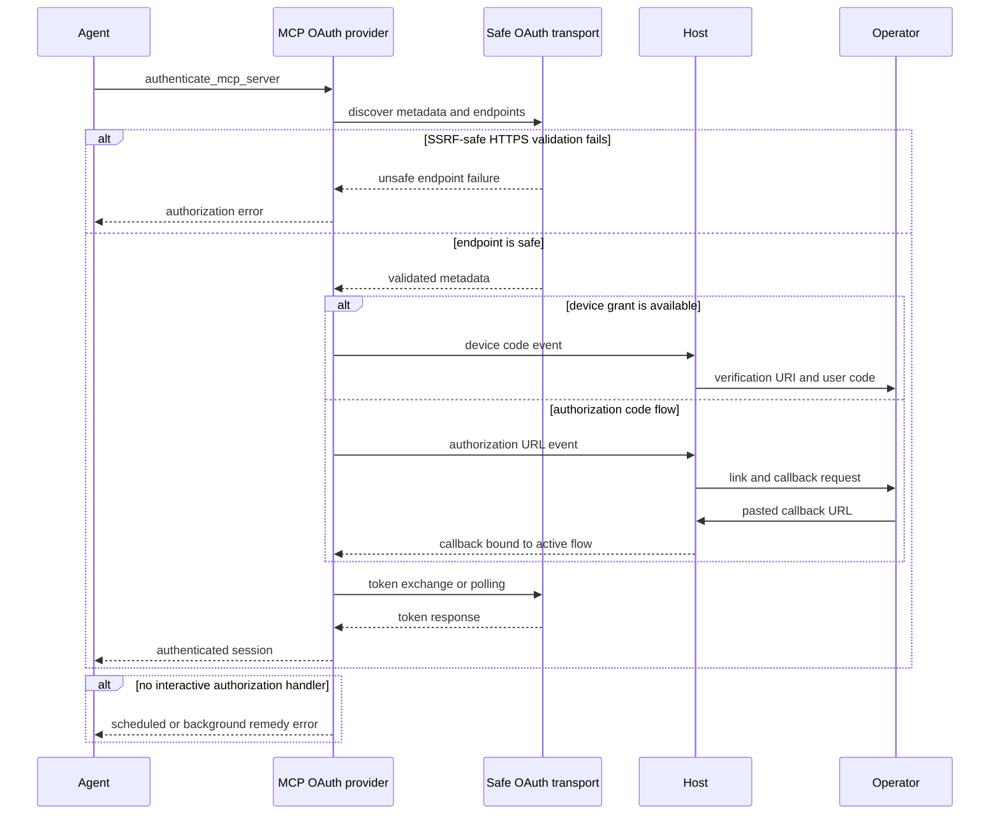

# Talon Runtime Host

> **Experimental, alpha software.** Talon is a local runtime host, not a production containment or multi-tenant boundary. An admitted sender can trigger an agent that uses the operator's configured model credentials and MCP tools. See [Architecture overview](../architecture/overview.md), [MCP](mcp.md), [channel admission](../concepts/talon-channel-admission.md), [scheduling](../concepts/talon-scheduling.md), and [security](../operations/security.md).

Talon is the integration boundary between channel turns and a `DeepAgentRuntime`. The host owns request routing, delivery, interactive approvals and OAuth notices; the runtime owns graph invocation and request-local context. MCP configuration determines which tools are available, while `mcp_auth.py` adapts the MCP SDK's OAuth hooks to either a terminal login or the host-mediated channel protocol.

## Runtime and MCP composition

Talon 0.0.9 requires Python 3.12 or later and exposes the `deepagents-talon` CLI. The test environment is available through the `test` dependency group:

```bash
uv sync --group test
uv run --group test pytest tests/
```

`DeepAgentRuntime` owns Deep Agents graph construction: it combines filesystem middleware, built-in clock and progress tools, configured runtime tools, optional archive and cron tools, approval tools, subagents, and optional web/help capabilities before the host invokes it through `AgentRequest`.

For each interactive turn, the host supplies request-scoped delivery, tool-approval, and authorization handlers plus trusted metadata; the runtime binds invocation graph, model, approval, history, cron, authorization, and message state in context variables and resets them after invocation. This prevents a handler from one concurrent turn becoming authority for another.

MCP tools are loaded from the configured JSON file, whose default is `~/.deepagents/.mcp.json` and whose location can be overridden with `DEEPAGENTS_TALON_MCP_CONFIG`. A server may be `stdio`, `sse`, or `streamable_http` (`http` is normalized to the latter). Talon validates server names and configuration shapes, expands permitted environment references, rejects dangerous environment variables for stdio servers, and rejects a remote OAuth configuration that also supplies an `Authorization` header. Loaded tools are namespaced as `<server>_<tool>` and tagged as Talon MCP tools; unavailable servers remain represented by a status rather than aborting every other server load.

For remote OAuth servers, `MCPToolProvider` adds status, reload, configuration, and `authenticate_mcp_server` management tools. A configuration change requests a reload before a later agent turn; reloading is serialized. If loading fails, the failure is surfaced rather than replacing the active graph with a partially loaded tool set. The operator can also perform an attended terminal login with:

```bash
deepagents-talon mcp login <server>
```

The login command only accepts remote `sse` or `streamable_http` servers and forces a fresh authorization attempt.

## OAuth discovery and channel authorization

The MCP SDK provider has two presentation modes. The CLI login prints the authorization URL and reads a pasted callback URL from the terminal. A channel-originated turn instead emits typed authorization events to the host; OAuth URLs, device codes, and callback credentials stay outside model context.



This sequence shows that endpoint safety and the availability of an interactive authorization handler are separate failure modes.

Each `AuthorizationBinding` identifies the server, exact tool invocation, expiration, and—when relevant—the redirect URI. The host accepts an authorization URL only for an identified sender, records the provider, channel conversation, agent conversation, sender, and binding, then delivers the URL. It waits only until the binding expires for a callback. Incoming callback-shaped messages are intercepted before model input: they must come from the same provider, conversation, and sender and match the binding's exact redirect endpoint. A wrong sender receives a rejection; an expired, malformed, or unmatched callback does not satisfy the waiting OAuth flow. Pending futures and flow state are cancelled or cleared on shutdown and when the turn ends.

Device authorization follows the same binding and delivery discipline but sends a verification URI and user code rather than waiting for a pasted callback. Completion or failure produces a bounded channel notice. For a terminal `authenticate_mcp_server` operation, a successfully delivered completion notice suppresses the otherwise redundant agent result.

## Safe network behavior

OAuth metadata, registration, device, token, and refresh requests use a dedicated `httpx.AsyncClient` with an SSRF-safe transport, HTTPS-only policy, `trust_env=False`, no redirects, a five-second HTTP timeout, and either `DEEPAGENTS_TALON_MCP_USER_AGENT` or the Talon version as User-Agent. The transport retains the validated resolved address for the connection while preserving the original hostname for TLS SNI and the HTTP Host header.

Before use, an OAuth URL must resolve as a safe public HTTPS URL and may not embed userinfo. Resolution runs off the event loop but has its own timeout. Discovered metadata must identify the expected issuer; device-flow endpoints must also share the issuer origin. Authorization-code metadata endpoints are independently URL-validated, allowing conforming split-origin providers while rejecting unsafe endpoints. Discovery and OAuth requests reject redirects, cap JSON response bodies at 64 KiB, and do not rely on proxy environment variables.

A server with no explicit client ID can use a discovered device grant when its metadata supports it; Talon only accepts a public device client. GitHub gets a known public device client preseeded, and Slack has its own preseeded public client and loopback callback endpoint. Explicit OAuth settings supply a client ID, optional callback URL, and scopes.

## Credential persistence

`FileTokenStorage` stores bearer tokens, refresh tokens, absolute expiry, and client registration in `~/.deepagents/mcp-tokens`. The filename includes the server name plus a digest of the server URL and non-default OAuth settings, preventing incompatible server or client settings from sharing credentials. These are cleartext live credentials: keep the directory outside an agent-writable workspace. Talon warns when the configured agent root contains the credential path, but this is hardening rather than a containment boundary for a local shell-capable agent.

Writes create owner-only directories (`0700`), tighten intermediate state directories, write an owner-only temporary file (`0600`), flush and `fsync` it, then atomically replace the credential file under a path lock. The lock avoids concurrent refresh read-modify-write loss. Refresh persistence retains an existing refresh token when a refresh response omits it; a fresh authorization replaces the grant and deliberately does not carry an old refresh token forward. Persisted expiry is restored into the OAuth provider so expired credentials can be refreshed after a restart.

## Unattended authority is intentionally absent

Schedules and background work must not initiate a conversation-bound OAuth flow. Scheduled calls receive no approval or authorization handler. Background subagents explicitly clear the copied authorization handler so that a task cannot retain an interactive prompt after its originating turn and host cleanup have ended. Background-result follow-up turns also receive neither handler. If an OAuth action has nowhere to present its prompt, Talon raises an error explaining that the run was not started by a channel message and directs the operator to authorize from chat or run `deepagents-talon mcp login <server>`.

The persistent scheduler scans due jobs one at a time, records run or delivery failures in the job store, suppresses `[SILENT]` output, and logs a failed scan before retrying on its normal interval rather than terminating its ticker.

## Focused regression coverage

Run the focused OAuth and integration tests from `libs/talon`:

```bash
uv run --group test pytest tests/test_mcp_auth.py tests/test_mcp.py tests/test_host.py tests/unit_tests/test_oauth_transport.py tests/unit_tests/test_tool_approval_authorization.py
```

`test_oauth_transport.py` is a targeted transport regression test: it verifies that public DNS resolution is pinned for the TCP connection while TLS SNI and Host retain the requested hostname, checks User-Agent selection for direct and SDK-mediated requests, and rejects a hostname that resolves to both public and loopback addresses. `test_mcp_auth.py` covers unsafe discovery and metadata, redirect refusal, storage permissions and atomic/locked writes, refresh-token retention semantics, bounded resolution, and the no-conversation remedy. Host and authority tests cover callback binding and interception plus the absence of approval and authorization handlers from scheduled and background delivery work.
