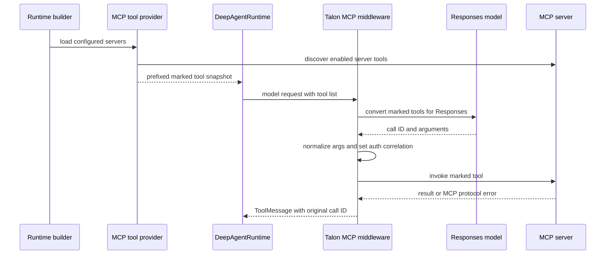

# Talon Runtime Integration

Talon separates MCP discovery and configuration from the per-call adapter. `MCPToolProvider` owns loading, status, configuration-management tools, and refresh revisions; `talon_mcp_middleware()` changes behavior only for tools that the provider marked as MCP tools. Thus ordinary tools keep normal LangChain binding, execution, and failure behavior.

This page covers the boundary and lifecycle. See [permissions and HITL](../concepts/permissions-hitl.md) for the general approval model, [Talon channel admission](../concepts/talon-channel-admission.md) for trusted request origins, and [security](../operations/security.md) for deployment controls.

## Construction, provenance, and exposure

The runtime bootstrap creates an `MCPToolProvider`, loads its tools, logs each server outcome, and passes provider refresh/reload callbacks plus one `talon_mcp_middleware()` into `DeepAgentRuntime`. Discovery opens each enabled configured server through `MCPAdapter`, prefixes a discovered name with the server name, and attaches `_deepagents_talon_mcp`. A `skillOnly` server also gets `_deepagents_talon_skill_only`; later exposure logic can keep it out of the ordinary catalog until its skill is disclosed. Middleware selection is by this metadata marker, not a name convention or transport.

`MCPToolProvider.load()` also supplies management capabilities: server status when servers are configured, channel-mediated OAuth authentication when an OAuth server exists, a scheduled reload tool, and the configuration store's read/update tools. It refuses the resulting set if any MCP tool name conflicts with a Talon management tool.

Fresh local subagents are deliberately compiled rather than inheriting the parent graph. Their compilation adds `talon_mcp_middleware()` and `SubagentControlMiddleware`; it carries forward only approval rules whose tool names are actually available, then installs `HumanInTheLoopMiddleware` when any apply. Talon refuses precompiled subagents because it cannot enforce that policy inside them. A senderless Telegram channel post, in turn, cannot create an approval request, even on an otherwise admitted channel.



*Only provenance-marked tools follow this MCP-specific model-binding and invocation sequence.*

## Model binding and call adaptation

For a `BaseChatOpenAI` request using the Responses API, the middleware applies `convert_to_openai_tool(tool, strict=False)` only to marked MCP `BaseTool` values. It leaves all other request tools untouched; models outside that condition receive the original request. The conversion is a derived request, so the loaded MCP tool and its recorded schema are not mutated. Tests cover optional nested object/null schemas and open object parameters, including forwarding structured values unchanged to the server.

At invocation the middleware derives a tool call with normalized arguments, then runs the normal handler under `_run_authorized()` with the exact tool-call ID. That context is the correlation key for a channel OAuth flow, not a new permission grant. `_run_authorized()` resets both the invocation and authorization-attempt context in `finally`; notification delivery failures are swallowed so they cannot reveal errors or undo already-persisted OAuth state.

Normalization is intentionally narrow:

- It removes an empty string only for an optional property that is string-like or has no usable property schema.
- It preserves empty strings for required fields and explicitly non-string fields.
- It preserves non-empty values, nulls, empty objects, and nested values.
- With a non-dictionary input schema it simply copies the supplied arguments.

This avoids generated optional empty strings overriding server defaults without treating meaningful structured input as absent.

### Protocol errors and elicitation

A marked call that raises `MCPError` returns an error `ToolMessage` correlated to the original tool name and call ID. Its model-visible content contains the MCP code and message, but not `MCPError.data`. Other exceptions propagate on the normal runtime path.

Talon has no elicitation UI. When the graph emits a valid MCP elicitation interrupt, the runtime resumes every unique request key with `action: "cancel"`; malformed or duplicate keys raise validation errors rather than becoming approval prompts. This handling is distinct from the approval interrupt path.

## Operator configuration: mediated, redacted, and deferred

The selected configuration path is `DEEPAGENTS_TALON_MCP_CONFIG`, if present in Talon's configured or process environment, otherwise `~/.deepagents/.mcp.json`. The loader validates names and types, expands supported `${NAME}` and `${NAME:-default}` references for enabled servers, supports stdio, SSE, and streamable HTTP, and records an individual server's load failure as `error` or `unauthenticated` while siblings continue. Disabled entries are neither expanded nor connected and report `disabled`.

`get_mcp_configuration` is a deliberately narrow read capability, not a direct file view. It returns a keyed revision and managed server fields: stored strings are `<redacted>` except transport/auth enum values and exact `${ENV_VAR}` references. It does not expand references. Unknown hand-authored fields are hidden from the model but retained across an update. Read, parse, and write failures return generic messages so file contents are not surfaced through tool errors.

`update_mcp_server(server_name, server, expected_revision)` adds, replaces, or removes one server. It takes the revision from the read result, locks a sidecar file, rereads under the lock, compares an HMAC revision, validates the replacement without starting a session, and atomically replaces the JSON file. A stale revision or a bounded lock wait becomes a conflict; validation or I/O failure does not schedule reload. Successful writes call the provider's refresh scheduler and return `available: after_successful_reload`.

A client may repeat `<redacted>` at the same nested position to preserve a stored string. This is useful but security-sensitive: if the update is auto-approved (including no active approval snapshot), reuse of a redacted value is rejected whenever any managed routing/execution field changes. Only `allowedTools` and `disabledTools` may differ, because they cannot redirect a restored credential. With a required human approval, the normal interrupt allows an operator to review such an execution change. Literal secrets should not be supplied to the tool; use environment references.

Redaction is **not filesystem isolation**. The store warns if the selected configuration is inside the agent workspace, but the default execution-capable shell can still access paths, including absolute paths. The store's no-follow regular-file read, POSIX lock, revision CAS, and atomic write protect the supported management operation, not against a process that can bypass it with shell/file tools. Real secrecy requires references whose values are unavailable to the agent process, an OS keyring, separate identity, or a sandboxed backend.

## Reload lifecycle and OAuth

`request_refresh()` only increments a revision. At a later runtime refresh, provider reload is serialized by its lock and skipped if no unapplied revision exists. On replacement, `DeepAgentRuntime` creates a new graph before assigning the new tool tuple and graph. A load or graph-refresh failure leaves the preceding graph usable and marks saved changes inactive. Running turns and tasks retain the graph snapshot with which they began; operators should use `get_agent_tools` to see whether changes activated rather than claiming immediate revocation.

The explicit `reload_mcp_configuration` tool likewise schedules rather than performs an inline rebuild, while the runtime API can force a reload under the same tools lock. OAuth server authentication is scoped to the management tool's injected call ID; normal load reports missing remote OAuth credentials as unauthenticated instead of prompting. The CLI exposes `deepagents-talon mcp config` for the chosen path and `deepagents-talon mcp login <server>` for interactive remote login.

## Focused verification

The middleware tests verify marking, optional-empty-string handling, context cleanup, protocol-error redaction, and propagation of non-protocol exceptions. Adapter tests exercise real FastMCP discovery and prefixed invocation, Responses schema preservation, structured argument forwarding, elicitation cancellation, in-flight reload safety, and stdio process cleanup. Skill-MCP tests cover skill-scoped disclosure together with approval and authorization behavior. Configuration tests cover redacted round trips, stale and concurrent CAS updates, lock contention, symlink rejection, atomic-write failure, reload scheduling, enable/disable tool unloading, and approval-policy protection against secret redirection. The Telegram test confirms a senderless channel post cannot create an approval.

From `libs/talon`, run a focused selection with:

```bash
make test TEST_FILE="tests/test_mcp_middleware.py tests/unit_tests/test_mcp_adapter.py tests/unit_tests/test_mcp_config.py tests/unit_tests/test_mcp_enabled.py tests/unit_tests/test_telegram_approvals.py"
```

The package target runs the bridge prerequisite, then pytest with sockets disabled except Unix sockets, a ten-second timeout, and coverage options. See the [testing guide](../testing/testing-guide.md) for broader conventions.
