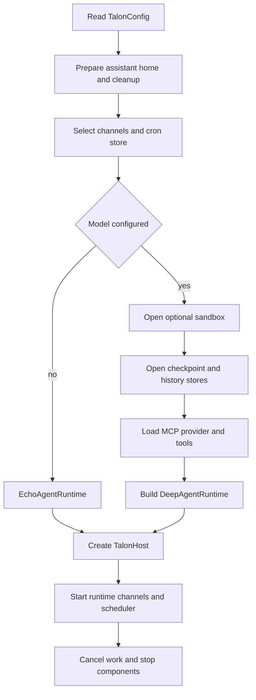
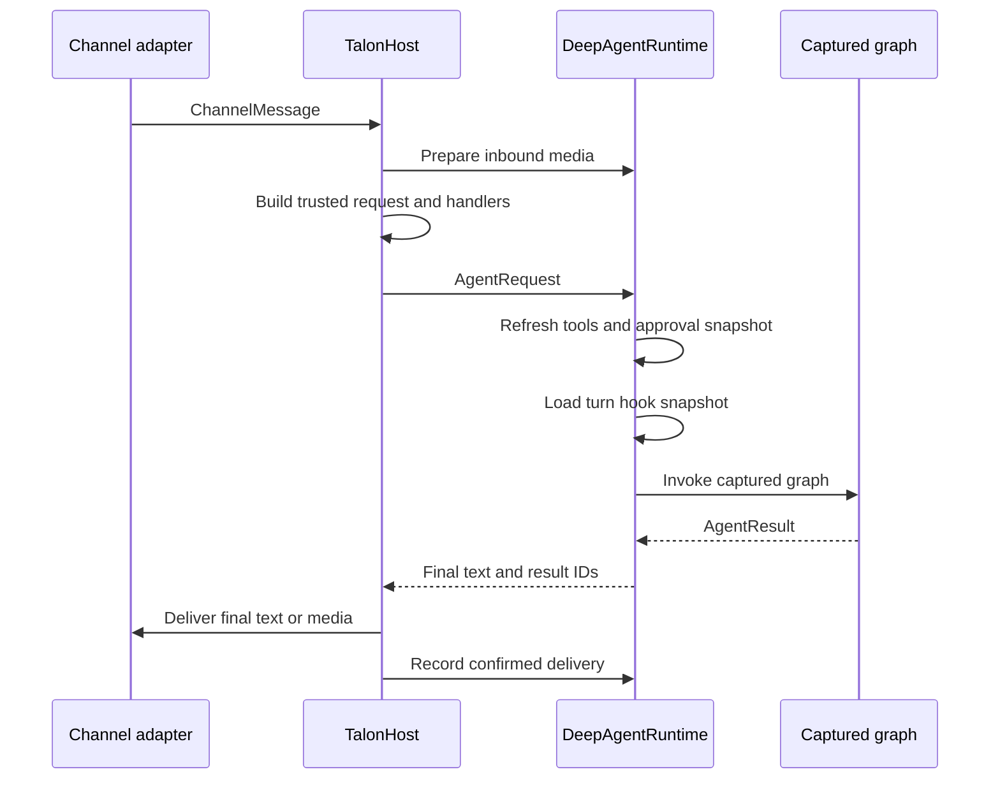
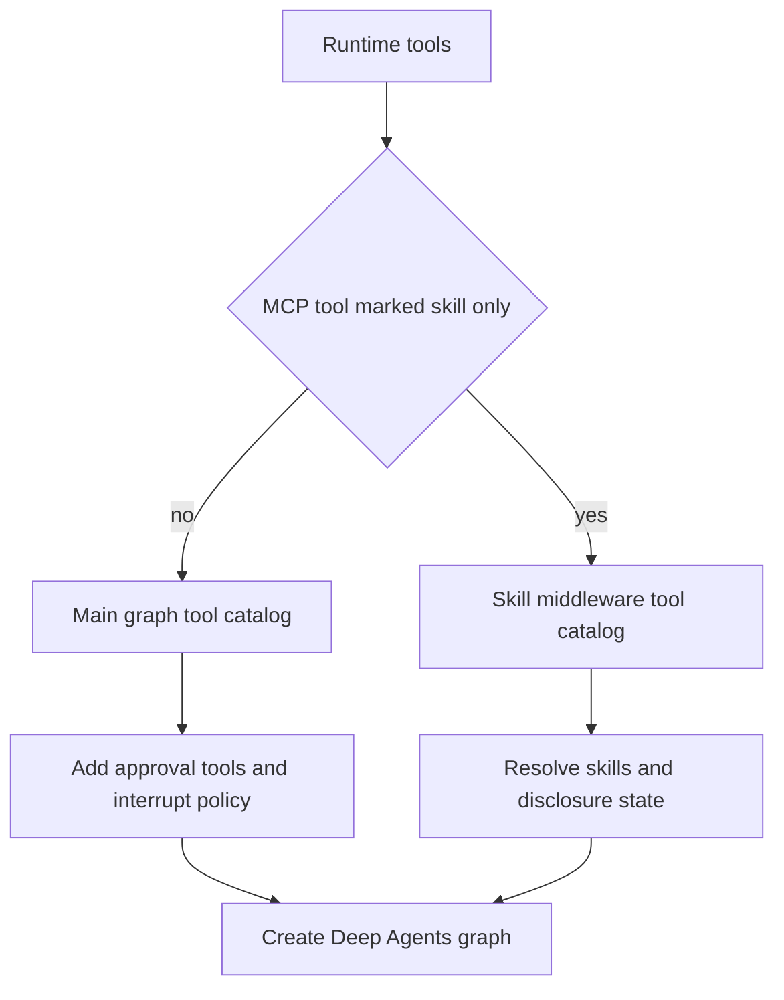
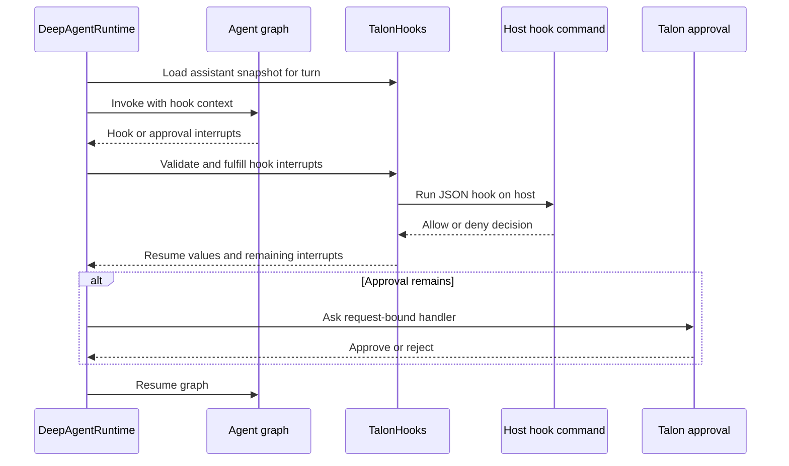

# Talon Runtime Integration

> **Experimental, single-operator software.** Talon is an alpha local runtime, not a production or multi-tenant security boundary. Admitting a sender effectively gives that sender access to the operator's agent, model credentials, configured MCP tools, and, without a sandbox, host resources. Approvals, redaction, hooks, and an opt-in execution sandbox are useful controls, not channel-administrator isolation, complete HITL policy, or MCP containment. See [channel admission](../concepts/talon-channel-admission.md), [runtime behavior](../architecture/runtime-behavior.md), and [security](../operations/security.md).

Talon separates transport, coordination, and execution:

- **Channel adapters** admit and deliver provider-specific messages; they do not invoke an agent graph.
- **`TalonHost`** binds channel callbacks, serializes and supersedes conversation work, fixes reply routing, and confirms final delivery.
- **`DeepAgentRuntime`** builds Deep Agents graphs and binds request-local state. It can publish replacement graphs between turns, but cannot choose a channel destination from model input.

## Startup, shutdown, and state

Run from `libs/talon` (or add `--directory libs/talon` from the repository root):

```bash
uv sync --group test
AGENT_ASSISTANT_ID=local AGENT_MODEL=<provider>:<model-id> uv run deepagents-talon --once
```

The CLI prepares assistant state and retention cleanup, selects enabled channels and a cron store, then selects a runtime. A configured model opens the optional sandbox, checkpoint and history resources, wraps the saver in `ConversationSaver`, loads MCP capabilities, and creates `DeepAgentRuntime`. Without a model, it uses `EchoAgentRuntime`, which is useful for channel wiring but has no persistent history tools. `--once` starts and immediately stops the assembled host.



This is the CLI-owned resource lifetime and host-managed process lifecycle. The host starts the runtime before channels and the scheduler. A partial start unwinds in reverse order; shutdown cancels active work and continues stopping every component even when one stop fails. `DeepAgentRuntime.stop()` does not close its resources if background workers outlive cancellation, because closing a live checkpointer risks incomplete writes; the host still continues shutdown of other components.

Conversation coordination is in memory. A conversation-root lock serializes work, a newer message can interrupt active work, `/stop` cancels, and `/new` starts fresh context. Talon waits up to 30 seconds for cancellation rather than running a replacement beside a stuck task. Durable checkpoints, history, hook transcripts, approvals, cron jobs, and MCP configuration are separate state owners.

## Turn, graph, and approval path

The host prepares inbound media before model content, merges inbound metadata before trusted route metadata, and supplies closures whose reply destination cannot be redirected by model arguments. An interactive `AgentRequest` carries request-scoped progress, approval, and authorization handlers; scheduled and background turns intentionally omit interactive approval and authorization.



This shows an interactive turn. The runtime binds the captured graph, selected model, approval snapshot, history, cron origin, authorization handler, progress handler, hook adapter, and message state with context variables, then resets them even on failure or cancellation. The final-reply route remains a host responsibility.

Graph construction includes filesystem middleware, clock and breakout tools, optional progress, archive, cron, approval, subagent, web, and help capabilities, configured runtime tools, and middleware. Tool assembly distinguishes **eager** from **skill-only** MCP tools.



A `skillOnly: true` MCP tool is removed from the eager catalog and supplied to skill middleware; it is disclosed when the corresponding skill is read or pinned. `get_agent_tools` reports active attachments, saved-but-inactive changes, and capabilities retained by the current or running task.

`DEEPAGENTS_TALON_VERBOSITY` accepts only `1`, `2`, and `3`: level 1 omits `send_message`; level 2 allows two interim messages per invocation; level 3 has no fixed budget. `ProgressMessages` forwards visible main-agent narration immediately before a tool call only when the message has calls and does not explicitly call `send_message`; subagent narration is excluded. Progress budgets and handlers are invocation-local, whereas final replies are separately delivered and recorded only after successful delivery.

With a remote sandbox, documents are staged only after inbound-root, regular-file, symlink, and size checks. The model sees document path notices rather than inline contents, and eligible images become bounded base64 blocks. Markdown media from a final response becomes channel media only after outbound-root containment checks.

`tools.json` is a bounded, validated, non-symlink exact-name mapping from tool name to boolean. Its byte-hash revision makes `ToolApprovalStore` updates lock-protected compare-and-swap operations. Before each invocation captures its graph, the runtime rereads the policy under the tools lock; a changed policy builds a graph before publishing it. A read or construction failure blocks that turn while retaining the old graph and snapshot. Active turns retain their captured graph and policy.

The same construct-before-publish rule applies to runtime-tool refresh, explicit MCP reload, subagent reload, and helper-model changes. A failed reload retains the previous graph; successful replacement affects later turns, not active work or already delegated tasks. This is availability-preserving, not immediate capability revocation.

## Command hooks

Talon adapts the shared `deepagents-code` command-hook engine. Configure trusted assistant-level hooks in `$DEEPAGENTS_TALON_HOME/$DEEPAGENTS_TALON_ASSISTANT_ID/hooks.json`; defaults make this `~/.deepagents/default/hooks.json`. The adapter supports `PreToolUse`, `PostToolUse`, and `PostToolUseFailure` for the main agent and fresh local subagents, plus `Stop` for the main agent. Commands receive JSON on stdin and return decisions on stdout; shell calls use the compatible `Bash` tool name and `tool_input.command`.

```json
{
  "hooks": {
    "PreToolUse": [{
      "matcher": "Bash",
      "hooks": [{"type": "command", "command": "/absolute/path/check-command", "timeout": 10}]
    }]
  }
}
```

Hooks execute on the **host**, even when the controlled tool runs in a remote sandbox. Install only commands trusted with host execution. The shared engine provides environment filtering, timeouts, output limits, and cancellation cleanup. Workspace `.deepagents/hooks.json`, Claude Code settings, plugin hooks, and client lifecycle hooks are deliberately excluded; Talon loads only the assistant's `hooks.json` at the start of each turn. Edits therefore apply to later turns, while active work retains its loaded snapshot. `updatedInput` is currently ignored, so hook-driven command rewriting is unsupported.



Hook interrupts are fulfilled before normal tool-approval interrupts. A hook denial suppresses the protected call and thus does not need approval; a hook **allow does not bypass Talon approvals**. Remaining protected calls still use the request-bound approval handler, while cron, unattended background delivery, and channels without one are auto-denied.

Each turn receives a hook context with a snapshot ID, conversation thread ID, and prompt ID. The adapter validates those identities and interrupt IDs before it executes or reuses a hook response, records committed graph messages before fulfillment, and bounds the combined hook/approval resume loop. Concurrent turns therefore retain separate hook context and transcript projections.

Fresh local subagents inherit the parent turn's hook snapshot—including background workers and dynamically attached tools—but receive new thread and prompt identities, an `agent_id`, and their configured agent type. Their hooks have isolated transcripts and omit `Stop`; opaque compiled and remote agents do not receive this adapter. Fresh local subagents also retain their normal approval restrictions, so hooks cannot authorize a protected action.

## Persistence and erasure

Talon validates assistant IDs, creates restrictive assistant-local state directories, and installs defaults without overwriting an existing `tools.json`. Checkpoint and history selection are independent: checkpoint URIs choose a LangGraph saver, history opens an assistant-namespaced archive, and `ConversationSaver` combines them. The checkpoint factory supports built-in SQLite/file, PostgreSQL, and MongoDB schemes before trusted entry-point plugins; setup errors are credential-safe configuration errors.

`ConversationSaver` checkpoints first and then archives committed message revisions. There is no transaction across those stores: an archive failure propagates after the checkpoint write, and retrying the same write repairs the idempotent archive. Cancellation waits for both writes to finish, preventing reset from racing an incomplete archive write.

Hook transcript projections belong to the durable parent conversation, not only a generated child session. They are stored beneath a hashed conversation owner directory, with serialization across loading, recording, materialization, and erasure. Deleting history or selected conversations first revokes transcript writers with a marker, removes current and legacy projections and backups without following symlinks, then deletes checkpoint and archive state. A failure leaves ownership registrations for retry; stale parent or child writers reject further writes after revocation.

The host records final replies in history only after channel delivery succeeds. On supersession, pre-delivery cancellation, or delivery failure, it requeues background-result IDs carried by `AgentResult`. A post-start dispatcher finds idle current conversations with pending results, starts a synthetic follow-up with the original reply route and progress handler but no interactive approval or authorization handler, and applies exponential retry backoff capped at 60 seconds.

## MCP configuration and authorization

Talon reads `~/.deepagents/.mcp.json` by default, or the path in `DEEPAGENTS_TALON_MCP_CONFIG`. Loaded tools are renamed `<server>_<tool>`, tagged as Talon MCP tools, and a failed server contributes status rather than preventing tools from other servers from loading. The provider adds status, reload, redacted configuration, and conditional OAuth-authentication capabilities; it serializes refreshes, and the runtime keeps the active graph if automatic refresh fails.

`MCPConfigStore` offers redacted, revisioned configuration management over regular non-symlink files, with bounded locking and atomic updates. This is not a secrecy boundary: the default execution-capable local shell can use absolute paths to bypass management tools and filesystem permissions. Keep credentials as environment references or use an OS, keyring, or sandbox boundary unavailable to the agent process. When an unapproved update reuses a hidden value, only tool-filter changes are accepted so a credential cannot silently be redirected.

MCP middleware applies only to marked tools: it normalizes optional empty string arguments, binds a tool-call ID into authorization context, and turns MCP protocol errors into sanitized tool messages. Fresh local subagents receive the same middleware. OAuth authorization uses a request-bound channel handler; unattended cron and background work have none, so operators must use interactive chat or:

```bash
deepagents-talon mcp config
deepagents-talon mcp login <server>
```

## Focused verification

From `libs/talon`, run the runtime and hook coverage with the existing MCP, persistence, and media safeguards:

```bash
uv sync --group test
uv run --group test pytest tests/test_runtime.py tests/unit_tests/test_hooks.py tests/unit_tests/test_hook_transcripts.py tests/test_mcp_middleware.py tests/unit_tests/test_mcp_config.py tests/unit_tests/test_skill_mcp.py tests/unit_tests/test_tool_approval_runtime.py tests/test_media.py tests/unit_tests/test_attachments.py tests/unit_tests/test_messaging.py tests/unit_tests/test_verbosity.py
```

The hook tests exercise wire payloads, pre-hook blocking, preserved Talon approval after hook allow, workspace-hook exclusion, snapshot reload between turns, isolated concurrent contexts, and local-subagent inheritance. Transcript tests cover scoped deletion, restart retry after each cleanup-stage failure, serialization against an in-flight write, and symlink resistance. See the [testing guide](../testing/testing-guide.md) for repository-wide conventions.
