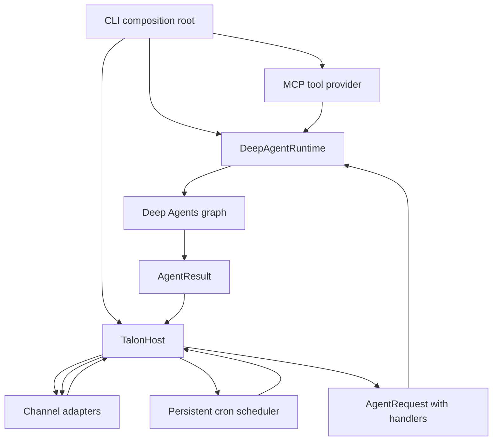
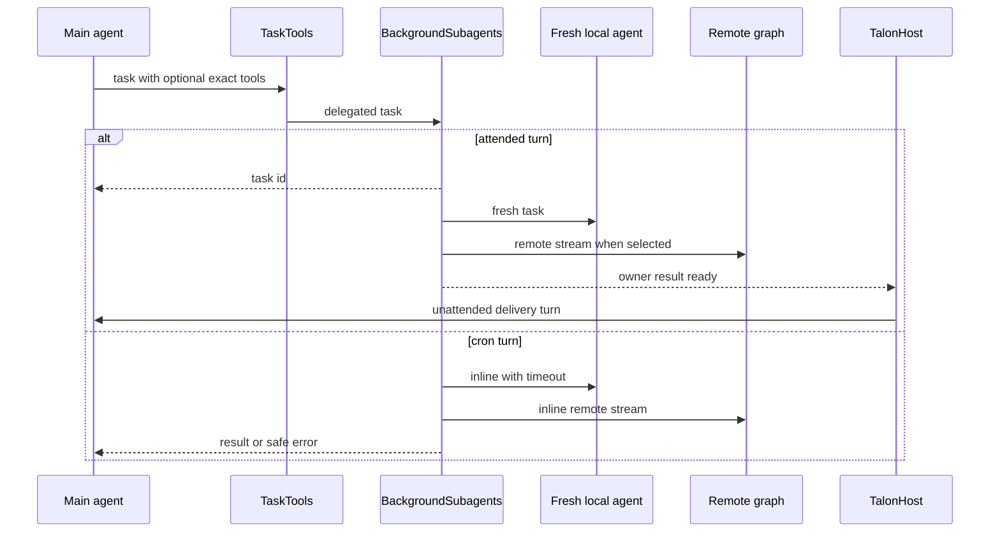

# Talon Runtime Integration

Talon is an experimental local host for long-running Deep Agents channels and schedules. Its boundary is deliberate: channel adapters translate provider events, `TalonHost` owns routing, interactive callbacks, delivery, and shutdown, while `DeepAgentRuntime` owns graph construction, checkpointed execution, and process-local background jobs. Adapters do not invoke the runtime directly.

See [Runtime behavior](../architecture/runtime-behavior.md), [Subagents and skills](../concepts/subagents-skills.md), [Talon scheduling](../concepts/talon-scheduling.md), [MCP integration](mcp.md), [Security](../operations/security.md), and the [Testing guide](../testing/testing-guide.md).

## Composition and ownership

The `deepagents-talon` CLI is the production composition root. With a configured model, it loads MCP tools, opens checkpoint and history resources, and constructs `DeepAgentRuntime` with the assistant directory, async-subagent loader, cron store, sandbox backend when configured, and `talon_mcp_middleware()`. It gives the runtime and adapters to `TalonHost`. A `PersistentCronScheduler` exists only when channels exist, and invokes and delivers jobs through the host.

`AgentRequest` is the host-to-runtime contract: it contains the host-resolved conversation ID, text, trusted metadata, selected model/effort, and optional approval, authorization, progress, breakout, and question handlers. `AgentResult` carries output and acknowledged background IDs. The runtime can acknowledge that the model consumed a result, but the host alone knows whether its channel reply was delivered and requeues IDs when it was not.



*Channels and the scheduler enter through the host. The runtime executes a request but does not own channel delivery or the lifetime of host callbacks.*

### Lifecycle and failure containment

`TalonHost.start()` ensures the home directory, starts the runtime, binds and starts channels, then starts the scheduler. A failed partial start is unwound in reverse order. Shutdown cancels the background dispatcher and active conversation work before stopping channels in reverse order, scheduler, and runtime; a component-stop failure is logged without preventing remaining cleanup.

`DeepAgentRuntime.stop()` cancels background workers before closing its graph/checkpointer. If a worker outlives cancellation, it raises and leaves those resources open rather than allow a worker to write through a closed checkpointer. This is process-local worker ownership, not an obligation for a channel adapter or scheduler.

## Graph assembly, reload, and diagnostics

At start, the runtime resolves subagents, reads a `ToolApprovalStore` snapshot, and builds a graph. It creates a catalog from filesystem and ordinary runtime tools, removes MCP tools marked `skillOnly` from the main tool list, attaches approval-management and `get_agent_tools`, resolves local frontmatter tool names exactly against that catalog, then configures background delegation against the resolved agents.

The graph includes filesystem support, selected-model summarization and selection, prompt caching, progress, human approval, server hooks, `TaskTools`, background delegation, optional context-size tools, memory, skills, and caller-supplied middleware. `get_agent_tools` reports configured attachments separately from names selectable per task; opaque compiled or remote agents report unknown tools. Saved MCP/subagent changes require reload, and running turns/tasks retain their original graph and capabilities.

Before an invocation, the runtime refreshes supplied tools, then holds its tools lock while reading approval policy and rebuilding only if that snapshot changed. It publishes a replacement graph only after construction succeeds and places the selected graph and approval snapshot in context variables. Consequently, failed reloads preserve the prior graph and an in-flight turn cannot gain or lose capabilities mid-execution. `reload_subagent_configuration()` follows the same build-before-publish approach for later turns.

Selected model choice is turn-scoped. An unavailable saved selection falls back to the default, and summarization caches a selected-model-specific summarizer while subagents use their startup summarizer.

### Memory and context doctor

`TalonMemoryMiddleware` replaces the SDK middleware in the same stack position and removes checkpointed `memory_contents` before each synchronous or asynchronous turn. It therefore reloads configured memory sources rather than preserving stale injected memory after a file edit. This behavior applies to checkpointed conversations without mutating the incoming checkpoint state.

`DeepAgentRuntime.context_doctor(conversation_id)` pairs the active compiled graph with its configuration snapshot and returns a bounded, content-free context-cost report. It reads the named checkpoint, recomputes configured memory and skills, enumerates graph tools, and estimates effective conversation tokens after any summarization event. The report intentionally excludes source text and paths, caps row detail, and does not change checkpoint state; provider input tokens are reported only when the latest AI message supplied them. The host exposes this as `/context-doctor` without interrupting active work and returns a safe generic failure when diagnostics are unavailable or fail.

## Hooks, approvals, and MCP are invocation capabilities

The runtime loads `hooks.json` from the trusted assistant home at the beginning of every invocation. It opens it without following symlinks and accepts only a regular file. Missing configuration means no hooks; malformed content becomes diagnostics and an empty hook snapshot so the turn can continue. Workspace/project hooks are deliberately excluded because the workspace is untrusted. Legacy configuration is migrated where safe and emits deprecation diagnostics.

A `TalonHooks` session owns that turn's snapshot, transcript runtime, prompt identity, and completed hook responses. It accepts only `PreToolUse`, `PostToolUse`, `PostToolUseFailure`, and `Stop` server events. Resume validates interrupt ID uniqueness and verifies snapshot, thread, and prompt identities before fulfilling an invocation; duplicate fulfillment is cached. The runtime resets `ACTIVE_HOOKS` in `finally`, so a concurrent or later turn does not inherit this session.

A hook denial blocks its tool call before ordinary approval. A hook allow does **not** bypass Talon approval: `hook_approval_required` still asks for approval unless the hook denied that specific call. `APPROVAL_OPERATOR` is enabled only for a host-designated operator request that is neither cron nor background delivery; authorization, question, breakout, progress, history, hook, pending-result, model, and cron state are installed only for the invocation and reset afterward.

Talon wires one `talon_mcp_middleware()` into the main `DeepAgentRuntime` and installs the same middleware in freshly compiled local subagents. It preserves marked MCP schemas for OpenAI Responses calls, normalizes arguments, scopes authorization to the tool-call ID, and returns a correlated `ToolMessage` for `MCPError`. Talon has no elicitation UI, so MCP elicitation interrupts are resumed as cancellation.

`MCPToolProvider` adds management capabilities around loaded tools: status always describes configured servers, OAuth-capable configurations additionally expose `authenticate_mcp_server`, and configuration/reload tools schedule refresh for a subsequent turn. The provider serializes reloads and rejects a tool-name collision with Talon's management tools. A runtime builds a replacement graph before publishing refreshed tools; a failed refresh therefore leaves the currently usable graph active.

### Operator session bridges

Optional, disabled-by-default session bridges expose list and message tools for Claude Code, Codex, or dcode. They are operator-only and unavailable to subagents; the send tools require human approval even if the ordinary stored policy marks the tool unprotected. Their purpose is controlled cross-session collaboration, not a general remote-agent substrate.

- **Claude Code:** Talon discovers only sockets in private, owned runtime directories, validates peer identity, creates its own private inbox, and accepts only correlated protocol frames from the selected session. Replies and optional idle notices are delivered as bounded, escaped external results to the originating conversation; unsolicited or malformed frames are dropped.
- **Codex:** Talon lists valid saved thread identifiers through the Codex app-server protocol, queues a marker-bearing message, and reads only a completed turn that carries the matching request marker. It bounds outbound message size, escapes returned content, and drops a late reply after the owning conversation is cancelled.
- **dcode:** Talon discovers live, non-symlink Unix event sockets only in private directories and sends one framed `prompt` event with a correlation ID. It accepts delivery only when the peer acknowledges that same ID; dcode provides a delivery receipt, not a conversational reply stream.

All three bridges use `BackgroundSubagents.deliver()` and its existing owner, retry, acknowledgement, and requeue path. This keeps untrusted external text distinct from a model tool result and prevents a reply from being injected into another conversation.

## Fresh local subagents and task replacement

Talon replaces the SDK `SubAgentMiddleware` with `TaskTools` under the same middleware name, preventing duplicate `task` tools. The replacement accepts a `tools` list only for a named local subagent. Every name must be unique and present in the current selectable catalog; selected tools augment, rather than replace, its configured tools for that task. The subagent is freshly compiled with fresh message state: it does not inherit parent history, memory, skills, or delegation tools.

Fresh local agents receive `talon_mcp_middleware()`, control middleware, only the approval rules applicable to their resolved tools, and `HumanInTheLoopMiddleware` only when such rules exist. For a hook-enabled parent turn, each local execution gets a child hook session with the same immutable snapshot but new thread/prompt/agent identities and a separate transcript. It does not emit `Stop`; it can resume its own hook interrupts and preserves the parent's working directory.

A precompiled runnable is opaque. If any approval policy is active, Talon substitutes a refusal rather than execute it; otherwise it may run with task-only state. Remote `AsyncSubAgent` definitions are likewise opaque and stream the configured remote graph with the task description as user input, requesting cancellation on disconnect. `fork` mode is rejected for every subagent source.



*Attended tasks detach into process-local jobs for later host-mediated delivery. Scheduled tasks wait inline because no follow-up conversation is available.*

## Delegation and delivery behavior

For attended turns, `BackgroundSubagents` creates in-memory, conversation-owned jobs and enforces a process-shared running limit. Workers clear approval-operator and authorization-handler authority, block nested delegation, bound result text, and convert timeout, failure, remote error, and approval interrupt into safe results. Listing, inspection, cancellation, and control are limited to the owning conversation; queued guidance is available only to Talon-built local agents. Jobs and pending results disappear on process restart.

The host dispatches eligible completed results using an unattended `background_delivery` request, which has no approval or authorization handler. It avoids active, blocked, mismatched, or history-locked conversations and applies exponential retry backoff. Results are acknowledged only after a successful runtime turn; retry exhaustion marks the job dropped. If the host cannot deliver the reply after acknowledgement, it requeues the IDs for a later turn. For cron requests, delegation runs inline under a separate semaphore and timeout; nested delegation remains refused and failure becomes a safe tool error rather than an escaping graph retry.

## Compatibility and operations

Talon is an alpha package named `deepagents-talon` (version `0.1.1`), requires Python `>=3.14,<3.15`, and exposes `deepagents-talon`. It depends on the Deep Agents SDK (`deepagents>=0.7.41`), `deepagents-code>=0.2.13,<1.0.0`, LangChain/LangGraph 1.x-compatible packages, MCP, and a SQLite checkpointer by default. In this repository the `deepagents` and `deepagents-code` dependencies are editable sibling sources, so Talon intentionally integrates against their current APIs rather than a bundled copy. dcode remains outside Talon's channel and worker lifecycle; when enabled, the dcode session bridge is a narrowly scoped local Unix-socket messaging integration.

Relevant configuration includes the assistant manifest/home, model and context settings, optional sandbox, MCP configuration, `DEEPAGENTS_TALON_MAX_BACKGROUND_TASKS`, and `DEEPAGENTS_TALON_VERBOSITY`. Validate a normal attended turn and a cron turn separately: their authority and delegation lifecycle intentionally differ.

When changing this integration:

- Keep the host as the sole owner of provider delivery and interactive callback lifetime.
- Treat hooks, approval authority, authorization, questions, and progress handlers as per-invocation capabilities; never leak them to a detached worker or delivery turn.
- Build replacement graphs before publishing them and preserve per-invocation graph/policy snapshots.
- Keep task attachment catalog-based, exact-name, and fresh-context; do not give a role parent history, all tools, or an approval bypass.
- Treat compiled and remote agents as opaque policy boundaries.
- Preserve trusted-home-only hook loading, child-session isolation, and memory reload semantics.

## Focused validation

`tests/test_runtime.py` proves transactional MCP replacement: a graph is built before the tool tuple and active graph are replaced, and a failed build leaves both prior values active. `tests/unit_tests/test_subagent_reload.py` similarly proves that an active turn stays on its original graph and that a failed subagent compilation preserves the preceding configuration. `tests/test_host.py` covers lifecycle and host interaction boundaries, while `tests/unit_tests/test_background.py` exercises detached delivery, ownership, capacity, cancellation, failure containment, retry/requeue behavior, and the distinct inline scheduled path.

`tests/unit_tests/test_memory_reload.py` is the regression guard for fresh sources: after a checkpointed turn, changes to every configured memory file—including a file edited through the agent's filesystem tools—appear on the next turn without duplicate memory blocks or stale text. `tests/unit_tests/test_context_doctor.py` verifies content-free, non-mutating diagnostics and command behavior. Hook and research-subagent tests cover hook wire payloads, denial versus approval, trusted file loading, fresh context, explicit attachments, MCP protections, and opaque-agent approval enforcement.

The focused session-bridge suites are security and routing regression tests. `test_claude_sessions.py` covers private socket discovery, peer/frame correlation, escape framing, idle notifications, owner routing, operator/approval gates, and shutdown. `test_codex_sessions.py` covers app-server handshake and turn correlation, outbound bounds, escaping, cancellation races, and forced approval. `test_dcode_sessions.py` covers private live-socket discovery, correlation acknowledgements, and the same operator, subagent, and approval boundaries.

```bash
cd libs/talon
uv run pytest tests/test_runtime.py tests/test_host.py tests/unit_tests/test_context_doctor.py tests/unit_tests/test_memory_reload.py tests/unit_tests/test_hooks.py tests/unit_tests/test_research_subagents.py tests/unit_tests/test_claude_sessions.py tests/unit_tests/test_codex_sessions.py tests/unit_tests/test_dcode_sessions.py
```
