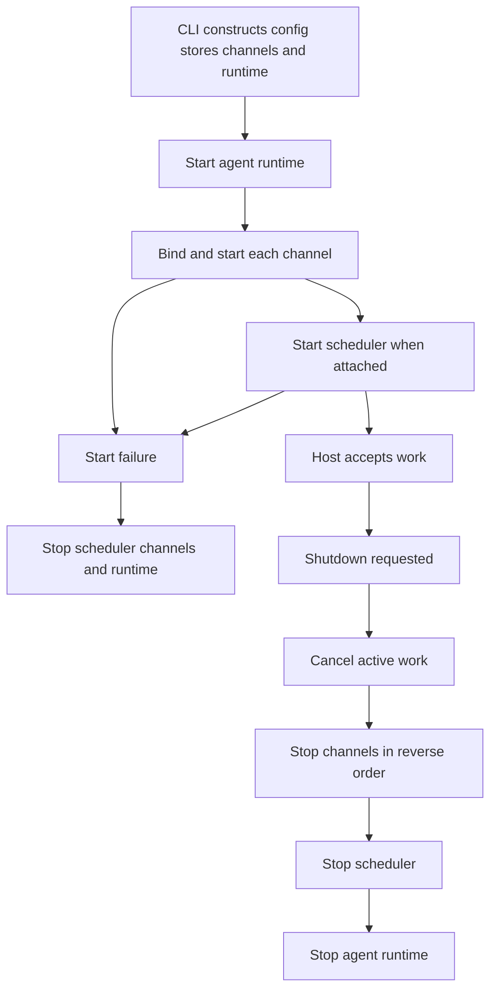
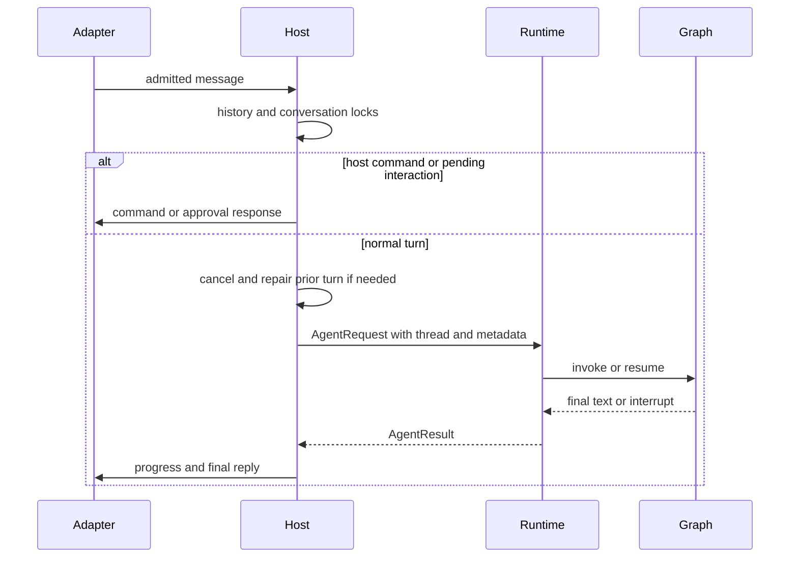

# Talon Runtime Host

> **Experimental, alpha software.** Talon is not a production containment or multi-tenant boundary: it lacks complete HITL policy and channel-administrator controls. Treat an admitted sender as able to trigger an agent using the operator's credentials, MCP tools, and—unless sandboxing is configured—local-host resources. The opt-in sandbox does **not** contain MCP tools.

Talon is a single-event-loop host for one long-running Deep Agents assistant. It owns the runtime, channel adapters, and, when a channel exists, a persistent cron scheduler. Adapters perform provider-specific admission and event translation; the host owns cross-adapter conversation identity, commands, cancellation, turn delivery, and request metadata. The runtime owns graph construction, tool assembly, checkpoint interaction, and request-scoped graph context. See [Architecture overview](../architecture/overview.md), [channel admission](../concepts/talon-channel-admission.md), [scheduling](../concepts/talon-scheduling.md), [sandbox partners](sandbox-partners.md), and [security](../operations/security.md).

## Entrypoint and composition

Talon 0.0.9 requires Python 3.12 or later and provides the `deepagents-talon` CLI. From `libs/talon` (or use `uv --directory libs/talon` from the repository root):

```bash
uv sync --group test
AGENT_ASSISTANT_ID=local AGENT_MODEL=<provider>:<model-id> uv run deepagents-talon --once
```

`--whatsapp`, `--telegram`, `--discord`, and `--slack` attach their adapters; the corresponding `DEEPAGENTS_TALON_<CHANNEL>_ENABLED` flags do the same. With no configured model, the CLI selects `EchoAgentRuntime`, useful for channel wiring and lifecycle checks. With a model, it opens the checkpoint and history stores, wraps the former in `ConversationSaver`, loads MCP tools, optionally opens a sandbox, and builds `DeepAgentRuntime`. A `PersistentCronScheduler` is attached only when one or more channels exist; it invokes `host.run_scheduled_job` and asks the host to deliver its result to the recorded origin channel.

`DeepAgentRuntime.start()` resolves local subagents, ensures the fixed assistant approval store, and constructs the Deep Agents graph. The graph combines filesystem tools and middleware, the clock and progress-message tools, configured MCP tools, optional web search/fetch tools, archive-history tools when `ConversationSaver` is present, cron tools when a cron store is present, tool-approval tools, configured subagents, and an optional `ask_for_help` tool. This assembly is intentionally runtime-owned: the host supplies an `AgentRequest`, not a raw graph call.



This lifecycle shows the host's ordered startup and best-effort cleanup. A channel is tracked before its `start()` call, so a partially started adapter is also stopped if startup fails. During shutdown, a failure stopping one component is logged but does not prevent later components from stopping. The runtime may deliberately leave resources open if background workers cannot be cancelled, rather than close a checkpointer while a worker can still write.

## Channel turn processing and request scope

The host binds each adapter's message callback, gets the provider, and derives a provider-qualified conversation root. It holds both a history-scope lock and a per-root conversation lock while it chooses the action. This prevents same-chat turns from overlapping while preserving independent conversations across providers; the agent thread id is distinct from the channel reply destination.



This is the normal admitted-turn path. `/help` is answered before the conversation root is created; recognized commands, pending tool-approval replies, and matching MCP authorization callbacks are handled by the host and do not become ordinary model input.

For a normal turn the host prepares voice and media, starts a refreshed typing indicator, and creates an `AgentRequest`. Host-set metadata overrides adapter metadata and includes channel, sender, message, history scope when enabled, original reply conversation when it differs from the agent thread, and bounded multimodal `model_content` when needed. It supplies request-scoped handlers for progress messages, tool approval, and MCP authorization, and passes the assistant-wide model selection captured when the turn starts. The runtime installs these values in `ContextVar`s for the invocation, protects a persistent conversation session, sets the selected model and approval policy, sets history/archive and cron origin context, then resets all of them in `finally`. Thus concurrently running unrelated turns do not share request handlers, history scope, graph selection, or authorization state.

A new message replaces an active turn for that conversation. Talon cancels it, appends an interruption marker after the latest committed checkpoint, and begins the new message on the same thread. If cancellation exceeds 30 seconds, it blocks that conversation, does not start the replacement, and requires a host restart to recover. A generation check drops a superseded result rather than replying after a newer request; consumed background-subagent result IDs are requeued when that discarded result was not delivered. The background dispatcher retries follow-up turns without interactive approval or authorization authority and avoids waiting behind another conversation's lock.

The host catches an ordinary runtime exception, logs its details, and sends a generic failure reply rather than provider internals. It refreshes typing while work is active and records a final reply in archive history only after successful channel delivery. Tool approvals are interactive only for an operator's attended main turn; scheduled and background work cannot ask an absent operator. Authorization callbacks are bound to provider, conversation, sender, and endpoint, so unsolicited or cross-chat callbacks do not reach the model.

## Lifecycle, persistence, and history

`TalonConfig` validates the assistant identifier and defaults its home to `~/.deepagents/<assistant-id>`; `DEEPAGENTS_TALON_HOME` changes the parent. It creates restrictive home, manifest, `agents/`, `cron/`, `channels/`, and inbound-media directories, installs defaults, and ensures the assistant `tools.json` approval store exists. Keep this home and MCP configuration outside the agent-writable workspace: same-user code can bypass filesystem permissions.

`DEEPAGENTS_TALON_CHECKPOINT_URI` selects local SQLite, PostgreSQL, MongoDB, or an operator-installed checkpoint backend. Built-in schemes take precedence; unknown or duplicate plugin schemes fail configuration. Checkpoint storage and `DEEPAGENTS_TALON_HISTORY_URI` history storage are independent. The history archive supports SQLite, PostgreSQL, MongoDB, or exactly one trusted installed history-backend plugin, is namespaced by assistant ID, requires one writer per assistant, and is initialized before the model host begins. Remote checkpoint thread IDs are not automatically assistant-namespaced, so separate databases per assistant are safer.

The archive preserves channel conversations through restarts and context compaction. `/new` changes the active agent thread but retains earlier sessions. Hidden `/reset-all-history` cancels current work and deletes only the current chat's archive sessions and checkpoints; it does not delete cron jobs, memory, media, traces, or backups. A failed clear can be partial and is retryable. Optional semantic search is enabled by `DEEPAGENTS_TALON_HISTORY_VECTOR_SEARCH`; an embedding-profile change requires the explicit `DEEPAGENTS_TALON_HISTORY_REINDEX=1` rebuild while transcripts remain.

## Scheduling relationship

Cron state is a JSON-backed assistant-scoped store under the home. It serializes in-process reads and mutations, but other processes and external writers are not coordinated: the live host is its only writer. Run `deepagents-talon pairing pause-jobs` only while Talon is stopped. The scheduler scans due jobs at minute granularity, claims and runs them one at a time, records success or error, suppresses `[SILENT]` output, and marks a delivery failure as an error without killing its ticker.

Each scheduled execution receives a fresh thread under `<job-id>:talon-cron:<random-id>`, so it can run while an interactive origin-chat turn remains active. It holds a per-job conversation lock, has a 30-minute bound, and repairs its interrupted thread after timeout. The request is tagged `trigger: cron`, carries any pinned skills, and reads the origin history scope only if the originating channel is still available. A result is delivered only through the adapter serving the recorded origin; missing origins are dropped rather than rerouted. Revoking a paired sender pauses jobs they created and cancels their active scheduled runs.

## Channels, commands, and admission

All adapters share `self`, `allowlist`, and explicitly acknowledged `open` exposure. `open` permits arbitrary senders to trigger the agent with operator credentials and local-host access. Sender pairing is limited to Discord, Slack, and Telegram: operator approval consumes a channel-bound short-lived code; pairing grants admission, not operator authority; unreadable persisted state fails closed. Pairing state uses locked atomic updates.

The shared chat-command registry drives host parsing, `/help`, and platform advertisements where supported. `/reset-all-history` and `/pair` are hidden but remain executable, while `/model` and `/smart-model` are visible. Discord registers visible shared commands as native slash commands when enabled. Slack exposes one app-owned slash command and requires bot mention plus typed command text in channel threads; its DM is one conversation, while each mentioned channel thread is a separate active conversation and reply destination but shares channel-scoped archive history. Slack acknowledges Socket Mode envelopes before handling them and deduplicates recent event IDs.

`/model` selection is assistant-wide: an operator can choose a credentialed provider-catalog model or the default, and the saved choice applies on the next turn across chats and persists across `/new` and restarts; scheduled jobs and subagents retain their configured or startup models. `/smart-model` separately controls the assistant-wide `ask_for_help` consultation model. MCP tools load at model-runtime startup; `deepagents-talon mcp config` exposes configuration paths and `deepagents-talon mcp login <server>` handles terminal OAuth. `/mcp-reload` builds replacement tools and graph under a lock. A refresh or reload failure leaves the previous graph usable and marks saved MCP changes inactive; active tasks retain their original capabilities.

Slack's single app-owned slash command is translated into a typed Talon command. It is accepted only in a DM except for operator pairing approval; validated Slack `response_url` values carry command results and rejections privately. For an admitted thread, bounded preceding replies from operators and allowlisted users are prompt context by default; `DEEPAGENTS_TALON_SLACK_INCLUDE_OTHER_THREAD_PARTICIPANTS=1` includes other participants. Loopback OAuth callback URLs are excluded before that context is truncated. Slack uses its bot token only for HTTPS `files.slack.com` downloads and rejects redirects; capped downloads use no-follow, owner-only local files and remove partial files after failure. Outbound Markdown is rendered as `mrkdwn`, split at 4,000 characters, and outbound mentions are separately restricted by `DEEPAGENTS_TALON_SLACK_MENTION_ALLOWLIST_USERS`.

## Media, sandbox, and observability

Channel media uses the positive integer `DEEPAGENTS_TALON_MAX_MEDIA_BYTES` cap, with a shared default of 1 GiB; adapters validate outbound type, trusted-root containment, and size before upload. Talon converts readable inbound images of at most 5 MiB to bounded base64 image blocks and inlines allowlisted text documents only through 100 KiB. Filesystem middleware offloads inbound binary once so graph checkpoints do not retain base64 content. Outbound Markdown media must resolve to a supported regular image or video beneath the trusted outbound root; URLs, traversal, absolute/home paths, and symlink escapes are rejected.

Without a sandbox, shell and file tools run on the host. The default local backend uses `DEEPAGENTS_TALON_WORKSPACE` when set, a scrubbed environment allowlist with a fixed safe `PATH`, and assistant-home binary artifacts. With a model configured, a requested sandbox is opened for the model-host lifetime and startup fails rather than falling back to host execution. An attached sandbox is retained; Talon closes an owned sandbox on exit and after a cancelled startup handoff. In sandbox mode, execution and ordinary filesystem operations go to the sandbox, with only assistant `skills/`, `memory/`, and `/blobs/` host-routed; blobs persist across recreated sandboxes. MCP, web, channel, download, and media handling remain outside that boundary.

LangSmith tracing runs only when `LANGSMITH_TRACING` is truthy and `LANGSMITH_API_KEY` is present. Traced invocations carry Talon assistant, conversation, trigger, and request metadata; a missing optional package degrades to a warning. Optional local activity logging records agent, model-lifecycle, and tool events, with redacted, structurally bounded tool previews truncated to 1,000 characters.

## Verification and operations

Run the suite from `libs/talon`:

```bash
uv run --group test pytest tests/
```

`tests/test_host.py` is the focused host contract: it exercises lifecycle unwind, provider-qualified roots, interruption and cancellation timeout behavior, new-thread/reset state, request metadata including inbound image blocks, tool approvals, authorization callback binding, background-result follow-up, scheduled-run serialization/timeout, and delivery. Also test the relevant channel, cron, persistence, MCP, and sandbox suites when changing their boundary. Before deployment, run `deepagents-talon --once` with the intended model, channel, checkpoint/history URI, MCP configuration, and sandbox environment.
