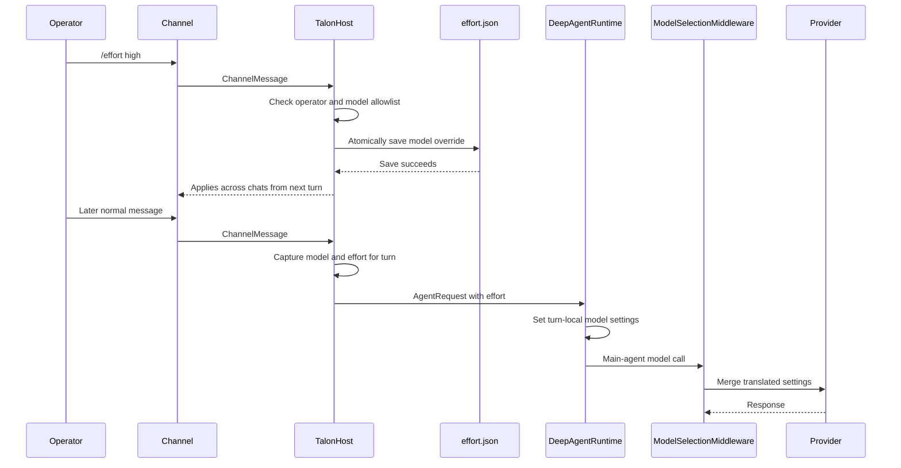

# Talon Runtime Integration

> **Experimental, single-operator control — not a security boundary.** Talon is alpha software and does not provide production-grade HITL policy, channel-administrator controls, or multi-tenant isolation. `/effort` restricts who can change a runtime setting; it does not make an admitted sender, channel, model provider, MCP tool, or host environment safe. Treat channel admission as access to the operator's agent and credentials. See [channel admission](../concepts/talon-channel-admission.md) and [security](../operations/security.md).

`/effort` is Talon's assistant-wide, model-specific control for a reasoning model's supported effort or thinking setting. It is a host command, not a prompt for the model: the host answers it directly, and a successful change applies to subsequent main-agent turns in every chat using that exact selected model. It is advertised by `/help` and channel command registries alongside `/model`.

## Operator use

```text
/effort
/effort high
/effort extra-high
/effort default
```

- `/effort` reports the current setting and the levels known for the **currently selected global model**. Reading the setting does not require operator authority.
- `/effort <level>` changes it only for a channel operator. `default` removes the saved override and restores the provider's default behavior for that model. `extra-high` and `x_high` normalize to `xhigh`.
- The host keeps a separate override for each exact `provider:model` identifier. Switching with `/model` therefore exposes that model's own setting; switching back restores the prior model's override. The default runtime model is used when no `/model` override is selected.
- The command rejects a non-operator write, a model with no known effort control, and an unsupported level without creating or altering saved state. An echo or other runtime that does not implement model selection reports that reasoning effort is unavailable.

The available levels are intentionally an allowlist rather than free-form provider parameters. Talon first asks the shared model profile metadata, then supplies documented fallbacks where metadata may be absent. It also recognizes common OpenAI-compatible model families and route aliases. Consequently, the response from `/effort`—not a generic list in operational documentation—is the authoritative list for the selected model.

## Supported control shapes and provider translation

Most models receive the selected value as `reasoning_effort`, allowing the LangChain provider adapter to serialize it appropriately. For example, Anthropic's adapter serializes the setting in `output_config.effort`, while the OpenAI Responses API serializes it as `reasoning.effort`.

Some OpenAI-compatible families need different wire settings, which Talon translates only after validating the requested label:

| Model family | Operator-visible controls | Invocation settings |
| --- | --- | --- |
| DeepSeek reasoning models | `none`, `low`, `high`, `max` | `none` disables `thinking`; another level enables it and supplies `reasoning_effort`. |
| Qwen reasoning models | `low`, `medium`, `high`, `xhigh`, `max` | Sends `extra_body.enable_thinking` where the checkpoint permits it and maps levels to `thinking_budget`: 1024, 4096, 8192, 16384, or the provider limit for `max`. |
| GLM | `off` and `on`, except forced-thinking GLM-5.3 models expose only `on` | Sends `extra_body.thinking.type` as `disabled` or `enabled`. |
| Other profiled or documented models | Model-specific native labels | Sends `reasoning_effort`. |

This translation is not a promise that every provider/model supports every label. Unknown OpenAI-routed names with a slash are deliberately not inferred as native effort-capable models. The selection is revalidated immediately before it becomes runtime settings, which protects the invocation path from stale or externally constructed `AgentRequest` values.

## Command-to-turn flow



This flow shows the successful write and a later turn. A command message itself is consumed by the host and never invokes the agent. The host dispatches commands while holding the conversation lock, derives the command name from the initial slash token (including an optional `@bot` suffix), and sends the response through the originating channel.

### Persistence, authorization, and failed writes

`TalonConfig.effort_state_path` resolves to `effort.json` within the validated per-assistant home, normally `~/.deepagents/<assistant_id>/effort.json`. The host loads it during construction as a JSON map of model specification to effort string. A successful update writes a temporary mode-`0600` file, flushes and fsyncs it, then replaces the state file. The in-memory selection map changes **only after** that write succeeds. Thus an `OSError` produces a generic operator-facing failure, retains the old active selection, and leaves the previous durable file intact rather than claiming a setting that did not persist.

A mutating command requires a configured channel operator ID, or a self-originated message when the channel is in `self` exposure mode. It is a narrow authorization check for this host command, not a general safety guarantee. In particular, configuring open or allowlisted channel exposure does not grant other senders permission to change effort.

### Capture and lifetime

When the host starts a normal agent turn, it snapshots both the current global model selection and the override associated with that model into its internal turn record. It passes those values in the `AgentRequest`; a later `/effort` or `/model` command therefore cannot alter already started work. Newly started turns, including ones in other chats, see the saved selection.

`DeepAgentRuntime` resolves the selected model for the request, translates a valid captured effort into settings, and stores those settings in the `ACTIVE_EFFORT` context variable for the duration of the invocation. It resets that context in `finally`, including on cancellation or failure. Concurrent turns consequently do not leak a Qwen budget or another provider setting into one another, and a following request without effort uses no override.

`ModelSelectionMiddleware` is the integration boundary that applies the selection to calls. It optionally swaps the main model, merges effort settings with existing `model_settings`, and merges nested `extra_body` and `thinking` mappings instead of discarding unrelated settings such as temperature or provider options.

### Subagent exclusion

Reasoning effort is intentionally a **main-agent-only** adjustment. Background and inline subagents mark their execution context with `_IN_SUBAGENT`; the model-selection middleware does not apply `ACTIVE_EFFORT` in that context. The selected-model summarization path likewise uses a subagent's startup model rather than the main turn's selected model. `/effort` therefore does not silently change the effort, model settings, or context budget of delegated work.

## Operational relationships

- Use `/model` first when the intent is to select a different model; `/effort` changes only the setting associated with whichever global model is currently selected. See [profiles and models](../concepts/profiles-models.md).
- State is per **assistant home**, while the effect is across that assistant's chats. Separate assistant IDs have separate `effort.json` files.
- The command controls model invocation settings, not scheduling, admission, tool approval, MCP authorization, or the execution sandbox. Scheduled and background work also does not inherit the main-agent effort setting through subagent execution.

## Focused verification

From `libs/talon`, run:

```bash
uv sync --group test
uv run --group test pytest tests/unit_tests/test_effort.py
```

The focused tests cover per-model persistence and restart recovery, next-turn capture, operator and unsupported-level rejection, failed-save rollback, documented family allowlists, concrete Anthropic/OpenAI/OpenAI-compatible payload serialization, concurrent context isolation, preservation of unrelated settings, and subagent-safe runtime behavior. See the [testing guide](../testing/testing-guide.md) for repository-wide test conventions.
