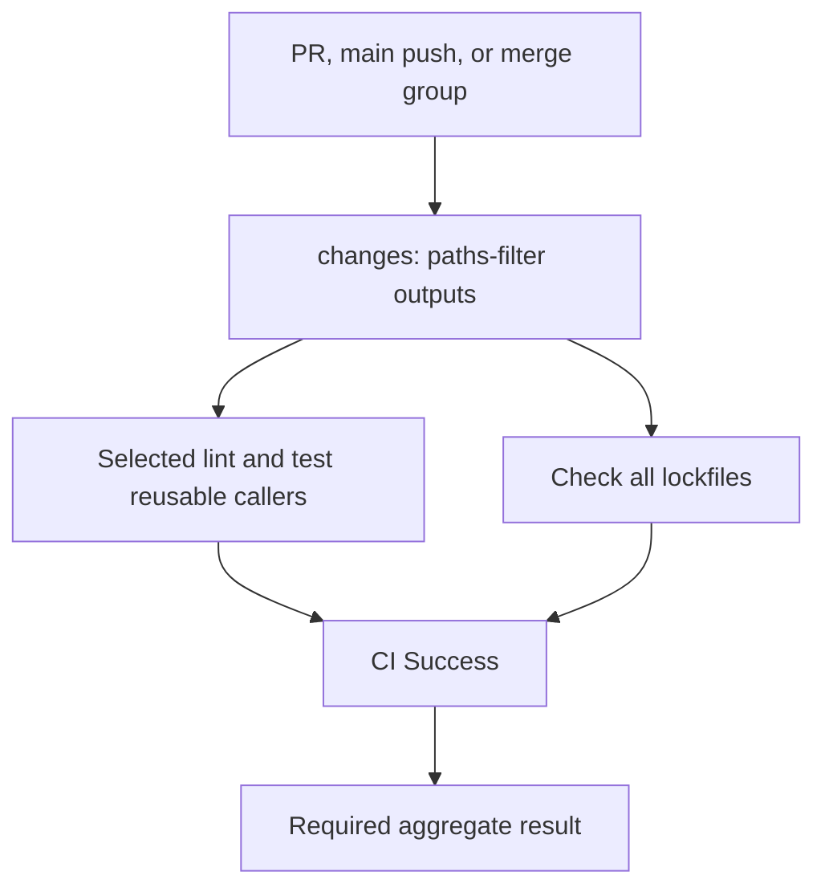
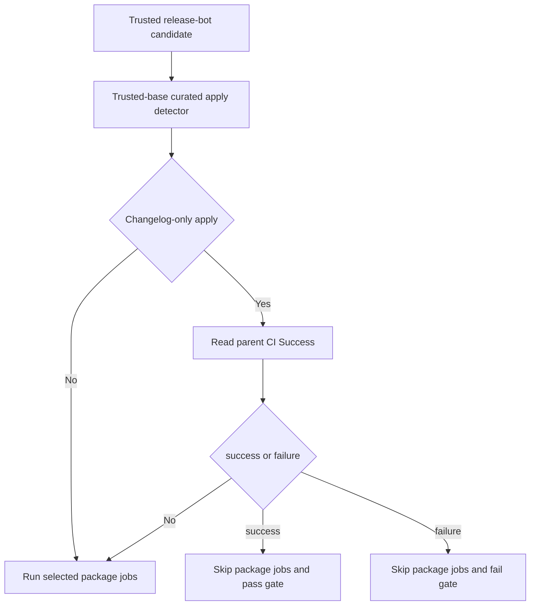
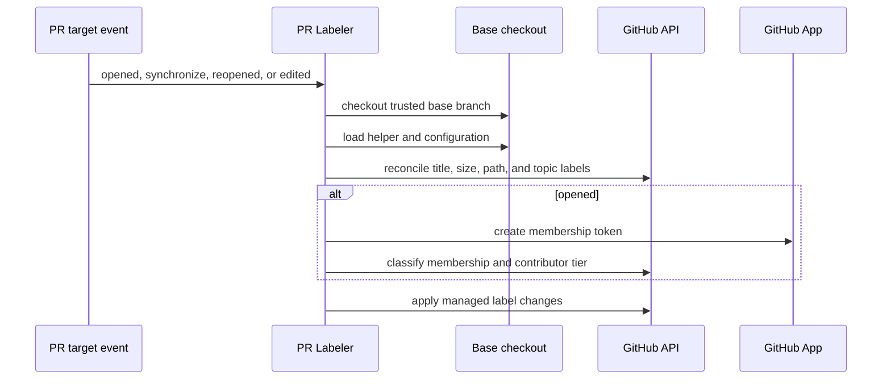

# CI, Change Selection, and Labels

CI and PR metadata are related but separate systems. [`ci.yml`](../../.github/workflows/ci.yml) is the event entrypoint and produces the required `✅ CI Success` result; reusable `_*.yml` workflows centralize test, lint, lockfile, and eval mechanics. [`pr_labeler.yml`](../../.github/workflows/pr_labeler.yml) is the sequential writer for PR size, title, path, provenance, and contributor labels. The taxonomy in [`.github/LABELS.md`](../../.github/LABELS.md) is the contract for label meanings, writers, readers, and maintainer overrides.

See [Development](development.md) for local commands, the [Testing Guide](../testing/testing-guide.md) for test conventions, [Run Evals](../workflows/run-evals.md) for eval entrypoints, and [GitHub Action](../integrations/github-action.md) for the published action. The `.github` layout reserves non-underscore workflow files for event entrypoints and `_*.yml` for `workflow_call` components.

## Main CI: select work, then aggregate it

`ci.yml` runs on pull requests, pushes to `main`, and merge-group events. It grants read-only `checks`, `contents`, and `pull-requests` permissions. The latter is deliberately available to the called test workflow so it can read current PR labels; a called workflow can narrow but cannot increase the caller's permissions.

The `changes` job uses `dorny/paths-filter` outputs to decide which package lint and test callers run. Each filter includes its package, the local CI/test/lint workflow files, and local actions, so infrastructure changes exercise affected packages. Editable local dependency relationships also expand fan-out: an SDK change selects dependents such as Code, Talon, Evals, and partner integrations. In contrast, every package job runs on a `main` push. `talon-src` intentionally tracks only `libs/talon/**`; it distinguishes a Talon-source edit from the broader Talon test fan-out caused by Code or SDK changes.



*Path selection controls package work, but lockfile validation and the aggregate gate remain part of every CI run.*

`ci_success` uses `always()`, requires the lockfile job plus all package jobs, ignores jobs that were intentionally skipped, and otherwise rejects failures. Its trusted-base `ci_gate.py` also permits only one narrow waiver: on a `pull_request` that does **not** modify `libs/talon`, `failure` from `lint-talon` or `test-talon` is advisory. The same failures remain blocking for Talon changes, pushes, and merge groups; cancellations remain blocking off `push`. An advisory job may maintain a PR comment, but is deliberately absent from the gate's dependencies. Gate code is sparse-checked out from `github.base_ref` (or the triggering SHA outside PRs), preventing PR code from redefining the required-check decision; the PR copy is a bootstrap fallback only while the base lacks the helper.

A Deepagents-only change also runs a small QuickJS prompt-snapshot smoke test when the full QuickJS suite is not selected. Evals changes run the Evals package tests and a DRBench reproducibility job that builds the dataset twice and diffs it. The helper-script test job runs `python -m pytest .github/scripts/tests -v` except on the curated-notes fast path.

## Shared setup, tests, and bypass labels

The local [`uv_setup`](../../.github/actions/uv_setup/action.yml) composite action installs a pinned `uv`, selects the requested Python version, prunes caches, and scopes cache dependency globs to the caller's `pyproject.toml`, `uv.lock`, and requirements files. Reuse it rather than copying setup steps.

`.github/workflows/_test.yml` is a `workflow_call` unit-test component. Callers must supply a working directory and a JSON array of quoted Python-version strings; optional extra legs are JSON objects with string `python-version` and `os`. A validation job rejects malformed matrices before a non-fail-fast matrix starts. Each leg checks out code, invokes `uv_setup`, runs `uv sync --group test`, runs `make test` on non-Windows runners or direct pytest on Windows, and verifies that the worktree stayed clean. Talon additionally installs Node 24.

On PR events, `_test.yml` reads labels from the live GitHub API rather than the stale webhook payload. An API failure fails closed: it reports the error but enables no override. `ci:allow-warnings` passes `-W default`, relaxing the package warning filter for that run only. Push and merge-group runs have no PR context and therefore keep normal warning enforcement.

`ci:skip-ripgrep` is intentionally narrower. It applies only to Linux `libs/deepagents` release-sensitive PR legs. Those legs normally install ripgrep without an install timeout and set `DEEPAGENTS_RIPGREP_EXPECTED=1`, making the ripgrep-dependent filesystem checks fail rather than silently skip. With the label, an install failure can continue only after checking whether `rg` actually works; a missing binary creates a one-day marker artifact and the gated tests skip. Ordinary PRs use a two-minute installation bound, a bounded `dpkg --configure -a` recovery, and the same marker artifact only for an actual timeout; other installation failures fail the job. Push and merge-group enforcement cannot be bypassed by either label.

The `ci:*` namespace denotes a maintainer acknowledgement or override and is read by gates, not written by the PR labeler. Important examples are `ci:allow-warnings`, `ci:skip-ripgrep`, `ci:skip-title-lint`, `ci:allow-scope-mismatch`, and the lockfile/release/documentation acknowledgements listed in [`LABELS.md`](../../.github/LABELS.md). Create a new bypass only with a live API lookup in the consuming gate, a pre-existing described repository label, and a taxonomy entry.

## Lockfiles

`check-lockfiles.yml` is a reusable, five-minute, read-only workflow called unconditionally by CI. It checks out full history, sets up Python 3.14 through `uv_setup` with caching disabled (the check does not create a cache directory), and calls:

```bash
python3 .github/scripts/checks/check_lockfiles_pre_commit.py
```

The helper discovers package directories from library/partner `Makefile`s and example `pyproject.toml` files. With no path arguments it checks all packages; with paths it checks only owning package directories. For every selected package it runs `uv lock --check --directory <package> --python <version>`, using Python 3.14 for ACP, Code, Evals, and Talon and 3.12 otherwise. The failure output identifies the stale `uv.lock` and gives the exact non-check `uv lock` command to run and commit. Its `stale_lock_dirs` helper additionally models transitive local `[tool.uv.sources]` consumers for callers that need to determine which lockfiles become stale after manifest changes.

## Reusable eval execution

`_eval.yml` is a single-model reusable evaluation worker. Its upstream caller is responsible for validating the model specification and making `artifact_key` unique. The worker accepts model/provider identity, category and tier include/exclude filters, optional failure analysis, and provider-specific options; it exposes optional provider secrets but grants only `contents: read` itself.

The job runs in the `evals` environment for up to six hours, uses frozen `uv` resolution in `libs/evals`, and scopes its cache with the artifact key so parallel model jobs do not collide. It builds pytest options from comma-separated categories and tiers, validates the OpenRouter fallback boolean and supported `quickjs` REPL option, injects only the selected provider's API key, and runs `make evals MODEL="$MODEL"`. A non-cancelled run must produce `evals_report.json`; it writes a summary and uploads the report. Optional LLM failure analysis is `continue-on-error` and uploads its JSON only when produced, so analysis cannot disguise a failed evaluation.

## Curated-notes release-bot path

A special optimization applies only to a trusted same-repository release-bot PR on the expected `release-please--branches--main--components--` branch pattern. CI does not cancel an earlier run for that PR, because the new head may need its parent result. The `changes` job checks the curated-apply detector and release configuration out of the trusted base ref, then determines whether the new commit is a changelog-only curated-notes apply. It queries the parent commit for exactly one latest `✅ CI Success` check.



*The optimization inherits a conclusive parent result; it never treats skipped package jobs as tests that passed.*

Only conclusive `success` or `failure` activates the fast path. Missing, malformed, cancelled, or unavailable parent data falls back to ordinary package jobs. A successful parent permits the head gate; a failed parent makes it fail, while lockfile validation still must pass. For an inherited failure, a non-gating `continue-on-error` diagnostic reports sanitized same-repository parent job information and retry guidance. It cannot add write permissions or change the gate. Fix or rerun parent CI first, then **re-run all jobs** on the curated head so detection reads the new parent state; rerunning only failed head jobs reuses the earlier detection output.

## PR labeler: trusted writer and lifecycle

`PR Labeler` handles `opened`, `synchronize`, `reopened`, and `edited` as `pull_request_target`. This is a privileged boundary: it checks out the base branch—not PR-head code—before loading the JavaScript helper and configuration. PR title, body, paths, and event values are treated as data. The job runs in the `labeling` environment with `pull-requests: write` and `issues: write`.



*The privileged workflow executes trusted base code only; untrusted PR content remains API payload data.*

On opening, it obtains a GitHub App token for private organization membership. Bots and active members are internal, 404 means external, and other membership failures fail rather than guessing. The App token applies external and contributor-tier labels so downstream `labeled` workflows can run; default `GITHUB_TOKEN` events do not trigger them. The labeler preserves opening-time provenance work by giving `opened` runs a separate non-cancelled concurrency group; update events cancel superseded runs for the same PR.

Before classification, it canonicalizes configured non-release Conventional Commit scope aliases through the API. The event title does not change after that API call, so the corrected title is passed by step output. Release titles are not rewritten. The configuration owns thresholds, exclusions, type/scope mappings, descriptions, colors, and file/branch/topic rules. The helper rejects incomplete configuration and ensures labels exist before a batch add; concurrent label creation (`422`) is harmless.

For non-`edited` events it paginates PR files, computes one size label excluding `uv.lock` and `docs/`, replaces stale size labels, and adds configured package/integration and path-derived topic labels. Branch and package labels are additive. Title parsing derives managed type, breaking, release, scope, and integration labels; recognized titles remove only stale managed title labels, while unrecognized titles preserve prior classification. Missing-label removals tolerate `404`.

A human removal of a path-derived topic has special authority. A user `unlabeled` event suppresses automatic reapplication until a later synchronize event provides an ahead-only, bounded, topic-relevant diff and a conservative classifier approves it. Bot removals do not suppress; comparison/classifier failures, oversized diffs, and insufficient context preserve removal. Other label categories continue independently. The default classifier uses Groq's OpenAI-compatible endpoint with `openai/gpt-oss-20b`, temperature zero, JSON output, and a 15-second abort; `TOPIC_CLASSIFIER_PROVIDER=semif` chooses the alternative provider. Its output is restricted to allowed labels and capped at three.

For manual reconciliation, dispatch `pr_labeler_backfill.yml` with a positive `max_items`. It reuses the helper, processes PRs independently, and fails after the loop if any item failed. Keep automatic PR label mutations in this workflow rather than adding competing writers.

## Focused verification and safe changes

Change classification policy in `.github/scripts/labeling/pr-labeler-config.json`, not by hardcoding it into a workflow. Maintain label descriptions and prefix colors for labels that the helper may create. Preserve the base-branch checkout, live-label fail-closed behavior, and conservative topic-removal rule.

Useful focused checks are:

```bash
python .github/scripts/tests/labeling/test_pr_labeler.py
python -m pytest .github/scripts/tests/checks/test_check_lockfiles_pre_commit.py
python -m pytest .github/scripts/tests/checks/test_ci_gate.py
python -m pytest .github/scripts/tests/workflows/test_inherited_ci_diagnostics.py
```

The labeler contract suite covers configuration/taxonomy drift, alias canonicalization, title reconciliation, label creation, and topic removal/reapplication. Lockfile tests cover path selection, package interpreter choice, and actionable failures. CI workflow contracts exercise ripgrep paths and bypass behavior; gate tests cover the narrow Talon waiver; inherited-CI tests verify parent-result propagation, fallback behavior, and safe diagnostic rendering.
